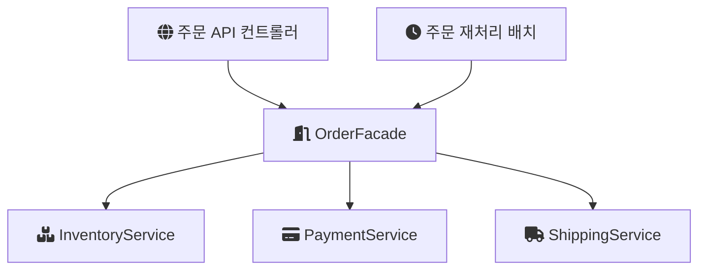

# Facade

주문 하나를 처리하려면 재고를 확인하고, 결제를 승인하고, 배송을 요청해야 한다고 해 보자. 컨트롤러가 이 세 서비스를 직접 알고 순서대로 부르면, 주문 흐름이 바뀔 때마다 호출하는 쪽 코드가 같이 흔들린다. 같은 순서를 배치 작업이나 관리자 화면에서도 반복해야 한다면 중복도 생긴다.

Facade(퍼사드) 패턴은 이럴 때 복잡한 하위 시스템 앞에 단순한 진입점 하나를 두는 구조 패턴이다. GeeksforGeeks의 설명은 이 패턴을 복잡한 하위 시스템에 "a simple and unified interface"를 제공하는 구조 패턴으로 정의한다(단순하고 통일된 인터페이스, [GeeksforGeeks](https://www.geeksforgeeks.org/facade-design-pattern-introduction/)). 퍼사드라는 이름은 건물의 정면 외벽에서 왔다. 바깥에서는 정면만 보이고 안쪽 구조는 보이지 않는다는 뜻이다.

---

## 구성 요소

GeeksforGeeks 문서는 패턴을 세 부분으로 나눈다.

- Facade: 클라이언트에게 단순한 메서드를 제공하고, 요청을 알맞은 하위 시스템에 위임한다.
- 하위 시스템 클래스: 실제 기능을 수행한다. 자신이 퍼사드 뒤에 있다는 사실을 모른다.
- 클라이언트: 하위 시스템 대신 퍼사드만 호출한다.

하위 시스템이 퍼사드를 모른다는 점이 중요하다. 퍼사드는 하위 시스템을 감싸는 얇은 조율 계층이지, 하위 시스템이 의존하는 새 상위 객체가 아니다. 그래서 퍼사드를 쓰지 않는 클라이언트는 여전히 하위 시스템을 직접 호출할 수 있다.

호출 관계를 그림으로 보면 클라이언트에서 뻗어 나가던 화살표가 퍼사드 하나로 모인다.



---

## 작은 예시

아래는 위 그림을 코드로 옮긴 예시다. 서비스 이름과 메서드는 설명을 위해 만든 것이다.

```java
public class OrderFacade {

    private final InventoryService inventoryService;
    private final PaymentService paymentService;
    private final ShippingService shippingService;

    public OrderFacade(InventoryService inventoryService,
                       PaymentService paymentService,
                       ShippingService shippingService) {
        this.inventoryService = inventoryService;
        this.paymentService = paymentService;
        this.shippingService = shippingService;
    }

    public OrderResult placeOrder(OrderCommand command) {
        inventoryService.reserve(command.productId(), command.quantity());
        PaymentReceipt receipt = paymentService.approve(command.userId(), command.amount());
        shippingService.request(command.orderId(), command.address());
        return new OrderResult(command.orderId(), receipt.approvalNumber());
    }
}
```

컨트롤러와 배치는 이제 `placeOrder` 하나만 알면 된다. 결제 승인 전에 쿠폰 검증이 추가되더라도 수정할 곳은 퍼사드 안쪽이다. 호출하는 쪽은 "주문한다"라는 의도만 표현하고, 그 의도를 어떤 순서의 하위 호출로 바꿀지는 퍼사드가 정한다.

---

## 라이브러리에서 보는 퍼사드

애플리케이션 코드뿐 아니라 라이브러리 설계에서도 이 패턴을 볼 수 있다. Java 로깅 API인 SLF4J는 이름부터 Simple Logging Facade for Java이고, 공식 매뉴얼은 SLF4J를 여러 로깅 프레임워크에 대한 "simple facade or abstraction"이라고 소개한다([SLF4J Manual](https://www.slf4j.org/manual.html)). 애플리케이션 코드는 `org.slf4j.Logger`만 호출하고, 실제 출력은 배포 시점에 붙인 Logback이나 Log4j 같은 구현체가 맡는다.

SLF4J가 로그를 남기는 좁은 API만 제공하고 로그 설정은 다루지 않는다는 점도 참고할 만하다. 퍼사드는 하위 시스템의 모든 기능을 다시 노출하는 것이 아니라, 클라이언트가 자주 쓰는 일부만 단순하게 열어 준다. 세밀한 설정이 필요하면 하위 시스템(여기서는 구현체의 설정 파일)을 직접 다룬다.

---

## 언제 쓰는가

GeeksforGeeks 문서가 꼽는 적용 상황을 내 말로 정리하면 다음과 같다.

- 외부 API나 복잡한 라이브러리를 여러 곳에서 같은 방식으로 호출해야 할 때
- 계층 사이에 경계를 분명히 두고 싶을 때
- 여러 시스템을 묶어 하나의 진입점으로 제공해야 할 때
- 하위 시스템의 내부 변경이 호출하는 쪽까지 번지지 않게 하고 싶을 때

공통점은 호출하는 쪽이 알아야 할 것을 줄이는 데 있다. 하위 시스템이 하나뿐이고 호출도 한 줄이라면 퍼사드를 두어도 얻는 것이 거의 없다.

---

## 주의할 점

같은 문서는 단점도 함께 적는다. 추상화 계층이 하나 늘어나 구조를 이해하기 어려워질 수 있고, 하위 시스템의 세부 기능에 직접 접근하기 어려워지며, 단순한 시스템에서는 과한 설계가 될 수 있다는 것이다.

실무에서 특히 조심할 부분은 두 가지라고 본다.

- 퍼사드가 비대해지는 경우: 관련 없는 흐름까지 한 퍼사드에 모이면 모든 것을 아는 객체가 된다. 퍼사드는 유스케이스 단위로 나누는 편이 관리하기 쉽다.
- 퍼사드가 비즈니스 규칙을 갖기 시작하는 경우: 퍼사드의 역할은 조율이다. 재고 차감 규칙이나 결제 한도 검증 같은 판단이 퍼사드에 쌓이면 하위 시스템의 책임이 흐려진다.

## 참고

- [Facade Design Pattern](https://www.geeksforgeeks.org/facade-design-pattern-introduction/) — GeeksforGeeks
- [SLF4J User Manual](https://www.slf4j.org/manual.html) — SLF4J
