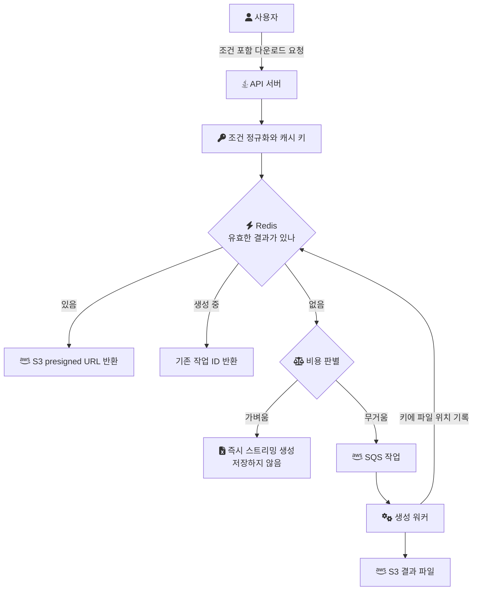
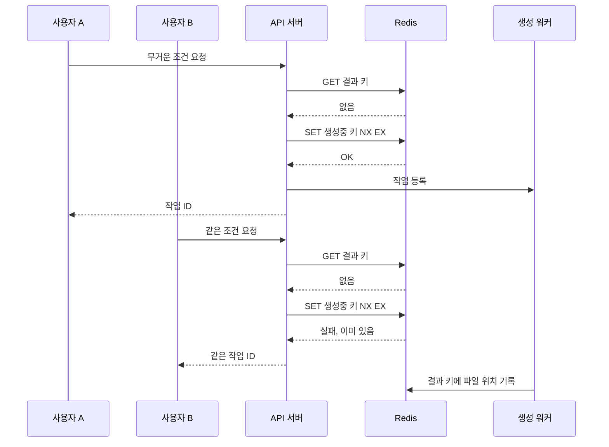

전체 다운로드에 가까운 양을 요구하면서 조건이 조금씩 붙는 엑셀 요청은 미리 만들어 둘 수도 없고, 매번 처음부터 만들기에는 무겁다. 이 글은 그런 요청을 처리 비용으로 먼저 분류하고, 무거운 조건의 결과만 골라 재사용하는 구조를 설계로 정리한다.

이 글은 설계 글이다. 엑셀에 대해 내가 실제로 고치고 수치로 확인한 것은 생성 단계의 메모리다. 2022년 음원 플랫폼 회사에서 조회를 청크로 나누고 Apache POI의 SXSSF 스트리밍으로 바꿔 엑셀 생성 메모리를 1.2GB에서 180MB로 줄였다([대용량 엑셀 다운로드 요청을 안정적으로 처리하는 방법](/posts/bulk-excel-performance/)). 요청을 점수로 분류해 경로를 나누거나 조건별 결과를 캐싱하는 구조를 운영에 적용했다는 기록은 없다. 그래서 아래의 점수, 임계치, TTL, 키 형식은 모두 설계 예시이고, 효과는 측정값이 아니라 무엇을 재야 확인되는지로 적는다.

## 사전 생성이 닿지 않는 요청

[메시지 큐와 S3 사전 생성으로 나누는 설계](/posts/rebuilding-outsourced-system-2/)에서 조건 없는 전체 다운로드는 정해진 시각에 미리 만들어 둔 파일로 응답했다. 결과가 요청자와 무관하게 하나뿐이기 때문에 가능한 방법이다.

조건이 하나라도 붙으면 이 전제가 깨진다.

- `2025년 전체 + 특정 지역`
- `전체 상품 중 카테고리 일부 제외`

이런 요청은 전체에 가까운 양을 읽지만 결과가 조건마다 다르다. 가능한 조건 조합을 모두 미리 만들 수는 없다. 그렇다고 요청마다 처음부터 만들면, 같은 조건이 하루에 여러 번 들어와도 매번 같은 비용을 낸다.

그래서 방향을 "조건마다 미리 만들기"에서 "한 번 만든 결과를 조건 단위로 다시 쓰기"로 바꾼다. 다만 모든 결과를 저장하면 저장 비용과 무효화 문제가 요청 수만큼 커진다. 저장할 가치가 있는 것은 다시 만들기 비싼 결과뿐이다. 이 설계의 질문은 "캐싱할 수 있는가"가 아니라 "무엇을 캐싱할 것인가"다.

## 처리 경로

요청은 네 갈래로 나뉜다. 같은 조건의 유효한 파일이 있으면 재사용하고, 같은 조건을 누가 이미 만들고 있으면 그 작업을 기다리게 한다. 둘 다 아니면 비용으로 가른다.



가벼운 요청은 저장하지 않는다. 다시 만드는 비용이 저장과 무효화를 관리하는 비용보다 작기 때문이다. 무거운 요청만 비동기로 생성하고, 만든 결과를 다음 요청이 쓸 수 있게 남긴다.

## 비용을 점수로 가늠한다

무거운지 가벼운지는 실행 전에 알아야 한다. 판별 기준(필터 점수, 임계치까지만 센 건수, 실행 계획, 과거 실행 이력)과 각각의 비용은 [무거운 엑셀 다운로드 요청을 사전에 판별하는 방법](/posts/excel-condition-expector/)에 따로 정리했다. 여기서는 가장 싼 기준인 필터 점수만 예로 든다.

```java
// 설계 예시: 요청만 보고 매기는 점수, DB에 묻지 않는다
int score(ExportFilter f) {
    int s = 0;
    if (f.period().toTotalMonths() >= 12) s += 3;   // 1년 이상
    if (f.region().isWideScope())        s += 2;   // 지역 조건이 넓음
    if (f.categories().isEmpty())        s += 2;   // 카테고리 제한 없음
    if (f.hasCustomSort())               s += 1;   // 인덱스와 다른 정렬
    return s;
}
```

| 점수 | 분류 | 경로 |
| --- | --- | --- |
| 0~3 | 가벼움 | 즉시 스트리밍 생성, 저장 안 함 |
| 4~6 | 애매함 | 건수나 실행 이력으로 한 번 더 판별 |
| 7 이상 | 무거움 | 비동기 생성, 결과 저장 |

점수와 경계값은 예시다. 실제로 쓰려면 같은 형태의 요청이 실제로 얼마나 걸렸는지를 기록해 두고 경계를 그 기록에 맞춰야 한다. 점수는 데이터 분포를 모르기 때문이다. 같은 "1년 이상"이라도 데이터가 몰린 기간과 빈 기간의 비용은 다르다.

## 캐시 키: 같은 의미는 같은 키가 되어야 한다

캐시 키는 조건을 직렬화해 해시한 값이다. 그런데 직렬화를 그대로 쓰면 같은 의미의 조건이 다른 키가 된다.

- 필드 순서만 달라도 JSON 문자열이 다르다.
- `["B", "A"]`와 `["A", "B"]`는 같은 카테고리 집합이다.
- `2025-01-01`과 `2025-01-01T00:00:00`은 같은 시작일이다.
- 빈 배열과 필드 없음은 둘 다 "제한 없음"이다.

그래서 해시 전에 정규화한다. 필드를 이름순으로 정렬하고, 집합 성격의 값은 정렬하고, 날짜는 한 형식으로 맞추고, 빈 값은 지운다.

키에 넣어야 하는 것이 조건만은 아니다.

- 조회 권한: 같은 조건이라도 사용자마다 볼 수 있는 행이 다르면, 권한 범위를 키에 넣지 않는 순간 다른 사람의 파일이 나간다. 이 설계에서 가장 비싼 실수다.
- 양식 버전: 엑셀 컬럼 구성이 바뀌면 옛 파일을 돌려주면 안 된다.
- 데이터 기준: 아래 무효화 절에서 다룬다.

```java
// 설계 예시
String cacheKey = "excel:v3:" + scope.id() + ":" + DigestUtils.sha256Hex(canonicalJson(filter));
```

## 같은 키를 동시에 만들지 않는다

인기 있는 무거운 조건은 캐시가 비어 있는 순간에 여러 요청이 동시에 들어올 수 있다. 모두가 "없음"을 보고 생성을 시작하면 가장 비싼 작업을 여러 번 하게 된다. 캐시가 비는 순간 요청이 원본으로 몰리는 이 현상이 [캐시 스탬피드](/posts/cache-stampede/)다.

이를 막으려면 생성 시작을 한 요청만 차지하게 한다. Redis의 `SET`은 `NX` 옵션으로 키가 없을 때만 값을 쓰고, `EX` 옵션으로 만료 시간을 초 단위로 함께 지정할 수 있다([Redis: SET](https://redis.io/docs/latest/commands/set/)). 생성 중 표시를 `NX EX`로 쓰면, 먼저 쓴 요청만 생성을 시작하고 나머지는 그 작업 ID를 받는다. 만료 시간은 워커가 죽었을 때 표시가 영원히 남지 않게 하는 장치이고, 가장 긴 생성 시간보다 길게 잡는다.



분기 로직을 코드로 옮기면 다음과 같다.

```java
// 설계 예시
ExportResponse handle(ExportFilter filter, Scope scope) {
    String key = cacheKey(filter, scope);

    Optional<CachedExport> cached = cache.findValid(key);
    if (cached.isPresent()) {
        return ExportResponse.ready(presigner.presignGet(cached.get().s3Key(), Duration.ofMinutes(10)));
    }

    Route route = classifier.classify(filter);          // 점수, 필요하면 건수와 이력
    if (route == Route.SYNC) {
        return ExportResponse.stream(filter, scope);    // 저장 없이 바로 생성
    }

    String jobId = UUID.randomUUID().toString();
    if (!cache.markBuilding(key, jobId, BUILD_TTL)) {   // SET NX EX
        return ExportResponse.pending(cache.buildingJobId(key));
    }
    queue.send(new ExportJob(jobId, key, filter, scope));
    return ExportResponse.pending(jobId);
}
```

## 저장 구조

메타 정보는 Redis에, 파일은 S3에 둔다.

| 필드 | 위치 | 설명 |
| --- | --- | --- |
| `cacheKey` | Redis 키 | 정규화한 조건, 권한 범위, 양식 버전의 해시 |
| `s3Key` | Redis 값 | 생성된 파일의 S3 객체 키 |
| `dataVersion` | Redis 값 | 생성 시점의 데이터 기준 |
| `createdAt` | Redis 값 | 생성 시각, 화면에 기준 시각으로 표시 |
| 만료 | Redis TTL | 재사용 허용 기간 |

S3 객체는 Redis 키보다 오래 남겨 둔다. 사용자가 받은 링크가 Redis 만료 직후에 끊기지 않게 하기 위해서다. 남은 파일은 S3 Lifecycle의 만료 규칙으로 정리한다. 만료 규칙을 걸면 정해진 기간이 지난 객체를 S3가 대신 지운다([Amazon S3: Managing the lifecycle of objects](https://docs.aws.amazon.com/AmazonS3/latest/userguide/object-lifecycle-mgmt.html)). 사용자에게 주는 링크는 공개 URL이 아니라 기간 한정 다운로드 권한을 주는 presigned URL이다([Amazon S3: Sharing objects with presigned URLs](https://docs.aws.amazon.com/AmazonS3/latest/userguide/ShareObjectPreSignedURL.html)).

## 무효화: 언제 옛 결과를 버리는가

캐시의 어려운 부분은 저장이 아니라 버리는 시점이다. 방법은 둘이다.

시간으로 버리는 방법은 단순하다. TTL을 24시간으로 두면 최대 24시간 전의 데이터가 나갈 수 있다. 정산 결과처럼 하루에 한 번 확정되는 데이터라면 충분하지만, 수시로 바뀌는 운영 데이터라면 사용자가 방금 고친 값이 다운로드에 없는 일이 생긴다.

데이터 기준으로 버리는 방법은 키에 데이터 버전을 넣는 것이다. 대상 테이블의 마지막 변경 시각이나 적재 배치의 실행 번호를 버전으로 쓰면, 데이터가 바뀐 순간 키가 달라져 옛 결과는 다시 조회되지 않는다. 대신 버전을 싸게 얻을 수 있어야 한다. 버전을 알아내려고 무거운 쿼리를 한 번 더 실행하면 캐시의 의미가 줄어든다.

어느 쪽이든 파일에 기준 시각을 남기고 화면에도 보여 주는 편이 낫다. 사용자가 "언제 기준 데이터인가"를 알면 재사용된 파일을 오해하지 않는다.

## 비용과 한계

- 판별이 틀리면 경로가 틀린다. 가볍다고 본 요청이 오래 걸릴 수 있으므로, 즉시 생성 경로에도 읽은 행 수나 경과 시간이 예산을 넘으면 멈추고 비동기로 다시 등록하는 안전장치가 필요하다.
- 캐시 적중률이 낮으면 이 구조는 비용만 늘린다. 같은 조건이 반복되지 않는 기능이라면 저장한 파일은 한 번도 다시 쓰이지 않는다.
- 키에 권한 범위를 빠뜨리면 데이터가 새는 사고로 이어진다. 기능 테스트에 "권한이 다른 두 사용자의 같은 조건 요청은 다른 파일을 받는다"를 넣어야 한다.
- 움직이는 부분이 Redis, S3, 큐, 워커로 늘어난다. Redis 장애 시에는 캐시를 건너뛰고 판별만으로 경로를 고르는 우회로가 있어야 한다.

## 확인하려면 재야 할 것

이 설계의 효과는 측정한 적이 없다. 적용한다면 다음을 전후로 잰다.

- 조건 포함 요청의 응답 시간 분포(p50, p95)를 경로별로
- 캐시 적중률과, 적중한 요청이 아꼈을 생성 시간의 합
- 같은 키에 대해 생성이 두 번 이상 시작된 횟수(0이어야 한다)
- 판별이 틀린 비율, 즉 즉시 경로에서 예산을 넘어 비동기로 넘어간 요청의 비율
- S3에 남은 파일 용량과 그중 한 번도 재사용되지 않은 파일의 비율

## 참고

- [Redis: SET](https://redis.io/docs/latest/commands/set/) — Redis 문서
- [Amazon S3: Managing the lifecycle of objects](https://docs.aws.amazon.com/AmazonS3/latest/userguide/object-lifecycle-mgmt.html) — AWS 문서
- [Amazon S3: Sharing objects with presigned URLs](https://docs.aws.amazon.com/AmazonS3/latest/userguide/ShareObjectPreSignedURL.html) — AWS 문서
- 랩 코드 (commit `d52297d`): [StreamingExcelExportService.java](https://github.com/polynomeer/engineering-lab/blob/d52297d0ad07c3d8a05a7471192a5655cb8b1378/career-lab/batch-excel/src/main/java/com/portfolio/batchlab/excel/StreamingExcelExportService.java), 생성 단계의 메모리를 묶은 구현. 이 글의 판별과 캐싱 로직은 랩에 없다.
