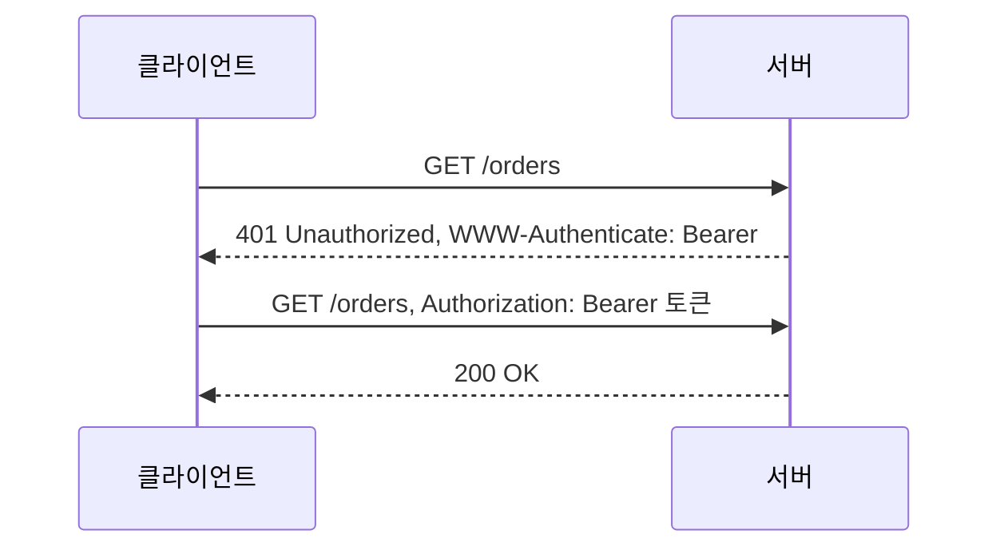

로그인 화면에 아이디와 비밀번호를 넣는 순간 서버가 하는 일은 "이 요청을 보낸 사람이 정말 그 사용자인가"를 확인하는 것이다. 이 확인 과정을 인증(authentication)이라고 한다. 이 글은 시리즈의 첫 글로, 인증이 무엇이고 HTTP에서 어떻게 표현되며 로그인 이후의 요청에서는 어떻게 이어지는지를 정리한다.

## 인증과 인가의 차이

인증과 인가(authorization)는 자주 함께 나오지만 묻는 질문이 다르다.

- 인증: 너는 누구인가. 요청을 보낸 주체가 주장하는 신원이 맞는지 확인한다.
- 인가: 너는 이것을 해도 되는가. 확인된 주체가 특정 자원이나 동작에 접근할 권한이 있는지 판단한다.

OWASP Authentication Cheat Sheet도 인증을 비밀번호나 보안 토큰 같은 인증 수단으로 신원을 확인하는 과정으로 정의하고, 인가는 별도의 주제로 다룬다([OWASP Authentication Cheat Sheet](https://cheatsheetseries.owasp.org/cheatsheets/Authentication_Cheat_Sheet.html)). 순서는 항상 인증이 먼저다. 누구인지 모르면 무엇을 허용할지도 정할 수 없다. 인가는 [Authorization](/posts/authorization/)에서 따로 다룬다.

## 인증 요소

신원을 증명하는 수단은 성격에 따라 세 가지로 나뉜다. NIST SP 800-63B는 이를 인증 요소(authentication factor)라고 부른다([NIST SP 800-63B](https://pages.nist.gov/800-63-4/sp800-63b.html)).

- 알고 있는 것(something you know): 비밀번호, PIN
- 가지고 있는 것(something you have): OTP 생성기, 보안 키, 휴대폰
- 본인 자체(something you are): 지문, 얼굴 같은 생체 정보

서로 다른 요소를 두 개 이상 조합하는 것이 다중 요소 인증(MFA)이다. 비밀번호와 보안 질문은 둘 다 "알고 있는 것"이므로 MFA가 아니다. 비밀번호가 유출되더라도 공격자가 두 번째 요소까지 갖기는 어렵기 때문에, OWASP는 가능한 곳에는 MFA를 적용하라고 권한다.

## HTTP에서 인증이 표현되는 방식

HTTP는 인증을 위한 공통 틀을 정의한다. RFC 9110 11장에 따르면 서버는 `WWW-Authenticate` 헤더로 "이런 방식으로 인증하라"는 도전(challenge)을 보내고, 클라이언트는 `Authorization` 헤더에 자격 증명(credentials)을 담아 다시 요청한다([RFC 9110, Section 11](https://www.rfc-editor.org/rfc/rfc9110.html#section-11)).

여기서 상태 코드 두 개를 구분해야 한다.

- `401 Unauthorized`: 요청에 유효한 인증 정보가 없다. 이름은 Unauthorized지만 의미는 "인증되지 않음"에 가깝고, 클라이언트는 알맞은 `Authorization` 헤더를 붙여 다시 요청할 수 있다.
- `403 Forbidden`: 서버가 요청을 이해했지만 수행을 거부한다. 인증 정보를 다시 보내도 결과가 바뀌지 않는 경우, 즉 인가 실패에 쓴다.

로그인하지 않은 사용자에게는 401을, 로그인했지만 관리자 페이지에 접근하려는 일반 사용자에게는 403을 돌려주는 식이다. 상태 코드 전반은 [HTTP 웹 기본 지식 7](/posts/http-basics-07-status-codes/)에, 인증 관련 헤더는 [HTTP 웹 기본 지식 8](/posts/http-basics-08-headers/)에 정리했다.

## 로그인 이후의 요청은 어떻게 인증하는가

HTTP는 무상태(stateless) 프로토콜이라 서버는 이전 요청을 기억하지 않는다([HTTP 웹 기본 지식 4](/posts/http-basics-04-http/)). 매 요청마다 비밀번호를 다시 보낼 수는 없으므로, 로그인에 성공하면 서버는 "이미 인증된 요청"임을 증명할 무언가를 클라이언트에게 건넨다. 그 방식은 크게 둘로 나뉜다.

| 방식 | 클라이언트가 보내는 것 | 인증 상태를 누가 들고 있는가 |
| --- | --- | --- |
| 세션 | 세션 ID가 담긴 쿠키 | 서버(세션 저장소) |
| 토큰 | `Authorization` 헤더의 토큰 | 토큰 자체(서명된 정보) 또는 토큰 저장소 |

세션 방식은 서버가 로그인 상태를 저장하고 클라이언트는 그 상태를 가리키는 무의미한 ID만 들고 다닌다. 토큰 방식은 서버가 발급한 토큰을 클라이언트가 매 요청에 실어 보내고, 서버는 토큰을 검증해 사용자를 식별한다. 토큰 방식은 시리즈의 다음 글인 [Token Authentication](/posts/token-authentication/)에서 이어서 다룬다.

## 인증을 구현할 때 자주 놓치는 것

OWASP Authentication Cheat Sheet가 정리한 항목 중 서버 개발자가 직접 챙겨야 하는 것을 추리면 다음과 같다.

- 오류 메시지를 구분하지 않는다. "존재하지 않는 아이디"와 "비밀번호 불일치"를 다르게 알려 주면 공격자가 가입된 아이디를 골라낼 수 있다. 어느 경우든 "아이디 또는 비밀번호가 올바르지 않다"처럼 같은 응답을 준다.
- 비밀번호는 복호화할 수 없는 방식으로 저장한다. 평문이나 되돌릴 수 있는 암호화가 아니라, 비밀번호 저장용으로 설계된 느린 해시 함수를 쓴다.
- 무차별 대입을 막는다. 일정 횟수 이상 실패하면 계정 단위로 잠그거나 지연을 늘린다. IP 기준만으로 막으면 여러 IP에서 나눠 시도하는 공격을 놓친다.
- 로그인에 성공하면 세션 ID를 새로 발급한다. 로그인 전의 세션 ID를 그대로 쓰면, 공격자가 미리 심어 둔 세션 ID로 피해자가 로그인하게 만드는 세션 고정(session fixation) 공격이 가능하다.
- 비밀번호나 이메일 변경 같은 민감한 동작 전에는 다시 인증을 요구한다.

## 정리

인증은 신원을 확인하는 일이고, 인가는 확인된 신원에 권한을 판단하는 일이다. HTTP에서는 `WWW-Authenticate`와 `Authorization` 헤더, 그리고 401과 403으로 이 둘이 구분되어 드러난다. 로그인 이후에는 세션이나 토큰이 매 요청의 인증을 대신하므로, 실제 보안 수준은 로그인 화면보다 그 뒤에 오가는 세션 ID와 토큰을 얼마나 안전하게 다루는지에 달려 있다.

## 참고

- [RFC 9110, HTTP Semantics, Section 11 HTTP Authentication](https://www.rfc-editor.org/rfc/rfc9110.html#section-11)
- [OWASP Authentication Cheat Sheet](https://cheatsheetseries.owasp.org/cheatsheets/Authentication_Cheat_Sheet.html)
- [NIST SP 800-63B, Digital Identity Guidelines: Authentication and Authenticator Management](https://pages.nist.gov/800-63-4/sp800-63b.html)
