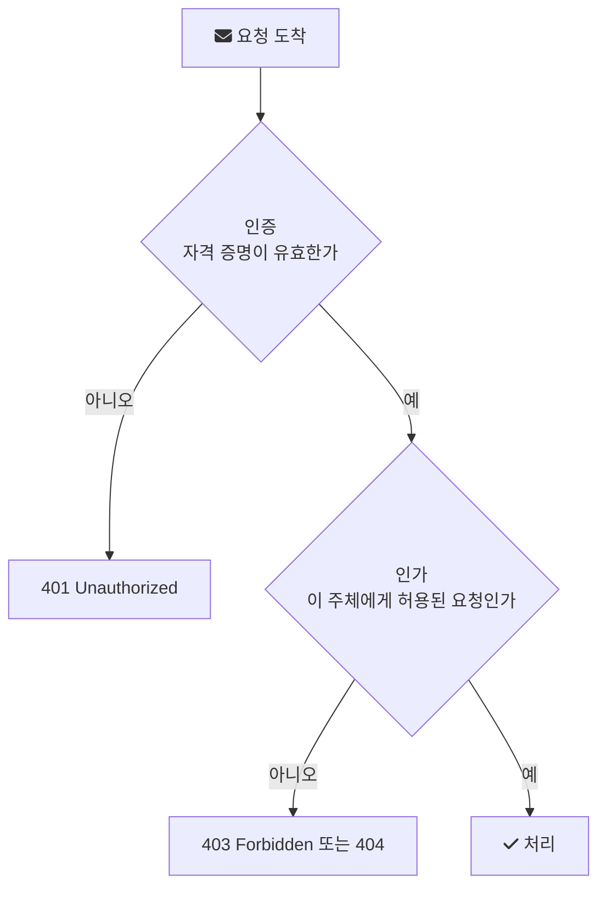

# Authorization

로그인에 성공한 사용자가 `/orders/1024`를 조회한다. 서버는 이 사용자가 누구인지 이미 알고 있다. 그래도 아직 답하지 않은 질문이 남는다. 이 사용자가 1024번 주문을 볼 수 있는가.

[인증(Authentication)](/posts/authentication/)이 "누구인가"를 확인하는 과정이라면, 인가(Authorization)는 "이 요청을 허용할 것인가"를 결정하는 과정이다. OWASP는 인가를 "the process of verifying that a requested action or service is approved for a specific entity"로 정의한다(요청된 행동이나 서비스가 특정 주체에게 승인되었는지 확인하는 과정, [OWASP Authorization Cheat Sheet](https://cheatsheetseries.owasp.org/cheatsheets/Authorization_Cheat_Sheet.html)).

---

## 인증 다음에 인가가 온다

두 단계는 순서가 있다. 인가 판단에는 주체가 누구인지가 입력으로 들어가므로, 인증이 먼저 끝나야 한다. [토큰 기반 인증](/posts/token-authentication/)에서도 마찬가지다. 토큰을 검증해 사용자를 식별하는 것까지가 인증이고, 그 사용자의 역할이나 속성으로 요청을 허용할지 정하는 것이 인가다.



---

## 401과 403은 다른 실패다

HTTP 명세도 두 실패를 구분한다. RFC 9110에서 401 Unauthorized는 요청이 대상 리소스에 대한 유효한 인증 자격 증명을 갖추지 못해 적용되지 않았다는 뜻이고, 서버는 `WWW-Authenticate` 헤더로 어떤 방식으로 인증해야 하는지 알려야 한다. 이름은 Unauthorized지만 의미는 "인증이 안 됐다"에 가깝다.

403 Forbidden은 서버가 요청을 이해했지만 수행을 거부한다는 뜻이다. 자격 증명이 있었다면 서버는 그것이 접근을 허용하기에 충분하지 않다고 본 것이고, 클라이언트는 같은 자격 증명으로 자동 재시도하면 안 된다. 명세는 리소스의 존재 자체를 숨기고 싶은 서버는 403 대신 404로 응답해도 된다고 적는다([RFC 9110 15.5.4](https://www.rfc-editor.org/rfc/rfc9110.html#name-403-forbidden)).

404를 쓰는 선택은 다른 사람의 주문 번호를 하나씩 넣어 보는 공격자에게 "그 번호의 주문이 존재한다"는 정보조차 주지 않으려는 것이다.

---

## 권한을 표현하는 방식

OWASP 문서는 세 가지 모델을 비교한다.

| 모델 | 판단 기준 | 예시 |
| --- | --- | --- |
| RBAC (Role-Based) | 사용자에게 부여된 역할 | `ADMIN`만 회원 목록을 볼 수 있다 |
| ABAC (Attribute-Based) | 사용자, 리소스, 환경의 속성 | 같은 부서이고 근무 시간일 때만 결재 문서를 볼 수 있다 |
| ReBAC (Relationship-Based) | 주체와 리소스 사이의 관계 | 문서의 소유자나 공유받은 사람만 편집할 수 있다 |

RBAC는 단순하고 이해하기 쉽지만, "자기 주문만 볼 수 있다" 같은 규칙은 역할만으로 표현되지 않는다. OWASP는 세밀한 권한과 복잡한 규칙이 필요하면 ABAC나 ReBAC를 권한다. 실제 서비스는 대개 둘을 섞는다. 역할로 기능 단위 접근을 막고, 리소스 소유 관계로 데이터 단위 접근을 막는 식이다.

---

## 서버에서 지켜야 할 원칙

OWASP 치트 시트의 권고 중 백엔드 개발자가 바로 적용할 수 있는 것을 추리면 다음과 같다.

- 최소 권한: 업무에 필요한 최소한의 권한만 준다.
- 기본 거부: 명시적으로 허용되지 않은 요청은 거부한다. 문서는 애플리케이션이 접근을 허용할지 거부할지 항상 결정해야 한다고 적는다.
- 모든 요청에서 검사: 첫 화면에서 한 번 확인했다고 이후 API 호출을 믿지 않는다.
- 서버 쪽에서 검사: 버튼을 숨기는 것은 사용자 경험일 뿐 인가가 아니다. 클라이언트 쪽 검사만으로는 막을 수 없다.
- 식별자를 숨기는 것으로 대신하지 않기: 추측하기 어려운 ID를 쓰더라도 접근 제어 검사는 따로 해야 한다.

마지막 항목이 흔히 IDOR(Insecure Direct Object Reference, 안전하지 않은 직접 객체 참조)라고 부르는 취약점과 연결된다. `/orders/1024`의 숫자를 1025로 바꿨을 때 남의 주문이 보인다면, 인증은 됐지만 인가가 빠진 것이다.

---

## Spring Security에서의 모습

Spring Security는 메서드 단위 인가를 애너테이션으로 표현할 수 있게 해 준다. 이 기능은 Spring Boot Starter Security에서 기본으로 켜지지 않으므로 설정 클래스에 `@EnableMethodSecurity`를 붙여야 한다([Spring Security Method Security](https://docs.spring.io/spring-security/reference/servlet/authorization/method-security.html)).

```java
@Service
public class OrderService {

    private final OrderRepository orderRepository;

    public OrderService(OrderRepository orderRepository) {
        this.orderRepository = orderRepository;
    }

    // 역할 기반: ROLE_ADMIN 권한이 있어야 호출된다
    @PreAuthorize("hasRole('ADMIN')")
    public List<Order> findAll() {
        return orderRepository.findAll();
    }

    // 결과 기반: 반환할 주문의 소유자가 현재 사용자일 때만 반환된다
    @PostAuthorize("returnObject.owner == authentication.name")
    public Order findById(Long id) {
        return orderRepository.findById(id).orElseThrow();
    }
}
```

`@PreAuthorize`는 메서드 실행 전에, `@PostAuthorize`는 실행 후 반환값을 보고 판단한다. 두 번째 메서드가 앞에서 본 IDOR을 막는 방식이다. 주문 ID만 맞으면 조회되는 것이 아니라, 그 주문이 현재 사용자 것인지까지 확인한다.

---

## 자주 놓치는 부분

- 목록 API의 데이터 범위: 단건 조회에는 소유자 검사를 넣고, 목록 조회에서는 조건을 빼먹는 경우가 있다.
- 수정과 삭제 경로: 조회 API만 검사하고 `PUT`, `DELETE`는 ID만 받아 처리하는 경우가 있다.
- 정적 파일과 스토리지: OWASP는 정적 리소스와 클라우드 스토리지에도 같은 접근 제어 정책을 적용하라고 권한다.
- 실패 기록: 인가 실패는 공격 시도의 흔적일 수 있으므로 분석 가능한 형식으로 로그를 남긴다.
- 테스트: 인가 로직은 단위 테스트와 통합 테스트로 자동 검증한다. "다른 사용자의 토큰으로 호출하면 403 또는 404가 나온다"는 테스트 하나가 IDOR 회귀를 막는다.

## 참고

- [Authorization Cheat Sheet](https://cheatsheetseries.owasp.org/cheatsheets/Authorization_Cheat_Sheet.html) — OWASP Cheat Sheet Series
- [RFC 9110: HTTP Semantics, 15.5.2 401 Unauthorized, 15.5.4 403 Forbidden](https://www.rfc-editor.org/rfc/rfc9110.html#name-401-unauthorized) — IETF
- [Method Security](https://docs.spring.io/spring-security/reference/servlet/authorization/method-security.html) — Spring Security Reference
