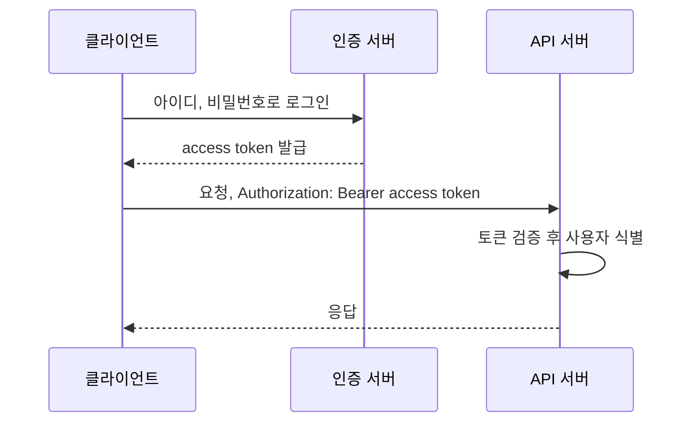

[Authentication](/posts/authentication/)에서 로그인 이후의 요청을 인증하는 방식은 세션과 토큰 두 가지로 나뉜다고 정리했다. 이 글은 그중 토큰 방식을 다룬다. 토큰 기반 인증은 로그인에 성공한 사용자에게 서버가 토큰을 발급하고, 이후 요청마다 클라이언트가 그 토큰을 함께 보내 신원을 증명하는 방식이다.

## 토큰 인증의 흐름

Okta의 설명을 따르면 흐름은 네 단계다. 사용자가 접근을 요청하고, 서버가 자격 증명을 확인하고, 서버가 유효 기간이 정해진 토큰을 발급하고, 이후 접근에는 그 토큰을 쓴다([Okta, What Is Token-Based Authentication?](https://www.okta.com/identity-101/what-is-token-based-authentication/)). 같은 글은 USB 키나 스마트카드 같은 물리적인 하드웨어 토큰도 함께 다루지만, 웹 API에서 말하는 토큰은 보통 문자열 형태의 소프트웨어 토큰이다.

인증 서버와 API 서버는 같은 애플리케이션일 수도 있고 분리되어 있을 수도 있다. 핵심은 비밀번호가 로그인 요청에서 한 번만 오가고, 이후에는 토큰이 그 역할을 대신한다는 점이다.

## Bearer 토큰

웹 API에서 가장 흔한 토큰 형태는 bearer 토큰이다. RFC 6750은 bearer 토큰을 이렇게 정의한다.

> "A security token with the property that any party in possession of the token (a "bearer") can use the token in any way that any other party in possession of it can."

토큰을 가진 사람이라면 누구든 정당한 소유자와 똑같이 그 토큰을 쓸 수 있다는 뜻이다([RFC 6750](https://www.rfc-editor.org/rfc/rfc6750.html)). 별도의 열쇠로 "내가 이 토큰의 주인"임을 증명할 필요가 없으므로 다루기 쉽지만, 토큰이 새어 나가면 그대로 도용된다. 그래서 RFC 6750은 다음을 요구한다.

- 토큰은 `Authorization: Bearer <토큰>` 헤더로 보내는 것이 기본이다.
- 토큰을 담은 요청은 항상 TLS(HTTPS)로 보내야 한다.
- 토큰을 URL 쿼리 문자열에 넣지 말아야 한다. 브라우저 기록이나 서버 접근 로그에 URL이 그대로 남기 때문이다.

토큰이 만료되었거나 폐기되었거나 형식이 잘못되었다면 서버는 `invalid_token` 오류와 401로, 토큰의 권한 범위가 부족하면 `insufficient_scope`와 403으로 응답한다.

## 토큰 안에 무엇이 들어 있는가

OAuth 2.0을 정의한 RFC 6749는 access token이 두 형태일 수 있다고 설명한다. 하나는 권한 정보를 조회하는 데 쓰는 식별자이고, 다른 하나는 권한 정보를 검증 가능한 형태로 직접 담은 토큰이다([RFC 6749, Section 1.4](https://www.rfc-editor.org/rfc/rfc6749.html#section-1.4)).

- 식별자형(opaque) 토큰: 의미 없는 임의 문자열이다. API 서버는 토큰 저장소나 인증 서버에 물어봐야 누구의 토큰인지 안다. 저장소에서 지우면 즉시 폐기된다.
- 자체 포함형 토큰: 사용자 ID, 만료 시각 같은 정보를 담고 서명한 토큰이다. 대표적인 형식이 JWT(JSON Web Token)다. API 서버는 서명과 만료 시각만 검증하면 되므로 저장소 조회가 필요 없다. 대신 만료 전에 무효화하기 어렵다.

JWT는 `헤더.페이로드.서명` 세 부분을 base64url로 인코딩해 점으로 이은 문자열이다([RFC 7519](https://www.rfc-editor.org/rfc/rfc7519.html)). 서명된 JWT의 페이로드는 인코딩되어 있을 뿐 암호화된 것이 아니므로 누구나 디코딩해서 읽을 수 있다.

## access token과 refresh token

토큰을 오래 쓰게 할수록 탈취되었을 때의 피해가 커지고, 짧게 하면 사용자가 자주 다시 로그인해야 한다. 이 긴장을 푸는 장치가 refresh token이다. RFC 6749에 따르면 refresh token은 access token이 만료되었을 때 새 access token을 받는 데 쓰며, 인증 서버에만 보내고 API 서버(resource server)로는 절대 보내지 않는다([RFC 6749, Section 1.5](https://www.rfc-editor.org/rfc/rfc6749.html#section-1.5)).

그래서 흔한 구성은 access token의 수명을 짧게 두고, 만료되면 refresh token으로 새 access token을 받는 것이다. 매 요청에 실려 여러 서버를 오가는 access token은 짧게 살고, 오래 사는 refresh token은 인증 서버와만 오가므로 노출 경로가 좁다.

## 토큰을 다룰 때 지킬 것

Auth0의 토큰 모범 사례 문서가 정리한 항목 중 핵심은 다음과 같다([Auth0, Token Best Practices](https://auth0.com/docs/secure/tokens/token-best-practices)).

- 서명 키를 다른 자격 증명처럼 비밀로 다루고, 필요한 서비스에만 공개한다.
- 페이로드에 민감한 정보를 넣지 않는다. 서명되어 있어도 쉽게 디코딩된다.
- 토큰에 만료 시간을 둔다.
- HTTPS로만 전송한다.
- 토큰을 파싱하고 검증하는 코드는 직접 짜지 말고 검증된 라이브러리나 미들웨어를 쓴다.
- 서명 알고리즘은 대칭키(HS256)보다 비대칭키(RS256)를 권한다. 검증하는 쪽이 공개키만 가지면 되고, 키를 교체할 때도 유리하다.

## 세션 방식과 비교하면

| 항목 | 세션 | 토큰(JWT 기준) |
| --- | --- | --- |
| 상태 저장 위치 | 서버 세션 저장소 | 토큰 자체 |
| 요청마다 저장소 조회 | 필요 | 불필요 |
| 즉시 로그아웃, 권한 회수 | 쉬움 | 어려움(만료까지 유효) |
| 여러 서비스에서 검증 | 세션 저장소 공유 필요 | 공개키만 있으면 가능 |

어느 쪽이 항상 낫지는 않다. 즉시 폐기가 중요하면 세션이나 opaque 토큰이, 여러 서비스가 독립적으로 검증해야 하면 JWT가 유리하다. JWT를 고르더라도 만료 시간을 짧게 두고 refresh token과 폐기 전략을 함께 설계해야 한다.

## 참고

- https://www.okta.com/identity-101/what-is-token-based-authentication/
- https://auth0.com/docs/secure/tokens/token-best-practices
- [RFC 6750, The OAuth 2.0 Authorization Framework: Bearer Token Usage](https://www.rfc-editor.org/rfc/rfc6750.html)
- [RFC 6749, The OAuth 2.0 Authorization Framework](https://www.rfc-editor.org/rfc/rfc6749.html)
- [RFC 7519, JSON Web Token (JWT)](https://www.rfc-editor.org/rfc/rfc7519.html)
