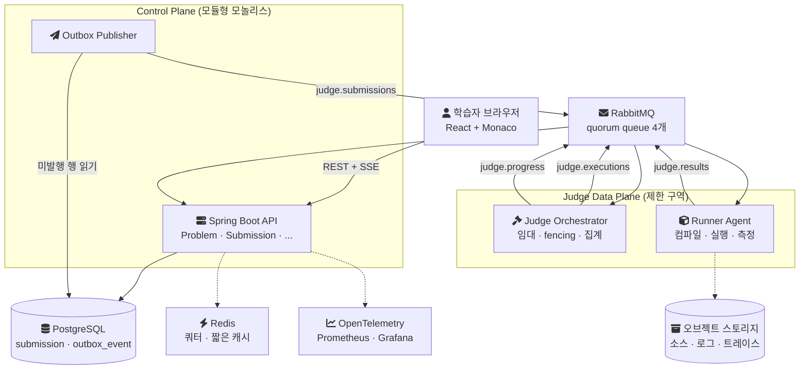
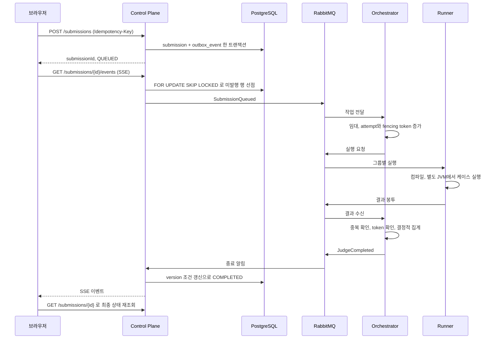
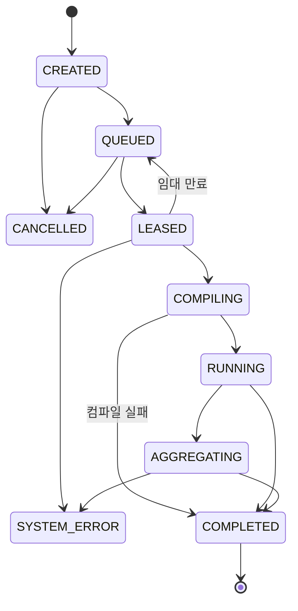

[CodeDrill](https://github.com/polynomeer/code-drill)은 알고리즘 문제를 채점하는 온라인 저지 위에, 제출·테스트·실행 트레이스를 증거로 모아 약한 역량을 진단하고 코칭하는 것을 목표로 시작한 프로젝트다. 첫 커밋은 2026-09-05이고, 같은 날 밤 문제 열기부터 판정과 리플레이까지 한 줄로 이어지는 첫 수직 슬라이스(vertical slice, 기능 하나를 화면부터 저장소까지 관통해 만든 최소 경로)가 돌았다.

이 글은 그날의 설계를 적는다. 기준은 첫날 커밋(`becfe5c`부터 `703dc42`까지)과 그날 저장소에 들어온 기준 문서 다섯 개(기획서, PRD, 기술 설계서, 디자인 설계서, UI 문서)다. 이후에 붙은 기능은 다루지 않는다. 기술마다 대안과 비교한 이유는 기술 설계서에 일부만 있었다. 그래서 빠진 부분을 저장소에 [`docs/tech-selection.md`](https://github.com/polynomeer/code-drill/blob/14b934c/docs/tech-selection.md)로 따로 정리했고, 이 글의 비교도 그 문서를 따른다. 그 문서에서 "재구성"이라고 표시한 비교는 첫날 문서에 적힌 이유가 아니라 나중에 내가 다시 짚은 것이다.

## 무엇을 풀려고 했나

PRD는 기존 온라인 저지의 한계를 이렇게 정리한다. 최종 출력과 정답률만 남기 때문에, 사용자가 문제를 오해했는지, 알고리즘을 잘못 골랐는지, 구현이나 복잡도나 디버깅 중 어디가 약한지 구분할 수 없다. CodeDrill은 이 구분을 실행 증거로 하려고 했다. 제출 결과, 사용자가 만든 테스트, compare·swap 같은 의미 단위의 실행 트레이스, 힌트 사용 이력을 append-only(덧붙이기만 하는) 원장에 쌓고, 숙련도는 그 원장에서 다시 계산할 수 있는 파생값(projection)으로 둔다.

그런데 이 모든 것은 판정이 정확하다는 전제 위에 선다. 기술 설계서가 정한 품질 속성 우선순위도 판정 정확성, 격리·보안, 가용성, 응답성, 관측성, 확장성 순이다. 설계 원칙 첫 줄도 "Judge first"다. 시각화가 고장 나도 채점은 막히지 않아야 한다.

설계가 출발한 조건은 다음과 같다. 모두 문서상의 가정이고 측정값이 아니다.

| 항목 | 값 | 출처 |
|---|---|---|
| 초기 용량 가정 | 동시 사용자 300명, 피크 제출 20건/초 | 기술 설계서 §1.2 |
| 판정 품질 목표 | 재현성 99.99%, 시스템 오류율 0.1% 미만 | PRD §0.5 |
| 지연 목표 | 큐 대기 p95 2초, 판정 반영 p95 1초 | 기술 설계서 §12.1 |
| 작업 전달 | at-least-once, 모든 소비자는 멱등 | §1.2 |
| 채점 언어 | Java, Kotlin, Python | §1.1 |
| 만드는 사람 | 나 한 명과 코딩 에이전트 | 커밋 이력 |

p95는 요청 100개 중 95번째로 느린 값이고, at-least-once는 메시지가 적어도 한 번은 오지만 두 번 이상 올 수도 있다는 전달 보장이다. 같은 요청이 두 번 와도 결과가 한 번 처리한 것과 같도록 만드는 성질이 [멱등성](/posts/idempotency-key-design/)이다.

## 초기 아키텍처

설계의 뼈대는 신뢰 경계다. 사용자가 제출한 코드, 그것을 컴파일한 결과, 그 코드가 찍은 출력은 모두 믿을 수 없는 입력이다. 그래서 그 코드를 실행하는 영역(Judge Data Plane)을 제출과 계정을 다루는 제어 영역(Control Plane)과 다른 배포 단위로 떼고, 실행 영역에서는 Control DB와 인터넷으로 직접 나가지 못하게 한다. 둘은 브로커로만 이야기한다.

아래 그림은 기술 설계서 §2와 첫날 코드가 같이 그리는 구성이다. 점선은 문서에는 있지만 첫날 코드가 아직 쓰지 않은 연결이다.

제어 영역 안은 도메인 모듈 여덟 개(Identity, Problem, Workspace, Submission, Competency, Coaching, Learning, Admin)로 나뉜다. 모듈마다 소유 데이터와 금지 의존성이 정해져 있다. 예를 들어 Submission은 Runner를 직접 부르지 못하고, Coaching은 판정을 바꾸지 못한다.

### 제출 한 건의 흐름

제출 한 건이 판정이 되기까지는 다음 순서를 거친다. 제출 행과 아웃박스 행을 한 트랜잭션에 넣는 것이 시작이다. 이 방식이 [Transactional Outbox](/posts/parity-pay-outbox/)다([Pattern: Transactional outbox](https://microservices.io/patterns/data/transactional-outbox.html)). 브로커가 죽어 있어도 제출은 사라지지 않고, 발행은 커밋 뒤에 따로 일어난다.

마지막 줄이 중요하다. SSE 스트림은 진실의 원천이 아니다. 브라우저는 이벤트를 받을 때마다 제출을 다시 조회해 DB 상태로 맞춘다. 스트림이 끊겨도 결과는 보인다.

### 상태 머신과 불변식

제출 상태는 한 방향으로만 흐른다.

`COMPLETED`는 바뀌지 않는다. 재채점은 상태를 되돌리지 않고 새 revision을 만든다. 이 밖에 첫날 코드가 테스트로 고정한 규칙이 몇 가지 있다.

- 워커를 잃은 줄 알고 다시 임대하면 attempt와 fencing token이 함께 오른다. 죽은 줄 알았던 워커의 결과가 늦게 오면 token이 낮아 거절된다. fencing token이 무엇을 막는지는 이후 [락 lease와 fencing token 실험](/posts/parity-pay-lock-lease/)에 적었다.
- 같은 결과가 두 번 오면 중복 검사를 fencing 검사보다 먼저 한다. 순서가 반대면 정상적인 재전달이 스테일 결과로 잘못 기록된다.
- 플랫폼 장애(`SYSTEM_ERROR`)는 집계에서 가장 먼저 본다. 사용자 코드 실패로 덮으면 사용자가 멀쩡한 코드를 고치게 된다.

## 기술 선택과 대안

여기서부터는 결정 하나에 한 절씩 쓴다. 각 절은 이 프로젝트가 무엇을 필요로 했는지, 어떤 대안이 있었는지, 무엇을 감수했는지 순서로 적는다.

### 구조: 모듈형 모놀리스와 독립 Judge

필요했던 것은 두 가지다. 사용자 코드는 제어 영역 자격증명과 다른 경계에서 돌아야 했다. 그리고 혼자 운영할 수 있을 만큼 구성이 작아야 했다. 기술 설계서 §18.1은 "운영 복잡도 과잉"을 위험으로 꼽고 완화책으로 모듈형 모놀리스와 구성요소 최소화를 적는다.

| 대안 | 평가 |
|---|---|
| 전면 마이크로서비스 | 도메인 8개를 처음부터 나누면 배포·관측·분산 트랜잭션 비용이 먼저 든다. 문서는 "팀/배포 충돌이 측정됨"을 재검토 조건으로 둔다 |
| 채점까지 한 앱 (재구성) | 가장 단순하지만 사용자 코드가 DB 자격증명과 같은 프로세스 경계에 놓인다 |
| 선택 | 신뢰 경계가 다른 곳만 배포 단위로 나눈다. 제어 영역은 Spring Boot 앱 하나, Orchestrator와 Runner는 각자 앱 |

제어 영역 안의 경계는 빌드가 지킨다. 첫 스캐폴드 커밋([`f68dbaf`](https://github.com/polynomeer/code-drill/commit/f68dbaf))이 `checkModuleBoundaries` 태스크를 넣었고, 도메인 모듈이 서로를 직접 참조하면 빌드가 깨진다. 모듈러 모놀리스에서 경계를 코드로 강제하는 일반적인 방법은 [이전 글](/posts/modular-monolith-boundaries/)에 정리했다. 감수한 것은 제어 영역 전체가 한 번에 배포된다는 점이다. 그리고 빌드 검사가 보지 못하는 의존(같은 테이블을 직접 읽는 것 같은)은 리뷰가 잡아야 한다.

### 언어와 프레임워크: Kotlin과 Spring Boot

기술 설계서가 적은 이유는 "도메인 모델링, 트랜잭션, 운영 생태계, 팀 생산성"이다. 대안 비교는 문서에 없어서 재구성했다.

| 대안 | 평가 |
|---|---|
| Java + Spring Boot (재구성) | 생태계는 같다. Kotlin은 Java 기반 프레임워크와 호환되고 Spring은 Kotlin을 "first-class"로 지원한다고 밝히므로 생태계를 잃지 않는다 |
| Go (재구성) | 채점 언어 셋 중 둘이 JVM이고, 첫 슬라이스는 Runner 프로세스 안에서 Kotlin을 컴파일했다. 언어를 나누면 제어·실행 영역 사이의 계약을 두 언어로 유지해야 한다 |
| Node.js + TypeScript (재구성) | 웹과 언어를 맞출 수 있지만 트랜잭션 경계와 AMQP·마이그레이션 통합을 직접 조립해야 한다 |
| 선택 | Kotlin 2.1, Spring Boot 3.4. 세 앱과 `judge/protocol` 계약 모듈이 한 Gradle 빌드를 공유한다 |

Spring 문서는 Kotlin 지원을 이렇게 설명한다. "The Spring Framework provides first-class support for Kotlin"(Spring은 Kotlin을 1급으로 지원한다, [Spring Framework Kotlin](https://docs.spring.io/spring-framework/reference/languages/kotlin.html)). 감수한 것은 JVM 기동과 메모리, 그리고 Kotlin 컴파일 지연이다. 기술 설계서는 컴파일 지연을 가능성 "높음"인 위험으로 적었다. 첫날 실제로 부딪힌 문제도 있다. `kotlin-compiler-embeddable`이 Spring Boot fat jar 안에서 자기 설정 파일을 찾지 못해, Runner만 `installDist` 배포로 바꿨다([`48b188a`](https://github.com/polynomeer/code-drill/commit/48b188a)).

### 주 저장소: PostgreSQL

기술 설계서가 적은 이유는 "트랜잭션, 버전 관리, JSONB 메타데이터"다. 이 프로젝트가 DB에 바란 것은 세 가지였다. 제출 행과 아웃박스 행을 한 트랜잭션에 넣는 것, `UNIQUE(user_id, idempotency_key)` 같은 유일 제약으로 중복 제출을 흡수하는 것, version 컬럼을 조건으로 상태를 갱신하는 것이다.

| 대안 | 평가 |
|---|---|
| MySQL (재구성) | 트랜잭션, `SKIP LOCKED`, JSON을 모두 갖춰 기능 차이가 크지 않다. MySQL을 배제한 이유는 문서에 없다 |
| MongoDB (재구성) | 다중 문서 트랜잭션을 지원하지만 공식 문서가 단일 문서 쓰기보다 비용이 크다고 하고 비정규화를 권한다. 이 제품의 핵심은 여러 테이블에 걸친 제약과 한 트랜잭션이다 |
| 선택 | PostgreSQL 17. 아웃박스 발행기는 `FOR UPDATE SKIP LOCKED`로 행을 잡고, 판정 그룹 결과는 `JSONB` 컬럼에 둔다 |

`SKIP LOCKED`는 잠긴 행을 기다리지 않고 건너뛴다. PostgreSQL 문서는 이것이 일반 작업에는 맞지 않지만 "can be used to avoid lock contention with multiple consumers accessing a queue-like table"(큐처럼 쓰는 테이블에 여러 소비자가 붙을 때 락 경합을 피하는 데 쓸 수 있다, [SELECT](https://www.postgresql.org/docs/17/sql-select.html))고 적는다. 발행기 replica가 늘어도 같은 이벤트를 두 인스턴스가 동시에 밀지 않는 이유다. JSONB는 입력할 때 분해된 이진 형식으로 바꾸므로 처리할 때 다시 파싱하지 않고 인덱스를 지원한다([JSON Types](https://www.postgresql.org/docs/17/datatype-json.html)). 감수한 것은 아웃박스 폴링 부하가 주 DB에 얹힌다는 점이다. 첫날 발행기는 200ms마다 미발행 행을 조회했다.

### 캐시와 쿼터: Redis

Redis의 역할은 문서에서 좁게 정해져 있다. 쿼터 카운터와 짧은 상태 캐시이고, 진실의 원천은 항상 DB다. 로컬 compose도 RDB와 AOF를 모두 끈 채로 띄운다. 잃어도 DB에서 다시 만들 수 있는 값만 둔다는 뜻이다.

| 대안 | 평가 |
|---|---|
| 프로세스 메모리 (재구성) | 인스턴스가 하나면 충분하다. 첫날의 임대 레지스트리와 SSE 구독 목록이 실제로 이렇게 시작했고, 코드 주석이 replica가 늘면 옮겨야 한다고 적는다 |
| PostgreSQL 카운터 (재구성) | 저장소가 하나 줄지만 제출마다 쿼터 갱신이 주 DB의 쓰기가 된다 |
| 선택 | Redis. 원자적 카운터와 TTL |

감수한 것은 구성요소 하나다. 장애 시에는 DB나 로컬 제한으로 보수적으로 허용한다(§12.2). 첫날 코드는 Redis 연결만 설정했고 아직 아무것도 저장하지 않았다.

### 작업 브로커: RabbitMQ quorum queue

이 결정은 기술 설계서 §18.2에 대안까지 적혀 있다. 이유는 "작업 확인·재전달·우선순위·운영 단순성"이고, 보류한 대안은 Kafka와 Redis Streams다. 요구는 작업 유실 0과 at-least-once였다.

| 대안 | 평가 |
|---|---|
| Kafka | 소비한 뒤에도 이벤트를 보존하고 파티션 안 순서를 보장한다. 재처리·분석에 강하다. 채점 작업에 필요한 것은 보존보다 작업 단위의 확인·재전달·우선순위였다. 문서는 재처리 규모가 급증하면 도메인 이벤트만 Kafka 계열로 분리하는 것을 검토한다 |
| Redis Streams | 소비자 그룹, 대기 목록(PEL), `XACK`, `XAUTOCLAIM`으로 작업 큐를 만들 수 있다. 다만 내구성이 Redis 영속화 설정에 묶이고, 기본 AOF 정책(1초마다 fsync)에서는 장애 시 1초 분량을 잃을 수 있다. Redis를 캐시로만 두려는 전제와 충돌한다 |
| 선택 | RabbitMQ 4 quorum queue. 첫날 네 큐를 모두 durable quorum으로 선언했다 |

RabbitMQ 문서는 quorum queue를 Raft 합의로 복제되는 내구성 큐로 설명하고, "designed for data safety"(데이터 안전을 위해 설계되었다, [Quorum Queues](https://www.rabbitmq.com/docs/quorum-queues))라고 적는다. 재배달 횟수를 추적하고, 4.0부터 기본 재배달 한도가 20이며, 우선순위도 지원한다. at-least-once는 수동 ack와 publisher confirm을 함께 써야 성립한다([Consumer Acknowledgements and Publisher Confirms](https://www.rabbitmq.com/docs/confirms)). Kafka 쪽 저장 구조는 [Kafka 저장 구조 글](/posts/kafka-storage-internals/)에 따로 정리했다.

감수한 것은 재처리다. 메시지는 ack 뒤 사라지므로 과거 작업을 다시 읽으려면 브로커가 아니라 DB(아웃박스와 제출 행)에서 시작해야 한다. 중복 전달은 소비자 멱등성과 fencing token이 흡수한다.

### 실시간 전송: SSE

판정 진행은 서버에서 브라우저로만 흐른다. 기술 설계서는 SSE를 "단방향 상태 갱신에 단순하고 재연결이 쉬움"이라는 이유로 고르고, WebSocket은 양방향 협업 기능이 생길 때 다시 보기로 했다.

| 대안 | 평가 |
|---|---|
| WebSocket | 양방향 통신용 프로토콜이다(RFC 6455). 판정 진행에는 그 능력이 필요 없다 |
| 짧은 주기 폴링 (재구성) | 가장 단순하지만 판정 반영 p95 1초를 맞추려면 1초보다 짧게 조회해야 한다 |
| 선택 | SSE. Spring MVC `SseEmitter` |

HTML 명세에 따르면 브라우저는 연결이 끊기면 스스로 다시 연결하고, 이때 마지막으로 받은 이벤트 ID를 `Last-Event-ID` 헤더로 보낸다([Server-sent events](https://html.spec.whatwg.org/multipage/server-sent-events.html)). 감수한 것은 두 가지다. 스트림을 진실의 원천으로 쓸 수 없어서 클라이언트가 이벤트마다 재조회한다. 그리고 첫날 구독 목록은 단일 인스턴스 메모리에 있어서 replica가 늘면 팬아웃 수단이 필요하다. 폴링을 SSE로 바꾼 다른 회사의 사례는 [SLASH 24 리뷰](/posts/slash24-sse-event-push/)에 정리했다.

### 샌드박스: gVisor 계열을 우선 검증

기술 설계서 §5.2의 샌드박스 정책은 비root UID, read-only rootfs, 네트워크 네임스페이스 분리, 언어별 seccomp 허용 목록, [cgroup v2](/posts/context-switching-and-cgroup/) CPU·메모리 제한을 요구한다. 격리 런타임은 §18.2에서 gVisor 계열을 고르고, 일반 runc와 Firecracker를 보류했다. 요청마다 Kubernetes Job을 만드는 구조는 지연이 커서 상시 워커 풀을 쓰기로 했다.

| 대안 | 평가 |
|---|---|
| runc + seccomp | Docker 기본 seccomp 프로필은 300여 개 시스템 호출 중 약 44개를 막는다([Docker seccomp](https://docs.docker.com/engine/security/seccomp/)). 허용된 호출은 결국 호스트 커널로 간다 |
| Firecracker | KVM으로 microVM을 만들어 가상 머신 경계로 격리한다. 하드웨어 가상화를 지원하는 CPU가 필요하다. 문서는 격리 요구가 오르면 microVM 풀로 강화하는 것을 다음 단계로 둔다 |
| 선택 | gVisor. 사용자 공간의 응용 커널이 시스템 호출을 가로채 호스트로 그대로 넘기지 않고, OCI 런타임 `runsc`로 기존 컨테이너 도구에 붙는다 |

gVisor 문서는 이 구조의 대가로 응용 호환성 저하와 시스템 호출당 오버헤드를 밝힌다([What is gVisor?](https://gvisor.dev/docs/)). 그런데 첫날 Runner는 이 중 아무것도 쓰지 않았다. 별도 JVM 프로세스, 힙 상한, 케이스별 벽시계 데드라인, 출력 한도까지만 강제했다. `SandboxProcess`의 주석은 나머지가 비어 있으니 공개 환경에서 돌리기 전에 반드시 채워야 한다고 적는다. 첫날의 판정 경로는 신뢰할 수 있는 코드로만 검증한 셈이다.

### 실행 트레이스: SDK와 계측 규약

리플레이용 트레이스를 어떻게 만들지도 §18.2에 있다. 범용 AST 변환이나 디버거로 의미 이벤트를 추론하는 방식을 보류하고, 문제별 계측 규약과 SDK를 골랐다. PRD도 비목표에 임의 코드의 완전한 의미 분석을 적었다.

첫날 구현([`00a6aec`](https://github.com/polynomeer/code-drill/commit/00a6aec))은 같은 `Drill` API를 두 모드로 컴파일한다. 판정 모드에서는 no-op이라 계측 오버헤드가 판정 시간에 섞이지 않는다. 트레이스 모드는 판정이 끝난 뒤 별도 작업으로 돌고, 공개 그룹의 첫 케이스에서만 만든다. 숨은 입력의 상태 변화를 보여 주면 테스트가 그대로 새기 때문이다. 감수한 것은 사용자가 `Drill.*`를 부르지 않으면 리플레이가 없다는 점이다.

### 웹: React, TypeScript, Monaco

기술 설계서의 이유는 "문제·편집·리플레이 UI 생태계와 타입 안정성"이다. 편집기 대안 비교는 재구성했다.

| 대안 | 평가 |
|---|---|
| CodeMirror 6 (재구성) | 모듈식이고 모바일에서 플랫폼 기본 선택·편집을 쓰며 스크린 리더 지원을 내세운다. VS Code와 같은 편집 경험은 확장을 조립해 만들어야 한다 |
| 선택 | Monaco. VS Code의 편집기 그대로다. 공식 저장소는 모바일 브라우저를 지원하지 않는다고 밝힌다 |

모바일 미지원은 PRD가 "모바일 전체 코딩 경험"을 MVP에서 뺐기 때문에 받아들일 수 있는 비용이었다. 무게는 첫날 처리했다. Monaco를 별도 청크로 지연 로드해 메인 번들을 4.2MB에서 203KB로 줄였고, CDN이 아니라 번들에서 불러 사용자 코드가 있는 페이지에서 서드파티 스크립트가 돌지 않게 했다([`4ae960d`](https://github.com/polynomeer/code-drill/commit/4ae960d)).

### 관측성과 대용량 객체

관측성은 OpenTelemetry로 만들고 Prometheus와 Grafana로 저장·조회한다. 이유는 요청에서 제출, 실행까지 이어지는 종단 추적이다. OpenTelemetry는 벤더 중립 계측 도구이고 스스로 백엔드가 아니므로([What is OpenTelemetry?](https://opentelemetry.io/docs/what-is-opentelemetry/)) 백엔드를 따로 고른 것이다. 첫날은 Micrometer·OTLP 의존성과 상관관계 ID 체인만 있었다.

소스, 컴파일 로그, 테스트 원본, 트레이스는 DB가 아니라 S3 호환 오브젝트 스토리지에 두고 DB에는 참조와 digest만 남긴다(§8.3). 그러나 첫날 슬라이스는 소스를 `submission.source` 컬럼과 큐 메시지에 직접 실었다. 두 곳 모두 운영에서는 참조로 바꿔야 한다는 주석이 붙어 있다.

## 첫날 커밋이 실제로 만든 것

기술 설계서 §16.2는 첫 수직 슬라이스를 "Two Sum 유사 함수형 1문제, Kotlin 1개 런타임, 문제 열기에서 리플레이까지"로 정의한다. 첫날 커밋은 그 범위를 그대로 따라갔다.

| 커밋 | 내용 |
|---|---|
| [`becfe5c`](https://github.com/polynomeer/code-drill/commit/becfe5c), [`70e706b`](https://github.com/polynomeer/code-drill/commit/70e706b), [`79a5a20`](https://github.com/polynomeer/code-drill/commit/79a5a20) | 작업 규칙, 커밋 컨벤션, 기준 문서 5종을 `docs/specs`로 |
| [`f68dbaf`](https://github.com/polynomeer/code-drill/commit/f68dbaf), [`dc3788c`](https://github.com/polynomeer/code-drill/commit/dc3788c), [`e452e82`](https://github.com/polynomeer/code-drill/commit/e452e82) | Gradle 멀티모듈(platform, control-plane 8개 모듈, judge 셋), 웹 스캐폴드, 로컬 의존성 compose와 CI |
| [`ca0e59e`](https://github.com/polynomeer/code-drill/commit/ca0e59e) | two-sum 문제 패키지(공개 샘플 2개, 숨은 테스트 6개)와 로더. digest를 파일 순회 순서와 무관하게 계산 |
| [`857bf3f`](https://github.com/polynomeer/code-drill/commit/857bf3f) | Kotlin 컴파일과 실행, AC/WA/CE/RE/TLE/SYSTEM_ERROR에 MLE/OLE까지 |
| [`1dc0e70`](https://github.com/polynomeer/code-drill/commit/1dc0e70) | 결정적 집계와 fencing token |
| [`48b188a`](https://github.com/polynomeer/code-drill/commit/48b188a) | 아웃박스, 브로커, SSE로 세 배포 단위를 연결 |
| [`00a6aec`](https://github.com/polynomeer/code-drill/commit/00a6aec) | 리플레이용 트레이스. 스모크 스크립트가 16개 항목을 실제 서비스로 확인 |
| [`4ae960d`](https://github.com/polynomeer/code-drill/commit/4ae960d) | 에디터, 판정 패널, 배열 리플레이 화면 |

판정 분류에서 첫날 정한 몇 가지는 설계 문서보다 구체적이다. 테스트 인자는 Kotlin 리터럴로 하네스에 인라인해, 자식 JVM이 JSON을 파싱하지 않는다. 기대 출력은 자식 프로세스에 넘기지 않고 부모에서만 비교한다. 그래서 숨은 테스트의 정답이 사용자 프로세스로 새지 않는다. OOM은 `RUNTIME_ERROR`가 아니라 `MEMORY_LIMIT`으로 가르고, 사용자 출력은 세기만 하고 버린다. 출력을 무제한으로 버퍼링하면 출력 초과가 메모리 초과로 잘못 분류되기 때문이다.

반대로 첫날 슬라이스가 문서와 다르게, 의도적으로 줄여 둔 것도 있다. 임대 레지스트리와 SSE 구독은 프로세스 메모리에 있고, 소스는 DB와 메시지에 직접 실렸으며, 샌드박스는 프로세스 분리까지만 했다. 모두 코드 주석에 "운영에서는 바꿔야 한다"는 문장이 붙어 있다.

## 설계가 남긴 질문

기술 설계서 §18.3은 구현 전에 확정해야 할 질문을 남겼다. 첫날 시점에 열려 있던 것은 다음과 같다.

- MVP Runner 플랫폼이 Kubernetes인지 전용 VM인지. 이 답에 따라 gVisor를 어떻게 붙일지가 달라진다.
- Java와 Kotlin의 정확한 런타임 버전과 성능 보정 정책.
- 함수형 하네스가 사용자 코드와 연결되는 표준 템플릿.
- 숨은 테스트 결과의 공개 수준과 오답 리플레이 입력 정책.
- Private Beta의 동시 사용자·피크 제출 목표를 계측 가능한 숫자로.

부록 C의 ADR 여덟 개 가운데 SSE(ADR-006), RabbitMQ(ADR-007), gVisor(ADR-008)는 첫날 기준 Proposed 상태였다. 기술 설계서 §17.3은 바뀔 지점도 미리 적어 두었다. 배포 독립성이 병목이 되면 Submission과 Problem을 서비스로 추출하고, 재처리가 급증하면 도메인 이벤트를 Kafka 계열로 분리하고, 격리 요구가 오르면 gVisor에서 microVM으로 옮긴다. 첫날 설계는 그 변화가 필요해질 때까지 구성요소를 늘리지 않는 쪽을 택했다.

## 참고

- CodeDrill 저장소 — [github.com/polynomeer/code-drill](https://github.com/polynomeer/code-drill)
- CodeDrill 기술 설계서 v1.2 — [`docs/specs/code_drill_technical_design.docx`](https://github.com/polynomeer/code-drill/blob/79a5a20/docs/specs/code_drill_technical_design.docx)
- CodeDrill PRD v1.2 — [`docs/specs/code_drill_prd.docx`](https://github.com/polynomeer/code-drill/blob/79a5a20/docs/specs/code_drill_prd.docx)
- CodeDrill 제품 맥락 — [`docs/project-context.md`](https://github.com/polynomeer/code-drill/blob/7d674eb/docs/project-context.md)
- CodeDrill 기술 선택의 이유와 대안 — [`docs/tech-selection.md`](https://github.com/polynomeer/code-drill/blob/14b934c/docs/tech-selection.md)
- RabbitMQ — [Quorum Queues](https://www.rabbitmq.com/docs/quorum-queues), [Consumer Acknowledgements and Publisher Confirms](https://www.rabbitmq.com/docs/confirms)
- Apache Kafka — [Introduction](https://kafka.apache.org/intro)
- Redis — [Redis Streams](https://redis.io/docs/latest/develop/data-types/streams/), [Redis persistence](https://redis.io/docs/latest/operate/oss_and_stack/management/persistence/)
- PostgreSQL 17 — [SELECT](https://www.postgresql.org/docs/17/sql-select.html), [JSON Types](https://www.postgresql.org/docs/17/datatype-json.html)
- MySQL 8.4 — [Locking Reads](https://dev.mysql.com/doc/refman/8.4/en/innodb-locking-reads.html)
- MongoDB — [Transactions](https://www.mongodb.com/docs/manual/core/transactions/)
- WHATWG — [Server-sent events](https://html.spec.whatwg.org/multipage/server-sent-events.html)
- IETF — [RFC 6455 The WebSocket Protocol](https://datatracker.ietf.org/doc/html/rfc6455)
- Spring Framework — [Kotlin](https://docs.spring.io/spring-framework/reference/languages/kotlin.html), [Asynchronous Requests](https://docs.spring.io/spring-framework/reference/web/webmvc/mvc-ann-async.html)
- Kotlin — [Kotlin for server side](https://kotlinlang.org/docs/server-overview.html)
- gVisor — [What is gVisor?](https://gvisor.dev/docs/)
- Firecracker — [firecracker-microvm.github.io](https://firecracker-microvm.github.io/)
- Docker — [Seccomp security profiles](https://docs.docker.com/engine/security/seccomp/)
- Monaco Editor — [microsoft/monaco-editor](https://github.com/microsoft/monaco-editor)
- CodeMirror — [codemirror.net](https://codemirror.net/)
- OpenTelemetry — [What is OpenTelemetry?](https://opentelemetry.io/docs/what-is-opentelemetry/)
- Chris Richardson — [Pattern: Transactional outbox](https://microservices.io/patterns/data/transactional-outbox.html)
