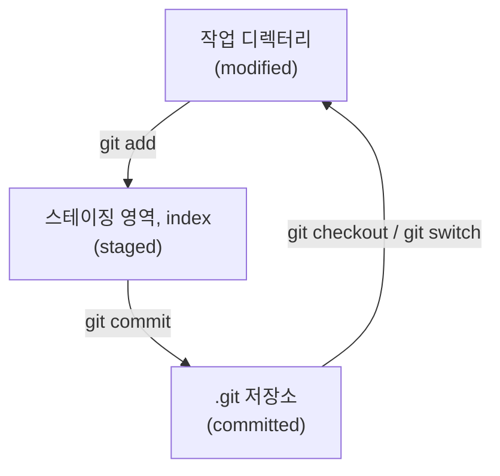
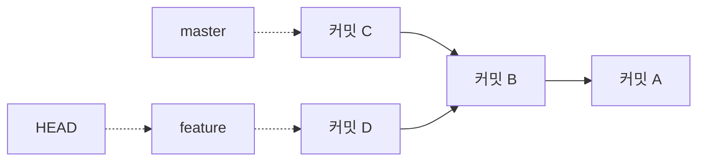

Git은 단순히 코드를 저장하는 도구가 아니라, 변경 이력을 관리하고 협업의 기준점을 만드는 도구다. 기본 개념을 흐리게 이해하면 명령어는 외워도 실제 상황에서 자주 꼬인다.

---

## Git은 변경분이 아니라 스냅샷을 저장한다

Git이 이전 버전 관리 도구와 가장 다른 점은 데이터를 보는 방식이다. Pro Git은 CVS나 Subversion 같은 도구가 파일별 변경분(diff)의 목록으로 이력을 저장하는 반면, Git은 커밋할 때마다 프로젝트 전체의 스냅샷을 찍는다고 설명한다. 바뀌지 않은 파일은 새로 저장하지 않고 이전에 저장한 파일을 가리키기만 한다([Pro Git, What is Git?](https://git-scm.com/book/en/v2/Getting-Started-What-is-Git%3F)).

같은 글은 두 가지 성질을 더 든다. 하나는 전체 이력이 로컬 디스크에 있어서 이력 조회나 비교 같은 대부분의 작업이 네트워크 없이 된다는 점이다. 다른 하나는 모든 데이터를 저장하기 전에 SHA-1 체크섬을 계산하고 그 해시로 가리키기 때문에, Git 모르게 파일 내용을 바꿀 수 없다는 점이다.

---

## 가장 중요한 세 가지

- 작업 디렉터리: 현재 수정 중인 파일 상태
- 스테이징 영역: 다음 커밋에 포함할 변경
- 커밋: 특정 시점의 이력 스냅샷

이 세 단계를 구분하면 많은 혼란이 줄어든다.

Pro Git은 이를 파일의 세 가지 상태로도 설명한다. 수정했지만 아직 커밋하지 않은 modified, 다음 커밋에 넣기로 표시한 staged, 로컬 저장소(`.git` 디렉터리)에 안전하게 저장된 committed다. 스테이징 영역은 Git 내부에서 index라고도 부른다.

세 영역 중 어디의 차이를 보고 있는지도 명령어마다 다르다.

| 명령어 | 보여 주는 것 |
| --- | --- |
| `git status` | 각 파일이 어느 상태에 있는지 |
| `git diff` | 작업 디렉터리와 스테이징 영역의 차이(아직 add하지 않은 변경) |
| `git diff --staged` | 스테이징 영역과 마지막 커밋의 차이(다음 커밋에 들어갈 변경) |

`git diff`가 아무것도 보여 주지 않는데 커밋할 내용이 있다면, 변경이 이미 스테이징 영역으로 넘어간 상태다.

---

## 왜 staging이 필요한가

Git은 수정된 파일 전체를 자동으로 한 번에 커밋하지 않는다. 어떤 변경을 묶어서 기록할지 사용자가 선택할 수 있게 staging이 존재한다.

즉, staging은 단순 중간 단계가 아니라 **의도적인 커밋 단위를 만드는 장치**다.

예를 들어 버그를 고치다가 같은 파일의 오타도 함께 고쳤다면, 두 변경은 이유가 다르므로 다른 커밋으로 남기는 편이 이력을 읽기 쉽다. `git add -p`는 파일 안의 변경 덩어리(hunk)를 하나씩 보여 주며 스테이징할지 묻는다([git-add 문서](https://git-scm.com/docs/git-add)). 이를 쓰면 한 파일 안의 변경도 나눠서 커밋할 수 있다.

---

## commit은 무엇을 남기는가

커밋은 파일 자체만 저장하는 것이 아니라, "왜 이 변경을 한 묶음으로 남겼는가"라는 의도까지 함께 기록한다. 그래서 커밋 메시지 품질도 중요하다.

Pro Git에 따르면 커밋 객체에는 스테이징된 내용의 스냅샷(tree)을 가리키는 포인터, 작성자 이름과 이메일, 커밋 메시지, 그리고 부모 커밋을 가리키는 포인터가 들어 있다([Pro Git, Branches in a Nutshell](https://git-scm.com/book/en/v2/Git-Branching-Branches-in-a-Nutshell)). 첫 커밋은 부모가 없고, 보통의 커밋은 부모가 하나, 병합 커밋은 부모가 둘 이상이다. 커밋들이 부모를 가리키며 이어진 사슬이 곧 이력이다.

---

## branch는 무엇인가

브랜치는 특정 커밋을 가리키는 움직이는 포인터다. 새로운 기능, 버그 수정, 실험 작업을 기본 흐름과 분리해서 진행할 수 있게 해준다.

같은 글은 브랜치가 실제로는 40자리 SHA-1 체크섬과 줄바꿈 하나, 즉 41바이트짜리 파일이라고 설명한다. 브랜치를 만드는 일은 프로젝트를 복사하는 것이 아니라 이 작은 파일 하나를 쓰는 일이라서 거의 비용이 들지 않는다.

현재 어느 브랜치에서 작업 중인지는 `HEAD`라는 특별한 포인터가 가리킨다. 새 커밋을 만들면 `HEAD`가 가리키는 브랜치가 새 커밋으로 한 칸 앞으로 움직인다.

위 그림에서 실선은 "부모를 가리킨다"는 뜻이고, 첫 커밋 A는 부모가 없다. 커밋 B에서 `feature` 브랜치를 만든 뒤 각 브랜치에서 커밋을 하나씩 더 했다. `HEAD`가 `feature`를 가리키므로 다음 커밋은 D 뒤에 붙고 `feature`만 움직인다. `master`는 C에 그대로 남아 있다.

---

## 실무에서 기본이 중요한 이유

Git을 깊게 쓰지 않더라도 다음은 항상 중요하다.

- 작은 단위로 커밋하기
- 브랜치 목적을 분명히 하기
- pull 전에 현재 변경 상태 확인하기
- 충돌이 나면 무엇이 기준 버전인지 이해하기

각 항목은 앞의 개념과 이어진다. 작은 커밋은 스테이징으로 만들고, 브랜치는 포인터일 뿐이니 목적별로 부담 없이 만들 수 있다. pull은 원격의 커밋을 가져와 현재 브랜치에 합치는 작업이므로, 그 전에 `git status`로 커밋하지 않은 변경이 없는지 확인하면 합치기 도중 꼬이는 일을 줄일 수 있다. 충돌은 두 브랜치가 같은 부분을 다르게 바꿨을 때 생기므로, 각 브랜치가 어떤 커밋에서 갈라졌는지 알면 어느 쪽 변경을 남길지 판단하기 쉽다.

Git의 기본은 명령어 암기보다, 변경 이력을 어떻게 관리할지에 대한 사고방식에 가깝다.

## 참고

- [1.3 What is Git?](https://git-scm.com/book/en/v2/Getting-Started-What-is-Git%3F) — Pro Git
- [3.1 Branches in a Nutshell](https://git-scm.com/book/en/v2/Git-Branching-Branches-in-a-Nutshell) — Pro Git
- [git-add Documentation](https://git-scm.com/docs/git-add) — Git Docs
