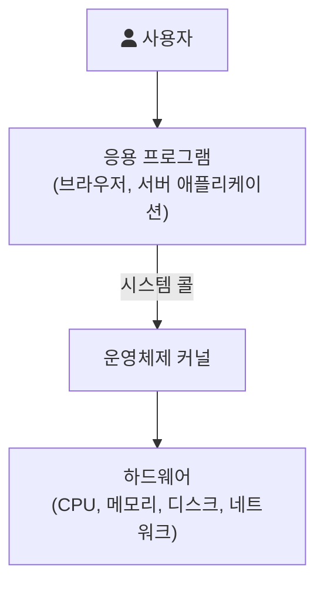

운영체제(Operating System, OS)는 하드웨어 바로 위에서 동작하면서, 사용자 프로그램이 하드웨어를 직접 다루지 않고도 실행될 수 있게 해 주는 소프트웨어다. 리눅스, Windows, macOS가 모두 운영체제다. 이 글은 운영체제가 무엇을 하는지를 "왜 필요한가"라는 목적에서부터 정리한다.

좁은 의미의 운영체제는 커널(kernel), 즉 메모리에 항상 올라가 있으면서 하드웨어와 프로그램 사이를 중재하는 핵심 부분을 말한다. 넓은 의미로는 셸이나 기본 유틸리티까지 포함하기도 한다. 이 글에서 말하는 운영체제는 커널이다.

---

## 운영체제의 목적

OSTEP(Operating Systems: Three Easy Pieces)는 운영체제의 역할을 시스템이 "정확하고 효율적으로, 그리고 쓰기 쉬운 방식으로" 동작하도록 책임지는 것이라고 설명한다([OSTEP, Introduction to Operating Systems](https://pages.cs.wisc.edu/~remzi/OSTEP/intro.pdf)). 이 설명은 아래 두 가지 목적으로 나눠 볼 수 있다.

### 1. 컴퓨터 시스템의 편의성을 제공

사용자 프로그램이 하드웨어를 직접 다룬다고 생각해 보면 편의성의 의미가 분명해진다. 파일 하나를 읽으려면 디스크 컨트롤러의 레지스터에 명령을 쓰고, 어느 섹터에 데이터가 있는지 직접 계산하고, 읽기가 끝났는지 계속 확인해야 한다. 운영체제는 이런 세부 사항을 감추고 `open`, `read` 같은 단순한 인터페이스를 제공한다.

OSTEP는 이를 가상화(virtualization)라는 말로 설명한다. 운영체제는 CPU, 메모리, 디스크 같은 물리 자원을 더 일반적이고 쓰기 쉬운 가상의 형태로 바꿔서 보여 준다.

- CPU 가상화: CPU가 하나뿐이어도 여러 프로그램이 동시에 실행되는 것처럼 보이게 한다. 각 프로그램은 CPU를 혼자 쓴다고 생각하고 코드를 짠다.
- 메모리 가상화: 각 프로그램은 자기만의 주소 공간을 가진 것처럼 동작한다. 두 프로그램이 같은 주소에 값을 써도 서로 덮어쓰지 않는다.
- 저장 장치 추상화: 디스크의 블록과 섹터 대신 파일과 디렉터리라는 단위로 데이터를 다루게 한다.

이 기능들을 쓰기 위한 통로가 시스템 콜(system call)이다. OSTEP는 일반적인 운영체제가 수백 개의 시스템 콜을 제공한다고 설명하며, 그래서 운영체제를 응용 프로그램에 대한 표준 라이브러리로 보기도 한다고 덧붙인다.

### 2. 컴퓨터 시스템의 자원을 효율적으로 관리

여러 프로그램이 CPU를 나눠 쓰고, 메모리를 나눠 쓰고, 디스크를 나눠 쓰면 누군가는 "지금 누구에게 얼마나 줄 것인가"를 정해야 한다. OSTEP는 이 때문에 운영체제를 자원 관리자(resource manager)라고도 부르며, CPU와 메모리와 디스크를 효율적으로, 또는 공정하게, 또는 다른 목표에 맞게 관리하는 것이 운영체제의 역할이라고 설명한다.

자원 관리에는 두 가지 관점이 함께 있다.

- 효율성: 주어진 하드웨어로 최대한 많은 일을 처리한다. CPU가 놀지 않게 하고, 메모리를 낭비 없이 배분한다.
- 형평성: 특정 프로그램이 자원을 독차지해 다른 프로그램이 굶지 않게 한다.

두 관점은 자주 부딪친다. 처리량만 보면 짧은 작업을 계속 먼저 돌리는 것이 유리하지만, 그러면 긴 작업은 영원히 기다릴 수 있다. 운영체제는 이런 판단을 정책(policy)으로 정하고, 정책을 실행하는 수단인 메커니즘(mechanism)과 구분해서 설계한다. 예를 들어 "실행 중인 프로그램을 멈추고 다른 프로그램으로 바꾸는 기능"은 메커니즘이고, "다음에 어떤 프로그램을 돌릴지 고르는 규칙"은 정책이다.

---

## 보호와 격리

편의성과 효율성 외에 OSTEP가 설계 목표로 함께 드는 것이 보호(protection)다. 한 프로그램의 버그나 악의적인 동작이 다른 프로그램이나 운영체제 자체에 영향을 주면 안 된다. OSTEP는 프로세스를 서로 격리(isolation)하는 것이 보호의 핵심이라고 설명한다.

이를 위해 CPU는 두 가지 실행 모드를 제공한다. 사용자 프로그램은 제한된 사용자 모드(user mode)에서 돌고, 운영체제는 하드웨어 전체에 접근할 수 있는 커널 모드(kernel mode)에서 돈다. 사용자 프로그램이 디스크 읽기 같은 특권 작업이 필요하면 시스템 콜로 커널에 요청하고, 이때 trap 명령이 커널로 진입하면서 권한 수준을 커널 모드로 올린다([OSTEP, Limited Direct Execution](https://pages.cs.wisc.edu/~remzi/OSTEP/cpu-mechanisms.pdf)). 이 구조는 [System Structure & Program Execution](/posts/system-structure-and-program-execution/)에서 더 자세히 다룬다.

---

## 운영체제는 왜 이런 모습이 되었는가

OSTEP의 역사 부분을 보면 위의 목적들이 어디서 나왔는지 이해하기 쉽다.

- 초기에는 사람이 맡은 운영자(operator)가 작업들을 모아 순서대로 실행했다. 여러 작업을 한 묶음으로 돌린다고 해서 일괄 처리(batch processing)라고 불렀다.
- 다중 프로그래밍(multiprogramming) 시대에는 여러 작업을 메모리에 올려 두고 빠르게 번갈아 실행했다. I/O 장치가 느려서, 한 작업이 I/O를 기다리는 동안 CPU를 놀리는 것은 낭비였기 때문이다. 이때부터 한 프로그램이 다른 프로그램의 메모리에 접근하지 못하게 하는 메모리 보호와, 인터럽트가 끼어드는 상황에서의 동시성 문제가 중요해졌다.
- 시분할(time sharing) 시스템은 여러 사용자가 동시에 대화형으로 컴퓨터를 쓰게 했다. 응답 시간이 중요하므로 한 프로그램이 CPU를 오래 붙잡으면 안 된다. 오늘날의 운영체제는 타이머 인터럽트로 일정 시간마다 제어권을 되찾아 다른 프로그램으로 바꿀 수 있다(OSTEP, Limited Direct Execution).

결국 편의성(가상화와 시스템 콜), 효율성(자원 관리와 스케줄링), 보호(모드 구분과 격리)는 따로 떨어진 목표가 아니라, 여러 프로그램이 한 컴퓨터를 함께 쓰게 되면서 같이 생긴 요구들이다.

---

## 운영체제를 분류하는 기준

운영체제를 설명할 때 자주 쓰는 분류는 다음과 같다.

| 기준 | 구분 |
| --- | --- |
| 동시 작업 수 | 단일 작업(single tasking), 다중 작업(multitasking) |
| 사용자 수 | 단일 사용자, 다중 사용자 |
| 처리 방식 | 일괄 처리, 시분할, 실시간(real-time) |

실시간 운영체제는 작업이 정해진 시간 안에 끝나는 것을 보장해야 하는 시스템(공장 제어, 차량 제어 등)에 쓰인다. 서버에서 흔히 쓰는 리눅스는 다중 사용자, 다중 작업, 시분할 운영체제다.

## 참고

- [OSTEP, Chapter 2: Introduction to Operating Systems](https://pages.cs.wisc.edu/~remzi/OSTEP/intro.pdf) — pages.cs.wisc.edu
- [OSTEP, Chapter 6: Mechanism: Limited Direct Execution](https://pages.cs.wisc.edu/~remzi/OSTEP/cpu-mechanisms.pdf) — pages.cs.wisc.edu
