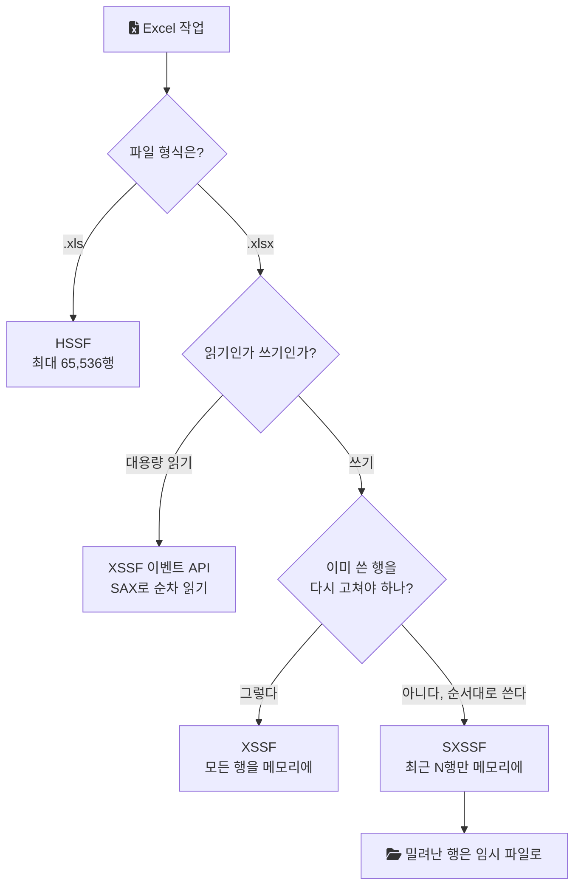
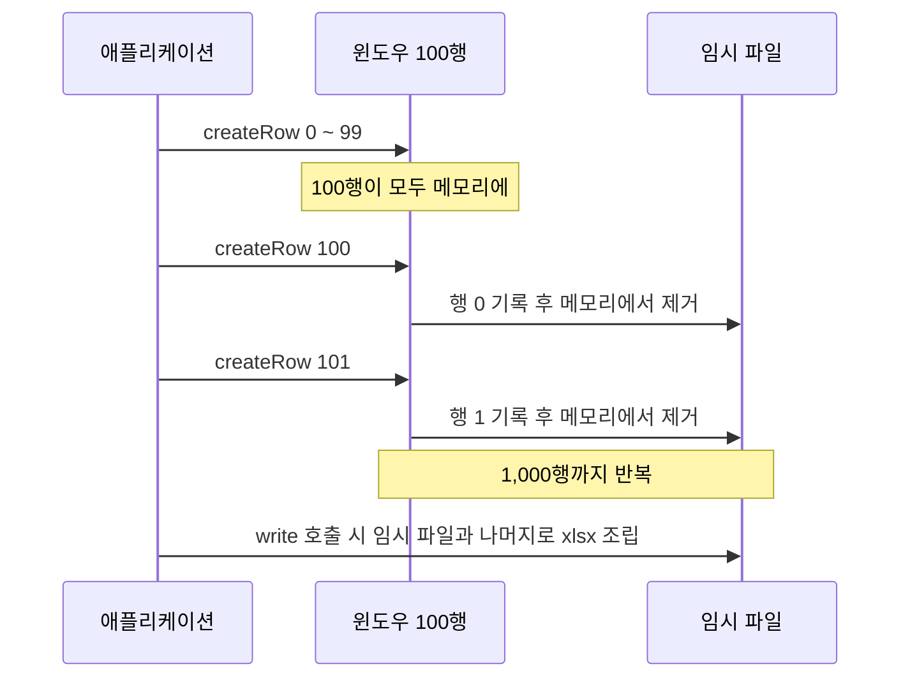

Java로 Excel 파일을 만들거나 읽을 때 가장 먼저 만나는 라이브러리가 Apache POI다. 그런데 POI 안에는 Excel을 다루는 구현이 여러 개 있다. `HSSFWorkbook`, `XSSFWorkbook`, `SXSSFWorkbook`은 같은 `Workbook` 인터페이스를 구현하지만 다루는 파일 형식과 메모리 사용 방식이 다르다. 수천 행짜리 파일에서는 차이가 보이지 않다가 수십만 행에서 갑자기 OOM(OutOfMemoryError, 힙에 새 객체를 둘 공간이 없을 때 나는 오류)이 나는 이유가 이 차이에 있다. 이 글은 세 구현을 파일 형식, 메모리 모델, 제약의 순서로 정리한다.

## Apache POI가 다루는 것

POI 프로젝트는 스스로의 목표를 OOXML(Office Open XML) 표준과 Microsoft의 OLE2 복합 문서 형식에 기반한 파일 형식을 다루는 Java API를 만드는 것이라고 적는다([Apache POI](https://poi.apache.org/)). Excel로 좁히면 두 형식이 있다.

- `.xls`: Excel 97부터 2007 이전까지 쓰던 바이너리 형식(OLE2 기반)
- `.xlsx`: Excel 2007부터 쓰는 XML 기반 형식(OOXML). 실제로는 여러 XML 파일을 묶은 zip이다.

POI의 Excel 구현과 의존성은 다음처럼 나뉜다([Apache POI: Component Overview](https://poi.apache.org/components/)).

| 구현 | 파일 형식 | Maven artifactId |
| --- | --- | --- |
| HSSF | `.xls` | `poi` |
| XSSF | `.xlsx` | `poi-ooxml` |
| Common SS (`org.apache.poi.ss.usermodel`) | `.xls`, `.xlsx` 공통 인터페이스 | `poi-ooxml` |

SXSSF는 이 표에 따로 나오지 않는다. XSSF의 하위 패키지(`org.apache.poi.xssf.streaming`)에 있으므로 XSSF와 같은 `poi-ooxml`로 쓴다. Common SS 행에는 `WorkbookFactory` 같은 공통 진입점이 core `poi`만으로는 안 되고 `poi-ooxml`을 요구한다는 주석이 붙어 있다.

`Workbook`, `Sheet`, `Row`, `Cell` 같은 공통 인터페이스로 코드를 쓰면 구현만 바꿔 끼울 수 있다. 세 구현 중 무엇을 고를지는 아래 흐름으로 정리된다.



## HSSF와 XSSF: usermodel의 두 구현

POI 문서는 HSSF를 "Excel '97(-2007) file format"의 순수 Java 구현으로, XSSF를 "Excel 2007 OOXML (.xlsx) file format"의 순수 Java 구현으로 정의한다([Apache POI: Spreadsheet](https://poi.apache.org/components/spreadsheet/)).

둘 다 두 층의 API를 제공한다.

- usermodel: 워크북 전체를 객체 트리로 메모리에 올려 읽고, 고치고, 새로 만든다. 다루기 쉽다.
- eventusermodel: 파일을 처음부터 끝까지 흘려 읽으면서 레코드나 XML 이벤트를 콜백으로 받는다. 읽기 전용이고 코드가 복잡하지만 메모리를 적게 쓴다.

같은 문서는 두 가지 메모리 비교를 명시한다. usermodel은 eventusermodel보다 메모리를 더 쓰지만 훨씬 다루기 쉽다. 그리고 XSSF가 다루는 `.xlsx`는 XML 기반이어서 처리에 드는 메모리가 HSSF가 다루는 바이너리 `.xls`보다 크다.

그래서 읽기 작업은 규모에 따라 나뉜다. 크지 않은 파일은 usermodel로 읽으면 되고, 큰 `.xlsx`를 읽기만 할 때는 이벤트 방식(`org.apache.poi.xssf.eventusermodel`)으로 행을 순서대로 받는 편이 메모리를 아낀다.

### HSSF의 행 한계

HSSF가 다루는 `.xls`는 형식 자체에 상한이 있다. POI의 `SpreadsheetVersion`은 Excel 97 형식의 행 수를 64K(2^16), 열 수를 256(2^8)으로, Excel 2007 형식의 행 수를 1M(2^20), 열 수를 16K(2^14)로 정의한다([SpreadsheetVersion Javadoc](https://poi.apache.org/apidocs/dev/org/apache/poi/ss/SpreadsheetVersion.html)).

| 형식 | 최대 행 | 최대 열 | 행 인덱스 범위 |
| --- | --- | --- | --- |
| `.xls` (HSSF) | 65,536 | 256 | 0 ~ 65,535 |
| `.xlsx` (XSSF, SXSSF) | 1,048,576 | 16,384 | 0 ~ 1,048,575 |

인덱스가 0부터 시작하므로 `.xls`에는 65,536행까지 들어간다. 65,537번째 행(인덱스 65536)을 만들려고 하면 예외가 난다.

```text
java.lang.IllegalArgumentException: Invalid row number (65536) outside allowable range (0..65535)
	at org.apache.poi.hssf.usermodel.HSSFRow.setRowNum(HSSFRow.java:246)
	at org.apache.poi.hssf.usermodel.HSSFSheet.createRow(HSSFSheet.java:263)
```

데이터가 6만 행을 넘을 수 있는 다운로드라면 형식부터 `.xlsx`여야 한다. 그러면 남는 선택지는 XSSF와 SXSSF다.

## XSSF가 큰 파일에서 무너지는 이유

`XSSFWorkbook`은 usermodel이다. 시트의 모든 행과 셀이 객체로 힙에 있다. 어느 행이든 `getRow()`로 다시 꺼내 고칠 수 있다는 장점이 이 구조에서 나온다.

비용도 같은 구조에서 나온다. 행 수와 열 수에 비례해 객체 수가 늘고, `write()`가 끝날 때까지 하나도 해제되지 않는다. 여기에 원본 데이터를 담은 리스트까지 메모리에 있으면 같은 데이터가 두 번 올라가 있는 셈이다. 수천 행에서는 보이지 않던 비용이 수십만 행에서 OOM으로 나타난다.

## SXSSF: 슬라이딩 윈도우로 쓰는 XSSF

SXSSF(`org.apache.poi.xssf.streaming`)는 POI 3.8-beta3부터 제공된다. POI 문서는 이를 다음처럼 소개한다([Apache POI: Spreadsheet](https://poi.apache.org/components/spreadsheet/)).

> "SXSSF is an API-compatible streaming extension of XSSF to be used when very large spreadsheets have to be produced, and heap space is limited."

XSSF와 API가 호환되는 스트리밍 확장이고, 매우 큰 스프레드시트를 만들어야 하는데 힙이 제한적일 때 쓰라는 뜻이다.

### 윈도우가 움직이는 방식

SXSSF는 메모리에 둘 행 수, 즉 윈도우 크기를 정한다. `new SXSSFWorkbook(int windowSize)`로 워크북 전체에, `SXSSFSheet#setRandomAccessWindowSize(int)`로 시트별로 지정할 수 있다. 기본값은 100행이다([Apache POI: SXSSF](https://poi.apache.org/components/spreadsheet/how-to.html#sxssf)).

`createRow()`로 새 행을 만들 때 아직 내보내지 않은 행 수가 윈도우 크기를 넘으면, 인덱스가 가장 낮은 행이 임시 파일로 기록되고 메모리에서 빠진다. 그 행은 더 이상 `getRow()`로 꺼낼 수 없다. Javadoc은 윈도우 크기를 "`SXSSFSheet.getRow(int)`로 접근할 수 있는 최대 행 수"로 설명한다([SXSSFWorkbook Javadoc](https://poi.apache.org/apidocs/dev/org/apache/poi/xssf/streaming/SXSSFWorkbook.html)).

윈도우 크기가 100일 때 1,000행을 쓰는 과정을 그리면 다음과 같다.



공식 예제를 줄이면 이렇다. 1,000행을 쓰고 나면 0~899행은 이미 디스크로 나갔고 마지막 100행만 메모리에 남는다.

```java
SXSSFWorkbook wb = new SXSSFWorkbook(100);   // 메모리에 100행만 유지
Sheet sh = wb.createSheet();
for (int rownum = 0; rownum < 1000; rownum++) {
    Row row = sh.createRow(rownum);
    for (int cellnum = 0; cellnum < 10; cellnum++) {
        row.createCell(cellnum).setCellValue(rownum + ":" + cellnum);
    }
}
// sh.getRow(0) ~ sh.getRow(899)는 null, sh.getRow(900) ~ sh.getRow(999)는 접근 가능
try (FileOutputStream out = new FileOutputStream("sxssf.xlsx")) {
    wb.write(out);
}
wb.dispose();   // 임시 파일 삭제
```

### 자동 flush를 끄고 직접 내보내기

윈도우 크기를 `-1`로 주면 접근 제한이 사라지고 자동으로 내보내지 않는다. 대신 `flushRows(int keepRows)`를 직접 호출해 최근 `keepRows`행만 남기고 나머지를 내보낸다. `flushRows()`는 `flushRows(0)`과 같아서 모든 행을 내보낸다. 윈도우 크기 `0`은 셀을 채우기 전에 행이 내보내지므로 허용되지 않는다([SXSSFWorkbook Javadoc](https://poi.apache.org/apidocs/dev/org/apache/poi/xssf/streaming/SXSSFWorkbook.html)).

```java
SXSSFWorkbook wb = new SXSSFWorkbook(-1);   // 자동 flush 끔
SXSSFSheet sh = wb.createSheet();
for (int rownum = 0; rownum < 1000; rownum++) {
    Row row = sh.createRow(rownum);
    row.createCell(0).setCellValue(rownum);
    if (rownum % 100 == 0) {
        sh.flushRows(100);   // 최근 100행만 남기고 나머지를 디스크로
    }
}
```

몇 행 단위로 묶어서 처리한 뒤 한 번에 내보내고 싶을 때, 예를 들어 묶음 안에서는 행을 오가며 값을 고쳐야 할 때 이 방식이 쓸모 있다.

## SXSSF를 쓸 때 지켜야 할 것

### 임시 파일은 직접 지운다

POI 문서는 SXSSF가 임시 파일을 만들고, 이 파일은 항상 `dispose()`를 호출해 명시적으로 지워야 한다고 적는다. Javadoc에 따르면 `dispose()`는 워크북을 받치는 임시 파일을 삭제하고, 그 뒤로는 워크북을 쓸 수 없다. `close()`는 내부 XSSF 워크북과 패키지 자원을 닫는 별도 메서드다. 그래서 `write()`가 예외로 끝나도 임시 파일이 남지 않도록 `finally`에서 `dispose()`를 부르는 편이 안전하다.

임시 파일은 생각보다 크다. 문서는 20MB짜리 CSV 데이터의 임시 XML이 1GB를 넘을 수 있다고 예를 든다. 디스크 사용량이 문제라면 `setCompressTempFiles(true)`로 임시 XML을 gzip으로 압축할 수 있다. Javadoc은 이 설정이 성능 저하를 부를 수 있고, 호출 이후에 만드는 시트에만 적용된다고 적는다.

```java
SXSSFWorkbook wb = new SXSSFWorkbook();
wb.setCompressTempFiles(true);   // 이후 만드는 시트의 임시 XML을 gzip으로
```

### 메모리에 남는 것들이 있다

SXSSF가 줄이는 것은 행과 셀이다. 문서는 병합 영역, 하이퍼링크, 주석 같은 기능은 여전히 메모리에만 저장되므로 많이 쓰면 메모리를 많이 요구할 수 있다고 적는다.

문자열도 따져 볼 지점이다. SXSSF는 기본적으로 공유 문자열 테이블 대신 인라인 문자열을 쓴다. 문서 내용을 메모리에 둘 필요가 없어 효율적이지만, 일부 클라이언트와 호환되지 않는 문서를 만든다고 알려져 있다. 공유 문자열을 켜면 문서의 모든 고유 문자열을 메모리에 둬야 한다. 호환성 요구와 메모리 예산을 같이 보고 정해야 한다.

스타일과 폰트는 SXSSF에 한정된 이야기는 아니지만 대량 쓰기에서 자주 문제가 된다. POI의 Quick Guide는 워크북의 고유 폰트 수가 32,767개로 제한되므로 셀마다 폰트를 만들지 말고 재사용하라고 적는다([Busy Developers' Guide](https://poi.apache.org/components/spreadsheet/quick-guide.html)). `CellStyle`과 `Font`는 루프 밖에서 한 번 만들어 재사용한다.

### 할 수 없는 것

POI 문서가 꼽는 SXSSF의 제약은 세 가지다.

- 특정 시점에 접근할 수 있는 행 수가 제한된다.
- `Sheet.clone()`을 지원하지 않는다.
- 수식 평가를 지원하지 않는다.

첫 번째 제약은 쓰기 패턴을 바꾼다. 마지막에 합계를 위쪽 행에 넣거나, 뒤쪽 데이터를 보고 앞쪽 서식을 바꾸거나, 모든 행을 보고 열 너비를 자동으로 맞추는 작업은 이미 디스크로 나간 행을 건드려야 한다. 이런 양식은 쓰면서 값을 누적하거나, 필요한 값을 미리 계산해 두고 한 번에 순서대로 써야 한다.

## 어느 것을 고를까

| 상황 | 선택 |
| --- | --- |
| `.xls`를 읽거나 써야 한다 | HSSF (65,536행 한계 확인) |
| `.xlsx`를 만들고, 이미 쓴 행을 자유롭게 고쳐야 하며, 행 수가 크지 않다 | XSSF |
| `.xlsx`를 대량으로 만들고, 행을 위에서 아래로 한 번씩만 쓴다 | SXSSF |
| 큰 `.xlsx`를 읽기만 한다 | XSSF 이벤트 API |

SXSSF로 바꿔도 원본 데이터를 리스트 하나로 다 받아 두면 메모리 문제는 절반만 풀린다. 조회도 id 같은 정렬 키를 기준으로 일정 건수씩 끊어 읽고, 읽은 묶음을 바로 행으로 흘려보내야 입력과 출력이 모두 일정한 크기로 묶인다.

## 참고

- [Apache POI](https://poi.apache.org/) — Apache POI
- [Apache POI: Component Overview](https://poi.apache.org/components/) — Apache POI
- [XSSF, SXSSF)](https://poi.apache.org/components/spreadsheet/) — Apache POI: Spreadsheet (HSSF
- [Apache POI: SXSSF (Streaming Usermodel API)](https://poi.apache.org/components/spreadsheet/how-to.html#sxssf) — Apache POI
- [Apache POI: Busy Developers' Guide to HSSF and XSSF Features](https://poi.apache.org/components/spreadsheet/quick-guide.html) — Apache POI
- [Apache POI Javadoc: SXSSFWorkbook](https://poi.apache.org/apidocs/dev/org/apache/poi/xssf/streaming/SXSSFWorkbook.html) — Apache POI
- [Apache POI Javadoc: SpreadsheetVersion](https://poi.apache.org/apidocs/dev/org/apache/poi/ss/SpreadsheetVersion.html) — Apache POI
