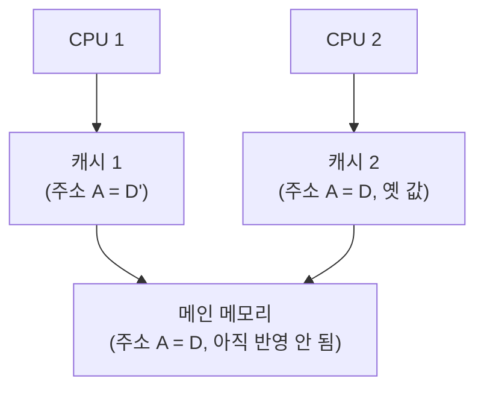
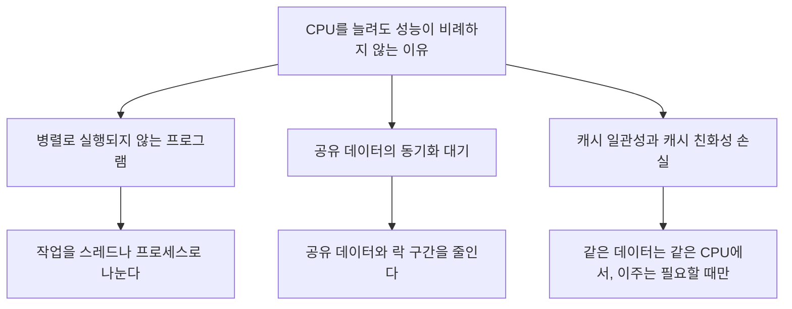

요즘은 노트북에도 CPU 코어가 여러 개 들어 있다. CPU가 여러 개인 시스템을 멀티프로세서(multiprocessor) 시스템이라고 하고, 한 칩에 코어를 여러 개 넣은 것을 멀티코어 프로세서라고 한다. 코어가 늘었으니 성능도 그만큼 늘 것 같지만 실제로는 그렇지 않다. 이 글은 CPU를 여러 개 두었을 때 어떤 문제가 새로 생기고, 운영체제와 프로그램이 성능을 끌어내기 위해 무엇을 하는지를 정리한다.

## 왜 멀티프로세서가 되었나

OSTEP는 멀티코어가 널리 퍼진 이유를, CPU 하나를 전력 소모를 크게 늘리지 않고 더 빠르게 만들기 어려워졌기 때문이라고 설명한다([OSTEP, Multiprocessor Scheduling](https://pages.cs.wisc.edu/~remzi/OSTEP/cpu-sched-multi.pdf)). 코어 하나의 속도를 올리는 대신 코어 수를 늘리는 방향으로 간 것이다.

그런데 같은 글은 바로 문제를 짚는다. 일반적인 애플리케이션은 CPU 하나만 쓰기 때문에, CPU를 더 꽂아도 그 애플리케이션은 빨라지지 않는다. 여러 CPU의 이득을 보려면 프로그램을 스레드 등으로 병렬 실행되게 다시 짜야 한다. 멀티프로세서의 성능 향상은 하드웨어만으로 오지 않고, 운영체제의 스케줄링과 프로그램의 병렬 구조가 함께 맞아야 나온다.

## 캐시가 만드는 문제

멀티프로세서에서 새로 생기는 문제의 대부분은 캐시에서 나온다. CPU는 느린 메인 메모리 대신 자주 쓰는 데이터를 작고 빠른 캐시에 복사해 두고 쓴다. CPU가 하나일 때는 문제가 없지만, CPU마다 자기 캐시를 가지면 같은 데이터의 복사본이 여러 곳에 생긴다.

OSTEP의 예는 이렇다. CPU 1에서 돌던 프로그램이 주소 A의 값 D를 D'로 바꾸면, 메인 메모리에 쓰는 것은 느리므로 일단 캐시 1에만 반영한다. 그 상태에서 운영체제가 프로그램을 CPU 2로 옮기면, CPU 2는 자기 캐시에 A가 없으니 메모리에서 읽어 옛 값 D를 보게 된다. 이것이 캐시 일관성(cache coherence) 문제다.

이 문제는 하드웨어가 푼다. 버스 기반 시스템에서는 각 캐시가 메모리로 가는 버스를 지켜보다가(bus snooping), 자기가 가진 데이터가 다른 곳에서 바뀌면 자기 복사본을 무효화하거나 갱신한다. 덕분에 프로그램은 올바르게 동작하지만, 여러 CPU가 같은 데이터를 번갈아 고치면 무효화와 재적재가 반복되면서 느려진다.

## 동기화의 비용

캐시 일관성이 보장되어도 공유 데이터를 고치는 코드에는 여전히 락 같은 상호 배제가 필요하다. OSTEP는 공유 연결 리스트에서 머리 노드를 꺼내는 코드를 예로 든다. 두 CPU의 스레드가 동시에 같은 머리 노드를 읽으면, 둘 다 같은 노드를 꺼내고 같은 메모리를 두 번 해제하려 한다. 락을 걸면 정확해진다.

문제는 성능이다. OSTEP는 CPU 수가 늘어날수록 동기화된 공유 자료구조에 대한 접근이 상당히 느려진다고 설명한다. 락으로 보호되는 구간은 한 번에 한 CPU만 실행할 수 있으므로, 이 구간이 길수록 CPU를 늘려도 나머지 CPU는 락을 기다리기만 한다. 공유 데이터를 줄이고, 락으로 보호하는 구간을 짧게 만드는 것이 멀티프로세서에서 성능을 올리는 프로그램 쪽의 기본 원칙이다.

## 캐시 친화성

프로세스가 한 CPU에서 실행되면 그 CPU의 캐시(그리고 주소 변환 캐시인 TLB)에 자기 데이터가 쌓인다. 다음에도 같은 CPU에서 실행되면 이미 캐시에 있는 데이터를 바로 쓸 수 있어 빠르다. 매번 다른 CPU로 옮겨 다니면 올바르게는 동작하지만 실행할 때마다 캐시를 다시 채워야 해서 느리다. 이를 캐시 친화성(cache affinity)이라고 하고, 멀티프로세서 스케줄러는 가능하면 프로세스를 같은 CPU에 머물게 하려고 한다.

리눅스에서는 프로그램이 직접 특정 CPU에 묶일 수도 있다. `sched_setaffinity()`로 스레드가 실행될 수 있는 CPU 집합을 지정한다([sched_setaffinity(2)](https://man7.org/linux/man-pages/man2/sched_setaffinity.2.html)).

## 스케줄러의 두 가지 구조

운영체제가 여러 CPU에 작업을 나눠 주는 방식은 크게 두 가지다.

| 구조 | 방식 | 장점 | 단점 |
| --- | --- | --- | --- |
| SQMS (single-queue) | 모든 작업을 큐 하나에 넣고 CPU들이 꺼내 감 | 구현이 단순하고 부하가 고르게 분산됨 | 큐에 대한 락 경합, 작업이 CPU를 옮겨 다녀 캐시 친화성이 깨짐 |
| MQMS (multi-queue) | CPU마다 큐를 따로 두고 작업을 한 큐에 배정 | CPU가 늘어도 경합이 적고 캐시 친화성이 자연스럽게 유지됨 | 큐마다 작업 수가 달라지는 부하 불균형 |

MQMS의 부하 불균형은, 예를 들어 CPU 0의 큐는 비어 있는데 CPU 1의 큐에는 작업이 셋 쌓여 있는 상황이다. CPU 0은 놀고 CPU 1의 작업들은 CPU를 나눠 쓰느라 느려진다. 해결책은 작업을 큐 사이에서 옮기는 이주(migration)다.

언제 옮길지를 정하는 대표적인 방법이 작업 훔치기(work stealing)다. 작업이 적은 큐가 가끔 다른 큐를 들여다보고, 상대가 눈에 띄게 많으면 작업을 하나 이상 가져온다. OSTEP는 여기에도 긴장이 있다고 짚는다. 다른 큐를 너무 자주 보면 그 비용 때문에 확장성이 떨어지고(애초에 큐를 나눈 이유가 사라지고), 너무 드물게 보면 심한 불균형을 방치하게 된다.

리눅스는 한 가지 답으로 수렴하지 않았다. OSTEP에 따르면 O(1) 스케줄러와 CFS(Completely Fair Scheduler)는 다중 큐를, BFS는 단일 큐를 썼다. 두 구조 모두 실제로 성공할 수 있다는 뜻이다.

## 성능을 끌어내기 위한 정리

멀티프로세서에서 성능을 올리는 일은 결국 세 가지 비용을 줄이는 일이다.

프로그램은 일을 나눌 수 있게 짜고 공유를 줄여야 하며, 운영체제는 부하를 고르게 나누면서도 작업을 불필요하게 옮기지 않아야 한다. 두 요구는 서로 당기기 때문에, OSTEP의 결론처럼 범용 스케줄러에 단순한 정답은 없다. 스레드 단위의 스케줄링은 [MultiThreading and Thread Scheduling](/posts/multithreading-and-thread-scheduling/)에서 이어서 다룬다.

## 참고

- [OSTEP, Chapter 10: Multiprocessor Scheduling (Advanced)](https://pages.cs.wisc.edu/~remzi/OSTEP/cpu-sched-multi.pdf)
- [sched_setaffinity(2)](https://man7.org/linux/man-pages/man2/sched_setaffinity.2.html)
