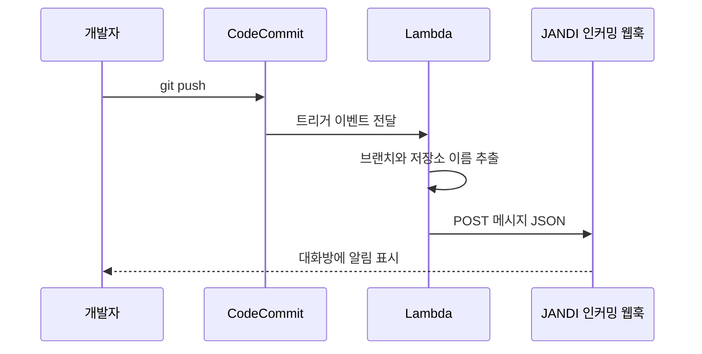

# JANDI

JANDI(잔디)는 팀 메신저다. 저장소에 누가 푸시했는지를 팀 대화방에서 바로 보고 싶다면, 저장소 이벤트를 메신저 메시지로 바꿔 주는 연결 고리가 필요하다. GitHub처럼 JANDI가 직접 연동을 제공하는 서비스도 있지만, [AWS CodeCommit](/posts/code-commit/)은 그런 전용 연동이 아니라 웹훅을 거쳐 연결해야 한다.

---

## JANDI에 AWS Code Commit 연동

- http://blog.jandi.com/ko/2016/03/02/jandi-connect-webhook/
- https://zapier.com/app/dashboard?redirect=true

첫 번째 링크는 JANDI 커넥트의 웹훅 기능을 소개하는 JANDI 블로그 글이고, 두 번째는 Zapier 대시보드다. Zapier는 여러 서비스를 이어 주는 자동화 서비스로, 중간 연결 고리를 외부 서비스에 맡기는 선택지다. 아래에서는 AWS 안에서 Lambda로 직접 연결하는 방법을 정리한다.

---

## 웹훅이란

웹훅은 어떤 이벤트가 생겼을 때 미리 등록해 둔 URL로 HTTP 요청을 보내는 방식이다. 받는 쪽이 주기적으로 "새 소식이 있는가" 묻는 폴링과 반대로, 보내는 쪽이 이벤트 시점에 알려 준다.

JANDI 커넥트에는 방향이 다른 두 종류가 있다.

- 인커밍 웹훅(Incoming Webhook): 외부 서비스가 JANDI로 메시지를 보낸다. JANDI 블로그는 이를 특정 형식에 맞는 데이터를 받아 지정된 대화방에 메시지로 전달하는 기능으로 설명한다.
- 아웃고잉 웹훅(Outgoing Webhook): JANDI 대화방의 메시지를 외부 서비스로 보낸다.

푸시 알림을 대화방에 띄우는 일은 외부에서 JANDI로 들어오는 방향이므로 인커밍 웹훅을 쓴다.

---

## 인커밍 웹훅의 요청 형식

JANDI 고객센터 문서에 따르면 인커밍 웹훅은 대화방마다 발급되는 URL로 `POST` 요청을 보내야 하고, 두 헤더가 필요하다([잔디 커넥트 인커밍 웹훅](https://support.jandi.com/ko/articles/connect-incoming-webhook-21bc249f)).

```bash
curl \
  -X POST https://wh.jandi.com/connect-api/webhook/[YOUR-WEBHOOK-ADDRESS] \
  -H "Accept: application/vnd.tosslab.jandi-v2+json" \
  -H "Content-Type: application/json" \
  --data-binary '{"body":"[MyDemoRepo] refs/heads/main 에 새 커밋이 푸시되었습니다.","connectColor":"#FAC11B","connectInfo":[{"title":"Repository","description":"MyDemoRepo"}]}'
```

본문 필드의 의미는 다음과 같다.

- `body`: 메시지 본문
- `connectColor`: 메시지 옆 강조 영역의 색상(16진수 색상 코드)
- `connectInfo`: `title`, `description`, 선택 항목인 `imageUrl`로 이루어진 정보 블록 배열

같은 문서는 메시지 길이 5,000자, 요청 크기 256KB라는 제한도 적어 둔다. 커밋 메시지 전체를 그대로 붙이면 이 제한에 걸릴 수 있다.

---

## CodeCommit 트리거에서 JANDI까지

CodeCommit은 저장소 이벤트가 생기면 Amazon SNS로 알리거나 AWS Lambda 함수를 호출하는 트리거를 지원한다. SNS는 이메일 알림처럼 단순한 경우에 쓰고, 외부 시스템과 상호작용하려면 Lambda 함수를 작성해야 한다고 문서가 안내한다([Manage triggers](https://docs.aws.amazon.com/codecommit/latest/userguide/how-to-notify.html)). JANDI 웹훅 형식에 맞춰 요청을 만들어야 하므로 Lambda를 중간에 둔다.



트리거를 만드는 가장 쉬운 방법은 Lambda 콘솔에서 함수를 만든 뒤 Add trigger로 CodeCommit을 고르는 것이다. 이렇게 만들면 CodeCommit이 함수를 호출하는 데 필요한 권한이 자동으로 들어간다. 트리거 설정에서는 이벤트 종류(모든 이벤트, 브랜치나 태그 생성 등)와 대상 브랜치를 고를 수 있다. Lambda 함수는 저장소와 같은 리전에 있어야 한다.

---

## Lambda 함수 예시

AWS 문서의 예제 함수는 트리거 이벤트에서 `Records[0].codecommit.references`의 `ref` 값과 `eventSourceARN`을 읽는다([Example: trigger for a Lambda function](https://docs.aws.amazon.com/codecommit/latest/userguide/how-to-notify-lambda.html)). 같은 값을 JANDI 메시지로 바꾸면 다음과 같다. 웹훅 URL은 코드에 적지 않고 환경 변수로 넣는다.

```python
import json
import os
import urllib.request

WEBHOOK_URL = os.environ["JANDI_WEBHOOK_URL"]


def lambda_handler(event, context):
    record = event["Records"][0]
    # ARN의 여섯 번째 요소가 저장소 이름이다 (AWS 예제와 같은 방식)
    repository = record["eventSourceARN"].split(":")[5]
    refs = [r["ref"] for r in record["codecommit"]["references"]]

    payload = {
        "body": f"[{repository}] 푸시 이벤트가 발생했습니다.",
        "connectColor": "#FAC11B",
        "connectInfo": [{"title": "References", "description": ", ".join(refs)}],
    }
    request = urllib.request.Request(
        WEBHOOK_URL,
        data=json.dumps(payload).encode("utf-8"),
        headers={
            "Accept": "application/vnd.tosslab.jandi-v2+json",
            "Content-Type": "application/json",
        },
        method="POST",
    )
    with urllib.request.urlopen(request, timeout=5) as response:
        return response.status
```

표준 라이브러리 `urllib`만 쓰므로 별도 패키지를 올리지 않아도 된다. 외부 호출에는 타임아웃을 지정해 JANDI가 느릴 때 함수가 실행 제한 시간까지 붙잡혀 있지 않게 한다.

---

## 확인과 운영

- CodeCommit 콘솔의 저장소 Settings, Triggers 메뉴에서 Test trigger를 누르면 샘플 데이터로 함수가 호출된다. 커밋 기록이 없는 저장소라면 0으로 채운 샘플 값이 들어간다.
- 실제 푸시 후에는 Lambda의 Monitoring 탭에서 CloudWatch 로그를 열어 호출 결과를 확인한다.
- 웹훅 URL을 아는 사람은 누구나 그 대화방에 메시지를 보낼 수 있다. URL은 비밀 값처럼 다루고 저장소나 로그에 남기지 않는다.

## 참고

- [잔디 커넥트 웹훅 소개](http://blog.jandi.com/ko/2016/03/02/jandi-connect-webhook/) — JANDI 블로그
- [잔디 커넥트 인커밍 웹훅](https://support.jandi.com/ko/articles/connect-incoming-webhook-21bc249f) — JANDI 고객센터
- [Manage triggers for an AWS CodeCommit repository](https://docs.aws.amazon.com/codecommit/latest/userguide/how-to-notify.html) — AWS CodeCommit User Guide
- [Example: Create an AWS CodeCommit trigger for an AWS Lambda function](https://docs.aws.amazon.com/codecommit/latest/userguide/how-to-notify-lambda.html) — AWS CodeCommit User Guide
