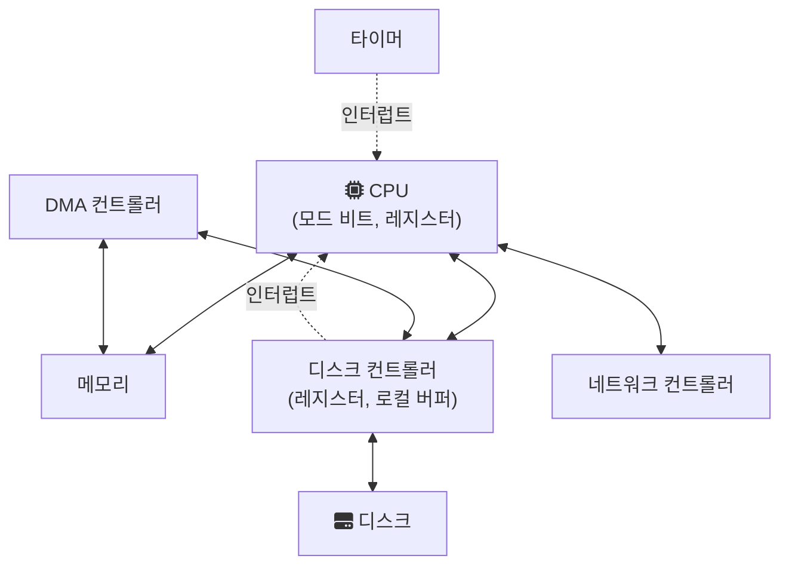
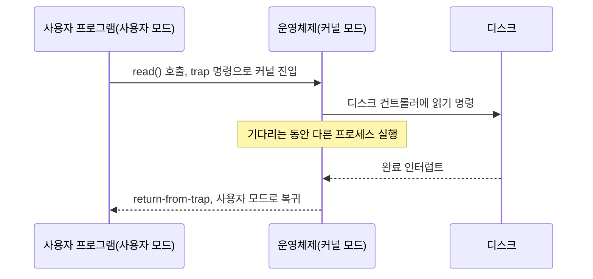

[Introduction to Operating System](/posts/Introduction-to-operating-system/)에서 운영체제가 편의성, 효율적인 자원 관리, 보호를 위해 존재한다고 정리했다. 이 글은 그 일이 하드웨어 위에서 실제로 어떻게 이뤄지는지를 다룬다. 앞부분은 컴퓨터 시스템의 구조(CPU, 메모리, I/O 장치가 어떻게 연결되고 신호를 주고받는가), 뒷부분은 프로그램이 디스크에서 메모리로 올라와 실행되기까지의 과정이다.

---

## 컴퓨터 시스템의 구조



CPU는 메모리에서 명령을 하나씩 읽어 실행한다. 디스크, 키보드, 네트워크 카드 같은 I/O 장치는 각자 장치 컨트롤러를 가지고 있다. 컨트롤러는 작은 전용 프로세서와 레지스터, 데이터를 잠시 담아 두는 로컬 버퍼를 가지고 장치를 직접 제어한다.

OSTEP는 장치가 바깥에 보여 주는 인터페이스를 상태(status), 명령(command), 데이터(data) 레지스터 세 가지로 단순화해서 설명한다([OSTEP, I/O Devices](https://pages.cs.wisc.edu/~remzi/OSTEP/file-devices.pdf)). 운영체제는 상태 레지스터로 장치가 바쁜지 확인하고, 데이터 레지스터에 데이터를 쓰고, 명령 레지스터에 명령을 써서 작업을 시작시킨다.

---

## 장치가 끝났다는 것을 어떻게 아는가: 폴링과 인터럽트

장치에 명령을 보낸 뒤 작업이 끝났는지 확인하는 방법은 두 가지다.

- 폴링(polling): CPU가 상태 레지스터를 반복해서 읽으며 끝났는지 확인한다. 구현은 단순하지만, 느린 장치를 기다리는 동안 CPU가 다른 일을 하지 못한다.
- 인터럽트(interrupt): CPU는 다른 일을 하다가, 장치가 작업을 마치면 하드웨어 인터럽트를 건다. CPU는 하던 일을 멈추고 미리 정해진 인터럽트 처리 루틴(interrupt handler)으로 넘어간다.

OSTEP는 인터럽트가 계산과 I/O를 겹쳐서 실행할 수 있게 해 준다고 설명한다. 한 프로세스가 디스크를 기다리는 동안 운영체제는 다른 프로세스를 CPU에서 돌리고, 디스크 요청이 끝나면 인터럽트로 알게 된다. 다만 인터럽트가 항상 나은 것은 아니다. 장치가 아주 빨라서 첫 확인에서 바로 끝나 있는 경우라면, 인터럽트를 처리하고 프로세스를 바꾸는 비용이 오히려 크다. 그래서 OSTEP는 빠른 장치에는 폴링이, 느린 장치에는 인터럽트가 낫다고 정리한다.

인터럽트는 장치만 거는 것이 아니다. 타이머도 일정 시간마다 인터럽트를 건다. 이 덕분에 운영체제는 사용자 프로그램이 CPU를 계속 붙잡고 있어도 주기적으로 제어권을 되찾을 수 있다([OSTEP, Limited Direct Execution](https://pages.cs.wisc.edu/~remzi/OSTEP/cpu-mechanisms.pdf)). 소프트웨어가 의도적으로 거는 인터럽트도 있는데, 이를 trap이라고 부르며 아래의 시스템 콜에 쓰인다.

---

## DMA: 데이터 복사도 CPU에게 맡기지 않기

인터럽트를 써도 남는 비용이 있다. 장치의 로컬 버퍼와 메모리 사이에서 데이터를 옮기는 일을 CPU가 한 바이트씩 직접 하면(programmed I/O), 큰 데이터를 옮기는 동안 CPU가 묶인다.

DMA(Direct Memory Access)는 이 복사를 전담하는 장치다. OSTEP에 따르면 운영체제는 DMA 엔진에 데이터가 메모리 어디에 있는지, 얼마나 복사할지, 어느 장치로 보낼지만 알려 주고 다른 일로 넘어간다. 복사가 끝나면 DMA 컨트롤러가 인터럽트를 걸어 완료를 알린다. 인터럽트가 바이트 단위가 아니라 블록 단위로 한 번만 발생하므로 CPU의 부담이 크게 줄어든다.

---

## 장치에 명령하는 방법

운영체제가 장치 레지스터에 접근하는 방법도 두 가지다.

- I/O 전용 명령: x86의 `in`, `out`처럼 장치와 통신하는 별도의 명령을 쓴다. 이 명령들은 보통 특권 명령(privileged instruction)이라 운영체제만 실행할 수 있다.
- 메모리 맵 I/O(memory-mapped I/O): 장치 레지스터를 메모리 주소처럼 보이게 한다. 일반적인 load/store 명령으로 그 주소를 읽고 쓰면 하드웨어가 메모리 대신 장치로 보낸다.

OSTEP는 두 방식 모두 오늘날 쓰이고 있다고 설명한다. 어느 쪽이든 장치마다 다른 세부 사항은 장치 드라이버(device driver)가 감추고, 운영체제의 나머지 부분은 드라이버가 제공하는 공통 인터페이스로 장치를 다룬다.

---

## 모드 비트와 시스템 콜

I/O 명령이 특권 명령이라는 말은, 사용자 프로그램이 디스크를 직접 읽을 수 없다는 뜻이다. OSTEP는 만약 아무 프로그램이나 디스크를 읽고 쓸 수 있다면 그 허점을 이용해 기계 전체를 장악할 수 있다고 설명한다.

이 구분을 하드웨어가 강제하는 장치가 CPU의 모드 비트다. 사용자 모드(user mode)에서는 특권 명령을 실행할 수 없고, 커널 모드(kernel mode)에서는 하드웨어 전체에 접근할 수 있다. 사용자 프로그램이 파일을 읽으려면 다음 순서를 거친다.



trap 명령은 커널로 점프하는 동시에 권한 수준을 커널 모드로 올린다. 어느 코드로 점프할지는 운영체제가 부팅할 때 하드웨어에 등록해 둔 trap 테이블이 정한다. 사용자 프로그램이 커널의 아무 주소로나 뛰어들 수 없게 하기 위해서다. 작업이 끝나면 return-from-trap 명령이 사용자 모드로 되돌리면서 프로그램이 멈췄던 곳으로 제어를 돌려준다.

그림에서 프로그램은 읽기가 끝날 때까지 기다린 뒤 다음 줄로 넘어간다. 이것이 동기식(synchronous) I/O다. 반대로 I/O 요청만 해 두고 결과를 기다리지 않은 채 다음 작업을 이어 가다가 나중에 완료를 확인하는 방식을 비동기식(asynchronous) I/O라고 한다. 동기식 I/O에서도 운영체제는 그 프로세스가 기다리는 동안 다른 프로세스를 실행하므로, CPU 자체가 노는 것은 아니다.

---

## 프로그램이 실행되기까지

이제 프로그램 쪽에서 보자. 프로그램은 디스크에 실행 파일 형태로 저장된 코드와 데이터일 뿐이다. OSTEP는 프로세스를 "실행 중인 프로그램"으로 정의하고, 운영체제가 프로그램을 프로세스로 만드는 과정을 다음처럼 설명한다([OSTEP, The Abstraction: The Process](https://pages.cs.wisc.edu/~remzi/OSTEP/cpu-intro.pdf)).

1. 코드와 정적 데이터(초기화된 전역 변수 등)를 디스크에서 읽어 프로세스의 주소 공간에 올린다. 초기의 운영체제는 실행 전에 한꺼번에 올렸지만, 현대 운영체제는 실행 중에 필요한 부분만 그때그때 올린다(lazy loading).
2. 지역 변수, 함수 인자, 복귀 주소를 담을 스택을 할당하고, `main()`의 인자인 `argc`와 `argv`를 채운다.
3. 동적으로 할당할 데이터를 위한 힙을 마련한다. 처음에는 작게 시작하고 `malloc()` 요청에 따라 커진다.
4. 표준 입력, 표준 출력, 표준 에러에 해당하는 파일 디스크립터 세 개를 열어 둔다(UNIX 계열).
5. 진입점인 `main()`으로 점프해 CPU 제어권을 새 프로세스에 넘긴다.

그 결과 프로세스의 주소 공간은 대략 다음 모양이 된다. OSTEP는 코드는 고정된 크기라 한쪽 끝에 두고, 실행 중에 크기가 변하는 힙과 스택을 서로 반대쪽 끝에서 마주 보며 자라게 배치하는 예를 든다([OSTEP, The Abstraction: Address Spaces](https://pages.cs.wisc.edu/~remzi/OSTEP/vm-intro.pdf)).

```text
낮은 주소   +----------------------+
            | 코드(명령어)         |
            | 정적 데이터          |
            | 힙 (아래로 자람)     |
            |         ...          |
            | 스택 (위로 자람)     |
높은 주소   +----------------------+
```

이 주소는 물리 메모리 주소가 아니라 프로세스마다 따로 가진 가상 주소다. 두 프로세스가 같은 주소를 써도 서로 다른 물리 메모리를 가리키게 하는 것이 앞 글에서 말한 메모리 가상화이고, 이것이 프로세스 사이의 격리를 만든다.

---

## 정리

CPU와 장치 컨트롤러는 인터럽트로 신호를 주고받고, 큰 데이터는 DMA가 옮기며, I/O 명령은 특권 명령이라 사용자 프로그램은 시스템 콜을 통해서만 장치를 쓸 수 있다. 프로그램은 운영체제가 코드와 데이터를 올리고 스택과 힙을 마련해 준 뒤에야 프로세스로서 실행된다. 여러 프로세스가 이렇게 CPU를 나눠 쓰는 방식은 [MultiThreading and Thread Scheduling](/posts/multithreading-and-thread-scheduling/)으로 이어진다.

## 참고

- [OSTEP, Chapter 4: The Abstraction: The Process](https://pages.cs.wisc.edu/~remzi/OSTEP/cpu-intro.pdf) — pages.cs.wisc.edu
- [OSTEP, Chapter 6: Mechanism: Limited Direct Execution](https://pages.cs.wisc.edu/~remzi/OSTEP/cpu-mechanisms.pdf) — pages.cs.wisc.edu
- [OSTEP, Chapter 13: The Abstraction: Address Spaces](https://pages.cs.wisc.edu/~remzi/OSTEP/vm-intro.pdf) — pages.cs.wisc.edu
- [OSTEP, Chapter 36: I/O Devices](https://pages.cs.wisc.edu/~remzi/OSTEP/file-devices.pdf) — pages.cs.wisc.edu
