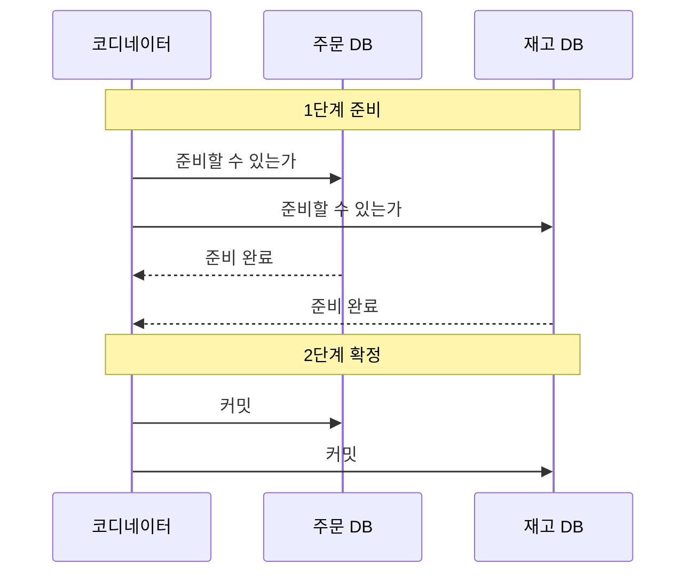
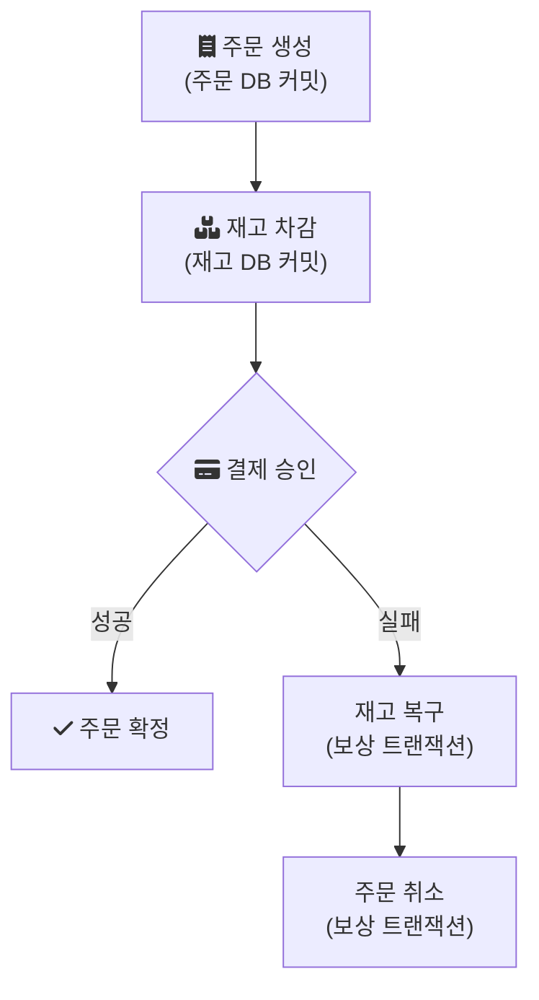

# Transaction

- https://velog.io/@ch200203/MSA-%ED%99%98%EA%B2%BD%EC%97%90%EC%84%9C%EC%9D%98-%EB%B6%84%EC%82%B0-%ED%8A%B8%EB%9E%9C%EC%9E%AD%EC%85%98-%EA%B4%80%EB%A6%AC2PC-SAGA-%ED%8C%A8%ED%84%B4

위 링크는 MSA 환경의 분산 트랜잭션을 2PC와 SAGA 패턴으로 나눠 설명한 글이다. 이 노트는 그 두 방식을 원 자료(PostgreSQL 문서, Saga 논문, microservices.io)로 다시 확인하며 정리한 것이다.

---

## 하나의 DB 안에서는 트랜잭션이 해결해 준다

트랜잭션은 여러 작업을 하나의 단위로 묶어, 모두 반영되거나 하나도 반영되지 않게 하는 장치다. 주문 저장과 재고 차감이 같은 DB에 있다면 `BEGIN`과 `COMMIT` 사이에 두 쿼리를 넣으면 된다. 중간에 실패하면 `ROLLBACK`으로 둘 다 되돌린다.

문제는 주문 서비스와 재고 서비스가 각자 자기 DB를 가질 때 생긴다. 서비스마다 DB를 따로 두는 구조(database per service)에서는 한 DB의 트랜잭션이 다른 DB의 변경을 함께 되돌릴 수 없다. 주문은 저장됐는데 재고 차감이 실패하면, 시스템은 그 사이의 어중간한 상태로 남는다.

이 문제를 다루는 대표적인 두 방법이 2PC와 Saga다.

---

## 2PC: 모두에게 준비됐는지 먼저 묻는다

2PC(Two-Phase Commit, 2단계 커밋)는 코디네이터라는 조정자가 참여자들에게 두 단계로 커밋을 진행하는 방식이다.

1단계에서 참여자는 커밋에 필요한 모든 것을 디스크에 기록하고 "준비 완료"를 답한다. 한 참여자라도 준비에 실패하면 코디네이터는 2단계에서 모두에게 롤백을 지시한다.

PostgreSQL의 `PREPARE TRANSACTION`이 이 1단계에 해당한다. 문서에 따르면 이 명령 이후 트랜잭션은 현재 세션에서 분리되고 상태가 디스크에 완전히 저장되어, DB가 중간에 죽더라도 이후 `COMMIT PREPARED`나 `ROLLBACK PREPARED`로 마무리할 수 있다([PostgreSQL: PREPARE TRANSACTION](https://www.postgresql.org/docs/current/sql-prepare-transaction.html)).

같은 문서에 2PC의 비용도 그대로 드러난다.

- 준비 상태의 트랜잭션은 가지고 있던 락을 계속 쥐고 있다. 코디네이터가 2단계 지시를 늦게 보내면 그동안 다른 트랜잭션이 기다린다.
- 준비 상태를 오래 두면 `VACUUM`이 공간을 회수하지 못하고, 극단적인 경우 트랜잭션 ID 고갈을 막기 위해 DB가 멈출 수도 있다.
- 문서는 이 명령이 애플리케이션용이 아니라 외부 트랜잭션 매니저용이며, 트랜잭션 매니저를 직접 만드는 경우가 아니라면 쓰지 않는 편이 좋다고 적는다.

정리하면 2PC는 원자성을 지키는 대신, 코디네이터와 모든 참여자가 응답할 때까지 자원을 묶어 둔다. 참여자 중 하나가 느리면 전체가 느려지고, 코디네이터가 멈추면 준비 상태의 참여자는 결정을 기다리며 락을 쥔 채 남는다. 링크한 글이 지적하듯 NoSQL 저장소처럼 2PC를 지원하지 않는 자원도 있다.

---

## Saga: 짧은 로컬 트랜잭션과 보상

Saga라는 개념은 1987년 Garcia-Molina와 Salem의 논문 "Sagas"에서 나왔다. 논문은 오래 걸리는 트랜잭션(LLT, long lived transaction)이 DB 자원을 오래 붙잡아 짧은 트랜잭션들을 지연시키는 문제를 다룬다. 해법은 LLT를 다른 트랜잭션과 끼어들어 실행될 수 있는 여러 트랜잭션의 연속으로 쓰고, 시스템이 그 연속 전체가 성공하거나 아니면 보상 트랜잭션(compensating transaction)이 실행되어 부분 실행을 수정하도록 보장하는 것이다([Sagas, SIGMOD 1987](https://www.cs.cornell.edu/andru/cs711/2002fa/reading/sagas.pdf)).

마이크로서비스에서 이 생각을 가져온 것이 Saga 패턴이다. microservices.io는 saga를 각 로컬 트랜잭션이 자기 DB를 갱신하고 다음 로컬 트랜잭션을 일으킬 메시지나 이벤트를 발행하는 연속으로 설명한다([Pattern: Saga](https://microservices.io/patterns/data/saga.html)).

각 단계는 자기 DB에서 바로 커밋하므로 다른 서비스의 락을 기다리지 않는다. 대신 실패하면 이미 커밋된 앞 단계를 되돌릴 방법이 롤백이 아니라 보상 트랜잭션이다. "재고 차감"의 보상은 "재고 복구"이고, "주문 생성"의 보상은 "주문 취소"다.

### 코레오그래피와 오케스트레이션

단계를 잇는 방법은 두 가지다.

- 코레오그래피(choreography): 각 서비스가 도메인 이벤트를 발행하고, 다른 서비스가 그 이벤트를 듣고 자기 단계를 실행한다. 중앙 조정자가 없다.
- 오케스트레이션(orchestration): 오케스트레이터가 참여자에게 어떤 로컬 트랜잭션을 실행할지 지시한다.

링크한 글은 코레오그래피가 단일 장애점은 없지만 흐름을 추적하고 디버깅하기 어렵고, 오케스트레이션은 흐름을 따라가기 쉽지만 오케스트레이터가 단일 장애점이 될 수 있다고 비교한다.

---

## Saga를 쓸 때 생기는 문제

microservices.io가 꼽는 단점은 두 가지다.

- 격리성 부족: Saga는 ACID의 I(Isolation)를 제공하지 않는다. 재고는 차감됐지만 결제는 아직인 중간 상태를 다른 요청이 볼 수 있다. 이 이상 현상은 설계로 막아야 한다. 예를 들어 주문 상태에 `PENDING`을 두고, 확정 전 주문은 다른 화면에서 다르게 다루는 식이다.
- 보상의 설계 책임: 자동 롤백이 없으므로 보상 트랜잭션을 개발자가 직접 설계해야 한다. 이미 발송된 이메일처럼 되돌릴 수 없는 작업은 보상 대신 정정 메시지를 보내는 수밖에 없다.

또 하나는 DB 갱신과 메시지 발행의 원자성이다. 로컬 트랜잭션은 커밋됐는데 다음 단계를 일으킬 이벤트 발행이 실패하면 Saga가 중간에서 멈춘다. microservices.io는 이를 위해 이벤트 소싱이나 Transactional Outbox 패턴을 제시한다. Outbox는 이벤트를 같은 DB의 별도 테이블에 비즈니스 데이터와 함께 커밋한 뒤, 별도 프로세스가 그 테이블을 읽어 브로커로 발행하는 방식이다([Pattern: Transactional outbox](https://microservices.io/patterns/data/transactional-outbox.html)).

보상 트랜잭션 자체가 실패할 수도 있다. 링크한 글은 멱등키와 재시도로 보상을 반복 실행할 수 있게 만들고, 재시도가 소진되면 사람이 개입하는 경로를 두는 방법을 소개한다. 같은 보상이 두 번 실행돼도 결과가 같아야 재시도가 안전하다.

---

## 어떤 방식을 고를까

| 기준 | 2PC | Saga |
| --- | --- | --- |
| 원자성 | 참여자 전체가 함께 커밋하거나 롤백 | 최종적으로 성공 또는 보상으로 정리 |
| 격리성 | 커밋 전까지 중간 상태가 보이지 않음 | 중간 상태가 보일 수 있음 |
| 자원 점유 | 2단계가 끝날 때까지 락 유지 | 각 단계가 바로 커밋하고 락을 놓음 |
| 참여 조건 | 모든 자원이 2PC 프로토콜을 지원해야 함 | 각 서비스가 로컬 트랜잭션과 메시지 발행만 하면 됨 |
| 구현 부담 | 트랜잭션 매니저와 장애 복구 | 보상 트랜잭션, 멱등성, 상태 모델 |

서비스 경계를 넘는 작업이라면 먼저 그 작업이 정말 하나의 트랜잭션이어야 하는지부터 묻는다. 같은 DB 안에 둘 수 있다면 그것이 가장 단순하다. 경계를 나눠야 한다면 2PC의 락 비용과 Saga의 격리성 부족 중 어느 쪽을 감당할지가 선택 기준이 된다. 동시에 같은 데이터를 건드리는 요청의 정합성은 [동시성 제어](/posts/concurrency/)와 함께 봐야 한다.

## 참고

- [MSA 환경에서의 분산 트랜잭션 관리: 2PC & SAGA 패턴](https://velog.io/@ch200203/MSA-%ED%99%98%EA%B2%BD%EC%97%90%EC%84%9C%EC%9D%98-%EB%B6%84%EC%82%B0-%ED%8A%B8%EB%9E%9C%EC%9E%AD%EC%85%98-%EA%B4%80%EB%A6%AC2PC-SAGA-%ED%8C%A8%ED%84%B4) — velog
- [PREPARE TRANSACTION](https://www.postgresql.org/docs/current/sql-prepare-transaction.html) — PostgreSQL Documentation
- [Sagas](https://www.cs.cornell.edu/andru/cs711/2002fa/reading/sagas.pdf) — cs.cornell.edu: Hector Garcia-Molina, Kenneth Salem, SIGMOD 1987
- [Pattern: Saga](https://microservices.io/patterns/data/saga.html) — microservices.io
- [Pattern: Transactional outbox](https://microservices.io/patterns/data/transactional-outbox.html) — microservices.io
