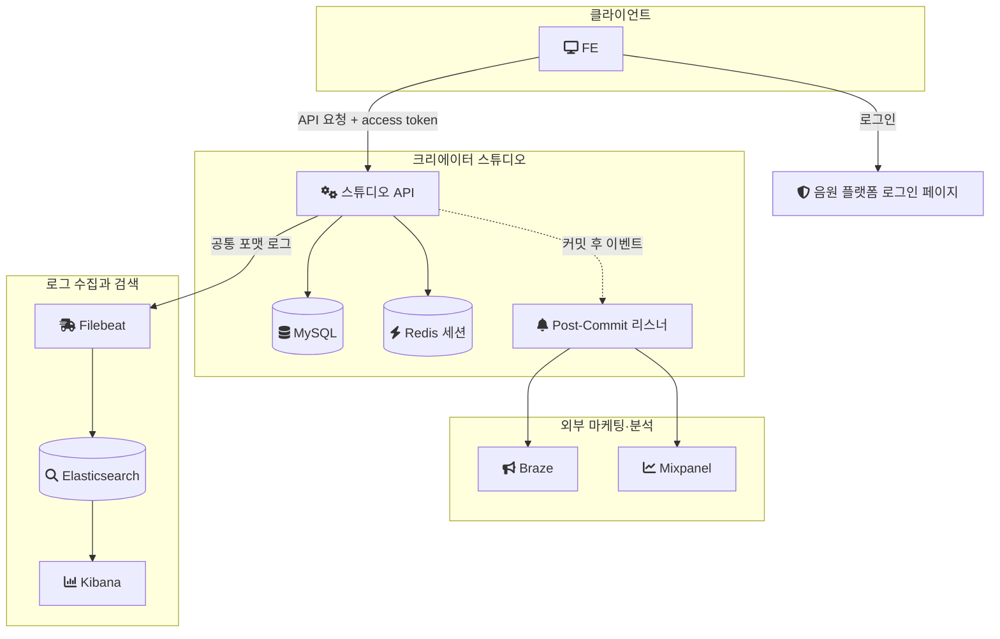
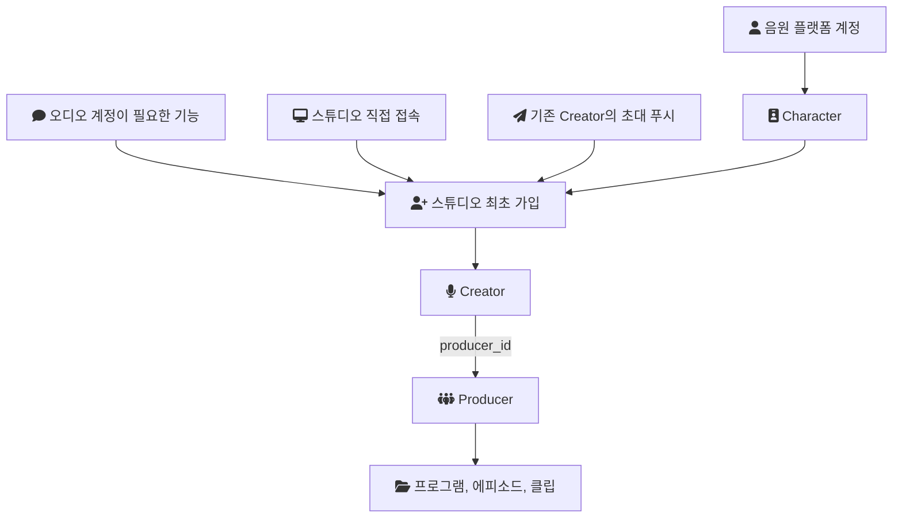
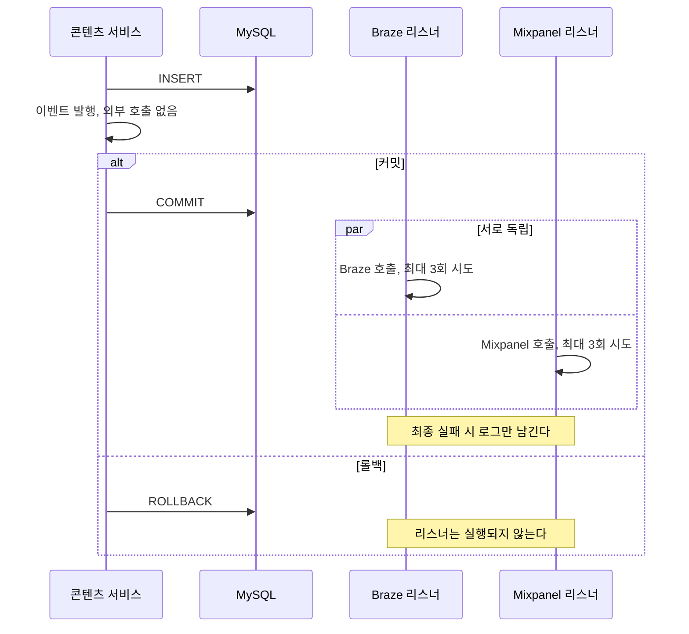
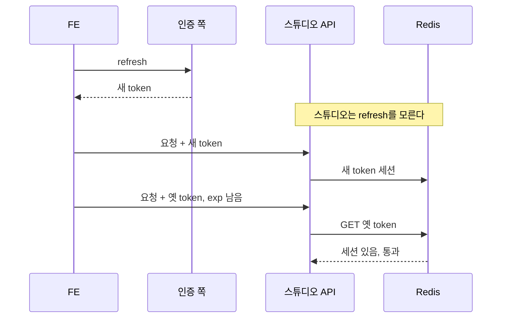
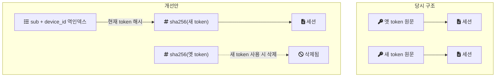
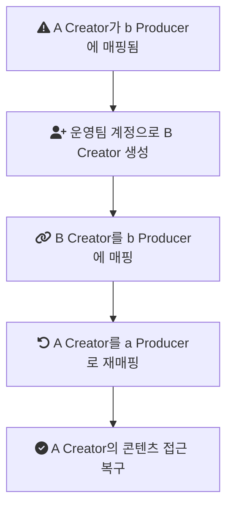

크리에이터 스튜디오는 누구나 오디오 콘텐츠를 만들어 음원 플랫폼에 배포할 수 있게 하는 B2C 제작 플랫폼이다. 2022년 4월에 새로 만들기 시작했고, 나는 초기 구축에 참여한 뒤 정담당자로 유지보수를 맡았다.

이 글은 그 프로젝트에서 내린 판단 네 가지를 한 번에 정리한 개요다. 외부 연동을 트랜잭션 밖으로 옮긴 일, 감사 로그 체계를 만든 일, 인증 세션 구조에서 빈틈을 찾고 개선안을 설계한 일, Creator-Producer 매핑 장애를 복구한 일이다. 각각이 어디까지 진행됐는지가 다르다. 구현해서 운영한 것, 설계까지만 한 것, 원인을 확정하지 못한 것을 구분해서 적는다.

회사 코드는 지금 볼 수 없다. 그래서 글의 코드는 두 종류다. 구조를 설명하려고 다시 쓴 예시와, 확정된 사실을 개인 실험 저장소(engineering-lab의 creator-studio 모듈, 이하 랩)에서 다시 구현한 코드다. 각 코드 블록에 어느 쪽인지 표시한다.

## 용어

- Braze: 마케팅 자동화 도구. 사용자 행동 이벤트를 받아 캠페인과 푸시에 쓴다.
- Mixpanel: 사용자 행동 분석 도구. 이벤트를 모아 추이를 본다.
- ISMS(정보보호 관리체계 인증): 기업의 정보보호 관리 체계를 외부 심사로 확인받는 국내 인증이다.
- ITGC(IT 일반통제): 회계 감사에서 재무 데이터를 다루는 IT 시스템의 통제를 점검하는 항목이다.
- MDC(Mapped Diagnostic Context): 로깅 라이브러리가 제공하는 스레드별 키-값 저장소다. 넣어 둔 값이 같은 스레드의 모든 로그에 붙는다.
- TTL(Time To Live): Redis 키가 자동으로 삭제되기까지 남은 시간이다.

## 프로젝트의 조건

| 항목 | 내용 |
| --- | --- |
| 서비스 | 오디오 콘텐츠 제작·배포 B2C 플랫폼(프로그램, 에피소드, 클립) |
| 기간 | 2022년 4월부터 8월까지 초기 구축, 이후 정담당자로 유지보수 |
| 팀 | 초기 구축은 Java 개발자 3명(시니어 1명, 주니어 2명, 나 포함) |
| 내 역할 | 초기에는 프로그램, 에피소드, 클립 API 구현. 이후 외부 연동(Braze, Mixpanel), 인증, KMS 암호화, ISMS 감사 대응을 단독으로 맡았다 |
| 스택 | Java, Spring Boot, JPA, QueryDSL, MySQL, Redis, AWS |
| 로그 수집 | Filebeat, Elasticsearch, Kibana |

사용자 수, 트래픽, 이벤트 건수, 로그 보관 기간 같은 수치는 기록으로 남아 있지 않다. 그래서 이 글의 판단 근거는 처리량이 아니라 데이터의 성격과 구조다. KMS로 어떤 필드를 암호화했는지도 기록이 없어 이 글에서는 다루지 않는다.

## 시스템 구성

스튜디오 API를 중심으로 바깥과 연결되는 지점을 그리면 다음과 같다. 인증은 스튜디오 밖에서 일어나고, 외부 연동은 커밋 뒤에 나가며, 로그는 별도 경로로 수집된다.



## 도메인: Character, Creator, Producer

스튜디오의 사용자는 세 단계로 이어진다. 음원 플랫폼 계정 아래에 Character가 있고, Character가 스튜디오에 처음 가입하면 Creator로 매핑된다. 모든 Creator는 Producer 아래에 속한다. 직접 가입할 때는 Producer를 먼저 만들고 Creator 이름을 입력한다.

가입으로 들어오는 경로는 세 가지다. 댓글처럼 오디오 계정이 필요한 기능을 누를 때, 스튜디오에 직접 접속할 때, 기존 Creator가 보낸 초대 푸시 링크를 누를 때다.



Creator와 콘텐츠 사이에 Producer가 있다는 점은 뒤의 매핑 장애에서 그대로 문제가 된다.

## 1. 외부 연동을 커밋 뒤로 옮겼다

### 문제

처음에는 콘텐츠를 만들거나 고치는 서비스 메서드 안에서 저장이 끝나면 바로 Braze와 Mixpanel을 호출했다. 이 구조에서 세 가지 문제가 있었다.

1. 외부 응답이 느리면 트랜잭션이 그만큼 길어진다. `@Transactional` 메서드가 끝나야 커밋되기 때문이다.
2. 외부 호출이 실패하면 예외가 메서드 밖으로 올라가 콘텐츠 저장까지 롤백된다. 네트워크 장애가 핵심 데이터 저장 실패로 번진다.
3. 재시도 로직이 호출하는 곳마다 흩어져 있어 일관성이 없었다.

```java
// 구조 설명용 예시(실제 코드 아님)
@Transactional
public void createProgram(ProgramCreateRequest request) {
    Program program = programRepository.save(Program.from(request));
    brazeClient.track(program.getId());     // 외부 호출이 트랜잭션 안에 있다
    mixpanelClient.track(program.getId());
}
```

### 결정

Braze와 Mixpanel 호출은 콘텐츠 생성의 일부가 아니라, 생성됐다는 사실에 대한 반응이다. 그래서 외부 연동을 도메인 트랜잭션의 부수 효과로 정의했다. 도메인 로직은 이벤트 발행만 하고, 외부 호출은 커밋 이후 비동기로 처리한다.

Spring의 `@TransactionalEventListener`가 이 구분을 표현한다. [Javadoc](https://docs.spring.io/spring-framework/docs/current/javadoc-api/org/springframework/transaction/event/TransactionalEventListener.html)에 따르면 이 리스너는 지정한 트랜잭션 단계에서 실행되고, 기본 단계는 `AFTER_COMMIT`이다. 롤백되면 리스너가 실행되지 않으므로, 저장되지 않은 콘텐츠를 외부에 알리는 일도 없다. 이 리스너가 동작하지 않는 경우는 [`@TransactionalEventListener`가 무시되는 이유](/posts/transactional-event-listener/)에 따로 정리했다.

Braze 리스너와 Mixpanel 리스너는 각자 자기 API만 호출하는 별개의 리스너였다. 두 시스템은 서로의 처리 결과에 의존하지 않으므로 순서 보장이 필요 없었다. 리스너를 어떻게 등록하고 분리했는지 같은 구현 세부는 기억나지 않는다.



### 끝내 실패하면 어떻게 하는가

커밋 뒤로 옮기면 "콘텐츠는 저장됐는데 외부 연동은 실패한" 상태가 생길 수 있다. 이 상태를 다루는 정책을 이렇게 표준화했다.

- 재시도는 3회로 제한한다.
- 최종 실패하면 별도로 재처리하지 않고 알림(로그)만 남긴다.
- 멱등성(같은 이벤트가 두 번 가도 결과가 같게 하는 처리)은 따로 고려하지 않는다.

마지막 두 항목의 근거는 연동 데이터의 성격이었다. Braze와 Mixpanel은 개별 이벤트 하나하나가 아니라 전체 통계 카운트로 추이를 보는 용도였다. 그래서 약간의 미스카운트(중복이나 누락)는 허용할 수 있다고 협의했다. 모든 도메인이 같은 수준의 정합성을 요구하지는 않으므로, 이 정책은 결제나 정산처럼 한 건의 누락도 문제가 되는 도메인에는 그대로 옮길 수 없다.

랩에서는 이 구조를 다음처럼 다시 구현했다. 도메인 서비스는 이벤트를 발행할 뿐 외부 시스템을 모른다.

```java
// 랩 코드: ProgramCreationService.java
@Transactional
public Program createProgram(Long producerId, Long creatorId, String title) {
    Program program = programRepository.save(new Program(producerId, creatorId, title));
    eventPublisher.publishEvent(new ContentChangedEvent(ContentType.PROGRAM, program.getId(), ChangeType.CREATED));
    return program;
}
```

랩의 `PostCommitEventListenerTest`는 커밋되면 두 리스너가 각각 실행되고, 롤백되면 실행되지 않는다는 두 가지를 확인한다. 두 테스트 모두 통과했다. 랩의 backoff 값과 스레드풀 크기는 랩에서 새로 정한 값이고 운영 값은 기록이 없다.

### 결과

외부 연동 실패가 핵심 트랜잭션에 영향을 주지 않게 됐다. 트랜잭션 길이와 장애 전파 범위가 줄었고, 재시도 정책이 한곳에서 일관되게 적용됐다. 이 결과를 보여주는 수치(트랜잭션 시간, 실패 건수)는 남아 있지 않다.

## 2. 감사 로그 체계를 만들었다

### 문제

감사 요구사항은 "누가, 언제, 무엇을 했는가"로 모인다. 그런데 이 질문을 일관되게 추적할 표준화된 로그 체계가 없었다.

### 결정과 구현

세 가지를 함께 정했다.

1. Audit Log의 포맷과 이벤트 구조를 표준화했다.
2. Logback MDC로 요청 ID, 사용자 ID, 세션 정보를 공통 로그에 자동으로 넣었다.
3. Filebeat로 로그 파일을 수집해 Elasticsearch에 쌓고, Kibana에서 검색하게 했다.

MDC는 값을 스레드 단위로 관리한다. [Logback 매뉴얼](https://logback.qos.ch/manual/mdc.html)은 이를 "The `MDC` manages contextual information on a _per thread basis_."라고 적는다. 요청이 들어올 때 필터에서 값을 넣고 나갈 때 비우면, 그 사이의 모든 로그에 같은 값이 붙는다. 같은 매뉴얼은 자식 스레드가 부모의 MDC를 자동으로 물려받지 않는다고도 적는다. 1번에서 외부 연동을 별도 스레드로 옮겼으므로, 그 경로의 로그에는 요청 컨텍스트가 자동으로 붙지 않는다. 당시 그 경로에 MDC를 전파했는지는 기록이 없다.

구체적인 필드 목록, 이벤트 분류 체계, 출력 형식(JSON 여부)도 기록이 없어 여기서 예시를 만들지 않는다. 구성의 세부는 [ISMS 대응을 위한 로그 수집 체계 개선](/posts/logsystem/)에 정리했다.

### 결과

운영 이슈 추적과 보안 감사 대응이 쉬워졌다. 회사는 ISMS 인증을 3회 연속 통과했고, 나는 그중 2023년과 2024년 두 차례 심사에 직접 참여했다. 3회는 회사의 인증 이력이고 2회는 내가 심사 현장에 있었던 횟수다. 참여한 심사에서 감사원 질문에 답하며 이 Audit Log 체계를 직접 언급하고 시연했다. 같은 로그 체계는 ITGC 회계 감사 대응에도 쓰였다.

인증 통과를 이 로그 체계 하나의 성과로 말할 수는 없다. ISMS 심사는 관리 체계 전체를 보기 때문이다. 감사 로그의 위·변조 방지 장치가 있었는지는 내가 모른다.

## 3. 인증 세션 구조의 빈틈을 찾고 개선안을 설계했다

### 당시 구조

인증은 스튜디오 밖에서 일어났다. FE가 음원 플랫폼 로그인 페이지에서 인증해 access token을 얻고, 그 token을 붙여 스튜디오에 요청한다. 스튜디오 backend는 로그인 서버나 인증 서버를 서버 대 서버로 직접 호출하지 않았다. token을 발급하거나 갱신하는 일도 스튜디오가 하지 않았다.

스튜디오는 받은 token을 Redis에 저장해 세션처럼 썼다. key는 access token 원문이고, value는 JWT(서명된 JSON 클레임 묶음)를 파싱한 값 전체였다. refresh token도 한 번은 저장했던 것으로 기억한다. [세션과 JWT](/posts/session-and-jwt/)의 관점에서 보면, 서버 저장소 없이 검증할 수 있는 JWT를 다시 서버 쪽 저장소에 담아 세션처럼 쓴 혼합 구조다.

### 문제: refresh 이후에도 옛 token이 통과한다

FE가 token을 refresh하면 새 access token을 받는다. 이 교환은 FE와 인증 쪽 사이에서 일어나므로 스튜디오는 알 수 없다. 그런데 옛 access token의 만료 시각(exp)은 아직 남아 있고, Redis에도 옛 token을 key로 한 세션이 그대로 있다. 그래서 옛 token으로 온 요청도 계속 통과될 수 있었다.



access token은 Bearer token이다. [RFC 6750](https://datatracker.ietf.org/doc/html/rfc6750#section-1.2)은 이를 "any party in possession of the token (a 'bearer') can use the token in any way that any other party in possession of it can"인 token으로 정의한다. 가진 사람이면 누구든 쓸 수 있다는 뜻이다. 필요 없어진 옛 token이 exp까지 살아 있으면, 유출됐을 때 쓸 수 있는 시간도 그만큼 길다.

나는 Redis TTL을 exp에 맞추는 것으로는 이 문제가 풀리지 않는다는 점을 짚었다. TTL은 저절로 사라지는 시점을 정할 뿐이고, 아직 만료되지 않은 옛 token을 지우지는 않는다. 필요한 것은 "새 token이 발급됐으니 이전 token은 폐기한다"는 별도 정책이다. 그런데 key가 token 원문뿐이라서, 새 token이 들어왔을 때 같은 사용자, 같은 기기의 이전 token이 무엇인지 찾을 방법이 없었다.

원문을 key로 쓰는 구조에는 다른 약점도 있었다. Redis 관리 도구나 백업(RDB, AOF)에서 자격 증명 원문이 보이고, 긴 JWT가 key가 되어 메모리와 네트워크 비용이 커지며, refresh마다 key가 늘어나고, 특정 사용자의 세션을 한 번에 찾아 강제 로그아웃시키기 어렵다.

### 개선안과 진행 범위

설계한 개선안은 두 가지다.

1. 세션 key를 access token 원문 대신 `sha256(access_token)`으로 바꾼다.
2. `sub`(JWT의 사용자 식별자)와 `device_id` 조합을 key로 하는 역인덱스를 두고, 값으로 "현재 유효한 token의 해시"를 저장한다.

새 token이 한 번 쓰이면 역인덱스에서 이전 해시를 찾아 그 세션을 즉시 지운다. 이후 옛 token 요청은 해시가 맞지 않아 거절된다.



나는 문제를 식별하고 개선안을 제안하는 데까지만 진행했다. 실제 구현과 배포는 하지 않았다. 실제 refresh token 형식, TTL 값, Redis key prefix, JWT 서명을 어디서 검증했는지, 로그아웃 처리 방식은 기록에 없다.

이 개선안은 이후 랩에서 처음 코드로 옮겼다. 랩의 원래 구조 재현은 refresh가 새 세션을 추가할 뿐, 이전 세션을 찾지 못한다.

```java
// 랩 코드: LegacySessionManager.java
return issue(memberId, deviceId); // 새 세션만 추가될 뿐, 이전 access token 세션은 손대지 않는다.
```

랩의 `SessionRotationRaceConditionTest`는 Testcontainers로 띄운 `redis:7.4-alpine`에서 원래 구조와 개선안을 비교한다. 원래 구조에서는 refresh 직후 옛 access token 조회가 통과하고, 개선안에서는 거절된다. 개선안은 refresh를 두 번 해도 기기당 세션 하나만 남기고, 이미 쓴 refresh token의 재사용을 거절한다. 네 테스트 모두 통과했다. 랩은 token을 서명된 JWT가 아닌 무작위 문자열로 단순화했고, refresh를 랩의 세션 관리자가 직접 처리한다. 그래서 이 결과는 key 구조가 옛 token을 거절할 수 있다는 확인이지 운영 환경의 결과가 아니다.

## 4. Creator-Producer 매핑 장애를 애플리케이션 흐름으로 복구했다

### 증상

A Creator가 a Producer를 만들어 가입했는데, 이후 b Producer로 재매핑됐다. 그 사이에 a Producer가 삭제됐다가 다시 만들어졌는지 같은 경위는 불명확하다. A Creator 입장에서는 그동안 등록한 프로그램, 에피소드, 클립이 전부 사라진 것처럼 보였고 VoC(고객 문의)가 접수됐다. 콘텐츠는 a Producer 쪽에 있고, Creator가 가리키는 Producer만 바뀌었기 때문이다.

### 복구: DML 대신 정상 흐름

UI로 바로 재매핑을 되돌리기 어려웠다. DML로 DB를 직접 고치는 방법도 있었지만, 그러면 연관 검증이나 부수 효과 같은 비즈니스 로직을 건너뛸 위험이 있다고 판단했다. 그래서 우회 경로를 택했다.



B Creator가 b Producer의 대표로 설정됐을 가능성이 있지만 정확하지 않다. a, b Producer가 최종적으로 어떻게 처리됐는지도 기록이 없다.

### 원인: 두 가설까지 좁혔다

이후 재구성하면서 원인 후보를 두 가지로 좁혔다.

1. 가입 여부 조회가 status, character_id, 캐시 불일치 같은 이유로 기존 Creator를 "미가입"으로 오판해, 재가입 흐름이 새 Producer를 만들었을 가능성.
2. Producer 생성 기능이 새 Producer를 INSERT한 뒤 기존 Creator의 `producer_id`를 새 값으로 덮어썼을 가능성.

실제 로그와 DB 조회로 어느 쪽인지 확정하지는 못했다. 그래서 이 두 가지는 가설이다.

### 재발 방지 방향

제안한 방향은 Producer 생성과 기존 Creator의 Producer 변경을 별개 동작으로 나누는 것, 기존 Creator가 있으면 재가입 대신 복구나 상태 확인 경로로 안내하는 것, 기존 Producer에 콘텐츠가 있으면 producer_id 변경을 막거나 명시적 이관 절차를 요구하는 것, 매핑 변경 이력을 기록하는 것이다. 이 방향이 실제로 구현됐는지는 확인되지 않았다.

랩에서는 가설 2를 "그런 구조였다면 어떻게 보이는가"로 재현하고, 제안 방향을 구현했다. 가입 진입점은 이미 Creator가 있으면 새 Producer를 만들지 않고 거절한다.

```java
// 랩 코드: CreatorOnboardingService.java
if (creatorRepository.existsByMemberId(memberId)) {
    throw new CreatorAlreadyExistsException(memberId);
}
```

랩의 `CreatorProducerMappingIntegrationTest` 네 개는 모두 통과했다. 가설 2 구조에서는 콘텐츠가 사라진 것처럼 보이고, 분리된 구조에서는 재가입이 거절되며, 콘텐츠가 있는 Producer로부터의 매핑 변경은 명시적 확인 없이 차단되고, 확인하고 바꾸면 이력이 남는다. 이것은 가설 하나를 재현한 결과이지 실제 원인의 증명이 아니다.

## 네 판단이 남긴 비용

| 작업 | 진행 범위 | 남은 비용과 공백 |
| --- | --- | --- |
| 외부 연동 분리 | 구현, 운영 | 최종 실패한 이벤트는 로그로만 남고 재처리되지 않는다. 통계 용도라서 허용한 비용이다 |
| 감사 로그 | 구현, 감사 대응에 사용 | 비동기 경로의 컨텍스트 전파, 위·변조 방지 여부는 기록이 없다 |
| 세션 개선안 | 설계까지 | 내가 맡은 동안 옛 token 통과 문제는 운영에서 해결되지 않았다 |
| 매핑 장애 | 복구 완료 | 원인 미확정, 재발 방지책의 구현 여부 미확인 |

네 작업을 다시 보면 공통점이 하나 있다. 결정의 근거가 성능 수치보다 데이터의 성격과 책임의 경계였다. 외부 연동은 통계라서 느슨한 정합성을 택했고, 세션은 스튜디오가 token 발급자가 아니라서 TTL만으로는 폐기를 표현할 수 없었고, 매핑 복구는 DB보다 애플리케이션 흐름이 비즈니스 규칙을 지킨다고 봤다.

## 참고

- [Spring Framework Javadoc: TransactionalEventListener](https://docs.spring.io/spring-framework/docs/current/javadoc-api/org/springframework/transaction/event/TransactionalEventListener.html) — 트랜잭션 단계별 실행, 기본 단계 `AFTER_COMMIT`
- [Logback Manual, Chapter 8: Mapped Diagnostic Context](https://logback.qos.ch/manual/mdc.html) — 스레드 단위 관리, 자식 스레드 비상속
- [RFC 6750 1.2절: Bearer Token 정의](https://datatracker.ietf.org/doc/html/rfc6750#section-1.2)
- 랩 [creator-studio README](https://github.com/polynomeer/engineering-lab/blob/d52297d0ad07c3d8a05a7471192a5655cb8b1378/career-lab/creator-studio/README.md) — 사실 기반 재현과 새 설계의 구분
- 랩 코드 [`ProgramCreationService.java`](https://github.com/polynomeer/engineering-lab/blob/d52297d0ad07c3d8a05a7471192a5655cb8b1378/career-lab/creator-studio/src/main/java/com/portfolio/creatorlab/integration/ProgramCreationService.java)
- 랩 테스트 [`PostCommitEventListenerTest.java`](https://github.com/polynomeer/engineering-lab/blob/d52297d0ad07c3d8a05a7471192a5655cb8b1378/career-lab/creator-studio/src/test/java/com/portfolio/creatorlab/integration/PostCommitEventListenerTest.java)
- 랩 코드 [`LegacySessionManager.java`](https://github.com/polynomeer/engineering-lab/blob/d52297d0ad07c3d8a05a7471192a5655cb8b1378/career-lab/creator-studio/src/main/java/com/portfolio/creatorlab/session/LegacySessionManager.java)
- 랩 테스트 [`SessionRotationRaceConditionTest.java`](https://github.com/polynomeer/engineering-lab/blob/d52297d0ad07c3d8a05a7471192a5655cb8b1378/career-lab/creator-studio/src/test/java/com/portfolio/creatorlab/session/SessionRotationRaceConditionTest.java)
- 랩 코드 [`CreatorOnboardingService.java`](https://github.com/polynomeer/engineering-lab/blob/d52297d0ad07c3d8a05a7471192a5655cb8b1378/career-lab/creator-studio/src/main/java/com/portfolio/creatorlab/onboarding/CreatorOnboardingService.java)
- 랩 테스트 [`CreatorProducerMappingIntegrationTest.java`](https://github.com/polynomeer/engineering-lab/blob/d52297d0ad07c3d8a05a7471192a5655cb8b1378/career-lab/creator-studio/src/test/java/com/portfolio/creatorlab/onboarding/CreatorProducerMappingIntegrationTest.java)
