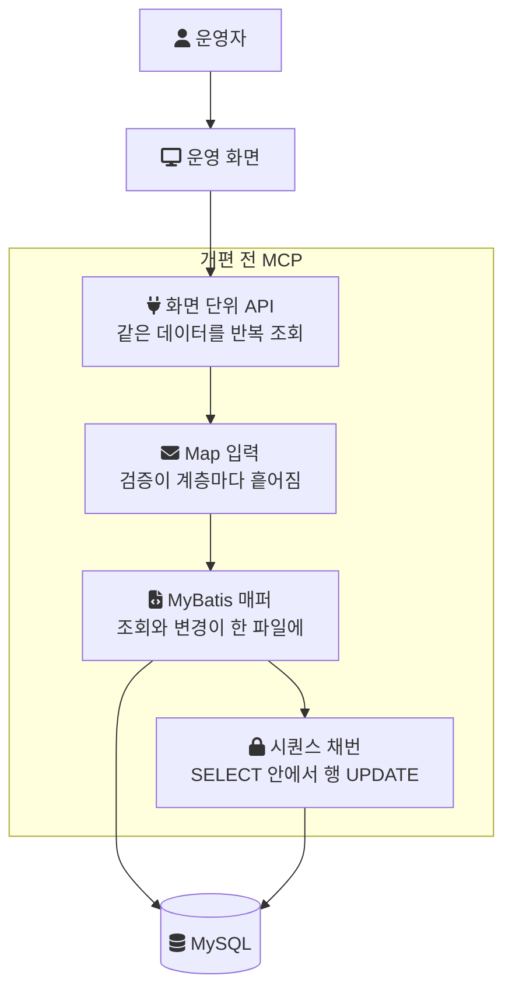
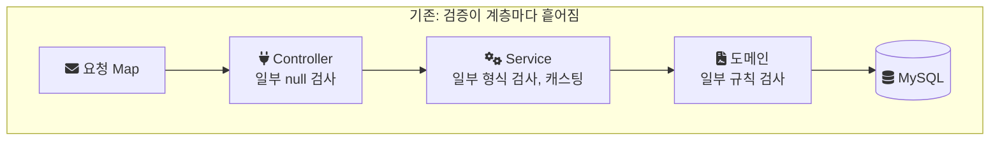
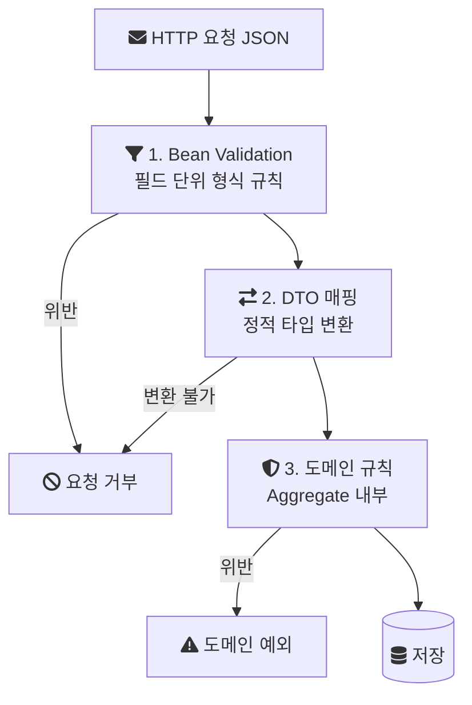
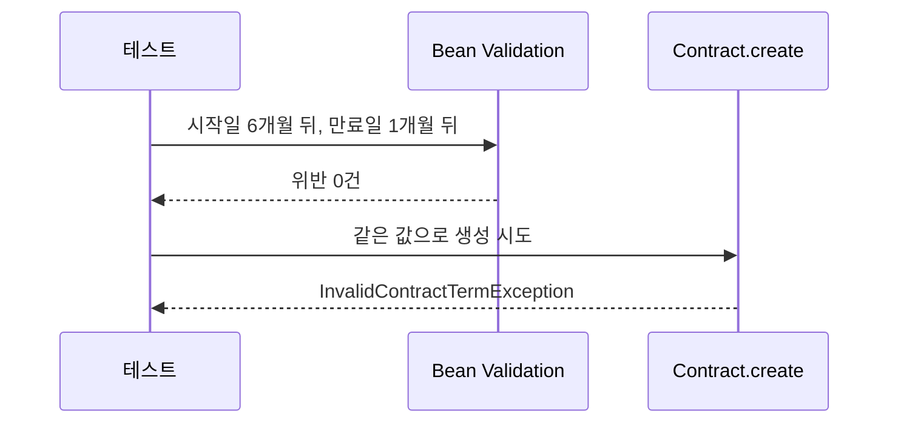

음원 플랫폼 회사에서 2024년에 음원 콘텐츠 플랫폼(MCP)을 전면 개편했다. 이 시리즈는 그 개편에서 내가 직접 구현한 부분을 주제별로 나눠 정리한다. 1편은 입력 구조다. 요청을 `Map`으로 받던 API를 DTO로 바꾸고, 흩어져 있던 검증을 세 단계로 나눈 과정을 다룬다.

> 이 글의 코드는 회사의 실제 소스가 아니다. 기존 구조는 설명을 위한 재구성 예시이고, 개선 후 구조는 같은 설계를 처음부터 다시 만든 개인 랩(engineering-lab의 mcp-platform 모듈)의 코드다. 랩 코드는 그렇다고 표시했다.

## 배경과 조건

MCP는 계약, 앨범, 곡(트랙) 메타데이터와 유통사·계약별 라이선스 권리를 관리하는 사내 플랫폼이다. 회사가 다루는 곡 중 서비스 상태가 "사용"인 트랙만 8천만 건이 넘었다. 사용자는 외부 고객이 아니라 정산, 라이선스, 데이터 관련 부서의 운영자다. 계약 코드처럼 정산과 외부 유통에 연결되는 식별자도 이 시스템에서 만들어진다. 잘못된 값이 한 번 저장되면 그 값을 읽어 가는 쪽까지 영향이 이어진다.

| 항목 | 내용 |
| --- | --- |
| 기간 | 2024년 1월부터 11월까지 전면 개편 |
| 팀 | 백엔드 3명. 나는 백엔드 리딩을 맡았다. 원래 팀이 풀스택으로 담당하던 프로젝트라 프론트엔드와도 일정과 아키텍처를 공유했다 |
| 내 구현 범위 | 공통 기능(엑셀, 파일 업로드·다운로드 인터페이스, RabbitMQ 메시지 인터페이스), ArchUnit 아키텍처 규칙, 앨범·트랙·계약·지분율 관리 API |
| 스택 | Java, Spring Boot, JPA, MapStruct, MySQL, RabbitMQ, ArchUnit |

배치 처리와 권리 이관처럼 규모가 큰 기능은 다른 팀원에게 독립적으로 맡겼다. 이 시리즈는 그 기능들을 다루지 않는다.

## 개편 전 구조와 이 시리즈의 범위

개편 전 MCP는 네 가지 구조 위에서 운영되고 있었다. 화면 단위로 쪼개진 API, `Map` 기반 동적 입력, 조회와 변경이 섞인 MyBatis 중심 데이터 접근, 그리고 row-level 락이 걸리는 시퀀스 채번이다. 레거시를 그대로 두면 정합성과 성능 문제가 계속 쌓이는 상황이었다.

각 구조가 어디에 있었는지 한 장으로 보면 다음과 같다.



시리즈의 각 편은 이 구조 하나씩과, 그 구조들을 유지하는 장치를 다룬다.

| 편 | 주제 | 결과 |
| --- | --- | --- |
| 1편(이 글) | Map 입력을 DTO와 3단계 검증으로 | 유입 단계에서 오류 차단. 수치 기록 없음 |
| [2편](/posts/legacy-jsp-system-refactoring-2/) | 계약 코드 채번 구조 | 계약 생성 처리 2분에서 10초 |
| [3편](/posts/legacy-jsp-system-refactoring-3/) | 변경은 MyBatis, 조회는 JPA·QueryDSL | 조회·변경 책임 분리. 수치 기록 없음 |
| [4편](/posts/legacy-jsp-system-refactoring-4/) | 화면 단위 API를 도메인 책임 API로 | API 응답 1.5초에서 300ms |
| [5편](/posts/legacy-jsp-system-refactoring-5/) | 판단 로직의 자리와 ArchUnit 가드레일 | 정적 분석 위반 480건에서 75건 |

## 문제: 입력에 타입이 없고, 검증에 자리가 없었다

기존 API는 요청 본문을 `Map<String, Object>`로 받았다. 아래는 그 형태를 설명하기 위한 재구성 예시다.

```java
// 재구성 예시: Map 기반 입력 (실제 코드 아님)
@PostMapping("/contract/save")
public Map<String, Object> save(@RequestBody Map<String, Object> params) {
    String type = (String) params.get("contractType");
    Long albumId = Long.valueOf(String.valueOf(params.get("albumId")));
    if (params.get("expiresAt") == null) { /* ... */ }
    contractService.save(params);   // Map이 그대로 아래 계층으로 내려간다
    // ...
}
```

이 구조에서는 요청에 어떤 필드가 어떤 타입으로 있어야 하는지가 코드 어디에도 선언되어 있지 않다. 그래서 세 가지 일이 생긴다.

- 키 이름을 잘못 쓰면 컴파일 오류가 아니라 `null`이 나온다. 그 `null`은 한참 아래 계층에서 `NullPointerException`으로 드러난다.
- 값을 꺼내는 쪽이 캐스팅해야 하므로, 클라이언트가 숫자 대신 문자열을 보내면 실행 중에 `ClassCastException`이나 `NumberFormatException`이 난다.
- 어떤 필드를 누가 쓰는지 IDE로 추적할 수 없다. 필드 하나의 규칙을 바꾸려 해도 그 키 문자열을 텍스트 검색으로 찾아야 한다.

검증의 위치도 문제였다. 검증 로직이 Controller, Service, 도메인 계층에 흩어져 있어서, 어떤 규칙이 어느 계층에서 검사되는지 한눈에 알 수 없었다. 정책 하나가 바뀌면 그 규칙이 몇 군데에서 어떻게 검사되는지부터 찾아야 했고, 그래서 변경의 영향 범위를 가늠하기 어려웠다.



## 결정: 정적 타입으로 받고, 검증을 단계로 나눈다

결정은 두 가지였다.

1. 입력 구조를 DTO(Data Transfer Object, 계층 사이에서 데이터를 나르는 전용 클래스) 기반 정적 타입으로 바꾼다. 요청에 무엇이 있어야 하는지를 클래스 선언이 말하게 한다.
2. 검증 흐름을 Bean Validation, DTO 매핑, 도메인 규칙 검증의 세 단계로 나눈다. 도메인 규칙은 Aggregate(함께 일관성을 지켜야 하는 객체 묶음과 그 대표 객체) 내부에서 최종 검증한다.

단계를 나누는 기준은 "그 규칙을 판단하는 데 무엇을 알아야 하는가"다.

| 단계 | 판단에 필요한 것 | 예 | 실패 시 |
| --- | --- | --- | --- |
| 1. Bean Validation | 그 필드 하나 | 필수값, 길이, 날짜가 미래인지 | 요청 거부 |
| 2. DTO 매핑 | 요청 DTO 전체 | 요청 DTO를 서비스가 쓰는 타입으로 변환 | 변환 불가 시 요청 거부 |
| 3. 도메인 규칙 | 다른 필드, 다른 엔티티의 상태 | 만료일이 시작일보다 앞서면 안 됨 | 도메인 예외 |

요청 하나가 세 단계를 지나는 흐름은 다음과 같다.



이렇게 나누면 규칙마다 들어갈 자리가 하나로 정해진다. 필드 하나만 보고 판단할 수 있으면 DTO의 어노테이션에 두고, 다른 데이터를 봐야 하면 도메인 객체에 둔다. 같은 규칙을 두 곳에서 검사할 이유가 없어진다.

## 1단계: Bean Validation

[Jakarta Bean Validation](https://jakarta.ee/specifications/bean-validation/3.0/)은 필드에 제약 어노테이션을 선언하고, 검증기가 그 선언대로 객체를 검사하는 Java 표준이다. 아래는 랩의 계약 생성 요청 DTO다. 랩은 계약 생성 하나만 재현한다.

```java
// 랩 코드: contract/api/dto/ContractCreateRequest.java
public record ContractCreateRequest(
        @NotBlank @Size(max = 200) String counterpartyName,
        @NotNull LocalDate startsAt,
        @NotNull @Future LocalDate expiresAt
) {
}
```

여기에는 다른 필드를 보지 않아도 판단할 수 있는 규칙만 둔다. 상대방 이름이 비어 있는지, 날짜가 들어왔는지, 만료일이 미래인지는 그 필드 하나로 결정된다. Controller는 이 DTO를 `@Valid @RequestBody`로 받으므로, 형식 오류는 서비스 계층에 들어가기 전에 걸러진다.

JSON의 필드 타입이 DTO와 맞지 않는 경우, 예를 들어 날짜 자리에 숫자가 오면 Bean Validation 이전에 JSON 역직렬화 단계에서 실패한다. `Map`으로 받을 때는 이런 오류가 서비스 계층의 캐스팅에서 터졌지만, DTO로 받으면 요청 경계에서 드러난다.

## 2단계: DTO 매핑

검증을 통과한 요청 DTO는 서비스와 도메인이 쓰는 타입으로 변환된다. 프로젝트에서는 MapStruct로 DTO 매핑 방식을 표준화했다. MapStruct는 매핑 구현을 컴파일 시점에 생성하는 어노테이션 프로세서라서, 매핑할 수 없는 타입 조합은 실행 중이 아니라 빌드에서 드러난다.

매핑 방식을 표준화한 이유는 5편에서 다시 나온다. 재설계가 진행되며 여러 개발자가 동시에 작업하자 같은 종류의 변환을 API마다 다른 방식으로 구현하는 일이 생겼기 때문이다.

랩은 이 단계를 MapStruct 대신 서비스의 수동 매핑으로 단순화했다. 랩이 확인하려는 것은 단계의 분리이지 매핑 라이브러리가 아니다.

## 3단계: 도메인 규칙은 Aggregate 안에서

마지막 단계는 다른 필드나 다른 엔티티의 상태를 알아야 판단할 수 있는 규칙이다. "만료일이 시작일보다 앞설 수 없다"는 두 필드를 함께 봐야 하므로, 필드 하나씩 보는 어노테이션으로는 표현되지 않는다.

```java
// 랩 코드: contract/domain/Contract.java
public static Contract create(String contractCode, String counterpartyName,
                               LocalDate startsAt, LocalDate expiresAt) {
    if (expiresAt.isBefore(startsAt)) {
        throw new InvalidContractTermException(
                "계약 만료일(%s)은 시작일(%s)보다 앞설 수 없음".formatted(expiresAt, startsAt));
    }
    return new Contract(contractCode, counterpartyName, startsAt, expiresAt);
}
```

이 규칙을 도메인 객체의 생성 메서드에 두면, 어떤 API 경로로 계약이 만들어지든 이 검사를 지나지 않고는 `Contract`가 생기지 않는다. 정책이 바뀌면 이 메서드 하나를 고치면 된다.

## 랩에서 확인한 것: 형식은 맞지만 규칙은 어긴 요청

세 단계를 나눈 이유는 1단계를 통과하고 3단계에서 걸리는 요청에서 드러난다. 랩의 `ValidationPipelineTest`가 이 경우를 재현한다.

```java
// 랩 코드: validation/ValidationPipelineTest.java
LocalDate startsAt = LocalDate.now().plusMonths(6);
LocalDate expiresAt = LocalDate.now().plusMonths(1); // startsAt보다 이전

ContractCreateRequest request = new ContractCreateRequest("㈜예시레이블", startsAt, expiresAt);
assertThat(validator.validate(request)).isEmpty();          // 1단계는 통과

assertThrows(InvalidContractTermException.class,            // 3단계에서 거부
        () -> Contract.create("MCP-2026-000001", request.counterpartyName(),
                request.startsAt(), request.expiresAt()));
```

두 날짜 모두 미래이고 null도 아니므로 Bean Validation은 이 요청을 통과시킨다. 그러나 만료일이 시작일보다 앞서므로 도메인 규칙에서 예외가 난다.



랩 조건은 Spring Boot 3.3.4, JDK 21이고, DB와 Spring 컨텍스트 없이 순수 단위 테스트로 돌렸다. 테스트 5개(1단계 거부 2개, 1단계 통과 1개, 3단계 거부 1개, 3단계 통과 1개)가 2026년 9월 29일 로컬에서 2회 연속 통과했다. 이것은 설계가 의도대로 동작한다는 확인이지, 운영에서 오류가 얼마나 줄었는지를 보여주는 측정은 아니다.

## 검증 실패를 어떤 응답으로 돌려줬는가

Bean Validation 실패와 도메인 예외를 각각 어떤 HTTP 상태 코드와 응답 본문으로 돌려줬는지는 기록이 남아 있지 않다. 그래서 공통 예외 처리 구조를 이 글에 적지 않는다. 랩도 이 부분은 아직 재현하지 않았다.

## 결과

개선 후에는 잘못된 데이터가 유입 단계에서 걸러졌다. `Map`을 캐스팅하며 생기던 런타임 타입 오류와 예외가 줄었다. 정책이 바뀌면 그 규칙이 필드 단위인지 문맥 의존인지에 따라 DTO나 도메인 객체 중 한 곳을 고치면 되므로, 수정 범위를 파악하기 쉬워졌다.

오류가 몇 건에서 몇 건으로 줄었는지 같은 수치는 남아 있지 않다. 이 개선의 효과는 정성적인 관찰로만 말할 수 있다.

## 비용과 남은 것

- 클래스가 늘어난다. API마다 요청 DTO가 생기고, DTO와 도메인 사이의 매핑이 생긴다. `Map` 하나로 받던 때보다 작성할 코드가 많다.
- 규칙을 어느 단계에 둘지 팀이 같은 기준을 써야 한다. 기준이 흐려지면 같은 규칙이 DTO와 도메인에 중복으로 들어가고, 처음의 분산 문제가 돌아온다. 이 문제는 5편의 아키텍처 규칙으로 이어졌다.
- MapStruct의 매핑 누락 정책(매핑되지 않은 대상 필드를 경고로 둘지 빌드 실패로 둘지)을 당시 어떻게 설정했는지는 기록이 없다.

다음 편은 같은 개편에서 계약 생성을 2분씩 붙잡던 [계약 코드 채번 구조](/posts/legacy-jsp-system-refactoring-2/)를 다룬다.

## 참고

- [Jakarta Bean Validation 3.0](https://jakarta.ee/specifications/bean-validation/3.0/) — Jakarta EE: 명세 페이지
- [MapStruct Reference Guide](https://mapstruct.org/documentation/stable/reference/html/) — MapStruct: 컴파일 시점 매핑 생성
- [ISMS 대응을 위한 로그 수집 체계 개선](/posts/logsystem/) — 감사 로그 작업의 실제 범위(크리에이터 스튜디오)
- [랩 코드: ContractCreateRequest.java](https://github.com/polynomeer/engineering-lab/blob/d52297d0ad07c3d8a05a7471192a5655cb8b1378/career-lab/mcp-platform/src/main/java/com/portfolio/mcplab/contract/api/dto/ContractCreateRequest.java) — GitHub
- [랩 코드: Contract.java](https://github.com/polynomeer/engineering-lab/blob/d52297d0ad07c3d8a05a7471192a5655cb8b1378/career-lab/mcp-platform/src/main/java/com/portfolio/mcplab/contract/domain/Contract.java) — GitHub
- [랩 코드: ValidationPipelineTest.java](https://github.com/polynomeer/engineering-lab/blob/d52297d0ad07c3d8a05a7471192a5655cb8b1378/career-lab/mcp-platform/src/test/java/com/portfolio/mcplab/validation/ValidationPipelineTest.java) — GitHub
- [랩 README: mcp-platform](https://github.com/polynomeer/engineering-lab/blob/d52297d0ad07c3d8a05a7471192a5655cb8b1378/career-lab/mcp-platform/README.md) — GitHub
