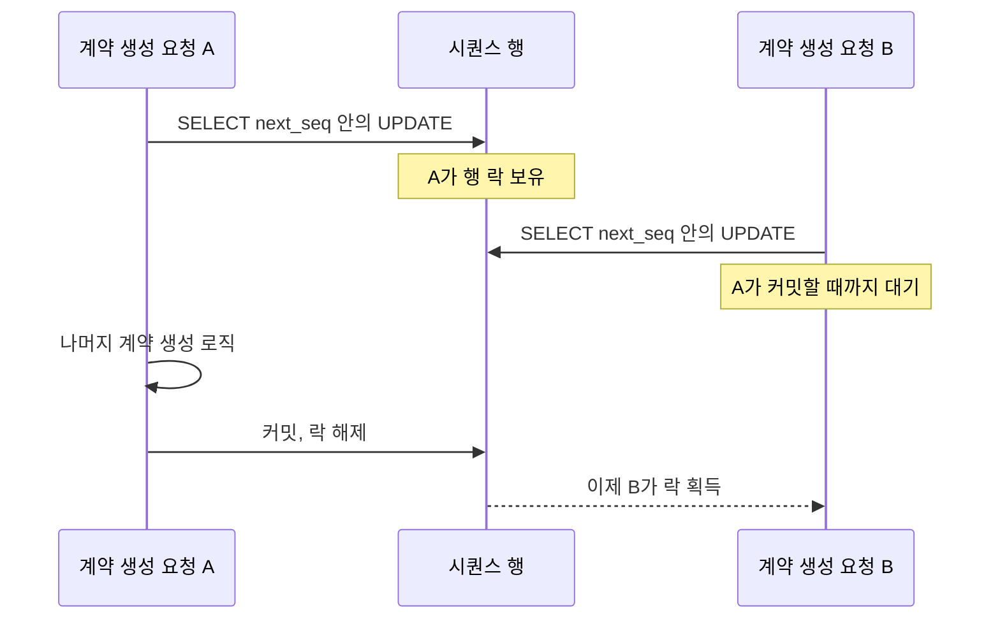
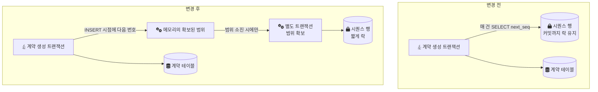
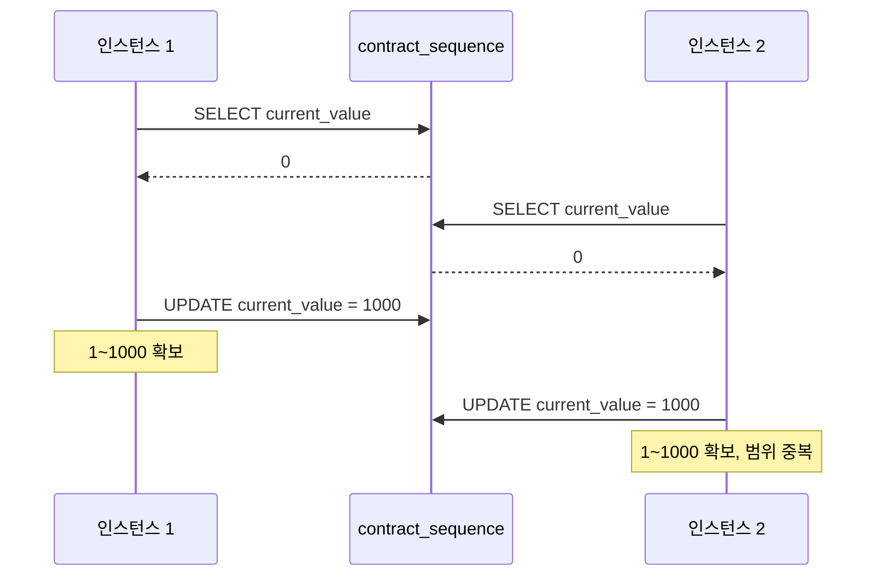
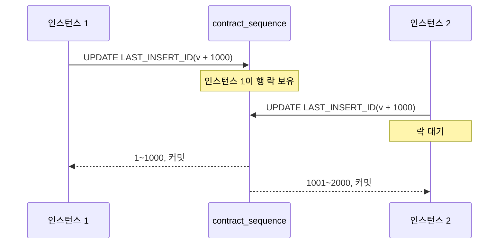

[1편](/posts/legacy-jsp-system-refactoring-1/)에서 다룬 입력 구조와 같은 시기에, 음원 콘텐츠 플랫폼(MCP)의 계약 생성이 2분씩 걸리는 문제를 고쳤다. 원인은 계약 코드를 발급하는 방식, 즉 채번(번호를 매기는 일) 구조에 있었다. 이 글은 그 구조가 왜 락 경합을 만들었는지, 무엇을 바꿔 10초로 줄였는지, 그리고 나중에 확인한 그 설계의 결함까지 정리한다.

> 이 글의 SQL과 코드는 회사의 실제 소스가 아니다. 기존 구조는 설명을 위한 재구성 예시이고, 개선 방향의 코드는 같은 구조를 다시 만든 개인 랩(engineering-lab의 mcp-platform 모듈)의 코드다. 랩 코드는 그렇다고 표시했다.

---

## 조건

결론이 다른 시스템에도 통하는지 판단하려면 조건부터 알아야 한다.

- 계약 코드: 계약이 생성될 때마다 발급된다. 정산과 외부 유통이 계약을 가리킬 때 쓰는 핵심 식별자다.
- 스택: Java, Spring Boot, MySQL. 데이터 변경은 MyBatis가 맡았다.
- 팀: 백엔드 3명. 나는 백엔드 리딩을 맡았고, 이 채번 구조 개선은 내가 직접 구현한 범위다.
- 트래픽: 운영 인스턴스는 여러 대였지만 사용자와 트래픽 자체가 적은 내부 시스템이었다. 당시 설계도 단일 서버 위주로 쓰인다는 전제에서 출발했다.

계약 건수나 초당 요청 수 같은 규모 수치는 기록이 없다. 이 글에서 운영에서 나온 숫자는 계약 생성 처리 시간의 변경 전과 후, 2분과 10초뿐이다. 랩에서 나온 숫자는 그때마다 랩이라고 밝힌다.

---

## 증상: 계약 생성에 2분이 걸렸다

드러난 증상은 세 가지였다.

- 계약 생성 처리에 2분이 걸렸다.
- 요청이 동시에 들어오면 대기 시간이 늘었다.
- 배치 처리에서도 병목이 커졌다.

세 증상은 모두 "동시에 하면 더 느려진다"는 방향을 가리킨다. 혼자 실행될 때의 계산 비용보다, 여러 요청이 같은 자원을 두고 순서를 기다리는 비용을 의심하게 만드는 모양이다.

---

## 원인: SELECT 안에서 일어나는 UPDATE

계약 코드는 SELECT 문 안에서 시퀀스 증가 함수를 호출해 받아 오고 있었다. 그 함수가 시퀀스 테이블의 행을 UPDATE했고, 그 UPDATE가 row-level 락 경합을 만들었다. 호출부는 대략 이런 모양이다.

```sql
-- 재구성 예시: 함수 이름과 구조는 설명용이다
SELECT next_seq('CONTRACT_CODE');

-- next_seq 내부에서 일어나는 일
UPDATE contract_sequence
SET current_value = current_value + 1
WHERE seq_key = 'CONTRACT_CODE';
```

문장은 SELECT이고 이름도 "다음 번호를 가져온다"로 읽히지만, 함수 안에서 행을 갱신하므로 이 호출은 쓰기이고 쓰기에 따르는 배타 락을 건다. InnoDB에서 행을 갱신하며 건 락은 그 트랜잭션이 커밋하거나 롤백할 때 풀린다. [MySQL 문서](https://dev.mysql.com/doc/refman/8.0/en/innodb-locking-reads.html)는 잠금 읽기가 거는 락을 "the same as if you issued an `UPDATE` statement for those rows"(그 행에 UPDATE를 실행한 것과 같다)라고 설명하고, 이 락이 커밋 또는 롤백 시점에 풀린다고 적는다.

채번이 계약 생성 트랜잭션 안에서 일어났으므로, 시퀀스 행의 락은 번호를 받은 순간부터 계약 생성 전체가 커밋될 때까지 유지됐다. 시퀀스 행은 계약 코드마다 하나뿐이다. 그래서 동시에 들어온 다른 계약 생성 요청과 배치는 앞선 트랜잭션이 끝날 때까지 그 행 앞에서 줄을 섰다.



당시 이 원인을 어떤 측정과 순서로 찾아냈는지는 기록이 남아 있지 않다. 그래서 진단 과정은 재구성하지 않는다.

---

## 결정: 세 가지를 함께 바꿨다

병목은 세 축으로 나눠 볼 수 있었다. 번호를 언제 받는가(채번 시점), 한 번에 몇 개를 받는가(채번 단위), 번호를 받는 일이 어느 트랜잭션에 속하는가(트랜잭션 경계). 세 축을 모두 바꿨다.

1. 채번 로직을 SELECT 단계에서 제거하고, 번호는 INSERT 시점에 소비하도록 옮겼다.
2. 시퀀스 테이블을 범위 할당(range allocation) 방식으로 바꿨다. 한 번의 증가로 여러 번호를 확보해 두고, 애플리케이션 메모리에서 순서대로 꺼내 쓴다.
3. 시퀀스 증가 로직을 별도 트랜잭션으로 분리했다.

바꾸기 전과 후의 경로를 나란히 놓으면 다음과 같다.



세 축은 서로 기대어 있다. 시점만 INSERT로 미루면 번호를 꺼내는 일이 여전히 시퀀스 행 UPDATE라서 경합 위치만 뒤로 밀린다. 범위로 받으면 시퀀스 행에 가는 횟수가 범위 크기만큼 줄지만, 그 UPDATE를 비즈니스 트랜잭션 안에서 실행하면 범위를 확보할 때마다 락이 다시 계약 생성 전체 길이만큼 유지된다. 별도 트랜잭션으로 떼어내야 시퀀스 행의 락 보유 시간이 비즈니스 로직의 길이와 분리된다.

---

## 별도 트랜잭션의 의미와 비용

Spring에서는 이것을 보통 `REQUIRES_NEW` 전파로 표현한다. [Spring 문서](https://docs.spring.io/spring-framework/reference/data-access/transaction/declarative/tx-propagation.html)는 `REQUIRES_NEW`가 바깥 트랜잭션에 참여하지 않는 독립된 물리 트랜잭션을 쓰며, 안쪽 트랜잭션의 락은 "released immediately after its completion"(끝나는 즉시 풀린다)이라고 설명한다.

같은 문서는 비용도 적는다. 바깥 트랜잭션이 커넥션을 쥔 채 안쪽 트랜잭션이 커넥션을 하나 더 받으므로, 커넥션 풀이 동시 스레드 수보다 최소 하나 이상 크지 않으면 이 옵션을 쓰지 말라고 경고한다. 당시 커넥션 풀 크기를 어떻게 잡았는지는 기록이 없다.

---

## 결번은 허용했다

범위 할당은 구조적으로 결번(쓰이지 않고 건너뛴 번호)을 만든다. 인스턴스가 범위를 확보한 뒤 다 쓰기 전에 재시작하면, 메모리에 남아 있던 번호는 버려진다. 계약 생성이 롤백돼도 이미 꺼낸 번호는 돌아오지 않는다. 별도 트랜잭션으로 확보한 범위는 이미 커밋됐기 때문이다.

이 설계는 결번이 생겨도 비즈니스상 큰 문제가 없다는 전제에서 출발했다. 계약 코드는 유일해야 하지만, 번호 사이에 빈 자리가 있다고 틀어지는 업무는 아니었다. 한 번에 확보하는 범위 크기를 얼마로 정했는지는 기록이 남아 있지 않다.

---

## 결과: 2분에서 10초로

계약 생성 처리 시간이 2분에서 10초로 줄었다. 락 대기와 배치 병목이 줄었고, 동시 요청에서도 처리 시간을 예측하기 쉬워졌다.

이 변경은 SQL 문장 하나를 빠르게 만든 것이 아니라 시퀀스 행의 락을 쥐는 시간과 횟수를 줄인 것이다. 다만 변경 전후에 락 대기 시간을 따로 재서 나눈 기록은 없으므로, 2분 중 얼마가 대기였는지는 숫자로 말할 수 없다.

---

## 회고 1: SELECT ... FOR UPDATE는 느리지 않았다

당시에는 `SELECT ... FOR UPDATE`처럼 행을 잠그는 조회 자체가 느리다고 판단해, 그것을 피하는 방향으로 설계했던 것 같다. 이후 직접 벤치마크해 보니 `SELECT ... FOR UPDATE`도 느리지 않았다. 범위를 청크 단위로 묶어 FOR UPDATE를 거는 방식으로도 충분한 성능이 나왔을 것이다. 그 벤치마크의 조건과 수치는 기록해 두지 않아 여기에 적지 못한다.

이 정정은 원인에 대한 해석을 바꾼다. 문제는 잠금 그 자체가 아니라, 잠금이 매 건마다, 그리고 비즈니스 트랜잭션 전체 길이만큼 걸리는 구조였다.

---

## 회고 2: 여러 인스턴스가 동시에 범위를 확보하면

이 설계에는 당시 예상하지 못한 빈틈이 있었다. 운영 인스턴스는 여러 대였고, 각 인스턴스는 자기 메모리의 범위가 소진되면 시퀀스 테이블에서 새 범위를 확보한다. 그런데 이 범위 확보 연산이 여러 인스턴스에서 동시에 실행될 수 있다는 점을 설계에서 고려하지 않았다. 범위 확보가 인스턴스 사이에서 항상 안전하게 직렬화된다는 보장이 없었다.

두 인스턴스가 거의 동시에 범위를 확보하면 겹치는 번호 범위를 받아 같은 계약 코드가 중복 발급될 위험이 이론적으로 있다. 트래픽이 적어 그런 순간 자체가 드물었고, 실제로 충돌이 일어난 적이 있는지는 확인되지 않았다.

빈틈의 모양을 보려고 랩에서 범위 확보를 "SELECT로 현재 값을 읽고, 애플리케이션에서 계산하고, 별도 UPDATE로 반영"하는 구조로 재구성했다. 세 단계가 하나의 원자적 연산으로 묶여 있지 않다.

```java
// 랩 코드: sequence/NonAtomicContractCodeAllocator.java (핵심 줄)
long current = jdbcTemplate.queryForObject(
        "SELECT current_value FROM contract_sequence WHERE seq_key = ?",
        Long.class, seqKey);                       // 1) 락 없이 읽는다
widenRaceWindow();                                 // 재현용 50ms 지연
long newValue = current + blockSize;               // 2) 메모리에서 계산한다
jdbcTemplate.update(
        "UPDATE contract_sequence SET current_value = ? WHERE seq_key = ?",
        newValue, seqKey);                         // 3) 따로 쓴다
return new AllocatedRange(current + 1, newValue);
```

두 인스턴스가 이 사이에 끼어들면 순서는 이렇게 된다.



평범한 SELECT는 락을 걸지 않으므로 두 인스턴스가 같은 값을 읽고, 두 UPDATE는 같은 값을 쓴다. 한쪽의 갱신이 사라지는 lost update다.

랩의 `NonAtomicAllocatorConcurrencyTest`는 Testcontainers로 띄운 MySQL에 10개 스레드를 동시에 출발시켜 각자 1,000개짜리 범위를 확보하게 한다. 스레드 하나가 인스턴스 하나 역할이다. 2026년 9월 29일 로컬 실행에서 이 구조는 겹치는 범위를 만들었고, 최종 시퀀스 값은 기대치 10,000에 못 미쳤다. 범위 크기 1,000과 스레드 수 10은 랩이 정한 값이다. SELECT와 UPDATE 사이에는 50ms 지연을 일부러 넣었다. 같은 머신의 로컬 MySQL에서는 두 문장 사이가 너무 짧아 지연 없이는 겹침이 매번 재현된다고 보장할 수 없었기 때문이다. 이 결과는 "이 구조에서는 겹칠 수 있다"를 보여줄 뿐, 운영에서 얼마나 자주 겹쳤을지는 말해 주지 않는다.

---

## 고치는 방향: 계산과 확정을 하나의 원자적 연산으로

문제를 인지한 뒤 정리한 방향은 범위를 계산하는 일과 확정하는(쓰는) 일을 떼어 놓지 않고, 인스턴스 수와 무관한 원자적 연산 하나로 묶는 것이다. 이 방향이 실제 운영 코드에 반영되고 배포됐는지는 확인되지 않았다. 아래 코드는 둘 다 랩의 구현이다.

첫째, 원자적 UPDATE 하나로 읽기, 계산, 쓰기를 묶는다. MySQL에는 `UPDATE ... RETURNING`이 없지만 `LAST_INSERT_ID(expr)`로 같은 효과를 낼 수 있다. [MySQL 문서](https://dev.mysql.com/doc/refman/8.0/en/information-functions.html)는 `UPDATE sequence SET id=LAST_INSERT_ID(id+1)` 다음에 `SELECT LAST_INSERT_ID()`로 값을 읽는 시퀀스 흉내 예제를 들고, 값이 커넥션 단위로 유지되므로 이 방식이 "multi-user safe"(여러 클라이언트가 동시에 써도 안전)하다고 적는다. 랩은 증가폭만 1에서 범위 크기로 바꿨다.

```java
// 랩 코드: sequence/AtomicUpdateContractCodeAllocator.java
@Transactional(propagation = Propagation.REQUIRES_NEW)
public AllocatedRange allocateBlock(String seqKey, int blockSize) {
    jdbcTemplate.update(
            "UPDATE contract_sequence SET current_value = LAST_INSERT_ID(current_value + ?) WHERE seq_key = ?",
            blockSize, seqKey);
    long blockEnd = jdbcTemplate.queryForObject("SELECT LAST_INSERT_ID()", Long.class);
    return new AllocatedRange(blockEnd - blockSize + 1, blockEnd);
}
```

`LAST_INSERT_ID()`는 커넥션 단위 상태라서, UPDATE와 그 뒤의 SELECT가 같은 커넥션에서 실행돼야 한다. 랩은 메서드를 `@Transactional`로 감싸 Spring이 두 호출에 같은 커넥션을 쓰게 했다.

둘째, `SELECT ... FOR UPDATE`로 시퀀스 행을 잠근 뒤 같은 트랜잭션 안에서 범위를 계산하고 갱신한다. 다른 인스턴스는 그 트랜잭션이 끝날 때까지 같은 행의 락을 기다리므로 범위가 겹칠 수 없다. 회고 1에서 적었듯 이 방식도 느리지 않았다.

랩에서 같은 10개 스레드, 1,000개 범위 조건으로 두 구현을 돌리면, 두 방식 모두 2회 반복에서 겹침 0건이었다. 원자적 UPDATE 쪽은 10개 범위를 정렬해 이어 붙이면 1부터 10,000까지 빈틈 없이 채워졌다.



두 방식 모두 인스턴스가 몇 대로 늘어도 그대로 안전하다. 그래서 채번에 인스턴스 식별자를 넣거나 인스턴스별로 시퀀스를 나눌 필요는 없다. 그렇게 하면 오히려 결번 관리가 복잡해진다. 트래픽이 더 커진다면 DB의 `AUTO_INCREMENT`를 그대로 쓰거나 전용 ID 생성기(Snowflake류)로 분리하는 것이 다음 대안이다.

---

## 비용과 남은 것

- 얻은 것: 계약 생성 처리 2분에서 10초. 시퀀스 행의 락 보유 시간이 비즈니스 로직의 길이와 분리됐다.
- 받아들인 것: 결번, 그리고 번호 순서와 생성 순서가 어긋날 수 있다는 점. 여러 인스턴스가 각자 다른 범위를 쓰면 나중에 만든 계약이 더 작은 번호를 받을 수 있다.
- 남은 것: 범위 확보의 인스턴스 간 직렬화. 고치는 방향은 정리했지만 반영 여부는 확인되지 않았다.
- 기록이 없는 것: 범위 크기, 커넥션 풀 크기, 원인을 찾은 과정, 회고 1의 벤치마크 조건.

다음 편은 같은 개편에서 [조회는 JPA·QueryDSL로, 변경은 MyBatis로 나눈 구조](/posts/legacy-jsp-system-refactoring-3/)에서 두 기술이 같은 테이블을 다르게 해석하는 지점을 다룬다.

## 참고

- [Locking Reads](https://dev.mysql.com/doc/refman/8.0/en/innodb-locking-reads.html) — MySQL 8.0 Reference Manual: 잠금 읽기가 거는 락과 해제 시점
- [Information Functions](https://dev.mysql.com/doc/refman/8.0/en/information-functions.html) — MySQL 8.0 Reference Manual: `LAST_INSERT_ID(expr)`로 시퀀스를 흉내 내는 예제
- [Transaction Propagation](https://docs.spring.io/spring-framework/reference/data-access/transaction/declarative/tx-propagation.html) — Spring Framework Reference: `REQUIRES_NEW`의 락 해제 시점과 커넥션 풀 경고
- [랩 코드: NonAtomicContractCodeAllocator.java](https://github.com/polynomeer/engineering-lab/blob/d52297d0ad07c3d8a05a7471192a5655cb8b1378/career-lab/mcp-platform/src/main/java/com/portfolio/mcplab/sequence/NonAtomicContractCodeAllocator.java) — GitHub
- [랩 코드: AtomicUpdateContractCodeAllocator.java](https://github.com/polynomeer/engineering-lab/blob/d52297d0ad07c3d8a05a7471192a5655cb8b1378/career-lab/mcp-platform/src/main/java/com/portfolio/mcplab/sequence/AtomicUpdateContractCodeAllocator.java) — GitHub
- [랩 코드: SelectForUpdateContractCodeAllocator.java](https://github.com/polynomeer/engineering-lab/blob/d52297d0ad07c3d8a05a7471192a5655cb8b1378/career-lab/mcp-platform/src/main/java/com/portfolio/mcplab/sequence/SelectForUpdateContractCodeAllocator.java) — GitHub
- [랩 코드: NonAtomicAllocatorConcurrencyTest.java](https://github.com/polynomeer/engineering-lab/blob/d52297d0ad07c3d8a05a7471192a5655cb8b1378/career-lab/mcp-platform/src/test/java/com/portfolio/mcplab/sequence/NonAtomicAllocatorConcurrencyTest.java) — GitHub
- [랩 README: mcp-platform](https://github.com/polynomeer/engineering-lab/blob/d52297d0ad07c3d8a05a7471192a5655cb8b1378/career-lab/mcp-platform/README.md) — GitHub
