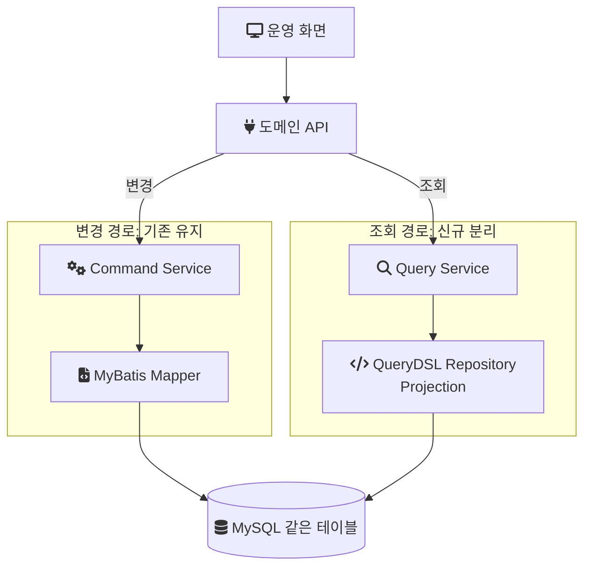
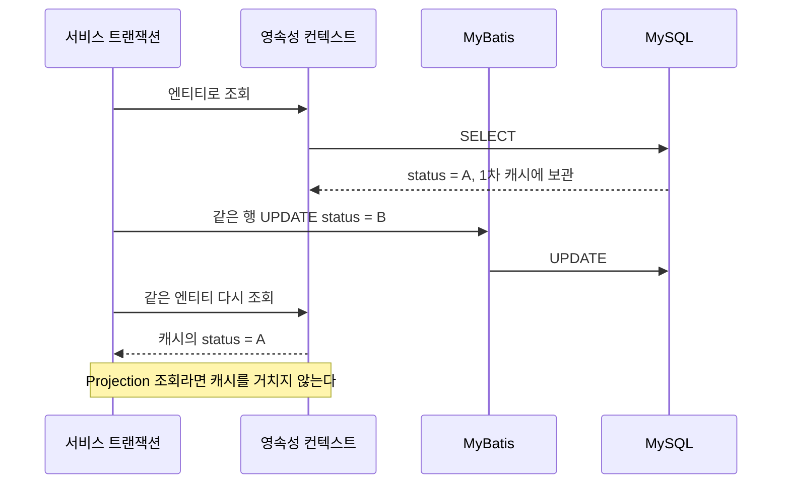
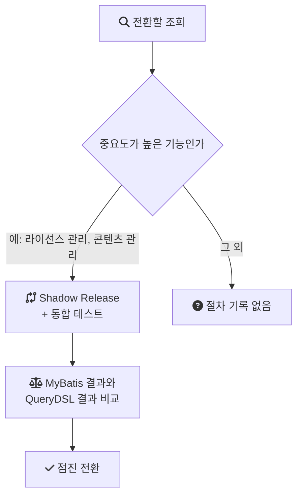

[2편](/posts/legacy-jsp-system-refactoring-2/)까지는 음원 콘텐츠 플랫폼(MCP)의 입력과 채번을 다뤘다. 이 글은 데이터 접근 계층이다. MCP 개편에서는 변경을 MyBatis에 그대로 두고 조회만 [JPA](/posts/jpa-architecture/)와 [QueryDSL](/posts/querydsl/)로 옮겼다. 그 결과 한 시스템 안에서 두 기술이 같은 테이블을 읽게 됐다. 이 글은 왜 그렇게 나눴는지, 두 기술이 같은 데이터를 다르게 해석하는 지점이 어디인지, 그리고 다시 쓴 조회가 기존과 같은 결과를 내는지 어떻게 확인했는지 정리한다.

> 이 글의 코드와 SQL은 회사의 실제 소스가 아니다. 구조를 설명하기 위한 재구성 예시이거나 일반적인 기법의 예시다. 불일치 유형과 대응 기법 중 당시 실제로 겪거나 적용했다는 기록이 없는 것은 일반론이라고 표시했다.

---

## 조건

- 시스템: 계약, 앨범, 곡 메타데이터와 라이선스 권리를 관리하는 사내 플랫폼. 서비스 상태가 "사용"인 트랙만 8천만 건이 넘는 데이터 위에서 운영됐다.
- 기간과 팀: 2024년 1월부터 11월까지, 백엔드 3명. 나는 백엔드 리딩을 맡았고 이 조회·변경 분리는 내가 직접 구현한 범위다.
- 스택: Java, Spring Boot, MyBatis, JPA, QueryDSL, MySQL. 저장소는 MySQL 하나다.

---

## 문제: 조회와 변경이 같은 매퍼에 있었다

기존 구조에서는 MyBatis 매퍼 하나가 조회 SQL과 변경 SQL을 함께 담고 있었다. 그래서 두 가지 일이 생겼다.

- 비슷한 조회 SQL이 여러 매퍼에 반복해서 작성됐다.
- 조회를 빠르게 하려고 매퍼의 SQL이나 결과 매핑을 고치면, 같은 매퍼를 쓰는 변경 로직이 영향을 받았다.

두 문제 모두 조회와 변경이 같은 계층, 같은 파일에 묶여 있는 데서 나온다.

---

## 결정: 변경은 MyBatis, 조회는 별도 Query 모델

변경은 기존 MyBatis 매퍼를 유지하고, 조회는 JPA 엔티티 위에 QueryDSL로 별도의 Query 모델을 만들었다. 저장소는 그대로 두고 코드 경로만 나눈 것이다. 명령(변경)과 조회의 모델을 분리하는 방식을 CQRS(Command Query Responsibility Segregation)라고 부르는데, 이 구조는 저장소까지 나누지 않는 가장 가벼운 형태에 해당한다.

풀려는 문제가 "조회 SQL의 중복"과 "조회 최적화가 변경에 미치는 영향"이었으므로, 변경 경로까지 새 스택으로 다시 쓸 필요는 없었다. 조회를 떼어내면 두 문제가 함께 풀린다.



조회 쪽에서 중요하게 본 것은 Projection(엔티티 전체가 아니라 필요한 컬럼만 DTO로 받는 방식)과 조건 조합을 일관되게 구성하는 것이었다. 아래는 그 형태의 재구성 예시다. 값이 null이면 그 조건을 건너뛰는 [동적 쿼리](/posts/dynamic-query/)를 조건 메서드 조합으로 쓴다.

```java
// 재구성 예시: 조회 전용 QueryDSL 리포지토리 (실제 코드 아님)
public List<ContractSummary> search(ContractSearchCondition c) {
    return queryFactory
        .select(Projections.constructor(ContractSummary.class,
            contract.id, contract.code, contract.status, album.title))
        .from(contract)
        .join(album).on(contract.albumId.eq(album.id))
        .where(distributorIdEq(c.distributorId()), statusEq(c.status()))
        .fetch();
}
```

---

## 같은 테이블, 두 가지 해석

이 결정에는 위험이 하나 따른다. 같은 테이블을 MyBatis는 SQL과 결과 맵으로, JPA는 엔티티 매핑으로 해석한다. 기존 조회 SQL을 그대로 옮긴 것이 아니라 QueryDSL로 다시 썼으므로, 같은 행을 읽어도 결과가 달라질 수 있다.

당시 실제로 어떤 불일치가 몇 건 나왔는지는 기록이 남아 있지 않다. 아래 네 가지는 두 기술을 같은 DB 위에 공존시킬 때 일반적으로 어긋나는 지점이다. 비교 로직을 짜거나 매핑을 설계할 때 미리 점검할 목록으로 쓸 수 있다.

### Enum 매핑

MyBatis는 문자열 컬럼을 문자열 그대로 내보내지만, JPA에서 `@Enumerated(EnumType.STRING)`으로 매핑하면 그 문자열을 enum 상수로 바꿔야 한다. `EnumType.STRING`은 [Jakarta Persistence Javadoc](https://jakarta.ee/specifications/persistence/3.1/apidocs/jakarta.persistence/jakarta/persistence/enumtype)의 설명대로 enum 값을 문자열로 저장하는 방식이다. 문자열을 enum 상수로 되돌리는 `Enum.valueOf`는 해당 이름의 상수가 없으면 `IllegalArgumentException`을 던진다([Enum.valueOf Javadoc](https://docs.oracle.com/en/java/javase/21/docs/api/java.base/java/lang/Enum.html)).

그래서 변경 경로(MyBatis)가 enum 정의 밖의 문자열을 하나라도 남기면, 조회 경로(JPA)는 그 행을 읽는 순간 실패한다. MyBatis로 읽을 때는 문제가 없던 데이터가 JPA로 읽을 때 처음 드러나는 셈이다.

### 날짜와 기본값

SQL에서 `NOW()` 같은 함수나 컬럼 기본값으로 채우던 값을 JPA에서 다르게 다루면 차이가 생긴다. 타임존 해석, 초 단위 이하의 정밀도, `TIMESTAMP` 자동 갱신 여부가 매퍼와 엔티티에서 다를 수 있다.

### null과 기본값

MyBatis 결과 맵에서 null인 값이 Projection 생성자의 기본 타입(`int`, `long`)으로 들어가면 0이 된다. 엔티티에 `nullable = false` 같은 제약을 걸었는데 DB에 null이 있으면 로딩이나 저장 단계에서 오류가 난다.

### SQL에 박혀 있던 규칙

조회 SQL 안에 `CASE` 문으로 들어 있던 상태 계산이나 포맷팅을 Java 코드로 옮기면 경계 조건이 달라질 수 있다. 기존 SQL만 보고 옮기면 누락되기도 쉽다.

---

## 영속성 컨텍스트와 MyBatis의 변경

두 기술이 같은 `DataSource`와 하나의 트랜잭션 매니저를 공유하면, 한 트랜잭션 안에서 같은 커넥션을 쓴다. 여기서 주의할 것은 JPA의 영속성 컨텍스트다. 영속성 컨텍스트는 트랜잭션 안에서 조회한 엔티티를 1차 캐시(트랜잭션 동안 들고 있는 엔티티 사본)에 보관한다. 같은 트랜잭션에서 MyBatis가 그 행을 바꾸면, JPA가 들고 있는 사본은 바뀐 내용을 모른다.

조회 모델을 엔티티가 아니라 Projection으로 구성하면 이 문제를 피할 수 있다. Projection은 결과를 DTO로 바로 받고 엔티티를 영속성 컨텍스트에 올리지 않으므로, MyBatis의 변경과 어긋날 사본이 생기지 않는다.



---

## 다시 쓴 조회를 어떻게 확인했나

라이선스 관리, 콘텐츠 관리처럼 중요도가 높은 기능은 통합 테스트에 더해 Shadow Release를 거쳐 점진 전환했다. Shadow Release는 기존 MyBatis 조회와 신규 QueryDSL 조회를 나란히 실행해 결과를 비교하되, 사용자에게는 기존 결과를 내보내는 방식이다.



전체 조회 API에 일괄 적용한 것은 아니다. 나머지 조회는 이 절차 없이 전환했을 가능성이 있는데, 정확한 적용 범위는 확인하지 못했다. Shadow Release를 얼마 동안 운영했는지, 어떤 불일치가 실제로 발견됐는지도 기록이 없다.

위의 불일치 유형은 비교 로직의 정규화 규칙으로 바로 옮겨진다. 정렬이 명세에 없는 조회는 같은 키로 정렬한 뒤 비교하고, null과 빈 문자열처럼 의미가 같은 값은 비교 전에 맞춰야 한다. 그렇지 않으면 실제로는 같은 결과가 전부 불일치로 잡힌다.

---

## 일반론: 정의 밖의 값을 다루는 기법

이 절은 당시 적용했다는 기록이 없는, 같은 상황에서 일반적으로 쓰는 기법이다.

첫째, enum 매핑을 안전하게 바꾼다. `@Enumerated` 대신 `@Convert`로 변환기를 지정하면, 읽기 경로에서 예외 대신 대체값을 돌려줄 수 있다. 변환기는 `AttributeConverter`를 구현하고, DB 컬럼 값을 엔티티 속성으로 바꾸는 메서드는 `convertToEntityAttribute`다([AttributeConverter Javadoc](https://jakarta.ee/specifications/persistence/3.1/apidocs/jakarta.persistence/jakarta/persistence/attributeconverter)).

```java
// 기법 설명용 예시
public enum Status {
    ACTIVE, INACTIVE, UNKNOWN;

    public static Status from(String value) {
        try {
            return Status.valueOf(value.toUpperCase());
        } catch (IllegalArgumentException | NullPointerException e) {
            return UNKNOWN;
        }
    }
}
```

대체값은 조회를 살리지만 잘못된 데이터를 가리기도 한다. `UNKNOWN`으로 읽힌 행이 몇 건인지 세지 않으면 문제를 덮은 것과 같다.

둘째, 전환 전에 데이터를 진단한다. enum 정의 밖의 값, null이 들어 있는 필수 컬럼을 SQL로 먼저 세어 보면 JPA 매핑이 어디서 깨질지 미리 알 수 있다.

```sql
-- 기법 설명용 예시: enum 정의 밖의 상태값 찾기
SELECT status, COUNT(*)
FROM contract
WHERE status NOT IN ('ACTIVE', 'INACTIVE')
GROUP BY status;
```

---

## 결과와 남은 것

조회와 변경의 책임이 분리됐다. 조회 SQL을 매퍼마다 반복해서 쓰던 일이 줄었고, 매퍼에는 변경 SQL만 남아 단순해졌다. 조회를 최적화해도 변경 경로에 영향이 없으므로 어떤 수정이 어디에 영향을 주는지 파악하기 쉬워졌다. 이 효과를 수치로 잰 기록은 없다.

남은 비용도 있다.

- 두 스택이 공존한다. MyBatis와 JPA가 같은 테이블을 다르게 해석하는 지점은 코드베이스에 계속 남고, 새로 합류한 사람은 두 기술을 모두 알아야 한다.
- Shadow Release를 적용한 조회는 전환 기간 동안 쿼리가 두 번 나간다.
- 개인 랩(mcp-platform)은 아직 MyBatis와 QueryDSL 이원화와 Shadow 비교를 재현하지 않는다.

다음 편은 같은 개편에서 [화면 단위 API를 도메인 책임 API로 옮긴 과정](/posts/legacy-jsp-system-refactoring-4/)을 다룬다.

## 참고

- [Jakarta Persistence 3.1, EnumType](https://jakarta.ee/specifications/persistence/3.1/apidocs/jakarta.persistence/jakarta/persistence/enumtype) — Jakarta EE
- [Jakarta Persistence 3.1, AttributeConverter](https://jakarta.ee/specifications/persistence/3.1/apidocs/jakarta.persistence/jakarta/persistence/attributeconverter) — Jakarta EE
- [Java SE 21, Enum.valueOf](https://docs.oracle.com/en/java/javase/21/docs/api/java.base/java/lang/Enum.html) — Oracle Docs
- [Querydsl을 사용하는 이유와 기본 패턴](/posts/querydsl/)
- [랩 README: mcp-platform](https://github.com/polynomeer/engineering-lab/blob/d52297d0ad07c3d8a05a7471192a5655cb8b1378/career-lab/mcp-platform/README.md) — GitHub: 재현 범위와 제외 항목(MyBatis·QueryDSL 이원화 미재현)
