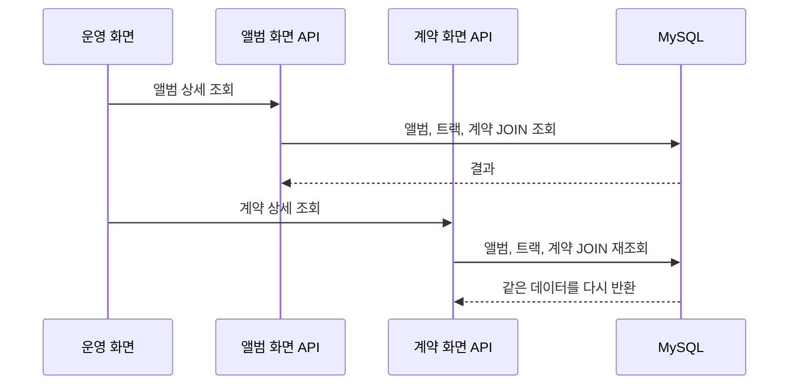
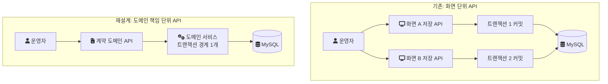
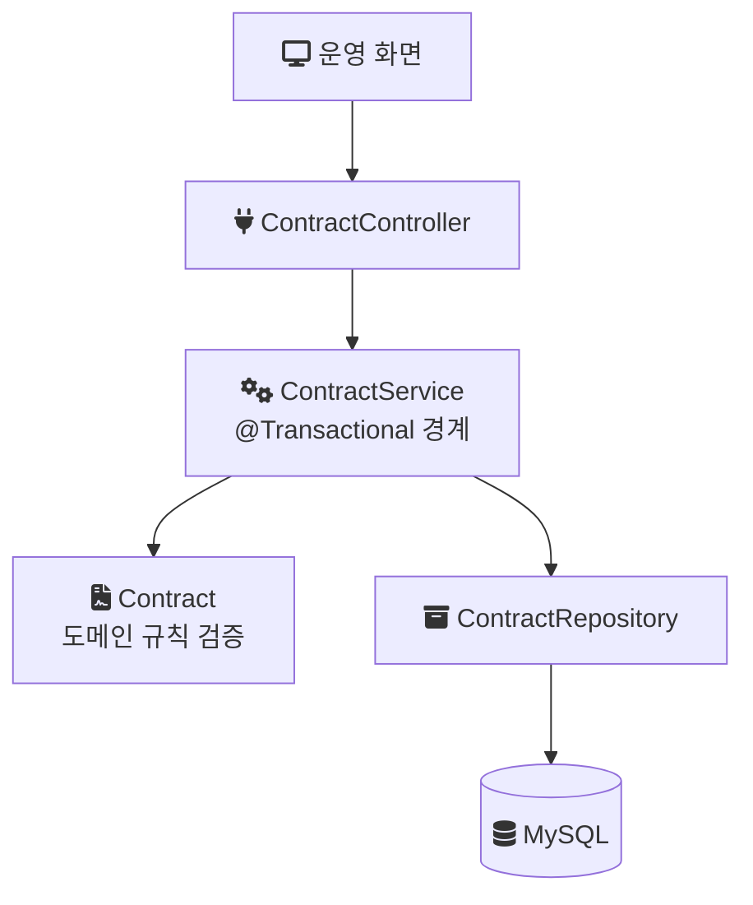
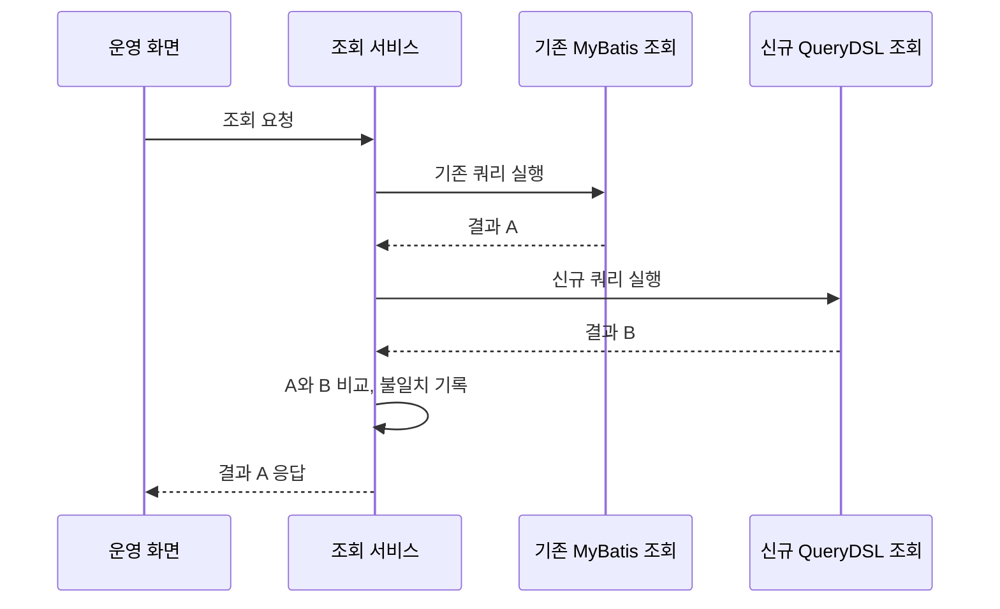

[1편](/posts/legacy-jsp-system-refactoring-1/)부터 [3편](/posts/legacy-jsp-system-refactoring-3/)까지는 음원 콘텐츠 플랫폼(MCP) 개편에서 입력, 채번, 데이터 접근 계층을 다뤘다. 이 글은 그 위에 있는 API의 단위다. 기존 API는 화면 하나에 맞춰 만들어져 있었고, 그 결과 같은 데이터를 여러 번 읽고 하나의 변경을 여러 API에 나눠 담고 있었다. 이 글은 그 구조가 어떤 증상으로 드러났는지, API를 어떤 기준으로 다시 나눴는지, 트랜잭션 경계를 어디에 두었는지, 그리고 새 API로 옮기는 동안 무엇으로 확인했는지 정리한다.

> 이 글의 다이어그램과 코드는 회사의 실제 소스가 아니다. 구조를 설명하기 위한 재구성 예시이거나, 같은 구조를 처음부터 다시 만든 개인 랩(engineering-lab의 mcp-platform 모듈)의 코드이며, 랩 코드는 그렇다고 표시했다. 마지막의 이관 기법 절은 당시 경험이 아니라 일반론이다.

---

## 조건

- 시스템: 계약, 앨범, 곡 메타데이터와 라이선스 권리를 관리하는 사내 플랫폼. 사용자는 정산, 라이선스, 데이터 관련 부서의 운영자다.
- 기간과 팀: 2024년 1월부터 11월까지, 백엔드 3명. 나는 백엔드 리딩을 맡았다. 원래 팀이 풀스택으로 담당하던 프로젝트라 프론트엔드와도 일정과 아키텍처를 공유했다.
- 내 범위: 이 글의 API 재설계는 내가 직접 구현했다. 내가 맡은 API는 앨범·트랙·계약·지분율 관리이고, 나머지 API는 다른 두 명이 나눠 맡았다.
- 스택: Java, Spring Boot, JPA, MapStruct, MySQL. 응답 시간은 Datadog 대시보드로 관찰했다.

---

## 증상: 같은 데이터를 여러 번 읽고, 변경은 순서에 의존했다

문제는 두 갈래로 드러났다.

첫째는 조회였다. API가 화면 단위로 나뉘어 있어서, 앨범 화면 API와 계약 화면 API가 각자 필요한 데이터를 따로 읽었다. 두 화면이 보는 데이터는 상당 부분 겹쳤다. 그래서 같은 테이블 조합을 여러 API가 반복해서 조회했고, 이 과정에서 슬로우 쿼리가 생겼다. Datadog에서 본 재설계 전 API 응답 시간은 1.5초 수준이었다. 이 값이 평균인지 P95(전체 요청의 95%가 이 시간 안에 끝나는 값)인지 같은 집계 기준은 기억나지 않는다.

아래 그림은 구조를 설명하기 위한 재구성 예시다. 화면마다 API가 있으면 한 번의 업무 흐름에서 같은 JOIN이 두 번 나간다.



둘째는 변경이었다. 하나의 업무상 변경이 여러 API에 나뉘어 있어서, 운영자가 특정 순서로 API를 호출해야만 데이터 정합성이 유지됐다.

트랜잭션 경계(함께 커밋되거나 함께 롤백되는 작업의 범위)로 보면 위험이 분명해진다. 서로 다른 API 호출은 각자 별도의 트랜잭션이다. 첫 번째 호출이 커밋된 뒤 두 번째 호출이 실패하면, 첫 번째 변경은 이미 DB에 남는다. 정합성을 지키는 책임이 코드가 아니라 운영자의 호출 순서에 있었다.



---

## 원인: API의 단위가 화면이었다

두 증상의 원인은 같았다. API를 나눈 기준이 데이터의 책임이 아니라 화면이었다.

화면 기준으로 API를 만들면 화면이 필요로 하는 데이터 묶음마다 조회가 생긴다. 화면끼리 데이터가 겹치면 조회도 겹친다. 변경도 화면의 저장 버튼 단위로 만들어진다. 계약 조건 변경 같은 도메인 개념 하나가 여러 화면에 걸쳐 있으면 그 변경 로직도 여러 API에 나뉜다. 어느 API가 어떤 도메인 규칙을 책임지는지 코드에서 드러나지 않으니, 규칙을 지키는 방법이 "이 순서로 호출한다"는 운영 지식으로 남는다.

쿼리 하나하나를 빠르게 만들어도 같은 데이터를 여러 번 읽는 구조와 호출 순서에 의존하는 변경은 그대로 남는다. 그래서 고칠 대상은 쿼리보다 API의 단위였다.

---

## 결정: 도메인 책임으로 나누고, 변경은 한 트랜잭션에

결정은 세 가지였다.

1. 화면 중심 API를 도메인 책임 기반 REST API로 재설계한다. 앨범, 트랙, 계약, 지분율처럼 데이터를 책임지는 도메인이 API의 단위가 된다.
2. 여러 API에 흩어진 변경 로직을 도메인 단위로 모은다. 하나의 업무상 변경은 하나의 서비스 메서드, 하나의 트랜잭션 안에서 끝나게 한다.
3. 조회 구조와 쿼리를 함께 정리한다. 반복 조회를 없애려면 API 단위만 바꿔서는 안 되고, 그 API가 실행하는 쿼리도 같이 다시 봐야 한다.

화면이 도메인 API를 조합해서 쓰게 되므로 프론트엔드의 호출부도 바뀐다. 백엔드만의 결정으로 끝나지 않는 변경이어서, 배포 전략과 도메인 규칙을 내가 설계해 프론트엔드를 포함한 팀과 공유하고 협의하며 진행했다.

---

## 구현: 트랜잭션 경계를 서비스 메서드 하나로

재설계 후에는 Controller가 요청을 받아 서비스에 넘기고, 서비스 메서드 하나가 트랜잭션 경계가 되며, 도메인 객체가 규칙을 검증하고, 저장소가 영속화를 맡는다.



아래는 랩에서 같은 구조를 다시 만든 코드다. 랩은 계약 도메인 하나만 최소 범위로 둔다. 계약 코드 확보, 도메인 객체 생성과 규칙 검증, 저장이 모두 이 메서드 안에서 함께 커밋되거나 함께 롤백된다. 계약 코드 확보 자체는 [2편](/posts/legacy-jsp-system-refactoring-2/)에서 다룬 대로 별도 트랜잭션이다.

```java
// 랩 코드: contract/application/ContractService.java
@Transactional
public String createContract(String counterpartyName, LocalDate startsAt, LocalDate expiresAt) {
    AllocatedRange range = contractCodeAllocator.allocateBlock("CONTRACT_CODE", 1);
    String contractCode = "MCP-%d-%06d".formatted(Year.now().getValue(), range.rangeStart());

    Contract contract = Contract.create(contractCode, counterpartyName, startsAt, expiresAt);
    contractRepository.save(contract);
    return contract.contractCode();
}
```

계약 코드 형식(`MCP-연도-번호`)은 랩이 정한 값이고 실제 형식이 아니다.

기존 구조에서 운영자가 API A, B를 순서대로 호출해야 했던 변경은, 이 구조에서는 서비스 메서드 하나의 호출이 된다. 중간에 실패하면 전체가 롤백되므로 중간 상태가 남지 않는다.

한 가지 주의할 점이 있다. Spring의 `@Transactional`은 프록시를 통해 적용된다. [Spring 문서](https://docs.spring.io/spring-framework/reference/data-access/transaction/declarative/annotations.html)는 "In proxy mode (which is the default), only external method calls coming in through the proxy are intercepted."라고 적는다(기본인 프록시 모드에서는 프록시를 거쳐 들어오는 외부 호출만 가로챈다). 같은 클래스 안에서 다른 `@Transactional` 메서드를 직접 호출하면 그 설정이 적용되지 않는다. 그래서 변경 로직을 모을 때 트랜잭션 경계는 Controller가 호출하는 서비스의 public 메서드 하나로 정하고, 세부 단계는 그 안의 일반 메서드나 도메인 객체의 메서드로 두었다.

---

## 옮기는 동안 무엇으로 확인했나

API의 단위를 바꾸면 화면이 부르는 API가 바뀌고, 조회 쿼리도 다시 쓰게 된다. 새 API가 기존과 같은 데이터를 돌려주는지 확인할 장치가 필요했다.

조회 쪽에서 라이선스 관리, 콘텐츠 관리처럼 중요도가 높은 기능은 통합 테스트에 더해 Shadow Release를 거쳐 점진 전환했다. 기존 MyBatis 조회와 신규 QueryDSL 조회를 나란히 실행해 결과를 비교하고, 사용자에게는 기존 결과를 내보내는 방식이다. 자세한 구조와 불일치 유형은 [3편](/posts/legacy-jsp-system-refactoring-3/)에 정리했다. 전체 조회 API에 적용한 것은 아니며, 나머지 조회를 어떤 절차로 옮겼는지는 확인하지 못했다.



배포 전략은 내가 설계해 팀과 공유했지만, 그 전략의 세부(어떤 단위로 나눠 배포했는지, 화면과 API를 어떤 순서로 바꿨는지)는 기록이 남아 있지 않다.

---

## 결과

Datadog 대시보드에서 재설계 전후 응답 시간을 관찰한 결과, 재설계 대상 API의 응답 시간이 1.5초에서 300ms로 줄었다. 80% 단축이다. 중복 조회와 슬로우 쿼리가 해소됐고, 운영자가 특정 순서로 API를 호출해야 하는 의존성이 없어졌다.

| 구분 | 기존 | 재설계 후 |
| --- | --- | --- |
| API 단위 | 화면 | 도메인 책임 (앨범, 트랙, 계약, 지분율) |
| 같은 데이터 조회 | 화면 API마다 반복 | 도메인 API 한 번 |
| 변경 로직 위치 | 여러 API에 분산 | 도메인 서비스 메서드 하나 |
| 정합성 유지 방법 | 운영자의 호출 순서 | 코드의 트랜잭션 |
| 응답 시간 (Datadog 관찰) | 1.5초 | 300ms |

---

## 한계와 비용

- 응답 시간의 집계 기준(평균, P95 등)은 기억나지 않는다. 같은 대시보드에서 전후 추이를 비교했다는 것까지만 말할 수 있다.
- API 단위 변경과 쿼리 정리를 함께 적용했기 때문에, 줄어든 폭 중 어느 쪽이 얼마를 기여했는지는 이 측정으로 나눌 수 없다.
- 화면이 호출하는 API가 바뀌므로 프론트엔드 변경이 함께 필요했다. 백엔드 단독으로 끝낼 수 있는 개선보다 일정 조율 비용이 컸다.
- 개인 랩은 계약 도메인 하나와 레이어 구조만 재현한다. 화면 단위 API와 도메인 API의 응답 시간을 같은 조건에서 비교하는 실험은 랩에 아직 없다.

---

## 일반론: 명세가 부족한 레거시 API를 옮길 때

이 절은 당시의 경험이 아니라, 기존 API의 동작이 문서로 남아 있지 않을 때 일반적으로 쓰는 기법을 정리한 것이다. 당시 이 기법들을 썼다는 기록은 없다.

기능 정의를 거꾸로 읽어 내는 출처는 두 가지다.

- 실제 트래픽: 브라우저 개발자 도구나 프록시 도구로 요청 URL, 메서드, 파라미터, 응답 구조를 캡처한다. WAS 접근 로그로 어떤 API가 실제로 얼마나 불리는지도 알 수 있다.
- 소스 코드: MyBatis 매퍼 XML의 SQL과 컨트롤러 매핑을 따라가면 화면 하나가 어떤 쿼리를 부르는지 알 수 있다.

읽어 낸 정의가 맞는지는 나란히 실행해 보며 확인한다. 같은 요청을 기존 API와 신규 API에 보내 응답을 비교하는 미러링이 대표적이다. NGINX의 mirror 모듈로 요청을 복제할 수는 있지만, [문서](https://nginx.org/en/docs/http/ngx_http_mirror_module.html)는 "Responses to mirror subrequests are ignored."라고 적는다(미러 요청의 응답은 버려진다). 그래서 응답을 비교하려면 신규 응답을 기록해 기존 응답과 맞대어 보는 로직을 따로 둬야 한다. 위의 Shadow Release는 이 비교를 애플리케이션 안에서 한 것이다.

비교로 확인한 뒤에는 트래픽을 나눠 옮긴다. Martin Fowler는 [Canary Release](https://martinfowler.com/bliki/CanaryRelease.html)를 새 버전을 일부 사용자에게 먼저 내보낸 뒤 전체로 넓혀 위험을 줄이는 기법으로 설명한다. 사용자가 사내 운영자로 한정된 시스템이라면, 일부 부서나 일부 화면부터 옮기는 방식이 같은 역할을 할 수 있다.

## 참고

- [Using @Transactional](https://docs.spring.io/spring-framework/reference/data-access/transaction/declarative/annotations.html) — Spring Framework Reference: 프록시 모드에서 외부 호출만 트랜잭션이 적용되는 동작
- [ngx_http_mirror_module](https://nginx.org/en/docs/http/ngx_http_mirror_module.html) — NGINX: 미러 요청의 응답 처리
- [CanaryRelease](https://martinfowler.com/bliki/CanaryRelease.html) — Martin Fowler
- [랩 코드: ContractController.java](https://github.com/polynomeer/engineering-lab/blob/d52297d0ad07c3d8a05a7471192a5655cb8b1378/career-lab/mcp-platform/src/main/java/com/portfolio/mcplab/contract/api/ContractController.java) — GitHub
- [랩 코드: ContractService.java](https://github.com/polynomeer/engineering-lab/blob/d52297d0ad07c3d8a05a7471192a5655cb8b1378/career-lab/mcp-platform/src/main/java/com/portfolio/mcplab/contract/application/ContractService.java) — GitHub
- [랩 README: mcp-platform](https://github.com/polynomeer/engineering-lab/blob/d52297d0ad07c3d8a05a7471192a5655cb8b1378/career-lab/mcp-platform/README.md) — GitHub
