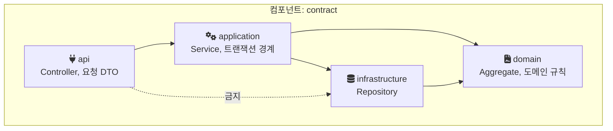
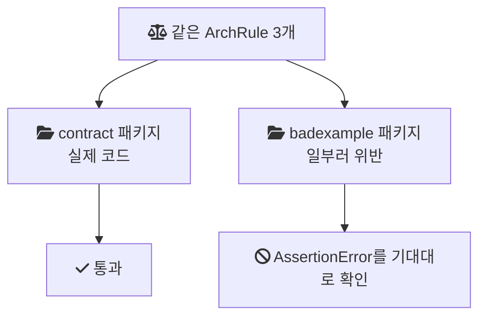
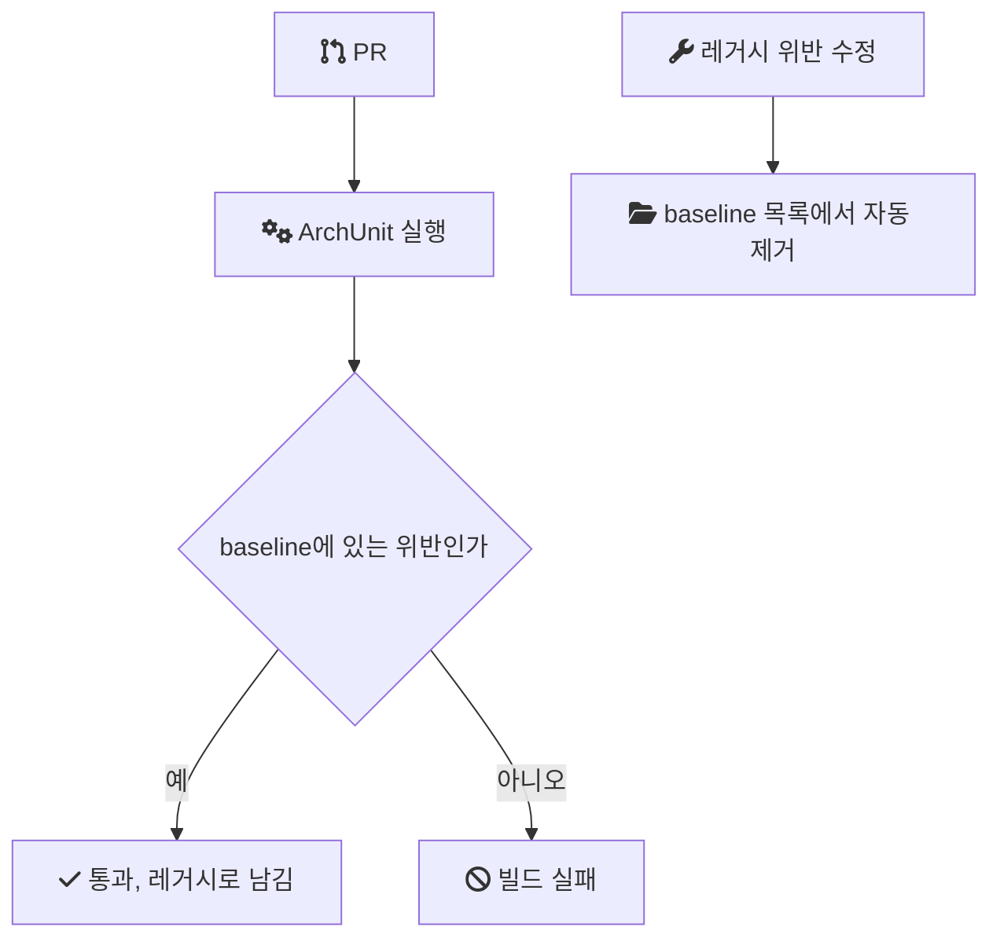

[1편](/posts/legacy-jsp-system-refactoring-1/)부터 [4편](/posts/legacy-jsp-system-refactoring-4/)까지 음원 콘텐츠 플랫폼(MCP) 개편에서 각 판단의 자리를 정했다. 필드 하나로 판단하는 규칙은 요청 DTO에, 다른 데이터를 봐야 하는 규칙은 도메인 객체에, 트랜잭션 경계는 서비스 메서드 하나에 둔다. 이 글은 그 약속이 세 명이 동시에 작업하는 코드베이스에서 어떻게 흐트러졌는지, 그리고 그 약속을 테스트와 PR 검증으로 옮겨 지킨 과정을 정리한다.

> 이 글의 코드는 회사의 실제 소스가 아니다. 같은 구조를 처음부터 다시 만든 개인 랩(engineering-lab의 mcp-platform 모듈)의 코드이거나 일반적인 기법을 설명하기 위한 예시이며, 각각 그렇다고 표시했다.

## 조건

- 기간과 팀: 2024년 1월부터 11월까지, 백엔드 3명. 나는 백엔드 리딩을 맡아 공통 기능, ArchUnit 아키텍처 규칙, 앨범·트랙·계약·지분율 관리 API를 직접 구현했고, 나머지 API는 다른 두 명이 나눠 맡았다.
- 스택: Java, Spring Boot, JPA, MapStruct, MySQL, ArchUnit, SonarCloud.
- 직전 경험: 이전 프로젝트(음원 유통 시스템 MDS)에서는 시니어 개발자가 ArchUnit으로 설계한 계약 강제 구조를 따라 개발했다. MCP에서는 그 구조를 직접 설계하고 적용하는 역할을 맡았다.

## 판단 로직은 서버의 정해진 자리에

규칙을 코드로 강제하기 전에, 무엇을 지키려는지부터 적는다. 개편의 방향은 판단 로직을 정해진 계층에 모으는 것이었다.

판단을 화면 쪽에 두지 않는 이유는 일반적인 보안 원칙과도 같다. [OWASP Input Validation Cheat Sheet](https://cheatsheetseries.owasp.org/cheatsheets/Input_Validation_Cheat_Sheet.html)는 "Client-side validation is bypassable; use it for immediate feedback."라고 적는다(클라이언트 검증은 우회할 수 있으니 즉각적인 피드백 용도로 쓰라). 화면의 검증은 사용자 경험을 위해 둘 수 있지만, 규칙을 지키는 최종 책임은 서버에 있어야 한다.

서버 안에서는 그 책임을 다시 계층별로 나눴다.

| 판단 | 자리 | 다룬 편 |
| --- | --- | --- |
| 필드 하나로 판단하는 형식 규칙 | 요청 DTO의 Bean Validation | 1편 |
| 다른 필드, 다른 엔티티를 봐야 하는 규칙 | 도메인 객체(Aggregate) | 1편 |
| 하나의 업무상 변경을 묶는 범위 | 서비스 메서드 하나의 트랜잭션 | 4편 |
| DTO와 도메인 사이의 변환 | MapStruct 매퍼 | 1편, 이 글 |

## 문제: 약속이 동시 작업 속에서 흐트러졌다

재설계의 방향은 팀에 공유되어 있었다. 그런데 재설계가 진행되며 여러 개발자가 동시에 작업하자 네 가지 문제가 쌓였다.

- 레이어 간 의존성이 얽혔다. 아래 계층이 위 계층을 참조하거나, 패키지끼리 서로를 참조하는 순환 의존이 생겼다.
- 서비스 계층을 우회하는 호출이 생겼다. Controller가 Service를 거치지 않고 저장소를 직접 부르면, 서비스에 모아둔 트랜잭션 경계와 도메인 규칙이 그 경로에는 적용되지 않는다.
- 도메인 규칙이 다시 분산됐다. 도메인 객체에 모으기로 한 규칙이 서비스나 컨트롤러에 들어갔다.
- DTO 매핑 방식이 통일되지 않았다. 같은 종류의 변환을 API마다 다른 방식으로 구현했다.

하나하나는 작은 위반이지만, 앞선 편의 설계가 의미를 갖기 위한 전제였다. 서비스 우회 호출이 하나 생기면 4편의 트랜잭션 경계가 그 경로에서 깨지고, 도메인 규칙이 흩어지면 1편의 단계 분리가 무너진다.

구조 규칙이 문서와 리뷰에만 있으면, 지켜지는지는 리뷰어가 매번 찾아내는 데 달려 있다. MDS에서 규칙이 테스트로 강제되는 코드베이스를 경험했기 때문에, 규칙을 코드로 옮기면 그 확인을 빌드가 맡는다는 차이를 알고 있었다.

## 결정: 구조, 매핑, 의존 규칙, PR 검증

결정은 네 가지였다.

1. 기능 중심 패키지 구조를 도메인 책임 중심의 Package-by-Component 구조로 바꾼다.
2. MapStruct 기반 DTO 매핑 규칙을 표준화한다.
3. 레이어 의존성 규칙을 ArchUnit 테스트 코드로 명문화한다.
4. SonarCloud로 PR마다 자동 검증한다.

적용 원칙은 하나였다. 신규로 추가되는 코드는 규칙을 100% 강제하고, 기존에 이미 존재하던 위반은 점진적으로 리팩터링하며 정리한다.

## Package-by-Component

Package-by-Component는 기술 계층(controller, service, repository)을 최상위로 두지 않고, 도메인 책임 단위(계약, 앨범, 트랙)를 최상위 패키지로 두는 방식이다. 각 컴포넌트 안에 api, application, domain, infrastructure 같은 계층을 둔다. 아래는 랩의 계약 컴포넌트 구조와 허용되는 의존 방향이다.



이 구조에서는 새 기능을 추가할 때 "어느 컴포넌트의 책임인가"를 정하면 패키지가 정해지고, 그 안에서 무엇이 무엇에 의존할 수 있는지는 규칙이 정한다. 계층 이름을 모든 컴포넌트에서 통일해야 `..api..` 같은 패턴 하나로 같은 규칙을 적용할 수 있다.

## 규칙을 테스트로 옮기기

[ArchUnit](https://www.archunit.org/userguide/html/000_Index.html)은 사용자 가이드의 표현대로 "a free, simple and extensible library for checking the architecture of your Java code"다. 컴파일된 클래스의 의존 관계를 분석해 구조 규칙을 JUnit 테스트로 표현한다. 규칙이 깨지면 테스트가 실패하고, CI(커밋마다 빌드와 테스트를 자동으로 돌리는 파이프라인)가 빌드를 막는다.

아래는 랩에서 다시 만든 규칙이다. 문제 목록의 서비스 우회 호출, 도메인의 프레임워크 의존, 레이어 의존 방향에 하나씩 대응한다.

```java
// 랩 코드: archrule/LayerArchitectureRules.java
public static final ArchRule CONTROLLERS_MUST_NOT_ACCESS_INFRASTRUCTURE =
        noClasses().that().resideInAPackage("..api..")
                .should().dependOnClassesThat().resideInAPackage("..infrastructure..");

public static final ArchRule DOMAIN_MUST_NOT_DEPEND_ON_SPRING_WEB =
        noClasses().that().resideInAPackage("..domain..")
                .should().dependOnClassesThat().resideInAnyPackage("org.springframework.web..");

public static final ArchRule LAYER_DEPENDENCY = Architectures.layeredArchitecture()
        .consideringAllDependencies()
        .layer("Api").definedBy(resideInAPackage("..api.."))
        .layer("Application").definedBy(resideInAPackage("..application.."))
        .layer("Domain").definedBy(resideInAPackage("..domain.."))
        .layer("Infrastructure").definedBy(resideInAPackage("..infrastructure.."))
        .whereLayer("Api").mayNotBeAccessedByAnyLayer()
        .whereLayer("Domain").mayOnlyBeAccessedByLayers("Application", "Infrastructure");
```

두 번째 규칙은 도메인 객체가 웹 계층의 타입을 알지 못하게 한다. 도메인 규칙이 HTTP 요청 객체 같은 것에 기대기 시작하면, 그 규칙은 웹 요청이 아닌 경로(배치, 메시지 소비)에서 재사용되지 못한다.

랩은 같은 규칙 인스턴스를 두 곳에 적용한다. `MainCodeArchitectureTest`는 실제 코드(`contract` 패키지)에 적용해 통과해야 하고, `ArchitectureViolationDemoTest`는 일부러 규칙을 어기도록 만든 테스트 전용 `badexample` 패키지에 적용해 `AssertionError`가 나는지 확인한다. 2026년 9월 29일 로컬 실행에서 세 규칙 모두 실제 코드에서는 통과하고 `badexample`에서는 위반으로 잡혔다. 실패하는 테스트를 커밋하면 빌드가 항상 깨지므로, "위반 시 예외가 던져진다"를 검증하는 통과 테스트로 표현했다.



랩을 만들며 확인한 것도 있다. `layeredArchitecture()`에서 "아무 계층도 접근할 수 없다"를 표현하려면 `mayNotBeAccessedByAnyLayer()`를 써야 하고, `mayOnlyBeAccessedByLayers()`를 인자 없이 부르면 `IllegalArgumentException`이 난다(archunit-junit5 1.3.0 기준).

## 위반이 이미 480건 쌓인 상태에서

규칙을 도입하는 시점에는 이미 위반이 쌓여 있었다. 정적 분석 위반은 480건이었다. 이 상태에서 규칙을 그대로 CI에 올리면 첫 실행부터 실패하고, 신규 코드가 규칙을 지켜도 모든 PR이 실패로 표시된다. 그래서 원칙을 "신규 코드는 100% 강제, 기존 위반은 점진 정리"로 정했다.

당시 이 원칙을 정확히 어떤 방식으로 구현했는지는 세부가 기억나지 않는다. 아래는 같은 원칙을 구현하는 일반적인 기법이고, 당시 이렇게 했다는 기록이 아니다.

ArchUnit에는 baseline(현재 위반을 목록으로 기록해 두고 그 밖의 새 위반만 실패로 처리하는 방식) 용도의 `FreezingArchRule`이 있다. 처음 실행할 때 위반을 저장소에 기록하고, 이후 실행에서는 기록에 없는 새 위반만 보고한다. 사용자 가이드는 "If violations are fixed, `FreezingArchRule` will automatically reduce the known stored violations to prevent any regression."이라고 설명한다(위반을 고치면 저장된 목록을 자동으로 줄여 회귀를 막는다).

```java
// 기법 설명용 예시: 기존 규칙을 baseline으로 감싸기
@ArchTest
static final ArchRule layerDependencyFrozen =
    FreezingArchRule.freeze(LayerArchitectureRules.LAYER_DEPENDENCY);
```



ArchUnit은 의존 관계를 본다. 코드 스멜, 중복, 복잡도는 보지 않는다. 그쪽은 SonarCloud로 PR마다 자동 검증했다. SonarCloud도 신규 코드와 기존 코드를 나눠 다루는 개념을 기본으로 갖고 있다. [문서](https://docs.sonarsource.com/sonarqube-cloud/standards/about-new-code/)는 New Code를 최근에 추가되거나 수정된 코드로 정의하고, "the built-in Quality gates Sonar Way defines conditions applying to new code only"라고 적는다(기본 Quality Gate의 조건은 신규 코드에만 적용된다). 당시 Quality Gate 조건을 어떻게 설정했는지는 기록이 없다.

## 결과

정적 분석 위반이 480건에서 75건으로 84% 줄었다. 레이어 침범과 순환 의존이 줄었고, 신규 기능을 추가할 때도 구조가 일관되게 유지되어 코드 리뷰 효율이 올라갔다.

480건을 75건까지 줄이는 동안의 큰 흐름은 앞의 원칙 그대로다. 신규 코드는 규칙을 어길 수 없게 하고, 기존 위반은 리팩터링하며 점진적으로 정리했다. 어떤 기준으로 정리 순서를 정했는지(심각도별로 나눴는지, 모듈별로 우선순위를 두었는지)는 기억나지 않아 재구성하지 않는다.

## 비용과 남은 것

- 규칙을 처음 설계하는 비용이 있다. 패키지 구조를 정하고 계층 이름을 통일한 뒤에야 패턴 하나로 모든 컴포넌트에 같은 규칙을 적용할 수 있다.
- 75건은 남았다. 점진 정리는 끝이 정해진 작업이 아니어서, 남은 위반을 언제까지 비울지는 별도의 결정이 필요하다.
- ArchUnit은 의존 방향은 잡지만 "이 규칙이 도메인 객체에 있어야 한다" 같은 의미 수준의 배치는 잡지 못한다. 그 부분은 여전히 리뷰의 몫이다.
- 개인 랩은 레이어 규칙 3개만 재현한다. `FreezingArchRule` baseline, SonarCloud 연동, 순환 의존 규칙은 아직 랩에 없다.

## 참고

- [OWASP Input Validation Cheat Sheet](https://cheatsheetseries.owasp.org/cheatsheets/Input_Validation_Cheat_Sheet.html) — OWASP Cheat Sheet Series: 클라이언트 검증의 한계
- [ArchUnit User Guide](https://www.archunit.org/userguide/html/000_Index.html) — ArchUnit: 레이어 규칙과 `FreezingArchRule`
- [SonarQube Cloud, About new code](https://docs.sonarsource.com/sonarqube-cloud/standards/about-new-code/) — docs.sonarsource.com: New Code 정의와 기본 Quality Gate의 적용 범위
- [랩 코드: LayerArchitectureRules.java](https://github.com/polynomeer/engineering-lab/blob/d52297d0ad07c3d8a05a7471192a5655cb8b1378/career-lab/mcp-platform/src/test/java/com/portfolio/mcplab/archrule/LayerArchitectureRules.java) — GitHub
- [랩 코드: MainCodeArchitectureTest.java](https://github.com/polynomeer/engineering-lab/blob/d52297d0ad07c3d8a05a7471192a5655cb8b1378/career-lab/mcp-platform/src/test/java/com/portfolio/mcplab/archrule/MainCodeArchitectureTest.java) — GitHub
- [랩 코드: ArchitectureViolationDemoTest.java](https://github.com/polynomeer/engineering-lab/blob/d52297d0ad07c3d8a05a7471192a5655cb8b1378/career-lab/mcp-platform/src/test/java/com/portfolio/mcplab/archrule/ArchitectureViolationDemoTest.java) — GitHub
- [랩 README: mcp-platform](https://github.com/polynomeer/engineering-lab/blob/d52297d0ad07c3d8a05a7471192a5655cb8b1378/career-lab/mcp-platform/README.md) — GitHub
