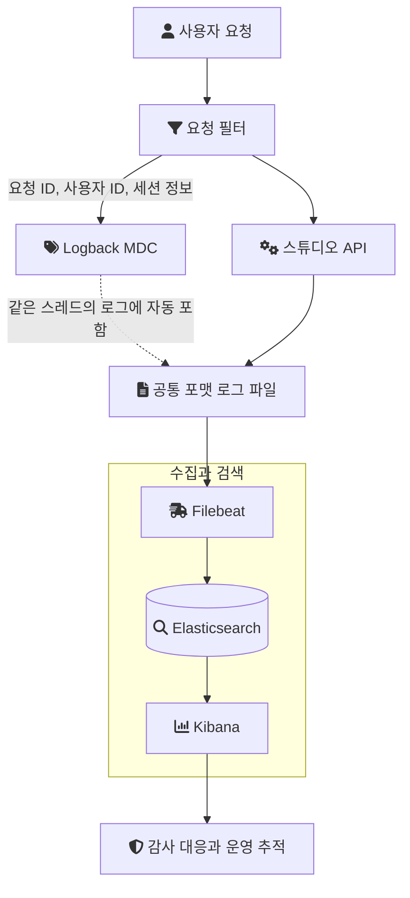
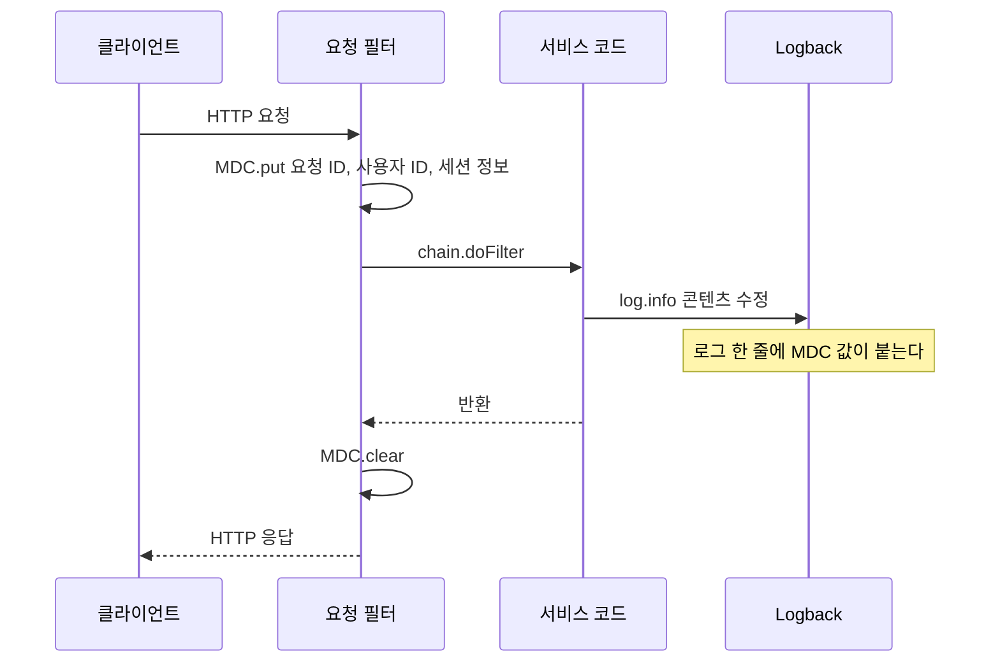
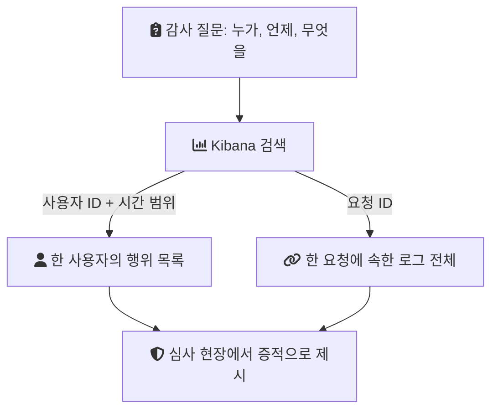

크리에이터 스튜디오는 누구나 오디오 콘텐츠를 만들어 음원 플랫폼에 배포할 수 있게 하는 B2C 제작 플랫폼이다. 회사가 ISMS 인증을 받고 있었기 때문에, 새로 만드는 이 서비스도 감사 질문에 로그로 답할 수 있어야 했다.

이 글은 그 요구를 위해 감사 로그의 모양을 정하고, 요청마다 식별 정보를 로그에 붙이고, 검색 가능한 저장소로 모은 과정을 정리한다. 각 요소의 일반적인 사용법은 [백엔드 시스템 로깅 베스트 프랙티스](/posts/logging-system-best-practice/)에서 다뤘다. 여기서는 이 서비스에서 실제로 정한 것과, 기록이 남아 있지 않아 적을 수 없는 것을 구분한다.

## 용어

- ISMS(정보보호 관리체계 인증): 기업이 정보보호 관리 체계를 갖추고 운영하는지 외부 심사로 확인받는 국내 인증이다. 심사에서는 정책 문서뿐 아니라 실제 운영 증적을 본다.
- ITGC(IT General Controls, IT 일반통제): 회계 감사에서 재무 데이터를 다루는 IT 시스템이 적절히 통제되는지 보는 항목이다.
- 감사 로그(Audit Log): 장애 분석용 로그와 달리, 누가 어떤 행위를 했는지 사후에 설명하기 위한 기록이다.
- MDC(Mapped Diagnostic Context): Logback 같은 로깅 라이브러리가 제공하는 스레드별 키-값 저장소다. 넣어 둔 값이 같은 스레드에서 찍는 로그에 자동으로 붙는다.
- ELK: Elasticsearch, Logstash, Kibana의 머리글자로 흔히 부르는 로그 수집·검색 묶음이다. 이 서비스에서는 Logstash 대신 Filebeat가 수집을 맡았다.

## 작업의 조건

| 항목 | 내용 |
| --- | --- |
| 서비스 | 오디오 콘텐츠 제작·배포 B2C 플랫폼 |
| 기간 | 2022년 4월부터 8월까지 초기 구축, 이후 정담당자로 유지보수 |
| 팀 | 초기 구축은 Java 개발자 3명. 감사 대응은 이후 내가 단독으로 맡았다 |
| 스택 | Java, Spring Boot, JPA, QueryDSL, MySQL, Redis, AWS |
| 로그 수집 | Logback, Filebeat, Elasticsearch, Kibana |
| 외부 요구 | ISMS 인증 심사, ITGC 회계 감사 |

로그 건수, 보관 기간, 인덱스 크기, 검색에 걸린 시간 같은 수치는 기록이 없다. 그래서 이 글은 성능 개선의 기록이 아니라, 감사 질문에 답할 수 있는 구조를 만든 기록이다.

## 문제: 감사 질문에 로그로 답할 체계가 없었다

감사 요구사항은 "누가, 언제, 무엇을 했는가"로 모인다. 로그로 이 질문에 답하려면 로그 한 줄에 행위자, 시각, 행위가 들어 있어야 하고, 여러 서버에 흩어진 로그를 한곳에서 조건으로 찾을 수 있어야 한다.

초기에는 이것을 일관되게 추적할 표준화된 로그 체계가 없었다. 로그가 남더라도 기능마다 모양이 다르면, 한 사용자의 행위를 여러 요청에 걸쳐 이어 붙이는 일을 감사 질문이 올 때마다 사람이 해야 한다.

## 결정: 포맷, 컨텍스트, 저장소를 함께 정한다

해결은 세 층으로 나눴다.

1. Audit Log의 포맷과 이벤트 구조를 표준화한다.
2. 요청 ID, 사용자 ID, 세션 정보를 Logback MDC에 넣어 공통 로그에 자동으로 포함한다.
3. 로그 파일을 Filebeat로 수집해 Elasticsearch에 쌓고, Kibana에서 검색한다.

세 층이 모두 필요한 이유는 각각이 다른 빈틈을 막기 때문이다. 포맷이 없으면 저장소에 모아도 검색 조건을 세울 수 없다. 컨텍스트가 없으면 포맷이 있어도 행위자 칸이 빈 로그가 생긴다. 저장소가 없으면 감사 질문마다 서버의 파일을 직접 뒤져야 한다.

전체 흐름은 다음과 같다.



## 구현 1: 포맷과 이벤트 구조를 고정한다

Audit Log의 포맷과 이벤트 구조를 표준화해, 어느 기능에서 남기든 같은 필드 이름과 같은 구조를 갖게 했다.

구체적인 필드 목록, 이벤트 분류 체계, 출력 형식이 JSON이었는지는 지금 기록으로 남아 있지 않다. 그래서 필드 예시를 만들어 넣지 않는다. 다만 표준화가 왜 수집보다 먼저인지는 수집 도구의 동작에서 드러난다.

[Filebeat의 filestream 입력 문서](https://www.elastic.co/guide/en/beats/filebeat/current/filebeat-input-filestream.html)는 JSON 파서에 대해 "Filebeat processes the logs line by line, so the JSON decoding only works if there is one JSON object per message."라고 적는다. 로그를 줄 단위로 읽으므로, 메시지 하나가 JSON 객체 하나여야 디코딩이 된다는 뜻이다. 일반적으로 구조화된 로그를 수집하려면 애플리케이션이 먼저 일정한 모양으로 써야 하고, 기능마다 모양이 다르면 Elasticsearch에 들어가도 필드로 나뉘지 않은 문자열이 된다.

## 구현 2: 요청마다 컨텍스트를 MDC에 넣는다

포맷이 "무엇을"을 검색 가능하게 한다면, MDC는 "누가"와 "어느 요청에서"를 채운다. 개발자가 로그를 찍을 때마다 사용자 ID를 넘기지 않아도 공통 로그에 들어가게 하는 것이 목적이었다.

MDC의 동작은 스레드 단위다. [Logback 매뉴얼](https://logback.qos.ch/manual/mdc.html)은 "The `MDC` manages contextual information on a _per thread basis_."라고 적는다. 요청 하나를 한 스레드가 처리하는 서블릿 방식에서는 요청이 들어올 때 값을 넣고 나갈 때 비우면, 그 사이의 모든 로그에 같은 값이 붙는다.

아래는 이 구조의 일반적인 형태를 보여주는 예시다. 회사 코드가 아니고, 개인 실험 저장소(engineering-lab의 creator-studio 모듈)에서도 감사 로그 부분은 아직 구현하지 않았다.

```java
// 구조 설명용 예시(실제 코드 아님)
public class AuditContextFilter extends OncePerRequestFilter {
    @Override
    protected void doFilterInternal(HttpServletRequest req, HttpServletResponse res, FilterChain chain)
            throws ServletException, IOException {
        MDC.put("requestId", UUID.randomUUID().toString());
        MDC.put("userId", resolveUserId(req));
        try {
            chain.doFilter(req, res);
        } finally {
            MDC.clear(); // 스레드가 풀로 돌아가기 전에 비운다
        }
    }
}
```

`finally`에서 비우는 이유는 서블릿 컨테이너가 스레드를 재사용하기 때문이다. 비우지 않으면 다음 요청이 같은 스레드를 받았을 때 이전 사용자의 ID가 남을 수 있다. 감사 로그에서 행위자가 잘못 찍히는 것은 로그가 없는 것보다 나쁘다.

요청 한 건 안에서 MDC 값이 생기고 사라지는 순서는 다음과 같다.



### 스레드가 바뀌면 컨텍스트는 따라가지 않는다

같은 성질이 반대 방향의 제약도 만든다. Logback 매뉴얼은 자식 스레드가 부모의 MDC를 자동으로 물려받지 않는다고 적고, 작업을 넘길 때 `MDC.getCopyOfContextMap()`으로 복사해 작업 스레드에서 `MDC.setContextMap()`으로 다시 넣는 방법을 안내한다.

이 서비스에는 그런 경계가 있었다. 콘텐츠 변경을 Braze, Mixpanel 같은 외부 시스템에 알리는 작업을 커밋 뒤 별도 스레드에서 실행했기 때문이다. 그 경로의 로그에는 요청 ID와 사용자 ID가 자동으로 붙지 않는다. 당시 비동기 경로에 MDC를 전파했는지는 기록이 없어, 경계가 있었다는 것까지만 적는다.

## 구현 3: Filebeat, Elasticsearch, Kibana로 모은다

수집 경로의 각 요소가 맡는 일은 다음과 같다.

| 요소 | 맡는 일 |
| --- | --- |
| Filebeat | 서버의 로그 파일을 읽어 Elasticsearch로 보낸다 |
| Elasticsearch | 로그를 필드 단위로 색인해 조건 검색이 가능하게 한다 |
| Kibana | 검색 조건을 화면에서 세우고 결과를 보여준다 |

공통 로그에 요청 ID와 사용자 ID가 들어 있으므로, Kibana에서 이 값과 시간 범위로 조건을 걸면 한 사용자 또는 한 요청의 로그를 한 화면에 모을 수 있다. 감사 질문에 답할 때 쓴 것도 이 검색이다.



Kibana 대시보드를 어떤 화면으로 구성했는지는 기록이 없다.

## 결과: 감사 대응에서 실제로 쓰였다

이 체계로 운영 이슈 추적과 보안 감사 대응이 쉬워졌다. 확인된 사실은 다음과 같다.

- 회사는 ISMS 인증을 3회 연속 통과했다. 이것은 회사 전체의 인증 이력이다.
- 나는 그중 2023년과 2024년, 두 차례 심사에 직접 참여했다.
- 참여한 심사에서 감사원의 질문에 답하며 이 Audit Log 체계를 직접 언급하고 시연했다.
- 같은 로그 체계는 ITGC 회계 감사 대응에도 쓰였다.

3회와 2회는 서로 다른 것을 센다. 앞은 회사의 인증 이력이고, 뒤는 내가 심사 현장에 있었던 횟수다. 인증 통과를 이 로그 체계 하나의 성과로 말할 수도 없다. ISMS 심사는 관리 체계 전체를 보기 때문이다. 이 체계가 한 일은 로그 관련 질문이 왔을 때 증적을 바로 찾아 보여줄 수 있게 한 것이다. 감사 응대 시간이 얼마나 줄었는지는 측정한 기록이 없다.

## 남은 것과 확인하지 못한 것

감사 로그는 기록이 남는 것만으로 끝나지 않는다. 기록을 믿을 수 있는지, 모든 경로에서 같은 정보가 남는지가 다음 질문이다.

- 위·변조 방지: 저장된 감사 로그를 고치거나 지우지 못하게 하는 장치가 있었는지 나는 모른다. 그래서 있었다고 적지 않는다.
- ITGC에서의 역할: 이 로그가 ITGC의 어떤 통제 항목의 증적으로 쓰였는지, 내가 직접 대응했는지는 확인하지 못했다.
- 심사별 참여 범위: 2023년과 2024년 심사에서 각각 어떤 부분을 맡았는지는 정리되어 있지 않다.
- 비동기 경로: 커밋 뒤 외부 연동 스레드의 로그에 요청 컨텍스트가 붙었는지는 기록이 없다.
- 수집 대상: 로그에 개인정보나 자격 증명이 섞이지 않게 어떤 필드를 걸렀는지도 기록이 없다. 수집 범위를 넓힐수록 유출 경로도 넓어지므로, 일반적으로 이 기준은 포맷 표준화와 함께 정해야 하는 항목이다.

## 정리

- 감사 질문에 로그로 답하려면 포맷, 컨텍스트, 저장소가 함께 있어야 한다. 하나가 빠지면 나머지가 있어도 질문에 답할 수 없다.
- MDC는 스레드 단위라서 요청 경계에서 넣고 비우기 쉽고, 같은 이유로 비동기 경계에서는 컨텍스트가 끊긴다.
- 인증 통과는 회사의 결과이고, 이 체계의 몫은 심사 현장에서 로그 증적을 바로 보여줄 수 있게 한 것이다.

## 참고

- [Chapter 8: Mapped Diagnostic Context](https://logback.qos.ch/manual/mdc.html) — Logback Manual: 스레드 단위 관리, 자식 스레드 비상속, 컨텍스트 복사 방법
- [Filebeat Reference: filestream input](https://www.elastic.co/guide/en/beats/filebeat/current/filebeat-input-filestream.html) — Elastic: 줄 단위 처리와 JSON 디코딩 조건
- [creator-studio README](https://github.com/polynomeer/engineering-lab/blob/d52297d0ad07c3d8a05a7471192a5655cb8b1378/career-lab/creator-studio/README.md) — 랩: 감사 로그(MDC/ELK)는 아직 랩 범위 밖
