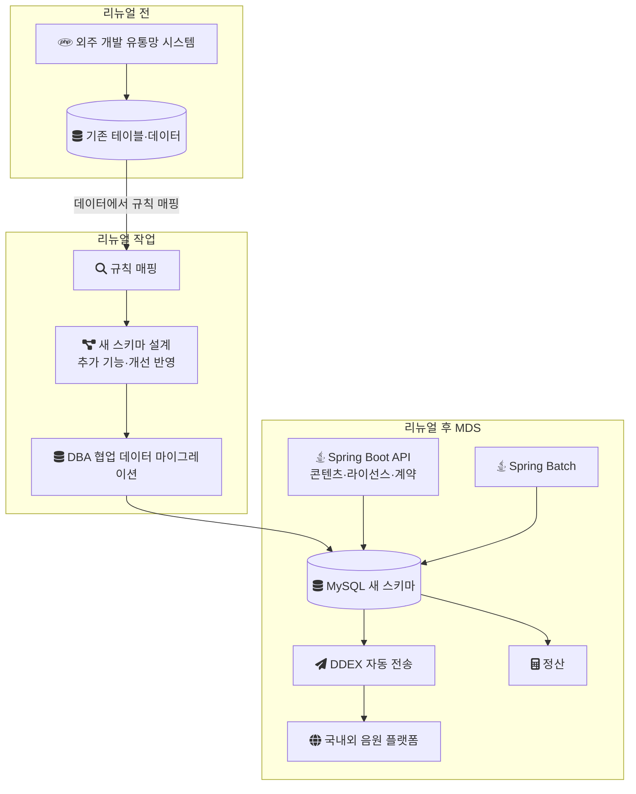
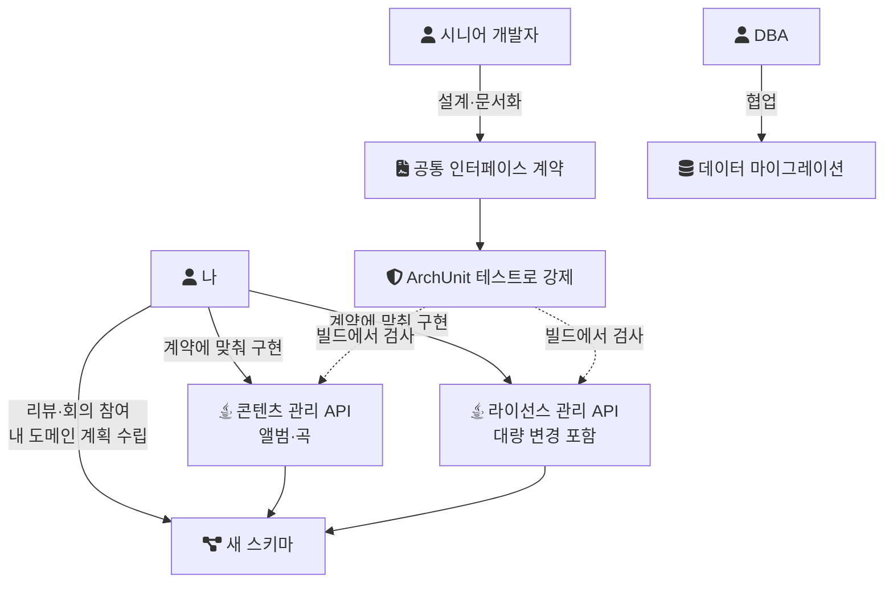

음원 플랫폼 회사에서 외주 개발사가 PHP로 만든 음원 유통 시스템을 새로 만든 프로젝트를 정리한다. 기존 시스템에서 넘겨받을 수 있었던 것은 테이블과 데이터뿐이었다. 그래서 이 프로젝트는 기존 코드를 옮기는 이관이 아니라, 기존 데이터에서 규칙을 읽어 스키마를 새로 설계하고 그 위에 시스템을 다시 세우는 리뉴얼이 되었다.

먼저 범위를 분명히 해 둔다. 기존 데이터에서 규칙을 매핑해 새 스키마를 설계한 작업은 내가 직접 한 일이 아니다. 나는 스키마 설계 리뷰와 데이터 마이그레이션 회의에 참여했고, 내 담당 도메인(콘텐츠·라이선스 관리)의 작업 계획을 세우는 데 적극적으로 참여했다. 내가 직접 만든 것은 새 스키마 위의 콘텐츠 관리 API와 라이선스 관리 API다. 이 글은 리뉴얼 전체를 배경으로 설명하고, 내 작업은 그 안에서 따로 표시한다.

## 어떤 시스템이었나

MDS(Music Distribution System)는 앨범과 곡을 등록·검수하고, DDEX 기반 자동 전송으로 국내외 음원 플랫폼에 유통하며, 그 수익을 정산하는 시스템이다. DDEX는 음악 산업에서 데이터를 주고받는 형식을 정하는 표준 단체이고, 스스로를 "a standards setting organisation focused on the creation of digital value chain standards"라고 소개한다(디지털 가치 사슬의 표준을 만드는 단체, [DDEX](https://ddex.net/)). 유통사가 플랫폼마다 다른 형식을 맞추지 않고 하나의 표준 메시지로 앨범과 곡 정보를 보낼 수 있게 해 준다.

정산은 계약·앨범·곡 메타데이터를 기준으로 수익을 계산하는 핵심 프로세스였다. 외부 연동, 배치 처리, 정산 로직이 계속 늘어나는 시스템이었다.

판단의 전제가 되는 조건은 다음과 같다.

| 항목 | 내용 |
| --- | --- |
| 기간 | 2023년 1월부터 2024년 1월까지 |
| 인원 | 백엔드 4명(시니어 1명, 주니어 3명, 나 포함), 정산개발팀 2명, 프론트엔드 4명(해외 소싱 개발자 2명 포함) |
| 스택 | Java, Spring Boot, JPA, Spring Batch, MySQL, Amazon SQS, ArchUnit |
| 내 역할 | 콘텐츠(앨범·곡) 관리 API와 라이선스 관리 API(대량 변경 기능 포함) 개발, 이후 계약관리 영역까지 인수인계받아 정담당자로 유지보수 |
| 공통 규칙 | 시니어 개발자가 설계한 공통 인터페이스 계약을 문서화하고 ArchUnit 테스트로 강제 |
| 협업 | 정산개발팀, 정산팀, 기획팀, 라이선스팀, 그리고 평소 협업이 잦지 않던 콘텐츠팀과 긴밀히 협업 |

테이블 수, 마이그레이션한 행 수, 마이그레이션에 걸린 시간 같은 규모 수치는 기록이 남아 있지 않다. 이 글의 내용은 그 수치 없이 "넘겨받은 것이 테이블과 데이터뿐이었다"는 조건 위에서 읽어야 한다.

## 넘겨받을 수 있었던 것은 테이블과 데이터뿐이었다

기존 유통망 시스템은 외주 개발사가 PHP로 개발했다. 그런데 테이블과 데이터 외에는 기존 시스템을 인수인계받거나 분석할 시간과 기회가 없었다. 코드를 읽고 동작을 옮기는 방식은 처음부터 선택지가 아니었다.

이 조건에서 남은 근거는 데이터다. 어떤 값이 어떤 컬럼에 들어 있고 행들이 서로 어떻게 이어지는지가 기존 시스템이 지키던 규칙의 흔적이다. 그래서 팀은 기존 DB 데이터를 기준으로 규칙을 모두 매핑해 스키마를 새로 설계했고, 그 뒤 DBA와 협업해 데이터 마이그레이션을 진행했다.

이 프로젝트를 내재화라고 부르지 않는 이유도 여기에 있다. 내재화는 보통 외주가 운영하던 시스템을 인수인계받아 내부 팀이 이어 운영하는 일을 뜻한다. 이 프로젝트는 인수인계가 없었고 스키마부터 새로 설계했으므로 리뉴얼로 부르는 편이 정확하다.

## 리뉴얼은 세 갈래가 동시에 진행됐다

리뉴얼은 순서대로 한 단계씩 진행되지 않았다. 기존 데이터에서 규칙을 매핑하는 일, 새 스키마에 추가 기능과 개선 사항을 반영하는 일, 기존 데이터를 새 스키마로 옮기는 일이 함께 진행됐다. 새 스키마 적용이 마이그레이션과 동시에 이루어졌다는 점이 이 프로젝트의 특징이다.

전후 구조를 그리면 다음과 같다.



세 갈래를 한 번에 진행하면 일정은 하나로 묶이지만, 확인할 거리는 겹친다. 마이그레이션 결과가 기대와 다를 때 그 원인은 매핑 규칙일 수도 있고, 새 스키마에 들어간 변경일 수도 있다. 이 프로젝트에서 그 둘을 어떤 절차로 나눠 확인했는지는 기록이 없다. 아래 일반 점검 항목은 그 구분에 쓰는 방법을 정리한 것이다.

## 내가 맡은 부분

나는 규칙 매핑을 직접 하지 않았다. 내가 참여한 지점은 세 곳이다.

- DB 스키마 설계 리뷰에 참여했다.
- 데이터 마이그레이션 관련 회의에 참여했다.
- 작업 계획을 세울 때 내 도메인인 콘텐츠·라이선스 관리의 계획에 적극적으로 참여했다.

구현은 새 스키마 위에서 했다. 콘텐츠(앨범·곡) 관리 API와 라이선스 관리 API를 만들었고, 라이선스 관리 API에는 대량 변경 기능이 포함됐다. 이 API들은 시니어 개발자가 설계한 공통 인터페이스를 기준으로 개발했다. 그 공통 인터페이스는 계약으로 문서화되어 있었고 ArchUnit 테스트로 강제됐다. ArchUnit은 "a free, simple and extensible library for checking the architecture of your Java code"다(Java 코드의 아키텍처 규칙을 테스트로 검사하는 라이브러리, [ArchUnit User Guide](https://www.archunit.org/userguide/html/000_Index.html)). 규칙이 테스트로 들어가 있으면 계약을 벗어난 코드는 리뷰 전에 빌드에서 걸린다.

역할의 경계를 그림으로 나누면 다음과 같다.



공통 인터페이스에 구체적으로 어떤 규칙이 들어 있었는지는 기록이 남아 있지 않아 여기서는 적지 않는다.

이후 계약관리 영역까지 인수인계받아 정담당자로 유지보수했다. 리뉴얼한 시스템 위에서 맡은 작업 중 결과가 기록으로 남은 것은 다음과 같다.

- 정산이 도는 동안 계약·앨범·곡 메타데이터 수정을 막는 장치를 만들었다. 앨범계약·곡계약·영상계약 테이블의 상태 플래그와 수정 API에 붙인 AOP 인터셉터로 정산 중 변경 요청을 사전에 차단했다.
- 폴링 기반 단일 스레드 배치로 처리하던 앨범 등록, 검수 요청, 외부 플랫폼 전송을 Amazon SQS 기반 이벤트 파이프라인으로 바꿨다. 평균 처리 대기 시간이 3~5분에서 1분 내외로 줄었다.
- 운영 담당자가 엑셀로 직접 처리하던 묵시적 계약 갱신과 라이선스 변경(권리이관, 서비스 중지/재개)을 Spring Batch Job과 Jenkins로 옮겼다. 월 1회 묵시적 계약 갱신은 담당자 1명 기준 8시간에서 4시간으로, 대형 권리이관이 있는 날의 일일 처리는 4시간에서 1시간 이내로 줄었다.

## 테이블과 데이터만 있을 때 확인할 것

여기부터는 이 프로젝트에서 내가 수행한 작업의 기록이 아니다. 테이블과 데이터만 남은 시스템을 다시 설계할 때 일반적으로 확인하는 항목을 정리한 것이다. 이 프로젝트의 규칙 매핑이 실제로 어떤 절차와 도구로 진행됐는지는 기록이 없다.

### 선언되지 않은 관계

외래 키 제약 없이 애플리케이션 코드만으로 조인되는 테이블이 흔하다. 제약이 없으면 스키마 정보만으로는 관계가 보이지 않으므로, 값이 실제로 이어지는지를 데이터로 확인한다.

```sql
-- 일반 예시: b.a_id가 a.id를 참조한다고 가정할 때 짝이 없는 행 찾기
SELECT COUNT(*) AS orphan_rows
FROM b
LEFT JOIN a ON a.id = b.a_id
WHERE b.a_id IS NOT NULL
  AND a.id IS NULL;
```

짝 없는 행이 0건이면 관계일 가능성이 높고, 일부 있으면 그 행들이 삭제 후 남은 흔적인지 다른 테이블을 가리키는 값인지를 따로 봐야 한다. 새 스키마에 외래 키 제약을 걸 계획이라면 이 행들을 어떻게 옮길지를 마이그레이션 전에 정해야 한다.

### 값의 분포로 읽는 규칙

코드 값 컬럼은 값의 분포를 보면 쓰임이 드러난다.

```sql
-- 일반 예시: 상태 코드 컬럼에 실제로 어떤 값이 얼마나 있는가
SELECT status_cd, COUNT(*) AS cnt, MIN(created_at), MAX(created_at)
FROM some_table
GROUP BY status_cd
ORDER BY cnt DESC;
```

어떤 값이 특정 기간 이후로 나타나지 않는다면 폐기된 상태일 수 있다. 이런 값은 새 스키마의 enum에 넣을지, 마이그레이션 시 다른 값으로 바꿀지를 정해야 한다. 날짜·금액 컬럼도 같은 방식으로 최솟값, 최댓값, NULL 비율을 보면 기본값이나 누락 규칙이 보인다.

### 같은 의미의 중복 컬럼

같은 의미의 값이 여러 테이블에 흩어져 있으면, 어느 쪽이 원본인지부터 정해야 한다. 두 컬럼의 값이 서로 다른 행이 있다면 그중 하나는 갱신이 누락된 사본일 수 있다. 새 스키마에서 한 곳으로 모을 때 어느 값을 기준으로 삼을지가 곧 매핑 규칙이 된다.

### 옮긴 결과를 비교하는 방법

규칙을 매핑해 옮긴 뒤에는 옛 데이터와 새 데이터에서 같은 질문의 답이 같은지를 비교한다. 행 수만 맞추면 매핑 오류가 숨는다. 업무상 의미가 있는 단위(계약 하나, 앨범 하나)로 집계해 비교하면 어느 규칙에서 어긋났는지 좁히기 쉽다.

```sql
-- 일반 예시: 계약 단위 곡 수를 옛 테이블과 새 테이블에서 비교
SELECT o.contract_key, o.track_cnt AS old_cnt, n.track_cnt AS new_cnt
FROM old_contract_summary o
JOIN new_contract_summary n ON n.contract_key = o.contract_key
WHERE o.track_cnt <> n.track_cnt;
```

새 스키마에 기능 변경이 함께 들어간 경우, 비교 쿼리는 "변경 때문에 달라져야 하는 차이"와 "매핑 오류로 생긴 차이"를 구분할 수 있게 짜야 한다. 앞에서 적은 동시 진행의 비용이 여기에서 드러난다.

## 기록이 남지 않은 것

이 프로젝트에서 다음 항목은 기록이 없어 쓰지 않았다.

- 규칙 매핑의 구체적인 절차, 사용한 도구, 매핑한 규칙의 수
- 테이블 수, 마이그레이션 대상 행 수, 마이그레이션 소요 시간
- 공통 인터페이스 계약에 들어 있던 ArchUnit 규칙의 내용
- 리뉴얼 전후의 운영 지표(장애 대응 시간, 기능 변경 반영 시간 등)

## 남는 교훈

넘겨받은 것이 데이터뿐일 때 데이터는 기존 시스템의 규칙을 알려 주는 유일한 근거가 된다. 그런데 그 근거를 읽어 규칙으로 바꾸는 일과 그 규칙 위에서 기능을 만드는 일은 서로 다른 작업이다. 이 프로젝트에서 나는 뒤쪽을 맡았고, 앞쪽에는 리뷰와 회의로 참여했다. 리뉴얼 경험을 말할 때 이 경계를 나눠 말해야 다른 사람이 자기 상황에 옮겨 쓸 수 있는 부분이 무엇인지 판단할 수 있다.

짝이 되는 글인 [대량 엑셀 다운로드를 메시지 큐와 S3 사전 생성으로 나누는 설계](/posts/rebuilding-outsourced-system-2/)는 MDS가 아니라 엑셀 다운로드 구조를 다룬다. MDS의 SQS 파이프라인에서 쓴 멱등 처리 방식(메시지 ID에 DB 유니크 제약)을 엑셀 생성 작업에 옮겨 보는 설계 글이다. 소스코드는 있지만 API 명세가 없는 레거시를 이관하는 경우는 [API 명세 없는 레거시 시스템의 신규 시스템 이관 전략](/posts/legacy-jsp-system-refactoring-4/)에서 다룬다.

## 참고

- [DDEX](https://ddex.net/) — DDEX 공식 사이트
- [ArchUnit User Guide](https://www.archunit.org/userguide/html/000_Index.html) — ArchUnit 공식 문서
- 랩 코드 (commit `d52297d`): [career-lab/mds-distribution README](https://github.com/polynomeer/engineering-lab/blob/d52297d0ad07c3d8a05a7471192a5655cb8b1378/career-lab/mds-distribution/README.md), 리뉴얼 이후의 정산 중 수정 차단과 메시지 멱등 처리를 다시 구현한 랩. 스키마 리뉴얼과 마이그레이션 과정은 랩에 없다.
