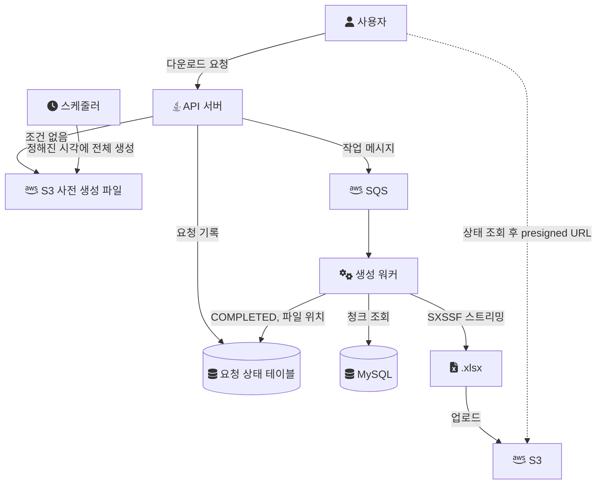
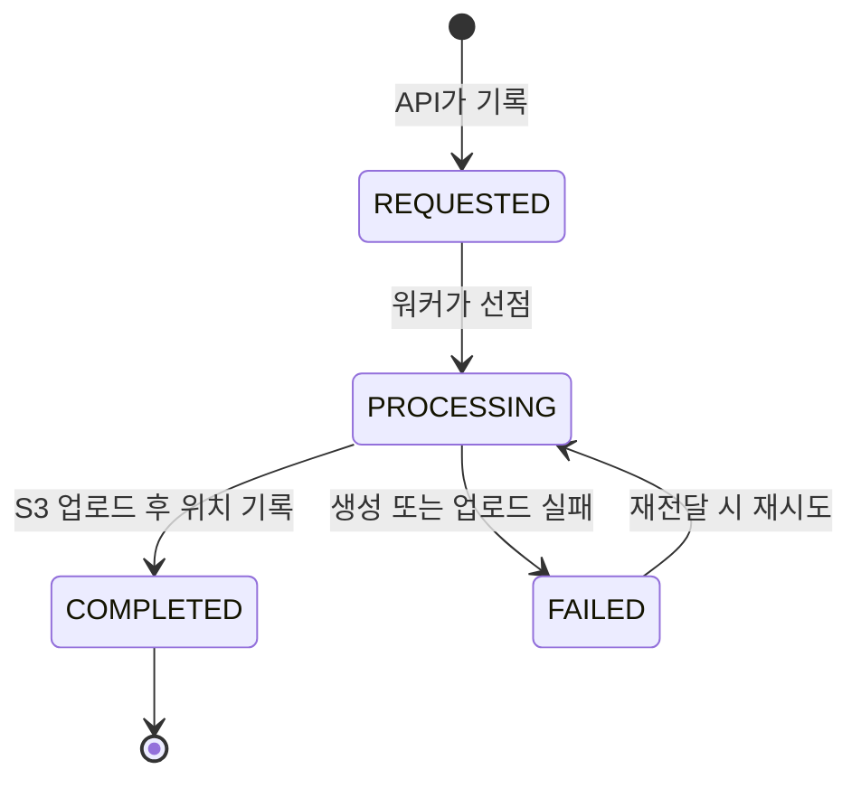
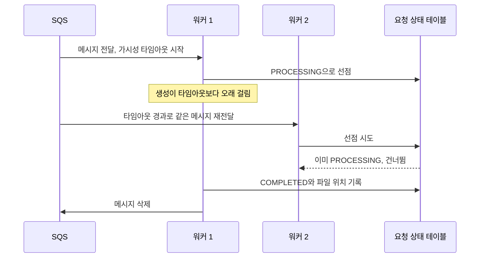

대량 엑셀 다운로드를 API 서버가 요청 안에서 직접 만들면, 조회와 파일 생성이 끝날 때까지 요청 스레드와 DB 커넥션이 묶인다. 이 글은 그 작업을 [메시지 큐](/posts/message-queue/) 뒤의 워커로 넘기고, 조건 없는 전체 다운로드는 파일을 미리 만들어 S3에 두는 구조를 설계로 정리한다. 그리고 큐로 옮기는 순간 생기는 새 문제인 중복 처리를 어떻게 막는지 다룬다.

## 내가 실제로 한 것과 이 글의 범위

이 글은 경험담과 설계를 섞지 않기 위해 경계를 먼저 적는다.

- 엑셀에 대해 내가 실제로 고치고 수치로 확인한 것은 생성 단계의 메모리다. 2022년 음원 플랫폼 회사에서 조회를 청크로 나누고 Apache POI의 SXSSF 스트리밍으로 바꿔, 엑셀 생성 메모리를 1.2GB에서 180MB로 85% 줄였다. 이 과정은 [대용량 엑셀 다운로드 요청을 안정적으로 처리하는 방법](/posts/bulk-excel-performance/)에 있다.
- Amazon SQS를 실제로 운영한 곳은 엑셀이 아니라 음원 유통 시스템(MDS)의 앨범 등록, 검수 요청, 외부 플랫폼 전송 파이프라인이다. 폴링 기반 단일 스레드 배치를 SQS 기반 이벤트 파이프라인으로 바꿨고, 재시도 정책과 DLQ를 적용했으며, 평균 처리 대기 시간이 3~5분에서 1분 내외로 줄었다. 멱등 처리는 메시지 ID에 DB 유니크 제약을 거는 방식이었다. 어느 테이블의 어느 컬럼이었는지는 기록이 없다.
- 엑셀 다운로드를 큐로 넘기거나 S3에 미리 만들어 둔 구조를 운영에 적용했다는 기록은 없다. 그래서 아래의 구조, 메시지 형식, 테이블, 주기, 수치는 모두 설계 예시다. 효과도 측정값이 아니라 기대하는 방향으로만 적는다.

MDS의 SQS 파이프라인에서 쓴 멱등 처리 방식은 퇴사 후 개인 랩에서 다시 구현했다. 아래의 랩 코드는 그 재구현에서 가져왔고, 엑셀이 아니라 앨범 등록 메시지를 다룬다.

## 동기 다운로드가 붙잡는 것

요청 안에서 파일을 만드는 구조는 다음 순서로 자원을 쓴다.

1. 요청 스레드 하나가 처리 시간 내내 묶인다.
2. 조회하는 동안 DB 커넥션 하나가 묶인다.
3. 조회 결과와 워크북이 힙에 올라간다.
4. 다 만든 파일을 응답으로 흘려보내는 동안 다시 스레드와 네트워크가 묶인다.

3번은 스트리밍 생성으로 데이터 크기와 거의 무관하게 묶을 수 있다. 하지만 1, 2, 4번은 생성 시간에 비례한다. 수십만 건을 읽어 쓰는 데 수십 초가 걸린다면, 그 시간 동안 다운로드 요청 몇 개가 일반 API와 같은 스레드 풀과 커넥션 풀을 나눠 쓴다. 같은 조건의 요청이 반복되면 같은 비용을 반복해서 낸다.

그래서 설계는 두 방향으로 나뉜다. 생성을 요청 경로 밖으로 옮기는 것, 그리고 같은 결과를 다시 만들지 않는 것이다.

## 전체 구조

API 서버는 요청을 기록하고 큐에 넣은 뒤 바로 작업 ID를 돌려준다. 생성은 워커가 하고, 결과 파일은 S3에 올린다. 조건 없는 전체 다운로드는 스케줄러가 미리 만들어 둔 파일로 응답한다.



각 부분을 아래에서 하나씩 본다.

## 요청 접수: 작업 ID와 상태 테이블

요청이 들어오면 API 서버는 필터를 직렬화해 요청 상태 테이블에 기록하고, 같은 내용을 메시지로 큐에 넣는다. 응답은 파일이 아니라 작업 ID다.

```json
{
  "requestId": "6f1c2e9a-...",
  "requester": "operator-17",
  "filter": { "category": "ALL", "from": "2025-01-01", "to": "2025-03-31" },
  "filterHash": "a4c3...91f2"
}
```

`requestId`는 이 요청 하나를 가리키는 키이고, `filterHash`는 필터 내용을 정규화해 해시한 값이다. 둘은 역할이 다르다. `requestId`는 같은 메시지가 두 번 처리되는 것을 막는 데 쓰고, `filterHash`는 다른 사람이 같은 조건으로 요청했을 때 이미 만든 파일을 다시 쓰는 데 쓴다.

```sql
-- 설계 예시
CREATE TABLE export_request (
  request_id   VARCHAR(64) PRIMARY KEY,
  filter_hash  CHAR(64)    NOT NULL,
  status       VARCHAR(16) NOT NULL,   -- REQUESTED, PROCESSING, COMPLETED, FAILED
  s3_key       VARCHAR(512),
  attempt      INT         NOT NULL DEFAULT 0,
  created_at   DATETIME    NOT NULL,
  updated_at   DATETIME    NOT NULL,
  KEY idx_filter_hash_status (filter_hash, status)
);
```

요청 하나의 상태는 다음처럼 움직인다. 실패한 요청만 다시 처리 중으로 갈 수 있고, 완료된 요청은 다시 열리지 않는다.



사용자는 작업 ID로 상태를 조회하고, `COMPLETED`가 되면 파일 링크를 받는다. 상태 조회 대신 완료 알림을 보내는 방법도 있지만, 조회 방식이 가장 단순하고 서버 상태를 덜 요구한다.

## 전체 다운로드는 미리 만든다

조건 없이 전체를 받는 요청은 누가 언제 보내든 결과가 같다. 데이터가 바뀌기 전까지는 같은 파일이다. 그래서 요청마다 만들지 않고, 정해진 시각에 스케줄러가 한 번 만들어 S3에 올려 둔다. 요청이 오면 API 서버는 그 파일의 링크만 돌려준다.

링크는 공개 URL이 아니라 presigned URL로 준다. S3 객체는 기본적으로 비공개이고, presigned URL은 URL을 만든 사용자의 자격 증명으로 기간 한정 다운로드 권한을 준다([Amazon S3: Sharing objects with presigned URLs](https://docs.aws.amazon.com/AmazonS3/latest/userguide/ShareObjectPreSignedURL.html)). 버킷을 공개하지 않고도 다운로드 트래픽을 API 서버 밖으로 뺄 수 있다.

```java
// 설계 예시: 전체 다운로드 요청은 미리 만든 파일의 presigned URL로 응답
if (filter.isUnfiltered()) {
    String key = preGeneratedKeys.latestFullExport();   // 예: exports/full/2025-05-22.xlsx
    return ExportResponse.ready(presigner.presignGet(key, Duration.ofMinutes(10)));
}
```

이 선택에는 비용이 있다.

- 파일은 생성 시각 기준의 데이터다. 그 뒤에 바뀐 데이터는 다음 생성 전까지 반영되지 않는다. 화면에 "기준 시각"을 함께 보여 줘야 사용자가 오해하지 않는다.
- 아무도 받지 않는 날에도 파일을 만든다. 요청 빈도가 생성 주기보다 낮다면 사전 생성은 오히려 낭비다.
- 지난 파일이 쌓인다. S3 Lifecycle의 만료 규칙을 걸면 정해진 기간이 지난 객체를 S3가 대신 지운다([Amazon S3: Managing the lifecycle of objects](https://docs.aws.amazon.com/AmazonS3/latest/userguide/object-lifecycle-mgmt.html)).

조건이 일부 붙은 요청은 결과가 조건마다 달라 미리 만들 수 없다. 그 요청들 중 무거운 것만 골라 결과를 재사용하는 설계는 [조건 기반 예측 캐싱](/posts/condition-based-excel-processing/)에서 따로 다룬다.

## 큐로 옮기면 생기는 문제: 같은 메시지가 두 번 온다

생성을 큐 뒤로 옮기면 요청 경로는 가벼워지지만, 메시지가 한 번만 처리된다는 보장이 사라진다. SQS 표준 큐는 최소 1회 전달(at-least-once)을 한다. 메시지는 적어도 한 번 전달되지만 두 번 이상 전달될 수도 있다는 뜻이다. AWS 문서는 메시지 사본을 저장한 서버 하나가 수신이나 삭제 시점에 응답하지 못하면 그 사본이 지워지지 않고 다시 전달될 수 있다고 설명하고, 애플리케이션을 멱등하게 설계하라고 권한다([Amazon SQS at-least-once delivery](https://docs.aws.amazon.com/AWSSimpleQueueService/latest/SQSDeveloperGuide/standard-queues-at-least-once-delivery.html)). 멱등하다는 것은 같은 메시지를 여러 번 처리해도 한 번 처리한 것과 결과가 같다는 뜻이다.

엑셀 생성에서는 중복 전달이 더 쉽게 생긴다. 메시지를 받으면 가시성 타임아웃이 시작되고, 그 안에 메시지를 지우지 않으면 메시지가 큐에 다시 보여 다른 소비자가 받을 수 있다. 기본값은 30초다([Amazon SQS visibility timeout](https://docs.aws.amazon.com/AWSSimpleQueueService/latest/SQSDeveloperGuide/sqs-visibility-timeout.html)). 수십 초가 걸리는 생성 작업이 이 시간을 넘기면, 첫 워커가 아직 만들고 있는 동안 두 번째 워커가 같은 파일을 만들기 시작한다.



이 그림에서 두 번째 생성을 막는 것은 큐가 아니라 상태 테이블이다. 그래서 중복 방지는 여러 층으로 나눠 생각한다.

## 중복을 막는 층

| 층 | 막는 것 | 수단 | 한계 |
| --- | --- | --- | --- |
| 전송 | 같은 메시지를 큐에 두 번 넣기 | SQS FIFO 큐의 중복 제거 ID | 5분 안의 재전송만 막는다 |
| 처리 | 같은 메시지를 두 번 처리하기 | `request_id` 유니크 제약과 상태 확인 | 처리 중 죽은 작업을 따로 풀어야 한다 |
| 재사용 | 다른 사람의 같은 조건 요청을 다시 만들기 | `filter_hash`로 완료된 파일 조회 | 데이터가 바뀐 뒤의 재사용 기준이 필요하다 |
| 시간 | 생성 중 재전달 | 가시성 타임아웃 연장 | 최대 12시간 |

### 전송: FIFO 큐의 중복 제거

FIFO 큐는 5분의 중복 제거 간격 안에 같은 중복 제거 ID로 다시 보낸 메시지를 큐에 넣지 않는다. ID를 직접 주거나, 콘텐츠 기반 중복 제거를 켜서 메시지 본문의 SHA-256 해시를 ID로 쓰게 할 수 있다([Exactly-once processing in Amazon SQS](https://docs.aws.amazon.com/AWSSimpleQueueService/latest/SQSDeveloperGuide/FIFO-queues-exactly-once-processing.html)).

```java
// 설계 예시 (AWS SDK for Java 2.x)
sqs.sendMessage(SendMessageRequest.builder()
        .queueUrl(queueUrl)
        .messageBody(json)
        .messageGroupId("excel-export")
        .messageDeduplicationId(requestId)
        .build());
```

이 층은 보내는 쪽의 재시도만 막는다. 5분이 지난 재전송, 그리고 받은 뒤 가시성 타임아웃이 지나 다시 보이는 메시지는 막지 못한다. 처리 층이 따로 필요한 이유다.

### 처리: 유니크 제약으로 한 번만 시작하기

처리 층의 기본은 "처리를 시작했다"는 사실을 유니크 제약이 걸린 행으로 남기는 것이다. 두 워커가 같은 ID로 동시에 INSERT하면 DB가 한쪽만 통과시킨다. MDS의 SQS 파이프라인에서 멱등 처리를 이 방식으로 했고, 랩에서 다시 구현해 보니 이 방식이 성립하려면 지켜야 할 조건이 두 가지 있었다.

첫째, JPA에서 `@Id`를 애플리케이션이 직접 채우면 `save()`가 INSERT를 하지 않을 수 있다. Spring Data JPA는 버전 속성이 없으면 ID가 null인지로 새 엔티티를 판단하고, 새 엔티티가 아니면 `persist()` 대신 `merge()`를 호출한다([Spring Data JPA: Entity State-detection Strategies](https://docs.spring.io/spring-data/jpa/reference/jpa/entity-persistence.html)). 이미 있는 행이면 예외 없이 덮어쓰므로 중복이 그대로 통과한다. 랩에서는 실제로 중복 메시지가 두 번 처리되는 결과가 나왔고, 엔티티가 `Persistable`을 구현해 `isNew()`가 항상 `true`를 반환하게 고쳤다.

```java
// 랩 코드: ProcessedMessage (일부)
@Entity
@Table(name = "processed_message")
public class ProcessedMessage implements Persistable<String> {
    @Id
    @Column(name = "message_id")
    private String messageId;
    // ...
    @Override
    @Transient
    public boolean isNew() {
        return true;   // save()가 항상 INSERT를 시도하게 한다
    }
}
```

둘째, 유니크 제약만으로는 실패한 메시지가 영원히 건너뛰어진다. 처리 중 실패한 메시지가 다시 전달돼도 INSERT는 항상 제약 위반이 나기 때문이다. 그것은 멱등 처리가 아니라 메시지 유실이다. 랩에서는 처음 INSERT에 실패하면, 상태가 `FAILED`인 행만 조건부 UPDATE로 다시 열도록 두 단계로 나눴다.

```java
// 랩 코드: IdempotentMessageProcessor (일부)
public boolean tryBegin(String messageId, String messageType) {
    if (tryInsertNew(messageId, messageType)) {
        return true;                     // 처음 보는 메시지
    }
    return tryRetryFailed(messageId);    // FAILED인 경우에만 UPDATE 1건 성공
}
```

랩 테스트는 순차 중복, 동시 중복, `DONE` 이후 재전달, 실패 후 재전달의 네 경우를 다룬다. 동시에 같은 PK로 INSERT가 몰리면 유니크 제약 위반 대신 잠금 대기 계열 예외가 나는 경우도 있어서, 랩은 예외를 `DataAccessException` 상위 타입으로 잡는다. 이 측정은 로컬 Testcontainers MySQL에서 나온 것이고 운영 환경의 결과가 아니다.

엑셀 생성에 옮기면 `processed_message`의 역할을 `export_request` 테이블이 맡는다. 워커는 `REQUESTED` 또는 `FAILED`인 행만 `PROCESSING`으로 바꾸는 조건부 UPDATE로 선점하고, 바뀐 행이 0건이면 건너뛴다.

```sql
-- 설계 예시: 선점은 조건부 UPDATE 한 문장으로
UPDATE export_request
   SET status = 'PROCESSING', attempt = attempt + 1, updated_at = NOW()
 WHERE request_id = ?
   AND status IN ('REQUESTED', 'FAILED');
```

남는 틈은 `PROCESSING`에서 워커가 죽는 경우다. 이 행은 아무도 다시 열지 못한다. `updated_at`이 일정 시간 이상 지난 `PROCESSING`을 `FAILED`로 돌리는 정리 작업이 필요하고, 그 시간은 가장 긴 생성 시간보다 길어야 한다. 랩도 이 경우는 다루지 않는다.

### 재사용: 같은 조건의 완료된 파일

요청 ID가 다르면 필터가 같아도 별개 요청이다. 같은 조건을 여러 사람이 요청할 때 다시 만들지 않으려면, 필터를 정규화한 해시로 완료된 요청을 찾는다.

```java
// 설계 예시: 키 순서와 날짜 형식을 고정한 뒤 해시
String canonical = canonicalJson(filter);        // 필드 정렬, 빈 값 제거, 날짜 ISO 형식
String filterHash = DigestUtils.sha256Hex(canonical);
```

정규화를 빼면 같은 의미의 필터가 다른 해시가 된다. 필드 순서만 달라도 JSON 문자열은 달라진다. 반대로 데이터가 바뀐 뒤에도 같은 해시로 옛 파일을 돌려줄 수 있으므로, 재사용에는 유효 시간을 둔다. 이 기준을 정하는 문제는 [조건 기반 예측 캐싱](/posts/condition-based-excel-processing/)에서 이어서 다룬다.

### 시간: 가시성 타임아웃과 DLQ

생성 시간이 들쭉날쭉하면 처리 중에 `ChangeMessageVisibility`로 가시성 타임아웃을 늘린다. 이 연장은 메시지를 처음 받은 때부터 12시간을 넘을 수 없다(같은 가시성 타임아웃 문서). 여러 번 실패한 메시지는 재처리 정책의 `maxReceiveCount`를 넘으면 DLQ(처리에 실패한 메시지를 따로 모으는 큐)로 옮겨진다([Using dead-letter queues in Amazon SQS](https://docs.aws.amazon.com/AWSSimpleQueueService/latest/SQSDeveloperGuide/sqs-dead-letter-queues.html)). 엑셀 요청이 DLQ로 갔다면 상태 테이블도 `FAILED`로 남겨, 사용자가 상태 조회로 실패를 알 수 있게 한다.

## 비용과 한계

- 응답이 즉시 파일에서 작업 ID로 바뀐다. 사용자는 상태를 다시 확인해야 하고, 화면은 "준비 중"과 "실패" 상태를 보여 줘야 한다. 수백 건짜리 가벼운 다운로드까지 이 경로로 보내면 오히려 느려진다. 어떤 요청을 큐로 보낼지 미리 가르는 기준은 [무거운 엑셀 다운로드 요청을 사전에 판별하는 방법](/posts/excel-condition-expector/)에 있다.
- 움직이는 부분이 늘어난다. 큐, 워커, 상태 테이블, S3 버킷, 정리 작업을 모두 운영해야 한다.
- 사전 생성 파일은 기준 시각 이후의 변경을 반영하지 못한다.
- 상태 테이블이 진실의 원천이 된다. 큐와 테이블이 어긋나면(메시지는 사라졌는데 행은 `REQUESTED`로 남는 경우) 테이블을 기준으로 다시 넣는 복구 경로가 필요하다.

이 설계로 API 서버의 부하와 응답 시간이 얼마나 달라지는지는 측정한 적이 없다. 확인하려면 다운로드가 몰리는 시간대의 일반 API p95 응답 시간, 요청 스레드 풀과 커넥션 풀 사용률, 같은 `filter_hash` 요청의 재사용 비율을 전후로 재야 한다.

## 참고

- [Amazon SQS at-least-once delivery](https://docs.aws.amazon.com/AWSSimpleQueueService/latest/SQSDeveloperGuide/standard-queues-at-least-once-delivery.html) — AWS 문서
- [Amazon SQS visibility timeout](https://docs.aws.amazon.com/AWSSimpleQueueService/latest/SQSDeveloperGuide/sqs-visibility-timeout.html) — AWS 문서
- [Using dead-letter queues in Amazon SQS](https://docs.aws.amazon.com/AWSSimpleQueueService/latest/SQSDeveloperGuide/sqs-dead-letter-queues.html) — AWS 문서
- [Exactly-once processing in Amazon SQS](https://docs.aws.amazon.com/AWSSimpleQueueService/latest/SQSDeveloperGuide/FIFO-queues-exactly-once-processing.html) — AWS 문서
- [Amazon S3: Sharing objects with presigned URLs](https://docs.aws.amazon.com/AmazonS3/latest/userguide/ShareObjectPreSignedURL.html) — AWS 문서
- [Spring Data JPA: Persisting Entities](https://docs.spring.io/spring-data/jpa/reference/jpa/entity-persistence.html) — Spring Data JPA 문서
- [Amazon S3: Managing the lifecycle of objects](https://docs.aws.amazon.com/AmazonS3/latest/userguide/object-lifecycle-mgmt.html) — AWS 문서
- 랩 코드 (commit `d52297d`)
  - [IdempotentMessageProcessor.java](https://github.com/polynomeer/engineering-lab/blob/d52297d0ad07c3d8a05a7471192a5655cb8b1378/career-lab/mds-distribution/src/main/java/com/portfolio/mdslab/messaging/IdempotentMessageProcessor.java) — GitHub
  - [ProcessedMessage.java](https://github.com/polynomeer/engineering-lab/blob/d52297d0ad07c3d8a05a7471192a5655cb8b1378/career-lab/mds-distribution/src/main/java/com/portfolio/mdslab/domain/ProcessedMessage.java) — GitHub
  - [ProcessedMessageRepository.java](https://github.com/polynomeer/engineering-lab/blob/d52297d0ad07c3d8a05a7471192a5655cb8b1378/career-lab/mds-distribution/src/main/java/com/portfolio/mdslab/repository/ProcessedMessageRepository.java) — GitHub
  - [StreamingExcelExportService.java](https://github.com/polynomeer/engineering-lab/blob/d52297d0ad07c3d8a05a7471192a5655cb8b1378/career-lab/batch-excel/src/main/java/com/portfolio/batchlab/excel/StreamingExcelExportService.java) — GitHub: 생성 단계의 메모리를 묶은 구현
