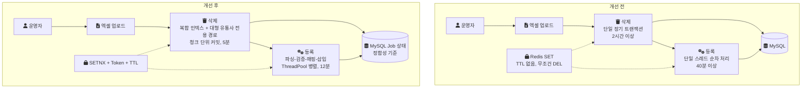
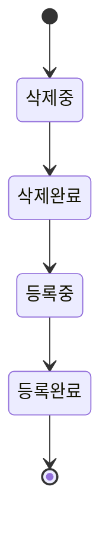
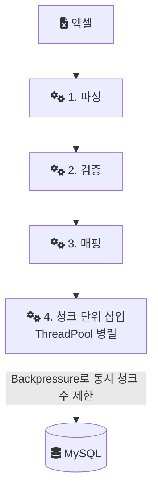

*이 글은 실제 운영 경험을 바탕으로 도메인 표현을 일반화해 재구성한 기록이다. SQL과 코드는 회사의 실제 소스가 아니라 설명용 예시이거나, 같은 문제를 처음부터 다시 구현해 본 개인 랩의 코드다.*

## 어떤 조건에서 나온 결론인가

음원 플랫폼 회사에서 저작권·실연권 지분율 시스템을 개선한 기록이다. 2022년 8월부터 11월까지 기존 시스템을 혼자 설계하고 구현했다. 스택은 Java, Spring Boot, MySQL, Redis, AWS였다.

지분율 데이터는 유통사별 월 단위 정산에 쓰이는 기준 데이터다. 정책이 바뀌거나 오류를 정정해야 하면 특정 월의 데이터를 대량으로 삭제한 뒤 다시 등록했다. 그래서 이 삭제·재등록이 늦어지거나 실패하면 정산 일정 전체가 밀렸다. 배치와 운영 요청이 동시에 들어오는 환경이라 성능과 함께 동시 실행 제어도 필요했다.

데이터 분포는 고르지 않았다. 협회 데이터와 일부 대형 유통사가 전체 지분율 데이터의 80% 이상을 차지했다. 아래 결론은 이 치우친 분포를 전제로 한다.

## 개선 전후 구조

개선 전에는 삭제가 하나의 긴 트랜잭션이었고, 등록은 단일 스레드였으며, 두 작업 사이의 순서는 TTL 없는 Redis 키 하나에 기대고 있었다. 개선 후 구조와 나란히 놓으면 다음과 같다.



## 대량 삭제: 2시간에서 5분으로

삭제 배치가 2시간 이상 걸리는 것을 확인하고 실행계획(MySQL이 쿼리를 어떤 인덱스와 순서로 실행할지 보여 주는 결과)을 조회했다. 기간이 겹치는 행을 찾는 조건이 OR로 묶여 있었고, 그래서 [인덱스](/posts/db-index/)를 제대로 타지 못하고 있었다.

MySQL 문서는 여러 컬럼으로 만든 복합 인덱스를 왼쪽 컬럼부터 차례로 쓸 수 있다고 설명하면서, 서로 다른 컬럼을 OR로 묶은 조건은 그 인덱스로 조회하지 못하는 예를 함께 든다([Multiple-Column Indexes](https://dev.mysql.com/doc/refman/8.0/en/multiple-column-indexes.html)). 아래는 이 차이를 보여 주는 설명용 예시이고, 실제 테이블과 조건식은 아니다.

```sql
-- 설명용 예시: 기간 조건이 OR로 묶이면 인덱스 범위를 하나로 좁히기 어렵다
DELETE FROM share_rate
WHERE partner_id = :partnerId
  AND (start_date BETWEEN :from AND :to OR end_date BETWEEN :from AND :to);

-- 설명용 예시: 유통사 등치 조건 + 기간 범위로 (partner_id, start_date, end_date) 인덱스를 탄다
DELETE FROM share_rate
WHERE partner_id = :partnerId
  AND start_date <= :to
  AND end_date >= :from;
```

원인이 쿼리 하나에만 있지는 않았다. 데이터 분포를 직접 쿼리로 확인해 보니 협회와 일부 대형 유통사가 전체의 80% 이상을 차지했다. 유통사를 가리지 않는 일반 쿼리로 처리하면 이 소수 유통사의 대량 데이터가 매번 스캔 범위와 트랜잭션 시간을 좌우했다. 이 분포가 단일 장기 트랜잭션과 맞물려 락을 쥐는 시간이 더 길어졌다.

그래서 세 가지를 함께 적용했다.

1. 기간 조건을 인덱스를 쓸 수 있는 형태로 다시 정의하고, 유통사ID와 기간 컬럼으로 복합 인덱스를 다시 설계했다.
2. 협회와 대형 유통사는 유통사 코드를 조건절에 고정한 전용 쿼리 경로로 분리했다. 복합 인덱스는 선두 컬럼(맨 앞 컬럼)인 유통사ID가 등치(`=`) 조건으로 들어올 때 가장 좁게 탄다. 전용 경로는 항상 이 형태로 들어가고, 유통사별 데이터량에 맞춰 청크 크기도 따로 정할 수 있었다. 나머지 소규모 유통사는 데이터가 적어 일반 경로로 충분했다.
3. 삭제를 단일 장기 트랜잭션이 아니라 청크(일정 건수씩 나눈 묶음) 단위 트랜잭션으로 바꿨다.

삭제 시간은 2시간에서 5분으로 줄었다(24배). 이 결과는 한 조치의 단독 효과가 아니다. 복합 인덱스가 스캔 범위를 줄였고, 전용 경로가 인덱스 선택성을 끌어올렸고, 청크화가 트랜잭션과 락을 쥐는 시간을 줄였다. 세 가지가 함께 작용한 결과다.

나중에 같은 구조를 랩에서 다시 구현해 보니, 청크화만 놓고 보면 총 처리 시간은 오히려 늘 수 있었다. 청크마다 커밋하면 커밋마다 로그를 디스크에 내려 쓰는 비용이 붙기 때문이다. MySQL 기본값(`innodb_flush_log_at_trx_commit=1`)에서는 "Logs are written and flushed to disk at each transaction commit."(커밋마다 로그를 쓰고 디스크로 flush한다)([InnoDB Startup Options and System Variables](https://dev.mysql.com/doc/refman/8.0/en/innodb-parameters.html)). 청크화가 줄이는 것은 한 트랜잭션이 다른 작업을 막는 시간이다.

## 분산 락: TTL과 소유권 검증

삭제와 등록은 같은 월 데이터를 건드리므로 동시에 돌면 안 된다. 기존 Redis 락은 `SET`으로 락을 잡고, TTL(키 만료 시간) 없이, `finally` 블록에서 소유권 확인 없이 `DEL`을 호출하는 구조였다. 그 결과 두 가지 구멍이 있었다.

- 프로세스가 예외나 네트워크 지연으로 비정상 종료되면 락이 영원히 풀리지 않는다.
- 락을 갖지 않은 프로세스가 무조건 `DEL`로 남의 락을 지울 수 있다. 그러면 삭제와 등록이 교차 실행되는 Race Condition(실행 순서에 따라 결과가 달라지는 상황)이 생길 수 있고, Redis와 DB의 상태도 어긋날 수 있다.

TTL만 거는 것으로는 두 번째 구멍이 막히지 않는다. 그래서 `SETNX`와 Lock Token(락을 잡은 쪽만 아는 고유 값)으로 락을 다시 설계했다. 락을 잡을 때 TTL을 함께 걸어 비정상 종료에도 락이 자동으로 풀리게 했고, 해제할 때는 현재 락의 토큰이 내 토큰과 같은지 확인한 뒤에만 지우게 했다. Redis `SET` 문서도 만료 후 보낸 `DEL`이 다른 클라이언트의 락을 지울 수 있으니, 값이 일치할 때만 지우라고 권한다([SET](https://redis.io/docs/latest/commands/set/)).

아래는 랩 코드다. 랩은 GET과 비교, DEL 사이에 다른 요청이 끼어들 틈을 없애려고 이 과정을 Lua 스크립트 하나로 묶었다.

```java
// 랩 코드: SafeRedisLock (실제 운영 코드 아님)
public boolean tryAcquire(String key, String token, Duration ttl) {
    return Boolean.TRUE.equals(redisTemplate.opsForValue().setIfAbsent(key, token, ttl));
}

// "if redis.call('get', KEYS[1]) == ARGV[1] then return redis.call('del', KEYS[1]) else return 0 end"
public boolean release(String key, String token) {
    Long result = redisTemplate.execute(COMPARE_AND_DELETE, Collections.singletonList(key), token);
    return result != null && result == 1L;
}
```

락만으로는 "지금 어디까지 끝났는가"에 답할 수 없다. 그래서 작업 상태를 네 단계로 정의하고, DB의 Job 메타데이터를 기준 상태로, Redis는 보조 수단으로만 썼다. 상태 전이는 다음과 같다.



이렇게 바꾼 뒤 동시 실행 환경에서도 삭제와 등록의 순서가 지켜졌고, 락을 쥔 프로세스가 비정상 종료돼도 TTL로 락이 풀렸다. Redis에 장애가 나도 정합성의 기준은 DB 상태에 남았다.

## 대량 등록: 40분에서 12분으로

등록은 엑셀 데이터를 파싱해 DB에 저장하는 과정 전체를 단일 스레드에서 순차로 처리했다. 대량 업로드 시 40분 이상 걸렸고, CPU를 충분히 쓰지 못한 채 I/O 대기 시간이 길었다.

처리 흐름을 파싱, 검증, 매핑, 삽입 네 단계로 나눴다. DB 삽입은 청크 단위로 묶고, ThreadPool로 청크를 병렬 처리하되 Backpressure(동시에 진행 중인 작업 수에 상한을 두어 앞단이 뒷단을 밀어붙이지 못하게 하는 흐름 제어)로 DB 과부하를 막았다.



랩에서는 이 흐름을 `Semaphore`로 구현했다. 청크를 제출하기 전에 허가를 얻고, 청크 처리가 끝나면 돌려준다. 스레드 수와 상한 값은 랩에서 임의로 정한 값이다.

```java
// 랩 코드: ParallelRegistrationPipeline (실제 운영 코드 아님)
for (List<RawEquityRow> chunk : chunks) {
    acquireUninterruptibly(backpressure);        // 동시에 진행 중인 청크 수가 상한이면 대기
    futures.add(pool.submit(() -> {
        try {
            return processAndInsertChunk(chunk); // 검증·매핑 후 배치 INSERT
        } finally {
            backpressure.release();
        }
    }));
}
```

등록 시간은 40분에서 12분으로 줄었다(70% 단축).

## 개선 요약

| 항목 | 개선 전 | 개선 후 | 효과 |
| --- | --- | --- | --- |
| 삭제 처리 시간 | 2시간 | 5분 | 24배 단축 |
| 등록 처리 시간 | 40분 | 12분 | 70% 단축 |
| 동시 실행 제어 | Redis `SET`, TTL 없음, 무조건 `DEL` | `SETNX` + Lock Token + TTL, 토큰 확인 후 해제 | 삭제·등록 교차 실행 제거 |
| 작업 상태 | 정의된 상태 모델 없음 | 삭제중-삭제완료-등록중-등록완료, DB 기준 | Redis 장애에도 DB 기준 정합성 유지 |
| 등록 방식 | 단일 스레드 순차 처리 | 4단계 파이프라인 + ThreadPool + Backpressure | DB 과부하 없이 처리 효율 향상 |

## 이 선택이 남긴 것

청크 단위 커밋을 택하면서 삭제 전체가 하나의 트랜잭션으로 원자적이라는 성질은 내려놓았다. 중간까지 커밋된 상태가 생길 수 있고, 그 상태를 읽어 판단하는 일은 상태 전이 모델이 맡게 됐다. 또 청크화의 효과는 처리량보다 락 점유 시간에서 나오므로, 총 처리 시간을 더 줄이려면 커밋 빈도와 디스크 flush 비용 사이의 균형을 따로 맞춰야 한다.

## 참고

- [Multiple-Column Indexes](https://dev.mysql.com/doc/refman/8.0/en/multiple-column-indexes.html) — MySQL 8.0 Reference Manual
- [InnoDB Startup Options and System Variables: innodb_flush_log_at_trx_commit](https://dev.mysql.com/doc/refman/8.0/en/innodb-parameters.html#sysvar_innodb_flush_log_at_trx_commit) — MySQL 8.0 Reference Manual
- [SET](https://redis.io/docs/latest/commands/set/) — Redis 문서
- [데이터베이스 인덱스를 어떻게 이해해야 하는가](/posts/db-index/)
- [SafeRedisLock.java](https://github.com/polynomeer/engineering-lab/blob/d52297d0ad07c3d8a05a7471192a5655cb8b1378/career-lab/equity-system/src/main/java/com/portfolio/equitylab/lock/SafeRedisLock.java) — GitHub: 랩 코드
- [ParallelRegistrationPipeline.java](https://github.com/polynomeer/engineering-lab/blob/d52297d0ad07c3d8a05a7471192a5655cb8b1378/career-lab/equity-system/src/main/java/com/portfolio/equitylab/registration/ParallelRegistrationPipeline.java) — GitHub: 랩 코드
- [OptimizedDeletionService.java](https://github.com/polynomeer/engineering-lab/blob/d52297d0ad07c3d8a05a7471192a5655cb8b1378/career-lab/equity-system/src/main/java/com/portfolio/equitylab/deletion/OptimizedDeletionService.java) — GitHub: 랩 코드
- [README](https://github.com/polynomeer/engineering-lab/blob/d52297d0ad07c3d8a05a7471192a5655cb8b1378/career-lab/equity-system/README.md) — GitHub: 랩 코드
