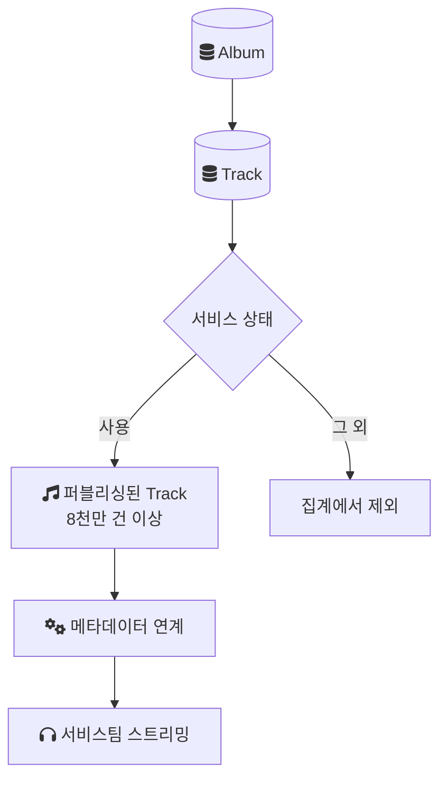
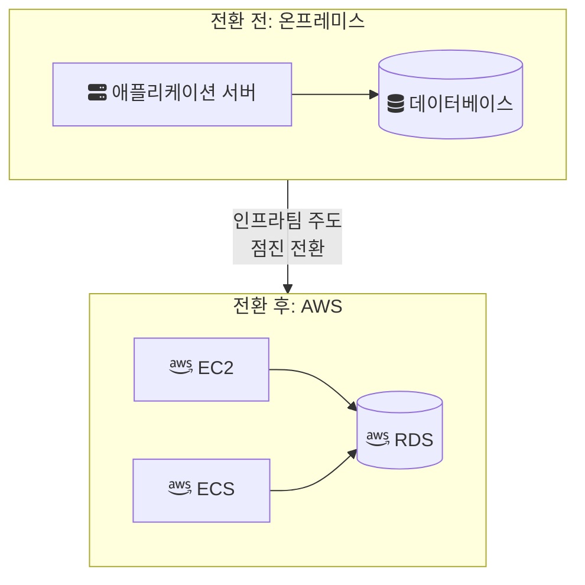

음원 플랫폼 회사에서 일하는 동안 회사 차원의 인프라 전환이 있었다. 온프레미스 서버에서 돌던 서비스를 AWS로 옮기는 작업이었고, 인프라팀이 주도하고 여러 팀이 참여하는 전사 이니셔티브였다. 나는 이 작업을 설계하거나 주도하지 않았다. 참여자로서 가까이에서 지켜본 것이다.

그래서 이 글은 마이그레이션 회고가 아니다. 어떤 데이터를 다루는 환경이었는지, 왜 옮겼는지, 그리고 참여자 위치에서 무엇을 알 수 있었고 무엇을 알 수 없었는지를 정리한다. 전환 순서, 이중 운영 기간, 롤백 계획, 사용한 도구처럼 내가 정확히 말할 수 없는 부분은 쓰지 않았다.

## 다루던 데이터의 규모

이 회사의 음원 콘텐츠 플랫폼(MCP)은 앨범(Album) 테이블 아래에 트랙(Track) 테이블을 두는 구조로 음원을 관리했다. 트랙 하나가 사용자가 실제로 재생하는 곡 한 개에 해당한다.

트랙이 곧바로 서비스되는 것은 아니다. 메타데이터가 정리되고 서비스 상태가 "사용"으로 퍼블리싱된 뒤 메타데이터 연계를 거쳐야 서비스팀 쪽에서 실제 스트리밍이 이뤄진다. 이 기준, 즉 Track 테이블에서 서비스 상태가 "사용"인 행만 세어도 8천만 건을 넘었다.

아래 그림은 이 숫자가 어디를 세는지 보여 준다.

"8천만 곡"이라는 숫자를 쓸 때 기준을 밝혀 두는 이유가 있다. 앨범 수, 전체 트랙 행 수, 서비스 중인 트랙 수는 서로 다른 숫자다. 사용 중지된 트랙이나 아직 퍼블리싱되지 않은 트랙까지 세면 숫자는 더 커진다. 여기서 말하는 8천만은 실제로 재생 가능한 곡의 수이고, 데이터 규모를 가늠할 때 가장 보수적인 기준이다.

## 왜 옮겼는가

전환의 목적은 당장의 비용 절감이 아니었다. 목적은 세 가지였다.

- 확장성. 데이터와 트래픽이 늘어날 때 필요한 만큼 자원을 늘릴 수 있어야 했다.
- 장애 대응의 유연성. 장애가 났을 때 대체 자원을 띄우거나 구성을 바꾸는 선택지가 넓어야 했다.
- 특정 외부 인프라에 대한 의존도 축소. 서비스가 특정 외부 인프라(SK 서버)에 묶여 있는 상태를 줄이려 했다.

온프레미스에서 구체적으로 어떤 장애나 확장 한계를 겪어서 이 결정이 나왔는지는 내가 확인할 수 있는 범위 밖이다. 그래서 "어떤 장애 때문에 옮겼다"는 식의 이야기는 쓰지 않는다.

## 전환 후의 구성

전환 대상은 AWS의 세 가지 서비스였다. EC2는 가상 서버, RDS(Relational Database Service)는 AWS가 운영을 맡는 관계형 데이터베이스, ECS(Elastic Container Service)는 컨테이너 실행을 관리하는 서비스다.

아래 그림은 전환 전후의 경계를 단순화한 것이다. 서비스 간 세부 배치는 그리지 않았다.

전환은 한 번에 끊어 옮기는 방식이 아니라 점진적으로 진행됐다. 어떤 서비스부터 옮겼는지, 온프레미스와 AWS가 얼마나 함께 돌았는지, 데이터 이관에 무엇을 썼는지는 내가 정리해 말할 수 있을 만큼 알지 못한다.

## 전략을 읽는 틀

참여자 위치에서도 전환이 어떤 종류의 작업인지 구분할 언어는 필요했다. AWS Prescriptive Guidance는 워크로드를 클라우드로 옮기는 방식을 7가지(7 Rs)로 나눈다. Retire, Retain, Rehost, Relocate, Repurchase, Replatform, Refactor다.

이 중 둘이 서버를 옮기는 작업과 가장 가깝다. Rehost는 "lift and shift"라고도 부르며, 애플리케이션을 변경 없이 그대로 옮기는 방식이다. Replatform은 옮기면서 관리형 서비스로 바꾸는 정도의 최적화를 더하는 방식이다. 가이드는 예시로 데이터베이스를 Amazon RDS로 옮기는 경우를 든다. 같은 문서는 대규모 마이그레이션에서 Refactor를 권하지 않는다. 옮기는 도중에 애플리케이션을 현대화하면 관리가 복잡해지므로, 먼저 옮기고 현대화는 그다음에 하라는 것이다.

이 틀은 어디까지나 읽는 도구다. 회사의 전환이 서비스별로 어떤 전략에 해당했는지는 내가 확인하지 못했으므로 대응시키지 않는다.

## 참여자로서 남은 것

이 작업에서 내가 개인 성과로 말할 수 있는 것은 없다. 전환의 설계와 우선순위는 인프라팀이 정했고, 내 참여 범위와 그 결과를 숫자로 보여 줄 기록도 없다.

그래도 이 경험은 이후에 쓰는 글의 전제가 된다. 8천만 건이 넘는 서비스 트랙과 그 위의 앨범, 계약, 권리 데이터가 있는 환경에서는 테이블 구조 하나를 바꾸는 일도, 인프라를 옮기는 일도 영향 범위가 넓다. 전사 전환이 한 번에 끊어 옮기는 방식이 아니라 점진적으로 진행된 것도 그 영향 범위와 무관하지 않을 것이라고 본다. 다만 이것은 내 해석이고, 전환을 주도한 쪽의 판단 근거를 들은 것은 아니다.

## 이 글에서 다루지 않은 것

- 전환 기간과 서비스별 전환 순서
- 이중 운영(온프레미스와 AWS 병행) 여부와 기간, 롤백 계획
- 데이터 이관 도구와 IaC(Infrastructure as Code) 사용 여부
- 전환 전후의 비용, 장애 대응 시간, 처리량 같은 정량 지표

## 참고

- [About the migration strategies — AWS Prescriptive Guidance](https://docs.aws.amazon.com/prescriptive-guidance/latest/large-migration-guide/migration-strategies.html) — AWS Docs
