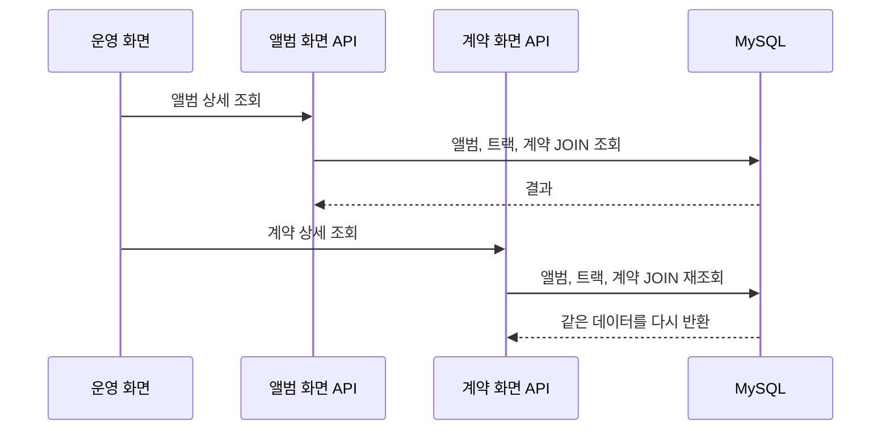
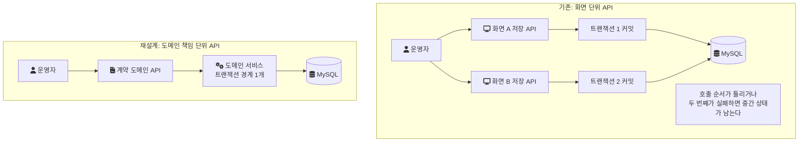
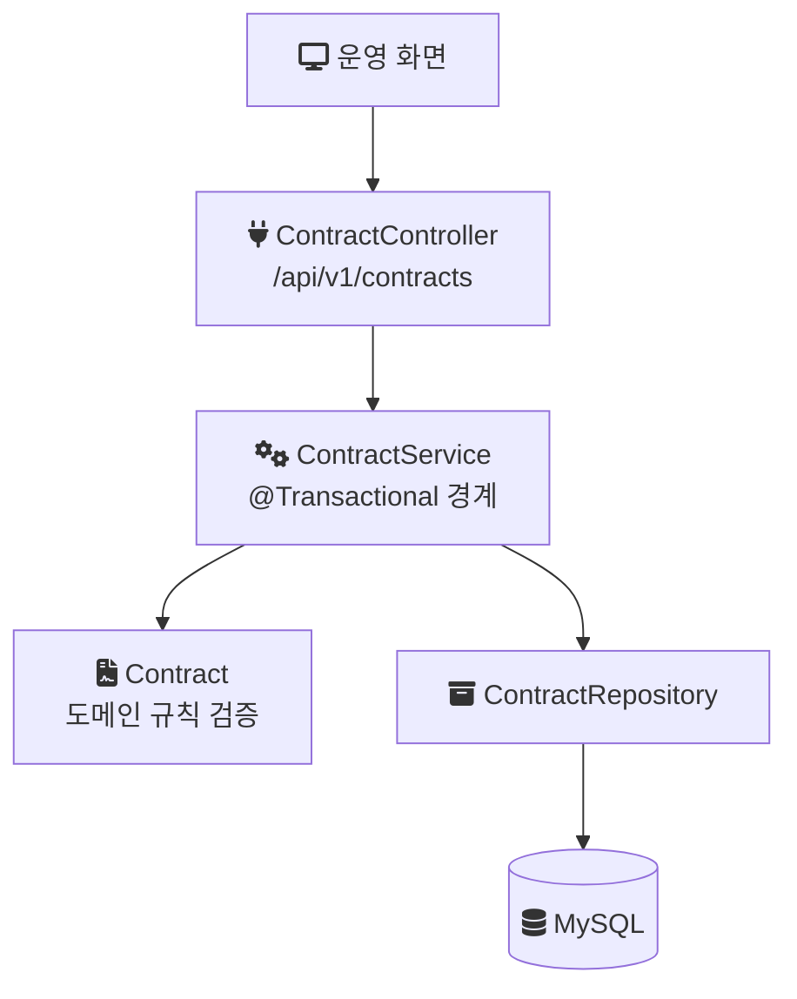

음원 콘텐츠 플랫폼(MCP) 전면 개편에서 가장 먼저 손댄 것은 API의 단위였다. 기존 API는 화면 하나에 맞춰 만들어져 있었고, 그 결과 같은 데이터를 여러 번 읽고, 하나의 변경을 여러 API에 나눠 담고 있었다. 이 글은 그 구조가 어떤 증상으로 드러났는지, 왜 API를 도메인 책임 단위로 다시 나눴는지, 트랜잭션 경계를 어디에 두었는지, 그리고 그 결과와 남은 한계를 정리한 기록이다.

> 이 글의 다이어그램과 코드는 회사의 실제 소스가 아니다. 구조를 설명하기 위한 재구성 예시이거나, 같은 구조를 처음부터 다시 만든 개인 랩의 코드이며, 랩 코드는 그렇다고 표시했다.

## 배경과 조건

MCP는 계약, 앨범, 곡(트랙) 메타데이터와 유통사·계약별 라이선스 권리를 관리하는 사내 플랫폼이다. 앨범 하위 트랙 중 서비스 상태가 "사용"으로 퍼블리싱된 곡만 8천만 건이 넘었다. 사용자는 외부 고객이 아니라 정산, 라이선스, 데이터 관련 부서의 운영자들이다.

개편 조건은 다음과 같았다.

- 기간: 2024년 1월부터 11월까지 전면 개편
- 인원: 백엔드 3명. 나는 백엔드 리딩을 맡았고, 원래 팀이 풀스택으로 담당하던 프로젝트라 프론트엔드와도 일정과 아키텍처를 공유하며 진행했다.
- 내 구현 범위: 공통 기능(엑셀, 파일 업로드·다운로드 인터페이스, RabbitMQ 메시지 인터페이스), 아키텍처 규칙, 앨범·트랙·계약·지분율 관리 API. 이 글의 API 재설계는 내가 직접 구현한 범위다.
- 스택: Java, Spring Boot, JPA, MapStruct, MySQL, RabbitMQ. 응답 시간은 Datadog 대시보드로 관찰했다.

계약 코드처럼 정산과 외부 유통에 연결되는 핵심 식별자도 같은 구조 위에 얹혀 있었다. 레거시를 그대로 두면 정합성과 성능 문제가 계속 쌓이는 상황이었다.

## 증상: 같은 데이터를 여러 번 읽고, 변경은 순서에 의존했다

문제는 두 갈래로 드러났다.

첫째는 조회였다. API가 화면 단위로 나뉘어 있어서, 앨범 화면 API와 계약 화면 API가 각자 필요한 데이터를 따로 읽었다. 두 화면이 보는 데이터는 상당 부분 겹쳤다. 그래서 같은 테이블 조합을 여러 API가 반복해서 조회했고, 이 과정에서 슬로우 쿼리가 생겼다. Datadog에서 본 재설계 전 API 응답 시간은 1.5초 수준이었다. 다만 이 값이 평균인지 P95(전체 요청의 95%가 이 시간 안에 끝나는 값)인지 같은 집계 기준은 기억나지 않는다. 대시보드에서 재설계 전후 응답 시간 추이를 관찰해 확인한 것까지가 확실한 부분이다.

아래 그림은 구조를 설명하기 위한 재구성 예시다. 화면마다 API가 있으면 한 번의 업무 흐름에서 같은 JOIN이 두 번 나간다.



둘째는 변경이었다. 하나의 업무상 변경이 여러 API에 나뉘어 들어가 있었다. 그래서 운영자가 특정 순서로 API를 호출해야만 데이터 정합성이 유지됐다.

여기서 트랜잭션 경계(하나로 묶여 함께 커밋되거나 함께 롤백되는 작업의 범위)를 생각하면 위험이 분명해진다. 서로 다른 API 호출은 각자 별도의 트랜잭션이다. 첫 번째 호출이 커밋된 뒤 두 번째 호출이 실패하면, 첫 번째 변경은 이미 DB에 남는다. 순서를 바꿔 호출해도 마찬가지로 중간 상태가 남는다. 정합성을 지키는 책임이 코드가 아니라 운영자의 호출 순서에 있었던 셈이다.



## 원인: API의 단위가 화면이었다

두 증상의 원인은 같았다. API를 나눈 기준이 데이터의 책임이 아니라 화면이었다.

화면 기준으로 API를 만들면 화면이 필요로 하는 데이터 묶음마다 조회가 생긴다. 화면끼리 데이터가 겹치면 조회도 겹친다. 변경도 마찬가지로 화면의 저장 버튼 단위로 만들어진다. 하나의 도메인 개념, 예를 들어 계약의 조건 변경이 여러 화면에 걸쳐 있으면 그 변경 로직도 여러 API에 나뉜다. 어느 API가 어떤 도메인 규칙을 책임지는지 코드에서 드러나지 않으니, 규칙을 지키는 방법이 "이 순서로 호출한다"는 운영 지식으로 남는다.

쿼리 하나하나를 빠르게 만들어도 같은 데이터를 여러 번 읽는 구조와, 호출 순서에 의존하는 변경은 그대로 남는다. 그래서 고칠 대상은 쿼리가 아니라 API의 단위였다.

## 결정: 도메인 책임으로 API를 나누고, 변경은 한 트랜잭션에 모은다

결정은 세 가지였다.

1. 화면 중심 API를 도메인 책임 기반 REST API로 재설계한다. 앨범, 트랙, 계약, 지분율처럼 데이터를 책임지는 도메인이 API의 단위가 된다.
2. 여러 API에 흩어진 변경 로직을 도메인 단위로 모은다. 하나의 업무상 변경은 하나의 서비스 메서드, 하나의 트랜잭션 안에서 끝나게 한다.
3. 조회 구조와 쿼리를 함께 정리한다. 반복 조회를 없애려면 API 단위만 바꿔서는 안 되고, 그 API가 실행하는 쿼리도 같이 다시 봐야 한다.

화면이 도메인 API를 조합해서 쓰게 되므로 프론트엔드의 호출부도 바뀐다. 백엔드만의 결정으로 끝나지 않는 변경이어서, 배포 전략과 도메인 규칙을 내가 설계해 프론트엔드를 포함한 팀과 공유하고 협의하며 진행했다.

## 구현: 트랜잭션 경계를 서비스 메서드 하나로

재설계 후의 구조는 계층이 분명하다. Controller는 요청을 받아 서비스에 넘기고, 서비스 메서드 하나가 트랜잭션 경계가 되며, 도메인 객체가 규칙을 검증하고, 저장소가 영속화를 맡는다.



아래는 개인 랩(mcp-platform)에서 같은 구조를 다시 만든 코드다. 실제 회사 코드가 아니고, 랩은 계약 도메인 하나만 최소 범위로 둔다. Controller는 서비스만 호출한다.

```java
// 랩 코드: contract/api/ContractController.java
@PostMapping("/api/v1/contracts")
@ResponseStatus(HttpStatus.CREATED)
public ContractResponse create(@Valid @RequestBody ContractCreateRequest request) {
    String contractCode = contractService.createContract(
            request.counterpartyName(), request.startsAt(), request.expiresAt());
    return new ContractResponse(contractCode);
}
```

트랜잭션 경계는 서비스 메서드 하나다. 계약 코드 확보, 도메인 객체 생성과 규칙 검증, 저장이 모두 이 메서드 안에서 함께 커밋되거나 함께 롤백된다.

```java
// 랩 코드: contract/application/ContractService.java
@Transactional
public String createContract(String counterpartyName, LocalDate startsAt, LocalDate expiresAt) {
    AllocatedRange range = contractCodeAllocator.allocateBlock("CONTRACT_CODE", 1);
    String contractCode = "MCP-%d-%06d".formatted(Year.now().getValue(), range.rangeStart());

    Contract contract = Contract.create(contractCode, counterpartyName, startsAt, expiresAt);
    contractRepository.save(contract);
    return contract.contractCode();
}
```

기존 구조에서 운영자가 API A, B를 순서대로 호출해야 했던 변경은, 이 구조에서는 서비스 메서드 하나의 호출이 된다. 중간에 실패하면 전체가 롤백되므로 중간 상태가 남지 않는다. 순서를 지키는 책임이 운영자에게서 코드로 옮겨진 것이다.

한 가지 주의할 점이 있다. Spring의 `@Transactional`은 프록시를 통해 적용된다. [Spring 문서](https://docs.spring.io/spring-framework/reference/data-access/transaction/declarative/annotations.html)는 "only external method calls coming in through the proxy are intercepted"라고 설명한다(프록시를 거쳐 들어오는 외부 호출만 가로챈다). 같은 클래스 안의 메서드가 다른 `@Transactional` 메서드를 직접 호출하면 새 트랜잭션 설정이 적용되지 않는다. 그래서 변경 로직을 모을 때 트랜잭션 경계는 Controller가 호출하는 서비스의 public 메서드 하나로 정하고, 그 안의 세부 단계는 같은 트랜잭션 안에서 실행되는 일반 메서드나 도메인 객체의 메서드로 두었다.

도메인 규칙의 검증 위치도 이 재설계와 함께 정리했다. 입력 형식은 요청 DTO에서, 다른 필드나 다른 엔티티 상태를 알아야 판단할 수 있는 규칙은 도메인 객체 안에서 최종 검증한다. 이 부분은 Map 기반 입력을 DTO로 바꾼 작업과 이어져 있어 다음 글에서 따로 다룬다.

## 조회 쪽 정리

API 단위를 바꾸는 것만으로 반복 조회가 사라지지는 않는다. 도메인 API가 화면의 필요를 한 번에 채울 수 있도록 조회 구조와 쿼리를 함께 정리했다.

| 구분 | 기존 | 재설계 후 |
| --- | --- | --- |
| API 단위 | 화면 | 도메인 책임 (앨범, 트랙, 계약, 지분율) |
| 같은 데이터 조회 | 화면 API마다 반복 | 도메인 API 한 번 |
| 변경 로직 위치 | 여러 API에 분산 | 도메인 서비스 메서드 하나 |
| 트랜잭션 경계 | API 호출마다 따로 | 업무상 변경 하나에 하나 |
| 정합성 유지 방법 | 운영자의 호출 순서 | 코드의 트랜잭션 |

조회 쪽은 이후 데이터 접근 구조 자체를 바꾸는 작업으로 이어졌다. 변경은 MyBatis에 두고 조회를 별도 모델로 분리한 과정은 이후 글에서 따로 정리한다.

## 결과

Datadog 대시보드에서 재설계 전후 응답 시간을 관찰한 결과, 재설계 대상 API의 응답 시간이 1.5초에서 300ms로 줄었다. 80% 단축이다. 중복 조회와 슬로우 쿼리가 해소됐고, 운영자가 특정 순서로 API를 호출해야 하는 의존성이 없어졌다. 변경 로직이 도메인 단위로 모이면서 새 기능을 추가하거나 규칙을 바꿀 때 어디를 고쳐야 하는지 찾기 쉬워졌다.

## 한계와 비용

이 결과를 읽을 때 알아야 할 조건이 있다.

- 응답 시간의 집계 기준(평균, P95 등)은 기억나지 않는다. 같은 대시보드에서 전후 추이를 비교했다는 것까지만 말할 수 있다.
- API 단위 변경과 쿼리 정리를 함께 적용했기 때문에, 1.5초에서 300ms로 줄어든 폭 중 어느 쪽이 얼마를 기여했는지는 이 측정으로 나눌 수 없다.
- 화면이 호출하는 API가 바뀌므로 프론트엔드 변경이 함께 필요했다. 백엔드 단독으로 끝낼 수 있는 개선보다 일정 조율 비용이 컸다.
- 개인 랩은 계약 도메인 하나와 레이어 구조만 재현한다. 화면 단위 API와 도메인 API의 응답 시간을 같은 조건에서 비교하는 실험은 랩에 아직 없다.

같은 시기에 진행한 입력 구조 개선은 [Map 기반 입력을 DTO와 3단계 검증으로 바꾸기](/posts/mcp-dto-validation-pipeline/)에서 이어서 정리한다.

## 참고

- [Spring Framework Reference: Using @Transactional](https://docs.spring.io/spring-framework/reference/data-access/transaction/declarative/annotations.html) — 프록시 모드에서 외부 호출만 트랜잭션이 적용되는 동작
- [랩 코드: ContractController.java](https://github.com/polynomeer/engineering-lab/blob/d52297d0ad07c3d8a05a7471192a5655cb8b1378/career-lab/mcp-platform/src/main/java/com/portfolio/mcplab/contract/api/ContractController.java)
- [랩 코드: ContractService.java](https://github.com/polynomeer/engineering-lab/blob/d52297d0ad07c3d8a05a7471192a5655cb8b1378/career-lab/mcp-platform/src/main/java/com/portfolio/mcplab/contract/application/ContractService.java)
- [랩 README: mcp-platform](https://github.com/polynomeer/engineering-lab/blob/d52297d0ad07c3d8a05a7471192a5655cb8b1378/career-lab/mcp-platform/README.md)
