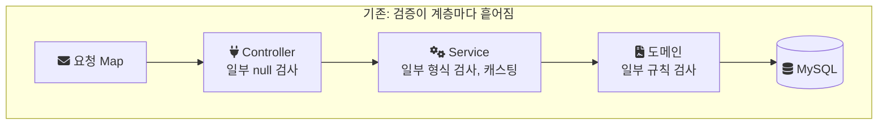
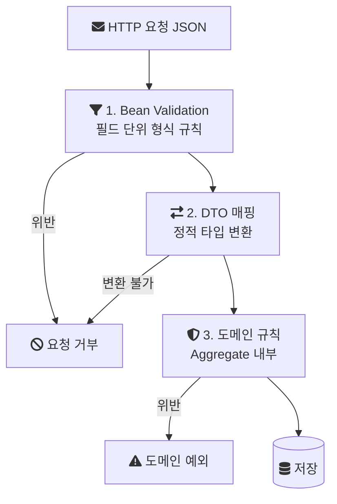
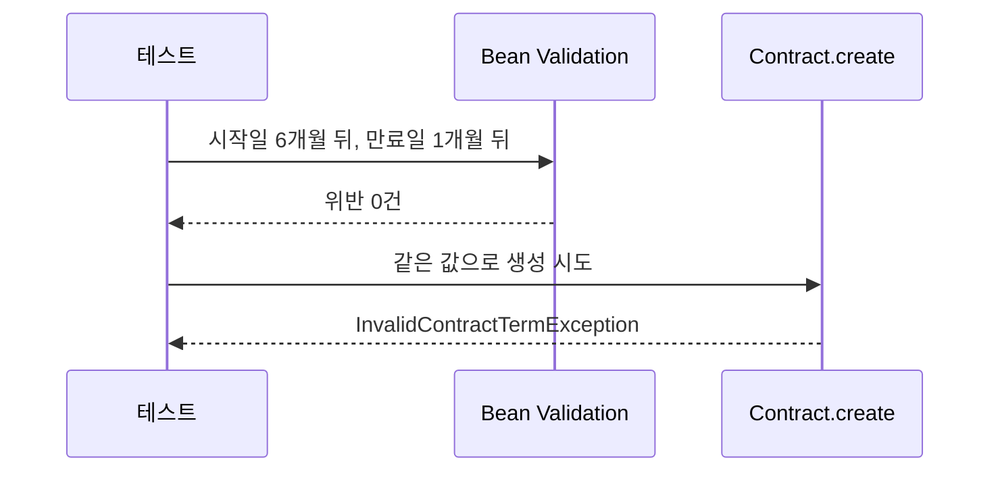

[API를 도메인 책임 단위로 다시 나눈 작업](/posts/mcp-domain-api-redesign/)과 같은 시기에, 음원 콘텐츠 플랫폼(MCP)의 입력 구조도 바꿨다. 기존 API는 요청 본문을 `Map`으로 받았고, 그 값이 맞는지 확인하는 코드는 여러 계층에 흩어져 있었다. 이 글은 그 구조가 어떤 문제를 만들었는지, 검증을 어떤 기준으로 세 단계로 나눴는지, 각 단계에 어떤 규칙을 두었는지, 그리고 이 방식이 남긴 비용을 정리한 기록이다.

> 이 글의 코드는 회사의 실제 소스가 아니다. 기존 구조는 설명을 위한 재구성 예시이고, 개선 후 구조는 같은 설계를 처음부터 다시 만든 개인 랩의 코드다. 랩 코드는 그렇다고 표시했다.

## 배경과 조건

MCP는 계약, 앨범, 곡 메타데이터와 유통사·계약별 라이선스 권리를 다루는 사내 플랫폼이다. 서비스 중인 곡만 8천만 건이 넘었고, 계약 코드처럼 정산과 외부 유통에 연결되는 식별자도 이 시스템에서 만들어졌다. 잘못된 값이 한 번 저장되면 그 값을 읽어 가는 쪽까지 영향이 이어지는 데이터다.

전면 개편은 2024년 1월부터 11월까지 백엔드 3명이 진행했고, 나는 백엔드 리딩과 함께 앨범·트랙·계약·지분율 관리 API를 직접 구현했다. 이 글의 입력 구조 개선도 내가 구현한 범위다. 스택은 Java, Spring Boot, JPA, MapStruct, MySQL이다.

## 문제: 입력에 타입이 없고, 검증에 위치가 없었다

기존 API는 요청을 `Map<String, Object>`로 받았다. 아래는 그 형태를 설명하기 위한 재구성 예시다.

```java
// 재구성 예시: Map 기반 입력 (실제 코드 아님)
@PostMapping("/contract/save")
public Map<String, Object> save(@RequestBody Map<String, Object> params) {
    String type = (String) params.get("contractType");
    Long albumId = Long.valueOf(String.valueOf(params.get("albumId")));
    if (params.get("expiresAt") == null) { /* ... */ }
    contractService.save(params);   // Map이 그대로 아래 계층으로 내려간다
    // ...
}
```

이 구조에서는 요청에 어떤 필드가 있어야 하는지가 코드 어디에도 선언되어 있지 않다. 그래서 세 가지 문제가 생긴다.

- 키 이름을 잘못 쓰면 컴파일 오류가 아니라 `null`이 나온다. 그 `null`은 한참 아래 계층에서 `NullPointerException`이 되어 드러난다.
- 값의 타입을 꺼내 쓰는 쪽에서 캐스팅해야 하므로, 클라이언트가 숫자 대신 문자열을 보내면 런타임에 `ClassCastException`이나 `NumberFormatException`이 난다.
- 어떤 필드를 누가 쓰는지 IDE로 추적할 수 없다. 정책이 바뀌어 필드 하나의 규칙을 고치려 해도, 그 키 문자열을 쓰는 곳을 문자열 검색으로 찾아야 한다.

검증 로직의 위치도 문제였다. 검증이 Controller, Service, 도메인 계층에 흩어져 있어서, 어떤 규칙이 어느 계층에서 검사되는지 한눈에 알 수 없었다.



이 상태에서는 정책 하나가 바뀌어도 그 규칙이 몇 군데에서 어떻게 검사되고 있는지부터 찾아야 했다. 정책 변경의 영향 범위를 파악하기 어려웠다.

## 결정: 정적 타입으로 받고, 검증을 단계로 나눈다

결정은 두 가지였다.

1. 입력 구조를 DTO(요청 데이터를 담는 전용 클래스) 기반 정적 타입으로 바꾼다. 요청에 어떤 필드가 어떤 타입으로 있어야 하는지를 클래스 선언이 말하게 한다.
2. 검증 흐름을 Bean Validation, DTO 매핑, 도메인 규칙 검증의 세 단계로 나눈다. 도메인 규칙은 Aggregate(함께 일관성을 지켜야 하는 객체 묶음과 그 대표 객체) 내부에서 최종 검증한다.

나누는 기준은 "그 규칙을 판단하는 데 무엇을 알아야 하는가"다.

| 단계 | 판단에 필요한 것 | 예 | 실패 시 |
| --- | --- | --- | --- |
| 1. Bean Validation | 그 필드 하나 | 필수값, 길이, 날짜가 미래인지 | 요청 거부, 어떤 필드가 틀렸는지 응답 |
| 2. DTO 매핑 | 요청 DTO 전체 | 요청 DTO를 서비스가 쓰는 타입으로 변환 | 매핑 불가 시 요청 거부 |
| 3. 도메인 규칙 | 다른 필드, 다른 엔티티의 상태 | 만료일이 시작일보다 앞서면 안 됨 | 도메인 예외 |



이렇게 나누면 각 규칙이 들어갈 자리가 하나로 정해진다. 필드 하나만 보고 판단할 수 있으면 DTO의 어노테이션에, 다른 데이터를 봐야 하면 도메인 객체에 둔다. 같은 규칙을 두 곳에서 검사할 이유가 없어진다.

## 1단계: Bean Validation

Bean Validation은 필드에 제약 어노테이션을 선언하고, 검증기가 그 선언대로 객체를 검사하는 Java 표준이다. [Spring 문서](https://docs.spring.io/spring-framework/reference/core/validation/beanvalidation.html)는 이를 "a common way of validation through constraint declaration and metadata"라고 설명한다(제약 선언과 메타데이터를 통한 공통 검증 방식).

아래는 개인 랩의 요청 DTO다. 랩은 계약 생성 하나만 재현한다.

```java
// 랩 코드: contract/api/dto/ContractCreateRequest.java
public record ContractCreateRequest(
        @NotBlank @Size(max = 200) String counterpartyName,
        @NotNull LocalDate startsAt,
        @NotNull @Future LocalDate expiresAt
) {
}
```

여기에는 다른 필드를 보지 않아도 판단할 수 있는 규칙만 둔다. 상대방 이름이 비어 있는지, 날짜가 들어왔는지, 만료일이 미래인지는 그 필드 하나로 결정된다.

Controller는 이 DTO에 `@Valid`를 붙여 받는다. [Spring MVC 문서](https://docs.spring.io/spring-framework/reference/web/webmvc/mvc-controller/ann-validation.html)에 따르면 `@RequestBody` 파라미터에 `@Valid`가 붙으면 그 파라미터 단위로 검증이 실행되고, 실패하면 `MethodArgumentNotValidException`이 발생한다. 요청이 서비스 계층에 들어가기 전에 형식 오류가 걸러진다.

```java
// 랩 코드: contract/api/ContractController.java
public ContractResponse create(@Valid @RequestBody ContractCreateRequest request) {
```

JSON의 필드 타입이 DTO와 맞지 않는 경우(날짜 자리에 숫자가 오는 경우 등)는 Bean Validation 이전에 JSON 역직렬화 단계에서 실패한다. Map으로 받을 때는 이런 오류가 서비스 계층의 캐스팅에서 터졌지만, DTO로 받으면 요청 경계에서 드러난다.

## 2단계: DTO 매핑

검증을 통과한 요청 DTO는 서비스와 도메인이 쓰는 타입으로 변환된다. 프로젝트에서는 MapStruct로 DTO 매핑 방식을 표준화했다. [MapStruct 문서](https://mapstruct.org/documentation/stable/reference/html/)는 MapStruct를 타입 안전한 매핑 클래스를 생성하는 어노테이션 프로세서로 설명한다. 매핑 구현이 컴파일 시점에 생성되고 리플렉션 없이 일반 메서드 호출로 동작하므로, 매핑할 수 없는 타입 조합은 런타임이 아니라 빌드에서 드러난다.

같은 문서는 매핑되지 않은 대상 필드를 어떻게 처리할지 `unmappedTargetPolicy`로 정할 수 있다고 설명한다. 기본값은 `WARN`이고 `ERROR`로 두면 매핑 누락이 빌드 실패가 된다. 당시 이 정책을 어떻게 설정했는지는 기록에 없다.

랩은 이 단계를 MapStruct 대신 서비스의 수동 매핑으로 단순화했다. 랩이 확인하려는 것은 단계의 분리이지 매핑 라이브러리가 아니기 때문이다. 매핑 규칙을 프로젝트 전체에 일관되게 강제한 방법은 아키텍처 규칙을 다루는 이후 글에서 정리한다.

## 3단계: 도메인 규칙은 Aggregate 안에서

마지막 단계는 다른 필드나 다른 엔티티의 상태를 알아야 판단할 수 있는 규칙이다. "만료일이 시작일보다 앞설 수 없다"는 규칙은 두 필드를 함께 봐야 한다. 필드 하나씩 보는 Bean Validation 어노테이션으로는 표현되지 않는다.

```java
// 랩 코드: contract/domain/Contract.java
public static Contract create(String contractCode, String counterpartyName,
                               LocalDate startsAt, LocalDate expiresAt) {
    if (expiresAt.isBefore(startsAt)) {
        throw new InvalidContractTermException(
                "계약 만료일(%s)은 시작일(%s)보다 앞설 수 없음".formatted(expiresAt, startsAt));
    }
    return new Contract(contractCode, counterpartyName, startsAt, expiresAt);
}
```

이 규칙을 도메인 객체의 생성 메서드에 두면, 어떤 API 경로로 계약이 만들어지든 이 검사를 지나지 않고는 `Contract`가 생기지 않는다. 여러 계층에 흩어져 있던 규칙이 이런 식으로 한 곳에 모인다. 정책이 바뀌면 이 메서드 하나를 고치면 된다.

## 랩에서 확인한 것: 형식은 맞지만 규칙은 어긴 요청

세 단계를 나눈 이유가 가장 잘 드러나는 경우는 1단계를 통과하고 3단계에서 걸리는 요청이다. 랩의 `ValidationPipelineTest`가 이 경우를 재현한다.

```java
// 랩 코드: validation/ValidationPipelineTest.java
LocalDate startsAt = LocalDate.now().plusMonths(6);
LocalDate expiresAt = LocalDate.now().plusMonths(1); // startsAt보다 이전

ContractCreateRequest request = new ContractCreateRequest("㈜예시레이블", startsAt, expiresAt);
assertThat(validator.validate(request)).isEmpty();          // 1단계는 통과

assertThrows(InvalidContractTermException.class,            // 3단계에서 거부
        () -> Contract.create("MCP-2026-000001", request.counterpartyName(),
                request.startsAt(), request.expiresAt()));
```

두 날짜 모두 미래이고 null도 아니므로 Bean Validation은 이 요청을 통과시킨다. 그러나 만료일이 시작일보다 앞서므로 도메인 규칙에서 예외가 난다. Bean Validation만 있었다면 이 요청은 저장됐을 것이다.



랩 실행 조건과 결과는 다음과 같다. Spring Boot 3.3.4, JDK 21 환경에서 DB와 Spring 컨텍스트 없이 순수 단위 테스트로 돌렸다. 테스트 5개(1단계 거부 2개, 1단계 통과 1개, 3단계 거부 1개, 3단계 통과 1개)가 2026년 9월 29일 로컬에서 2회 연속 통과했다. 이것은 설계가 의도대로 동작한다는 확인이지, 운영에서의 오류 감소량을 보여주는 측정은 아니다.

## 결과

개선 후에는 잘못된 데이터가 유입 단계에서 걸러졌다. Map을 캐스팅하며 생기던 런타임 타입 오류와 예외가 줄었다. 정책이 바뀌면 그 규칙이 필드 단위인지 문맥 의존인지에 따라 DTO나 도메인 객체 중 한 곳을 고치면 되므로, 수정 범위를 파악하기 쉬워졌다.

다만 오류가 몇 건에서 몇 건으로 줄었는지 같은 수치는 남아 있지 않다. 이 개선의 효과는 정성적인 관찰로만 말할 수 있다.

## 비용과 남은 것

- 클래스가 늘어난다. API마다 요청 DTO가 생기고, DTO와 도메인 사이의 매핑이 생긴다. Map 하나로 받던 때보다 작성할 코드가 많다.
- 규칙을 어느 단계에 둘지 팀이 같은 기준을 써야 한다. 기준이 흐려지면 같은 규칙이 DTO와 도메인에 중복으로 들어가고, 처음의 분산 문제가 다시 생긴다. 실제로 재설계가 진행되며 여러 개발자가 동시에 작업하자 도메인 규칙 분산과 DTO 매핑 방식 불일치가 다시 쌓였고, 이 문제는 아키텍처 규칙을 테스트로 강제하는 작업으로 이어졌다.
- 랩은 HTTP 계층의 오류 응답 매핑(Bean Validation 실패와 도메인 예외를 각각 어떤 상태 코드로 응답할지)을 아직 재현하지 않는다.

## 참고

- [Spring Framework Reference: Java Bean Validation](https://docs.spring.io/spring-framework/reference/core/validation/beanvalidation.html) — Spring Docs: Bean Validation의 제약 선언 방식
- [Spring Framework Reference: Validation (Spring MVC)](https://docs.spring.io/spring-framework/reference/web/webmvc/mvc-controller/ann-validation.html) — Spring Docs: `@Valid @RequestBody` 검증과 `MethodArgumentNotValidException`
- [MapStruct Reference Guide](https://mapstruct.org/documentation/stable/reference/html/) — MapStruct: 컴파일 시점 매핑 생성과 `unmappedTargetPolicy`
- [랩 코드: ContractCreateRequest.java](https://github.com/polynomeer/engineering-lab/blob/d52297d0ad07c3d8a05a7471192a5655cb8b1378/career-lab/mcp-platform/src/main/java/com/portfolio/mcplab/contract/api/dto/ContractCreateRequest.java) — GitHub
- [랩 코드: Contract.java](https://github.com/polynomeer/engineering-lab/blob/d52297d0ad07c3d8a05a7471192a5655cb8b1378/career-lab/mcp-platform/src/main/java/com/portfolio/mcplab/contract/domain/Contract.java) — GitHub
- [랩 코드: ValidationPipelineTest.java](https://github.com/polynomeer/engineering-lab/blob/d52297d0ad07c3d8a05a7471192a5655cb8b1378/career-lab/mcp-platform/src/test/java/com/portfolio/mcplab/validation/ValidationPipelineTest.java) — GitHub
