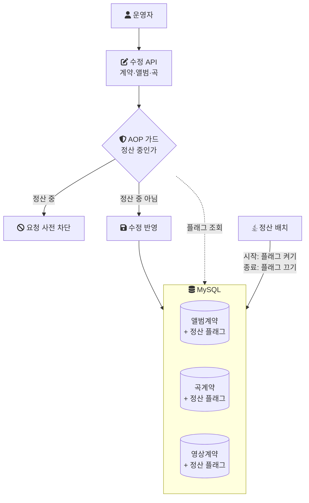
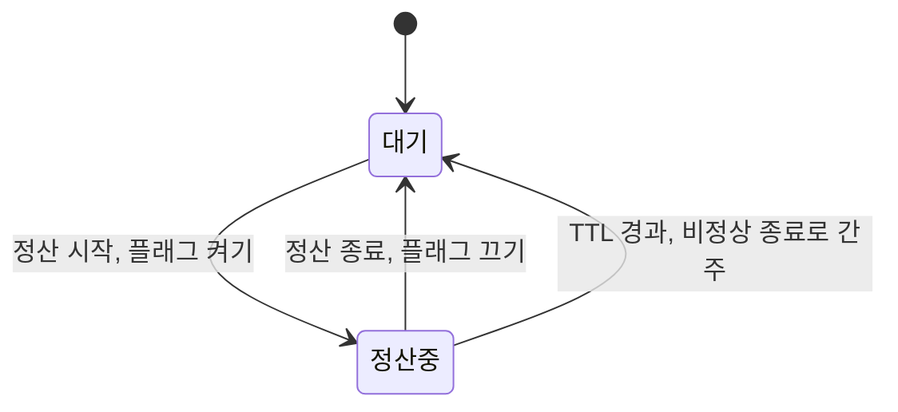
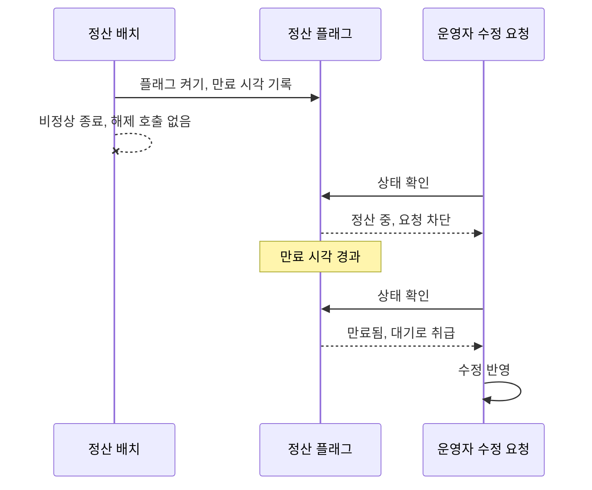
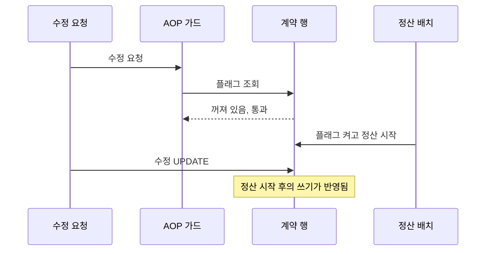

음원 유통 시스템(MDS)에서 정산은 계약, 앨범, 곡 메타데이터를 기준으로 수익을 계산하는 프로세스였다. 이 글은 정산이 도는 동안 그 기준 데이터가 바뀌는 문제를 어떻게 막았는지, 왜 DB 락이 아니라 애플리케이션 레벨의 상태 플래그를 택했는지, 그 선택이 남긴 틈이 무엇인지 정리한 기록이다.

## 어떤 시스템이었나

MDS는 외주 개발사가 PHP로 만든 기존 유통망 시스템을 리뉴얼한 시스템이다. 기존 시스템에서 넘겨받을 수 있었던 것은 테이블과 데이터뿐이었고, 그 데이터를 기준으로 스키마를 새로 설계한 뒤 DBA와 함께 마이그레이션했다. 앨범과 곡을 등록·검수하고, DDEX(음원 메타데이터와 전송을 위한 업계 표준 메시지 형식) 기반 자동 전송으로 국내외 음원 플랫폼에 유통하며, 그 수익을 정산한다.

판단의 전제가 되는 조건은 다음과 같다.

| 항목 | 내용 |
| --- | --- |
| 기간 | 2023년 1월부터 2024년 1월까지 |
| 인원 | 백엔드 4명(시니어 1명, 주니어 3명), 정산개발팀 2명, 프론트엔드 4명 |
| 스택 | Java, Spring Boot, JPA, Spring Batch, MySQL, Amazon SQS, ArchUnit |
| 내 역할 | 콘텐츠(앨범·곡) 관리 API와 라이선스 관리 API 개발, 이후 계약관리 영역까지 인수인계받아 정담당자로 유지보수 |
| 공통 규칙 | 시니어 개발자가 설계한 공통 인터페이스 계약을 문서화하고 ArchUnit 테스트로 강제 |

정산 대상 행 수나 정산 1회의 소요 시간 같은 규모 수치는 기록이 남아 있지 않다. 그래서 이 글의 판단은 "정산은 배치로 오래 돌고, 운영 수정은 사람이 화면에서 수시로 한다"는 정성적 조건 위에서 읽어야 한다.

회사 코드는 퇴사 후 볼 수 없다. 코드 예시는 같은 설계를 처음부터 다시 구현한 개인 랩([engineering-lab/career-lab/mds-distribution](https://github.com/polynomeer/engineering-lab/blob/d52297d0ad07c3d8a05a7471192a5655cb8b1378/career-lab/mds-distribution/README.md))에서 가져왔고, 랩에서 정한 값(TTL 15분 등)은 운영값이 아니다. 본문에서 랩 코드와 운영 사실을 구분해 적는다.

## 정산 도중에 기준이 움직일 수 있었다

정산은 배치로 돈다. 대상 계약과 앨범, 곡의 메타데이터를 읽어 계약 조건대로 수익을 계산한다. 그런데 정산이 도는 동안에도 운영자는 같은 데이터를 수정할 수 있었고, 그 수정은 정산 중인 데이터에 그대로 반영됐다.

어떤 일이 생길 수 있는지 숫자를 넣어 그려 보면 이렇다. 아래 배분율과 곡 번호는 설명용 예시다.

```text
정산 시작 (계약 A: 배분율 70%)
  → 곡 1~500 계산 (70% 기준)
  → 운영자가 계약 A 배분율을 60%로 수정
  → 곡 501~1000 계산 (60% 기준)
정산 종료
```

한 번의 정산 안에서 같은 계약이 두 가지 기준으로 계산된다. 정산 시작 시점과 종료 시점의 기준이 다르고, 결과는 어느 기준으로 봐도 맞지 않는 숫자가 된다. 이런 결과가 발견되면 재정산해야 하고, 재정산은 다시 운영 리스크가 된다. 막아야 하는 것은 "정산이 끝나기 전까지 그 정산이 읽는 기준 데이터가 바뀌는 것"이었다.

## 무엇을 잠가야 하는가

정산 대상 단위는 계약이다. MDS의 계약은 앨범계약, 곡계약, 영상계약 세 테이블로 나뉘어 있었고, 정산 상태 플래그는 이 세 테이블에 각각 별도로 두었다. 정산 중에는 이 세 테이블의 업데이트가 막혀야 했다.

전체 구조를 그리면 다음과 같다. 운영자의 수정 요청은 수정 API 앞에서 가드를 지나고, 정산 배치는 같은 계약 테이블의 플래그를 켜고 끈다.



플래그가 수정 대상과 같은 계약 행에 있다는 점은 뒤에서 남은 틈을 이야기할 때 다시 중요해진다.

## DB 락을 쓰지 않은 이유

가장 직접적인 방법은 정산이 읽는 행을 정산이 끝날 때까지 잠그는 것이다. `SELECT ... FOR UPDATE`(읽으면서 그 행에 쓰기 락을 거는 조회)로 대상 계약을 잠그고 정산 트랜잭션이 커밋될 때 풀면, 그사이의 수정은 락을 기다리다 실패한다.

이 방식을 택하지 않은 이유는 장기 트랜잭션과 락 경합이었다. 행 락은 락을 잡은 트랜잭션이 끝나야 풀린다. 그래서 정산 내내 수정을 막으려면 정산 전체를 하나의 트랜잭션으로 열어 두어야 하고, 정산은 배치로 오래 돈다.

- 트랜잭션이 오래 열려 있으면 커넥션을 계속 붙잡고, InnoDB는 그 트랜잭션이 볼 수 있는 옛 버전을 지우지 못한다. MySQL 문서는 읽기만 하는 트랜잭션도 주기적으로 커밋하라고 권하며, 그러지 않으면 "InnoDB cannot discard data from the update undo logs"(InnoDB가 update undo 로그를 버리지 못한다)고 설명한다([InnoDB Multi-Versioning](https://dev.mysql.com/doc/refman/8.0/en/innodb-multi-versioning.html)). undo 로그가 무엇인지는 [Redo Log와 Undo Log](/posts/redo-undo-log/)에 정리했다.
- 잠긴 행을 쓰려는 다른 요청이 락 대기로 쌓이고, 대기가 길어지면 타임아웃으로 실패한다. 이것이 락 경합이다.
- 정산을 청크(일정 건수 단위) 커밋으로 나누는 순간, 하나의 긴 트랜잭션이라는 전제가 사라지고 커밋 사이에 락이 풀린다.

두 방식의 성격을 나란히 놓으면 이렇다.

| | 물리 DB 락 | 상태 플래그 |
| --- | --- | --- |
| 강제 주체 | DB, 우회 불가 | 애플리케이션, 모든 수정 경로가 검사해야 함 |
| 트랜잭션 길이 | 정산 전체 | 플래그 갱신 한 번 |
| 수정 요청의 동작 | 락 해제까지 대기 | 즉시 거절 |
| 정산 프로세스가 죽으면 | 커넥션이 끊기며 DB가 해제 | 따로 복구 장치가 필요 |

상태 플래그는 강제력과 자동 해제를 내주고 짧은 트랜잭션을 얻는다. 내준 두 가지를 메우는 장치가 AOP 가드와 TTL이다.

## 상태 모델

플래그가 표현하는 상태는 둘뿐이다. 정산이 시작되면 켜지고, 끝나면 꺼지고, 정산이 끝을 알리지 못한 채 죽으면 TTL이 지난 뒤 꺼진 것으로 취급된다.



플래그 갱신은 행 하나를 바꾸는 짧은 트랜잭션이다. 정산 배치 본체는 이 상태와 별개로 자기 트랜잭션 단위대로 커밋하며 돌 수 있다.

## 수정 API마다 검사 코드를 쓰지 않기 위해

상태 플래그의 약점은 모든 수정 경로가 플래그를 확인해야 한다는 것이다. 한 경로라도 빠지면 그 경로로 정산 중 수정이 들어온다. 수정 API는 계약, 앨범, 곡에 걸쳐 여러 개였다.

그래서 검사 코드를 메서드마다 쓰지 않고, 수정 API에 애너테이션을 붙이면 [AOP](/posts/aop/)(여러 메서드에 공통으로 끼워 넣을 동작을 한곳에 모으는 기법) 인터셉터가 검사하도록 했다. 운영에서 가드가 컨트롤러와 서비스 중 어느 계층에 걸렸는지는 지금 확인할 수 없다. 아래는 랩에서 서비스 메서드에 건 형태다.

랩 코드: 수정 메서드는 애너테이션 한 줄로 보호 대상이 된다([AlbumMetadataService.java](https://github.com/polynomeer/engineering-lab/blob/d52297d0ad07c3d8a05a7471192a5655cb8b1378/career-lab/mds-distribution/src/main/java/com/portfolio/mdslab/settlement/AlbumMetadataService.java)).

```java
@SettlementGuarded(type = SettlementTargetType.ALBUM, idParam = "albumId")
@Transactional
public Album updateMetadataGuarded(Long albumId, String newTitle) { ... }
```

랩 코드: 가드는 상태를 읽기만 하고, 정산 중이면 예외로 요청을 끊는다([SettlementLockAspect.java](https://github.com/polynomeer/engineering-lab/blob/d52297d0ad07c3d8a05a7471192a5655cb8b1378/career-lab/mds-distribution/src/main/java/com/portfolio/mdslab/settlement/SettlementLockAspect.java)).

```java
@Before("@annotation(guarded)")
public void checkNotSettling(JoinPoint joinPoint, SettlementGuarded guarded) {
    Long targetId = extractTargetId(joinPoint, guarded.idParam());
    lockRepository.findByTargetTypeAndTargetId(guarded.type(), targetId)
            .filter(lock -> lock.isActiveConsidering(LocalDateTime.now()))
            .ifPresent(lock -> {
                throw new SettlementInProgressException(guarded.type(), targetId, lock.getExpiresAt());
            });
}
```

가드는 플래그를 켜거나 끄지 않는다. 켜고 끄는 것은 정산 배치의 책임이고, 가드는 읽기만 한다. 그래서 여러 수정 요청이 동시에 가드를 지나도 서로 기다리지 않는다.

### 가드와 트랜잭션의 순서

가드가 트랜잭션보다 먼저 돌면 거절된 요청은 트랜잭션을 열지도 않는다. 그런데 이 순서는 저절로 정해지지 않는다. Spring 문서는 서로 다른 애스펙트의 어드바이스가 같은 지점에 걸리면 "unless you specify otherwise, the order of execution is undefined"(따로 지정하지 않으면 실행 순서는 정해지지 않는다)고 적는다([Advice Ordering](https://docs.spring.io/spring-framework/reference/core/aop/ataspectj/advice.html)). `@Transactional`의 트랜잭션 어드바이스 기본 순서는 `Ordered.LOWEST_PRECEDENCE`이므로([Using @Transactional](https://docs.spring.io/spring-framework/reference/data-access/transaction/declarative/annotations.html)), 가드를 먼저 돌리려면 가드 애스펙트에 더 작은 `@Order` 값을 명시해야 한다.

랩의 `SettlementLockAspect`에는 `@Order`가 없다. 랩 테스트는 통과하지만, 이 순서를 검증하는 테스트는 아니다. 거절이 트랜잭션 안에서 일어나도 결과는 롤백이라 데이터는 같지만, 거절될 요청마다 커넥션을 잡았다 놓는 비용이 생긴다.

### 빠진 경로를 찾는 방법

애너테이션 방식에서는 "수정 API인데 가드 애너테이션이 없는 메서드"가 코드에서 정적으로 드러난다. MDS는 공통 인터페이스 계약을 ArchUnit(아키텍처 규칙을 단위 테스트로 검사하는 라이브러리) 테스트로 강제하고 있었으므로, 이런 규칙도 같은 방식으로 테스트로 만들 수 있다. 다만 가드 누락을 검사하는 ArchUnit 규칙을 실제로 두었는지는 기록이 없어 여기 적지 않는다.

## 정산이 죽으면 플래그도 남는다

상태 플래그의 가장 큰 구멍은 정산 프로세스가 비정상 종료됐을 때다. 플래그를 켠 채로 정산이 죽으면, 아무도 플래그를 끄지 않는다. 그 계약은 계속 수정할 수 없는 상태로 남는다. 물리 락이라면 커넥션이 끊길 때 DB가 풀어 주지만, 플래그는 그렇지 않다.

그래서 TTL(Time To Live, 정해진 시간이 지나면 만료되는 값) 기반 자동 복구를 두었다. 운영에서 쓴 정확한 TTL 값과 구현 방식은 기억나지 않는다. 값을 정하는 원칙은 분명하다. TTL이 정산의 정상 소요 시간보다 짧으면 정상 정산 도중에 플래그가 풀려 원래 문제가 돌아오고, 너무 길면 장애 후 그만큼 수정이 막힌다. 정산 소요 시간을 관측하고 있어야 정할 수 있는 값이다.

랩에서는 별도 복구 배치 없이, 읽는 시점에 만료 여부를 판단하는 지연 평가로 구현했다. TTL이 지난 플래그는 켜져 있어도 꺼진 것으로 본다.

랩 코드: [SettlementLock.java](https://github.com/polynomeer/engineering-lab/blob/d52297d0ad07c3d8a05a7471192a5655cb8b1378/career-lab/mds-distribution/src/main/java/com/portfolio/mdslab/domain/SettlementLock.java)

```java
public boolean isActiveConsidering(LocalDateTime now) {
    if (status != LockStatus.LOCKED) {
        return false;
    }
    return expiresAt == null || now.isBefore(expiresAt);
}
```

정산이 죽었을 때의 흐름은 다음과 같다. 랩 테스트(`SettlementGuardTest`)는 TTL을 2초로 두고 해제를 호출하지 않은 채 이 흐름을 재현한다.



랩 실행 결과(로컬 Testcontainers MySQL, TTL 2초, Awaitility 대기 상한 6초)에서 이 테스트는 2.27초 걸려 통과했다. TTL 2초가 지난 직후 다음 수정 시도에서 차단이 풀렸다는 뜻이다. 운영 TTL과는 무관한 숫자다.

TTL에는 짝이 되는 규칙이 하나 더 있다. 정산 A의 TTL이 지나 정산 B가 플래그를 다시 잡았는데, 뒤늦게 살아난 A가 종료하며 플래그를 끄면 B가 도는 중에 수정이 열린다. 랩은 플래그를 켠 실행의 ID(`locked_by`)를 함께 기록하고, 해제는 그 ID가 일치할 때만 하도록 막았다.

## 정산 시작은 원자적이어야 한다

플래그를 켜는 쪽도 경합이 있다. "플래그가 꺼져 있는지 확인한 뒤 켠다"를 두 단계로 나누면, 두 정산 실행이 같은 계약을 동시에 꺼져 있다고 보고 둘 다 시작할 수 있다. 확인과 갱신을 조건부 UPDATE 한 문장으로 합치면 이 틈이 사라진다.

랩 코드: 꺼져 있거나 만료된 경우에만 켠다([SettlementLockRepository.java](https://github.com/polynomeer/engineering-lab/blob/d52297d0ad07c3d8a05a7471192a5655cb8b1378/career-lab/mds-distribution/src/main/java/com/portfolio/mdslab/repository/SettlementLockRepository.java)).

```java
@Modifying
@Transactional
@Query("""
    UPDATE SettlementLock l
       SET l.status = LOCKED, l.lockedAt = :now, l.expiresAt = :expiresAt, l.lockedBy = :runId
     WHERE l.targetType = :targetType AND l.targetId = :targetId
       AND (l.status = UNLOCKED OR l.expiresAt < :now)
    """)
int tryAcquire(...);
```

(enum 값은 실제 코드에서 전체 경로로 쓴다. 읽기 쉽게 줄였다.)

반환값이 1이면 이 실행이 플래그를 잡은 것이고, 0이면 다른 실행이 유효한 플래그를 쥐고 있으므로 시작하지 않는다. 행 단위 조건부 UPDATE는 DB가 그 행에 쓰기 락을 걸고 수행하므로 두 실행 중 하나만 1을 받는다.

랩을 만들며 겪은 함정도 하나 있다. 이 메서드처럼 리포지토리 인터페이스에 직접 선언한 `@Query` 메서드는 기본 트랜잭션을 물려받지 않는다. Spring Data JPA 문서는 "Declared query methods (including default methods) do not get any transaction configuration applied by default"(직접 선언한 쿼리 메서드에는 기본 트랜잭션 설정이 적용되지 않는다)고 적는다([Transactionality](https://docs.spring.io/spring-data/jpa/reference/jpa/transactions.html)). 처음에는 호출하는 쪽에 트랜잭션이 없어 `TransactionRequiredException`이 났고, 메서드에 `@Transactional`을 직접 붙여 해결했다.

이 부분은 운영 구조와 다르다. 랩은 플래그를 별도 `settlement_lock` 테이블에 두었지만, 운영에서는 플래그가 세 계약 테이블 각각에 있었다. 운영에서 플래그를 켜는 문장이 조건부 UPDATE였는지는 기억나지 않는다.

## 확인과 쓰기 사이의 틈

수정 요청 쪽에는 이론상 틈이 남는다. 가드가 확인한 시점과 실제로 쓰는 시점이 다르기 때문이다.



가드는 통과했지만 쓰기는 정산 시작 뒤에 일어났다. 물리 락이라면 생길 수 없는 순서다.

운영에서 확인된 사실은 두 가지다. 플래그는 수정 대상과 같은 계약 행에 있었고, MDS 전반에는 낙관적 락(행에 버전 값을 두고, 갱신할 때 읽었던 버전과 다르면 실패시키는 방식)을 적용했다. 낙관적 락의 구체 방식과, 그것으로 이 틈을 어떻게 막았는지는 기억나지 않는다.

그래서 아래는 경험이 아니라 일반론이다. 플래그 켜기와 운영자 수정이 모두 같은 행의 버전을 확인하고 올리는 갱신이라면, 위 순서에서 수정 UPDATE는 자기가 읽은 버전이 이미 바뀌었으므로 실패한다. 반대로 플래그를 켜는 쪽이 버전을 올리지 않는 문장이라면 수정 쪽 버전 비교가 이 순서를 잡지 못한다. 낙관적 락이 틈을 막는지는 "양쪽 갱신이 모두 같은 버전 규칙을 지나는가"에 달려 있다. JPA의 `@Version`과 조건부 UPDATE로 경합을 다루는 방법은 [Spring과 JPA에서 Race Condition을 다루는 방법](/posts/how-to-control-race-condition/)에 정리했다.

랩은 이 틈을 다루지 않는다. 플래그가 별도 테이블에 있고 가드는 읽기만 하므로, 위 순서는 랩에서 그대로 재현된다.

## 지분율 배치와 비교

같은 회사의 지분율 시스템에서도 상태로 정합성을 지켰다. 그쪽은 Redis 분산락을 SETNX와 토큰 기반 해제로 다시 설계하고, 삭제중, 삭제완료, 등록중, 등록완료의 상태 전이 모델을 정의했다. 두 사례를 나란히 놓으면 원리는 같고 막는 방향이 다르다.

| | 지분율 배치 | MDS 정산 |
| --- | --- | --- |
| 지키려는 것 | 삭제와 등록의 순서 | 정산 기준 데이터의 불변 |
| 경쟁하는 주체 | 작업과 작업 | 정산 배치와 운영자 |
| 상태를 기록한 곳 | Redis 락과 작업 상태 | 계약 행의 플래그 |
| 막는 방향 | 서로를 배제 | 정산은 진행, 수정만 차단 |

정산은 진행하면서 수정만 막으면 됐기 때문에, MDS에서는 계약 행의 플래그와 TTL만으로 충분했다. 해제 시 소유자를 확인하는 규칙은 두 사례에 공통으로 필요하다.

## 결과와 비용

정산과 운영 수정이 동시에 일어나는 환경에서도 정산 기준 데이터의 일관성을 유지했고, 재정산 빈도가 줄었다. 재정산이 몇 번에서 몇 번으로 줄었는지는 기록이 없다. 정산 전체를 덮는 DB 락이 없으므로 장기 트랜잭션과 락 경합도 생기지 않았다.

대가로 남은 것은 다음과 같다.

| 비용 | 내용 |
| --- | --- |
| 강제력 | DB가 아니라 애플리케이션이 막는다. 가드가 없는 수정 경로, 배치나 SQL로 직접 쓰는 경로는 막지 못한다. |
| TTL 값 | 정산 소요 시간을 알아야 정할 수 있고, 정산이 느려지면 다시 정해야 한다. |
| 확인과 쓰기 사이의 틈 | 낙관적 락이 양쪽 갱신에 같은 규칙으로 걸려 있어야 닫힌다. 운영에서 어떻게 닫았는지는 확인하지 못했다. |
| 거절의 비용 | 정산 중 수정 요청은 실패로 끝나고, 정산이 끝난 뒤 다시 요청해야 한다. |

물리 락을 배제한 근거는 강제력이 아니라 락을 쥐고 있어야 하는 시간이었다. 정합성 도구를 고를 때 "얼마나 강하게 막는가"와 함께 "얼마나 오래 잡고 있어야 하는가"를 먼저 따져 본 것이 이 설계의 출발점이다.

## 참고

- [Spring Framework Reference: Advice Ordering](https://docs.spring.io/spring-framework/reference/core/aop/ataspectj/advice.html)
- [Spring Framework Reference: Using @Transactional](https://docs.spring.io/spring-framework/reference/data-access/transaction/declarative/annotations.html)
- [Spring Data JPA Reference: Transactionality](https://docs.spring.io/spring-data/jpa/reference/jpa/transactions.html)
- [MySQL 8.0 Reference Manual: InnoDB Multi-Versioning](https://dev.mysql.com/doc/refman/8.0/en/innodb-multi-versioning.html)
- 랩 README — [career-lab/mds-distribution/README.md](https://github.com/polynomeer/engineering-lab/blob/d52297d0ad07c3d8a05a7471192a5655cb8b1378/career-lab/mds-distribution/README.md)
- 랩 코드 — [SettlementLockAspect.java](https://github.com/polynomeer/engineering-lab/blob/d52297d0ad07c3d8a05a7471192a5655cb8b1378/career-lab/mds-distribution/src/main/java/com/portfolio/mdslab/settlement/SettlementLockAspect.java), [SettlementLockRepository.java](https://github.com/polynomeer/engineering-lab/blob/d52297d0ad07c3d8a05a7471192a5655cb8b1378/career-lab/mds-distribution/src/main/java/com/portfolio/mdslab/repository/SettlementLockRepository.java), [SettlementLock.java](https://github.com/polynomeer/engineering-lab/blob/d52297d0ad07c3d8a05a7471192a5655cb8b1378/career-lab/mds-distribution/src/main/java/com/portfolio/mdslab/domain/SettlementLock.java)
- 랩 테스트 — [SettlementGuardTest.java](https://github.com/polynomeer/engineering-lab/blob/d52297d0ad07c3d8a05a7471192a5655cb8b1378/career-lab/mds-distribution/src/test/java/com/portfolio/mdslab/settlement/SettlementGuardTest.java)
