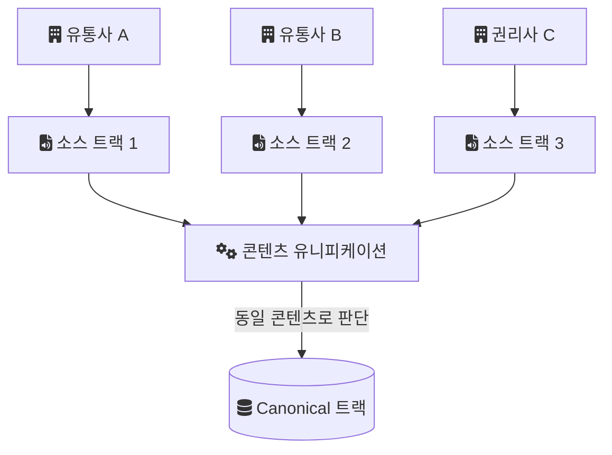

음원 콘텐츠 플랫폼(MCP)에는 같은 음원이 여러 경로로 들어온다. 한 곡이 여러 유통사와 권리사를 거쳐 입수되고, 경로마다 제목 표기, 아티스트 이름, 앨범 정보가 조금씩 다르다. 이 중복을 하나로 묶는 것이 콘텐츠 유니피케이션(중복 통합) 시스템이다.

먼저 범위를 밝혀 둔다. 이 시스템은 내가 맡았을 때 이미 구축되어 있었고, 나는 설계자가 아니라 운영자였다. 매칭 로직의 세부 수치, 운영 중 겪은 개별 사례, 기술 스택은 이 글에서 다루지 않는다. 정확하게 기록해 둔 것이 없는 내용을 그럴듯하게 채우는 것보다, 확인된 구조와 일반적인 원리를 구분해 적는 편이 낫다고 판단했다.

## 왜 중복이 생기는가

음원 플랫폼은 음원을 직접 만들지 않는다. 유통사와 권리사가 음원 파일과 메타데이터를 보내 오고, 플랫폼은 그것을 받아 서비스한다. 같은 녹음이 여러 계약 경로로 유통되면 플랫폼에는 같은 곡이 여러 번 도착한다.

도착한 메타데이터는 경로마다 다르다. 예를 들어 한쪽은 영문 제목, 다른 쪽은 한글 제목을 쓸 수 있고, 피처링 표기가 아티스트 필드에 들어갈 수도, 제목 괄호 안에 들어갈 수도 있다. 그래서 단순한 문자열 비교로는 같은 곡인지 판단할 수 없다.

이것을 그대로 서비스하면 사용자는 검색 결과에서 같은 곡을 여러 번 보게 된다. 반대로 서로 다른 곡을 같은 곡으로 잘못 묶으면 한 곡이 다른 곡의 메타데이터로 보이게 된다.

## Source와 Canonical을 나누는 구조

시스템의 기본 구조는 두 종류의 트랙을 구분하는 것이었다.

- 소스(Source) 트랙. 유통사나 권리사가 보내 온 그대로의 트랙이다. 입수 경로마다 하나씩 생긴다.
- 표준(Canonical) 트랙. 플랫폼 내부에서 "이 곡"을 대표하는 트랙이다.

같은 콘텐츠로 판단된 소스 트랙들은 하나의 canonical 트랙에 연결된다. 아래 그림이 그 관계다.

이렇게 나누면 원본을 덮어쓰지 않아도 된다. 소스 트랙은 입수된 그대로 남고, 통합 판단은 연결 관계로만 표현된다. 연결이 잘못됐다면 원본을 복구할 필요 없이 연결만 풀면 된다. 통합 판단은 틀릴 수 있으므로, 틀렸을 때 되돌리는 비용이 낮다는 점이 이 구조의 장점이다.

## 같은 곡인지 판단하는 신호

여기부터는 이 시스템의 실제 매칭 규칙이 아니라 이런 시스템이 일반적으로 쓰는 신호를 정리한 것이다. 실제 가중치와 임계값은 기억하는 것이 없어서 적지 않는다.

가장 강한 신호는 ISRC(International Standard Recording Code, 녹음물 고유 식별 코드)다. ISRC를 관리하는 IFPI는 이 코드를 이렇게 설명한다.

> "ISRC enables sound recordings and music videos to be uniquely and permanently identified."

녹음물과 뮤직비디오를 고유하고 영구적으로 식별한다는 뜻이다. 두 소스 트랙의 ISRC가 같다면 같은 녹음일 가능성이 높다. 다만 ISRC가 비어 있거나 입수 과정에서 잘못 입력된 경우가 있으므로, ISRC 하나에만 기대기는 어렵다.

그래서 제목, 아티스트, 재생 시간 같은 보조 신호를 함께 본다. 이 신호들은 표기 차이 때문에 그대로 비교하지 않고, 정규화(대소문자, 공백, 괄호 표기 정리)를 거친 뒤 유사도로 다루는 것이 일반적이다. 재생 시간은 표기 차이가 없다는 장점이 있지만, 같은 곡의 리마스터나 라디오 에디트처럼 실제로 다른 녹음을 구분하는 근거도 된다.

## 판단이 틀리는 두 방향

통합 판단의 오류는 방향이 둘이다. 이 구분은 이 시스템만의 것이 아니라 중복 판정 문제 전반에 해당한다.

- 같은 곡을 다른 곡으로 판단하면(미탐) 중복이 서비스에 그대로 노출된다.
- 다른 곡을 같은 곡으로 판단하면(오탐) 서로 다른 녹음이 하나로 합쳐진다.

두 오류의 비용은 같지 않다. 중복 노출은 사용자에게 불편이지만, 잘못된 병합은 한 곡의 메타데이터와 권리 정보가 다른 곡에 붙어 보이는 문제가 된다. 이런 시스템이 확신이 낮은 경우를 자동으로 처리하지 않고 사람의 검토로 넘기는 구조를 흔히 갖는 이유가 여기에 있다. Source와 Canonical을 나눠 연결만 풀면 되게 만든 구조도 같은 방향에서 이해할 수 있다.

## 이 글에서 다루지 않은 것

- 운영 기간과 팀 구성
- 실제 매칭 규칙, 가중치, 임계값
- 운영 중 다룬 구체적인 오탐, 미탐 사례와 대응
- 실제 기술 스택

이 항목들은 내가 정확하게 말할 수 있는 상태가 아니다. 그래서 이 글은 운영 회고가 아니라, 이 시스템이 왜 그런 모양이었는지에 대한 정리로 남겨 둔다.

## 참고

- [ISRC — IFPI](https://isrc.ifpi.org/en/)
