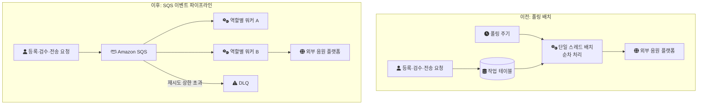
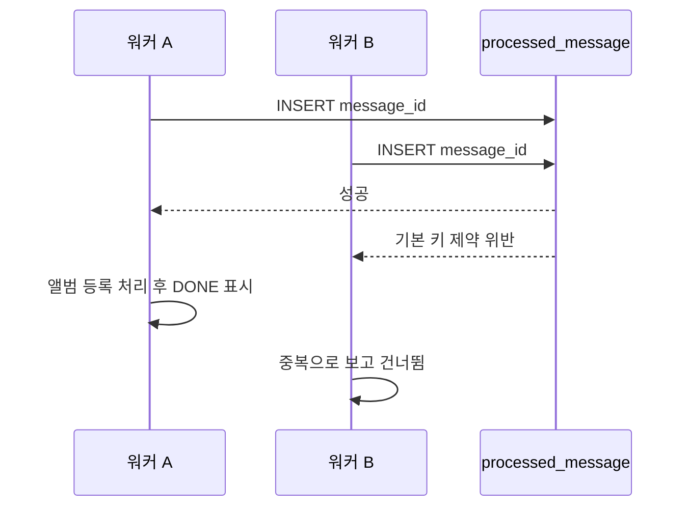
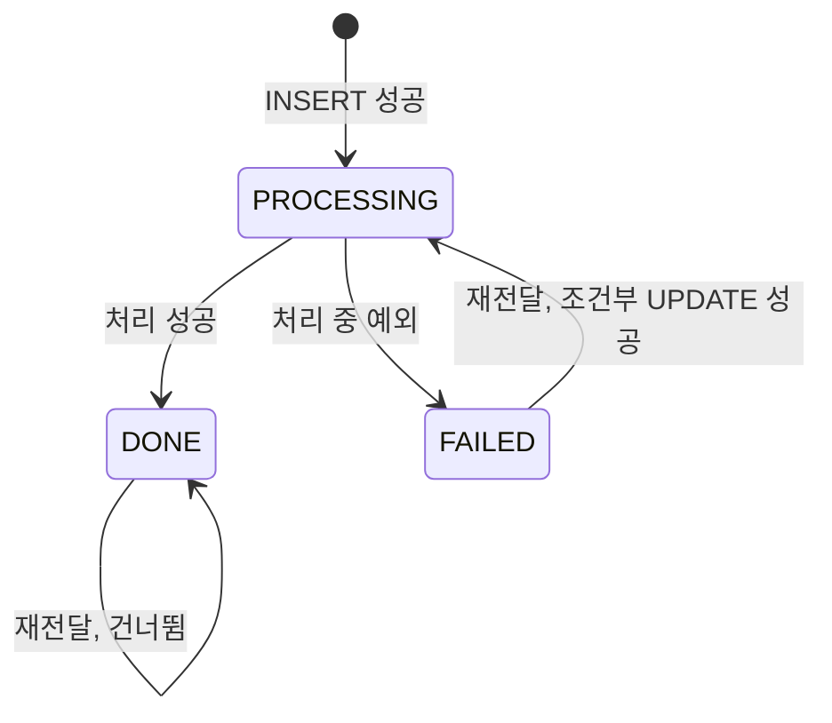
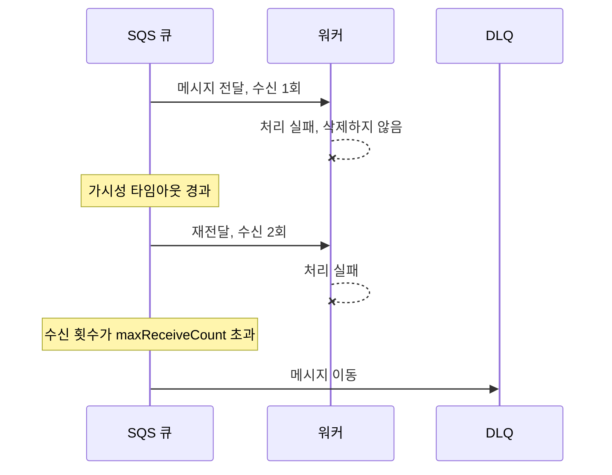

음원 유통 시스템(MDS)에서는 앨범 등록, 검수 요청, 외부 음원 플랫폼으로의 전송이 계속 발생한다. 처음에는 이 작업들을 폴링 배치가 순서대로 처리했다. 이 글은 그 구조가 어디서 막혔는지, 큐로 바꾸면서 무엇을 새로 떠안게 되는지(중복 전달, 순서, 실패 격리), 그리고 운영에서 확인된 것과 확인하지 못한 것을 나눠 정리한 기록이다.

---

## 어떤 시스템이었나

MDS는 외주 개발사가 PHP로 만든 기존 유통망 시스템을 리뉴얼한 시스템이다. 앨범과 곡을 등록·검수하고, DDEX(음원 메타데이터와 전송을 위한 업계 표준 메시지 형식) 기반 자동 전송으로 국내외 음원 플랫폼에 유통하며, 그 수익을 정산한다. 외부 연동, 배치 처리, 정산 로직이 계속 늘어나는 시스템이었다.

| 항목 | 내용 |
| --- | --- |
| 기간 | 2023년 1월부터 2024년 1월까지 |
| 인원 | 백엔드 4명(시니어 1명, 주니어 3명), 정산개발팀 2명, 프론트엔드 4명 |
| 스택 | Java, Spring Boot, JPA, Spring Batch, MySQL, Amazon SQS, ArchUnit |
| 내 역할 | 콘텐츠(앨범·곡) 관리 API와 라이선스 관리 API 개발, 이후 계약관리 영역까지 정담당 |

메시지 처리량, 워커 수, 큐 개수 같은 규모 수치는 확인되지 않았다. 이 글에서 숫자로 확인된 것은 평균 처리 대기 시간 하나다. 멱등 처리는 메시지 ID에 DB 유니크 제약을 거는 방식이었지만 어느 테이블에 어떤 컬럼으로 걸었는지는 기억나지 않아, 그 부분은 같은 설계를 다시 구현한 개인 랩([engineering-lab/career-lab/mds-distribution](https://github.com/polynomeer/engineering-lab/blob/d52297d0ad07c3d8a05a7471192a5655cb8b1378/career-lab/mds-distribution/README.md))의 설계로 설명하고 그렇게 표시한다.

---

## 폴링 배치가 막힌 지점

기존 구조는 폴링 기반 단일 스레드 배치였다. 주기마다 처리할 작업이 있는지 조회하고, 있으면 하나씩 순서대로 처리한다. 형태만 그리면 이렇다.

```text
매 주기:
  처리 대기 작업 조회 (등록 순)
  for each 작업:
    처리                  -- 단일 스레드, 순차
    완료 표시
```

요청이 급증하면 두 가지가 동시에 나빠졌다.

첫째, 대기열이 적체된다. 한 스레드가 순서대로 처리하므로 처리 속도가 요청 속도를 넘지 못하면 대기 작업이 쌓이고, 새 요청은 쌓인 작업이 모두 끝난 뒤에야 차례가 온다. 게다가 요청은 다음 폴링 주기가 돌아와야 처리가 시작된다. 주기를 줄이면 빈 조회가 늘고, 늘리면 대기가 는다.

둘째, 일부 작업의 실패가 전체 흐름을 지연시킨다. 외부 플랫폼 전송처럼 응답을 기다리는 작업이 늦어지거나 실패해 재시도하면, 그 뒤에 줄 선 앨범 등록과 검수 요청이 모두 그만큼 밀린다.

처리량을 늘리기도 어렵다. 같은 배치를 두 대 띄우면 같은 작업을 둘 다 집어 가므로, 조회에 락을 걸거나 작업을 인스턴스별로 나누는 조율이 필요해진다.

이 구조에서 평균 처리 대기 시간은 3~5분이었다.

---

## 작업을 메시지로 바꾸면 달라지는 것

폴링을 없애고, 작업 단위를 메시지로 분리해 Amazon SQS에 적재했다. 워커는 역할별로 나눠 수평 확장할 수 있게 했고, 재시도 정책과 DLQ(Dead Letter Queue, 계속 실패한 메시지를 옮겨 두는 별도 큐)를 적용했다. [메시지 큐](/posts/message-queue/)를 사이에 두면 요청을 받는 쪽과 처리하는 쪽이 분리된다.

전후 구조를 나란히 놓으면 다음과 같다. 큐와 워커의 개수는 확인되지 않아, 역할별로 나뉘었다는 사실만 그렸다.



폴링 배치의 문제는 각각 이렇게 바뀐다.

- 메시지가 큐에 들어오면 워커가 받아 간다. 폴링 주기를 기다리지 않는다.
- 한 워커가 느린 작업을 붙잡고 있어도 다른 워커는 다음 메시지를 처리한다.
- 워커를 더 띄우면 처리량이 늘어난다. 메시지 분배는 큐가 맡으므로 워커끼리 조율할 필요가 없다.

워커를 역할별로 나눈 것도 같은 맥락이다. 앨범 등록과 외부 전송은 처리 시간과 실패 양상이 다르다. 역할별로 나누면 느린 작업이 빠른 작업을 붙잡지 않고, 역할마다 워커 수를 따로 늘릴 수 있다.

그런데 이 전환은 공짜가 아니다. 폴링 배치에서는 한 스레드가 한 작업을 읽고 완료 표시를 했으니 같은 작업이 두 번 처리되거나 순서가 바뀔 일이 없었다. 큐로 바꾸면 이 두 가지를 애플리케이션이 다뤄야 한다.

---

## 새 문제 1: 같은 메시지가 두 번 온다

SQS 표준 큐는 최소 한 번(at-least-once) 전달이다. 워커가 메시지를 받으면 메시지는 큐에 남은 채 가시성 타임아웃(visibility timeout) 동안만 다른 워커에게 보이지 않는다. 그 안에 처리하고 삭제하지 못하면 메시지가 다시 보이고 다른 워커가 받아 간다([Visibility timeout](https://docs.aws.amazon.com/AWSSimpleQueueService/latest/SQSDeveloperGuide/sqs-visibility-timeout.html)). 워커가 정상이어도 드물게 중복이 생긴다. SQS는 메시지 사본을 여러 서버에 저장하는데, 수신이나 삭제 시점에 그중 한 서버가 응답하지 못하면 그 사본이 지워지지 않고 다시 전달될 수 있다. AWS 문서는 애플리케이션을 멱등하게, 즉 "not be affected adversely when processing the same message more than once"(같은 메시지를 여러 번 처리해도 나쁜 영향을 받지 않도록) 설계하라고 권한다([At-least-once delivery](https://docs.aws.amazon.com/AWSSimpleQueueService/latest/SQSDeveloperGuide/standard-queues-at-least-once-delivery.html)). 멱등성의 정의는 [Stateless와 Idempotent](/posts/stateless-and-idempotent/)에 정리했다.

운영에서는 메시지 ID에 DB 유니크 제약을 걸어, 같은 ID가 두 번 처리되지 않게 막았다. 다만 어느 테이블에 어떤 컬럼으로 제약을 걸었는지는 기억나지 않는다. 아래는 같은 방식을 다시 구현한 랩의 설계다. 메시지 ID를 기본 키로 하는 `processed_message` 테이블을 두고, 처리 전에 INSERT를 시도해 신규와 중복을 가른다.

```sql
-- 랩 스키마 (NEW-DESIGN, 운영 스키마 아님)
CREATE TABLE processed_message (
    message_id    VARCHAR(100) PRIMARY KEY,
    message_type  VARCHAR(50)  NOT NULL,
    status        VARCHAR(20)  NOT NULL DEFAULT 'PROCESSING',
    attempt_count INT          NOT NULL DEFAULT 1,
    ...
);
```

확인 후 기록(`existsById()`로 본 뒤 처리)이 아니라 기록 먼저 시도하는 이유는, 두 워커가 같은 메시지를 동시에 받았을 때 둘 다 "아직 없음"으로 읽는 틈을 없애기 위해서다. INSERT를 먼저 하면 기본 키 제약이 둘 중 하나를 거른다.



### 랩에서 실제로 부딪힌 것

랩 README의 "실행하며 실제로 발견한 것"에 남긴 세 가지가 이 설계의 전제를 드러낸다.

첫째, `save()`가 INSERT를 하지 않았다. `ProcessedMessage`의 ID는 애플리케이션이 채운다. 처음 구현에서는 중복 메시지가 멱등 처리되지 않고 앨범이 2건 등록됐다. Spring Data JPA는 버전 속성이 없으면 ID가 `null`인지로 새 엔티티를 판단하고, 새 엔티티가 아니면 `persist` 대신 `merge`를 호출한다([Entity State-detection Strategies](https://docs.spring.io/spring-data/jpa/reference/jpa/entity-persistence.html)). `merge`는 행이 있으면 UPDATE를 하므로 기본 키 위반이 나지 않았다. `Persistable`을 구현해 `isNew()`가 항상 `true`를 돌려주게 해서 INSERT를 강제했다.

랩 코드: [ProcessedMessage.java](https://github.com/polynomeer/engineering-lab/blob/d52297d0ad07c3d8a05a7471192a5655cb8b1378/career-lab/mds-distribution/src/main/java/com/portfolio/mdslab/domain/ProcessedMessage.java)

```java
public class ProcessedMessage implements Persistable<String> {
    ...
    @Override
    @Transient
    public boolean isNew() {
        return true;   // save()가 항상 persist(INSERT)를 시도하게 한다
    }
}
```

둘째, 동시 중복이 항상 기본 키 위반으로 나타나지는 않는다. 같은 키로 INSERT가 몰리면 MySQL의 잠금 대기 상황에 따라 다른 `DataAccessException` 계열 예외가 날 수 있어, 랩은 상위 타입인 `DataAccessException`을 잡아 "이미 누군가 처리 중이거나 처리했다"로 취급한다.

셋째, 기본 키 제약만으로는 실패한 메시지가 영원히 건너뛰어진다. 처리에 실패한 메시지가 재전달되면 INSERT가 항상 위반으로 끝나기 때문이다. 이것은 멱등이 아니라 유실이다. 그래서 랩은 상태를 두고, `FAILED`인 메시지만 조건부 UPDATE로 재시도를 허용한다.

랩 코드: [IdempotentMessageProcessor.java](https://github.com/polynomeer/engineering-lab/blob/d52297d0ad07c3d8a05a7471192a5655cb8b1378/career-lab/mds-distribution/src/main/java/com/portfolio/mdslab/messaging/IdempotentMessageProcessor.java)

```java
public boolean tryBegin(String messageId, String messageType) {
    if (tryInsertNew(messageId, messageType)) {
        return true;                        // 처음 온 메시지
    }
    return tryRetryFailed(messageId);       // FAILED일 때만 PROCESSING으로 바꾸고 재시도
}
```

메시지 처리 상태는 다음처럼 움직인다.



랩 테스트(`AlbumRegistrationIdempotencyTest`, Testcontainers MySQL)는 순차 중복, 두 스레드의 동시 중복, 실패 후 재시도, 완료 후 재전달 네 경우에서 앨범이 정확히 한 번 등록되는 것을 확인한다. 네 테스트 모두 통과했다.

### 랩 설계에 남은 틈

랩 리스너는 등록 처리와 `DONE` 표시를 같은 트랜잭션에 넣지 않는다. `tryBegin`이 `PROCESSING` 행을 먼저 커밋하고, 처리가 끝나면 별도 트랜잭션으로 `DONE`을 표시한다. 그래서 워커가 처리 도중 예외가 아니라 프로세스째 죽으면 행은 `PROCESSING`으로 남고, 가시성 타임아웃 뒤 재전달된 메시지는 "처리 중"으로 보여 건너뛰어진다. 처리 결과와 처리 기록을 한 트랜잭션에 묶거나, `PROCESSING`에도 만료 시각을 두어 오래된 것은 재시도를 허용해야 닫히는 틈이다. 랩은 아직 이 경우를 테스트하지 않는다.

---

## 새 문제 2: 순서가 보장되지 않는다

표준 큐는 순서를 보장하지 않는다. 같은 앨범에 대한 두 이벤트가 거의 동시에 발행되면 나중 것이 먼저 처리될 수 있다.

MDS에서 메시지 순서를 어떻게 다뤘는지는 확인하지 못했다. 그래서 선택지를 일반론으로만 적는다.

- FIFO 큐는 같은 메시지 그룹 안에서 순서를 지킨다. 대신 그룹 안에서는 처리 중인 메시지가 삭제되거나 타임아웃될 때까지 다음 메시지가 나오지 않고([Visibility timeout](https://docs.aws.amazon.com/AWSSimpleQueueService/latest/SQSDeveloperGuide/sqs-visibility-timeout.html)), 고처리량 모드가 아니면 파티션당 API 액션별 초당 300건으로 제한된다([Message quotas](https://docs.aws.amazon.com/AWSSimpleQueueService/latest/SQSDeveloperGuide/quotas-messages.html)).
- 표준 큐를 쓰면서 워커가 처리 전에 대상의 현재 상태를 읽고, 그 메시지가 지금 상태에서 유효한 전이인지 확인하는 방법도 있다. 이 경우 늦게 도착해 무효가 된 메시지를 조용히 버리면 버그로 버려지는 메시지와 구분되지 않으므로, 버린 횟수를 지표로 남겨야 한다.

---

## 새 문제 3: 실패를 어디에 격리하는가

폴링 배치에서는 실패한 작업이 다음 폴링에 다시 잡혔고, 계속 실패하는 작업은 매번 뒤 작업을 붙잡았다.

SQS에서는 워커가 메시지를 삭제하지 않으면 가시성 타임아웃 뒤 다시 전달된다. 이것이 재시도다. 수신 횟수가 redrive 정책의 `maxReceiveCount`를 넘으면 큐가 그 메시지를 DLQ로 옮긴다([Dead-letter queues](https://docs.aws.amazon.com/AWSSimpleQueueService/latest/SQSDeveloperGuide/sqs-dead-letter-queues.html)). 이것이 격리다. 계속 실패하는 메시지가 빠져나가므로 다른 메시지의 처리를 막지 않는다.



운영에서 쓴 재시도 횟수와 가시성 타임아웃 값은 기록이 없다. 값을 정하는 기준은 문서에 있다.

- 가시성 타임아웃은 워커가 처리하고 삭제하는 데 걸리는 최대 시간에 맞춘다. 기본값은 30초, 최대 12시간이다. 짧으면 처리 중인 메시지가 다른 워커에 재전달돼 중복이 늘고, 길면 실패한 메시지가 늦게 다시 나타난다([Visibility timeout](https://docs.aws.amazon.com/AWSSimpleQueueService/latest/SQSDeveloperGuide/sqs-visibility-timeout.html)). 처리 시간이 다른 작업을 역할별로 나누면 이 값도 역할별로 맞출 수 있다.
- `maxReceiveCount`는 일시적 오류를 넘길 만큼 커야 한다. AWS 문서는 이 값을 1처럼 낮게 잡으면 한 번의 실패로 DLQ로 간다고 예를 든다.
- DLQ는 실패를 격리할 뿐 해결하지 않는다. DLQ에 메시지가 쌓이면 알림이 가야 하고, 원인을 고친 뒤 원래 큐로 되돌리는 절차(DLQ redrive)가 있어야 한다. 이 절차가 없으면 DLQ는 실패한 작업이 조용히 사라지는 곳이 된다.

DLQ 이후 절차가 당시 어디까지 갖춰져 있었는지는 정확히 기억나지 않는다.

---

## 결과

평균 처리 대기 시간이 3~5분에서 1분 내외로 줄었다. 동시 처리량이 늘었고, 실패한 작업이 DLQ로 격리되면서 전체 실패율이 낮아졌다. 실패율의 전후 수치는 기록이 없다.

남은 비용은 다음과 같다.

| 비용 | 내용 |
| --- | --- |
| 중복 전달 | 모든 소비자가 멱등해야 한다. 운영에서는 메시지 ID 유니크 제약으로 막았지만 스키마 세부는 기록이 없고, 랩 설계에는 프로세스 중단 시 `PROCESSING`이 남는 틈이 있다. |
| 순서 | 표준 큐는 순서를 보장하지 않는다. 운영에서 어떻게 다뤘는지는 확인하지 못했다. |
| DLQ 운영 | 격리된 메시지를 확인하고 되돌리는 절차가 따로 필요하다. |
| 관측 | 큐 깊이, 가장 오래된 메시지 나이, DLQ 깊이를 지표로 따로 봐야 한다. |

돌아보면 이 전환의 효과는 대기 시간이 줄어든 것만이 아니라, 한 작업의 지연과 실패가 다른 작업으로 번지는 범위를 좁힌 것이었다. 같은 시스템에서 정산 중 수정을 막은 방법은 [정산 중 기준 데이터 수정 차단](/posts/settlement-write-guard/)에 정리했다.

## 참고

- [Amazon SQS at-least-once delivery](https://docs.aws.amazon.com/AWSSimpleQueueService/latest/SQSDeveloperGuide/standard-queues-at-least-once-delivery.html) — AWS 문서
- [Amazon SQS visibility timeout](https://docs.aws.amazon.com/AWSSimpleQueueService/latest/SQSDeveloperGuide/sqs-visibility-timeout.html) — AWS 문서
- [Using dead-letter queues in Amazon SQS](https://docs.aws.amazon.com/AWSSimpleQueueService/latest/SQSDeveloperGuide/sqs-dead-letter-queues.html) — AWS 문서
- [Amazon SQS message quotas](https://docs.aws.amazon.com/AWSSimpleQueueService/latest/SQSDeveloperGuide/quotas-messages.html) — AWS 문서
- [Spring Data JPA: Entity State-detection Strategies](https://docs.spring.io/spring-data/jpa/reference/jpa/entity-persistence.html) — Spring Data JPA 문서
- [career-lab/mds-distribution/README.md](https://github.com/polynomeer/engineering-lab/blob/d52297d0ad07c3d8a05a7471192a5655cb8b1378/career-lab/mds-distribution/README.md) — 랩 README —
- [IdempotentMessageProcessor.java](https://github.com/polynomeer/engineering-lab/blob/d52297d0ad07c3d8a05a7471192a5655cb8b1378/career-lab/mds-distribution/src/main/java/com/portfolio/mdslab/messaging/IdempotentMessageProcessor.java) — 랩 코드 —
- [AlbumRegistrationListener.java](https://github.com/polynomeer/engineering-lab/blob/d52297d0ad07c3d8a05a7471192a5655cb8b1378/career-lab/mds-distribution/src/main/java/com/portfolio/mdslab/messaging/AlbumRegistrationListener.java) — GitHub
- [ProcessedMessage.java](https://github.com/polynomeer/engineering-lab/blob/d52297d0ad07c3d8a05a7471192a5655cb8b1378/career-lab/mds-distribution/src/main/java/com/portfolio/mdslab/domain/ProcessedMessage.java) — GitHub
- [AlbumRegistrationIdempotencyTest.java](https://github.com/polynomeer/engineering-lab/blob/d52297d0ad07c3d8a05a7471192a5655cb8b1378/career-lab/mds-distribution/src/test/java/com/portfolio/mdslab/messaging/AlbumRegistrationIdempotencyTest.java) — 랩 테스트 —
