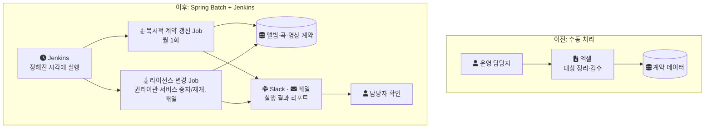
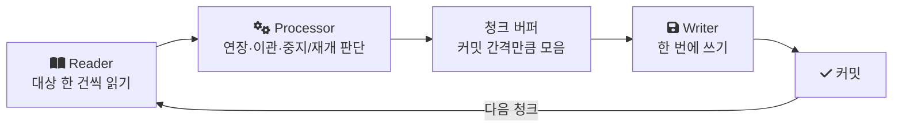
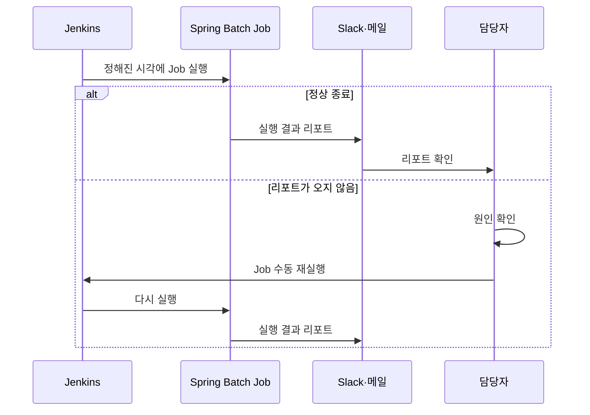

음원 유통 시스템(MDS)의 계약은 만료일이 오면 연장되거나, 라이선스 변경에 따라 권리가 넘어가거나 서비스가 멈췄다가 다시 열린다. 리뉴얼 전에는 이 처리를 운영 담당자가 엑셀로 했다. 이 글은 그 처리를 Spring Batch Job과 Jenkins로 옮기면서 무엇을 나눴고, 실패를 어떻게 다뤘고, 무엇이 줄었는지 정리한 기록이다.

---

## 어떤 시스템이었나

MDS는 외주 개발사가 PHP로 만든 기존 유통망 시스템을 리뉴얼한 시스템이다. 앨범과 곡을 등록·검수하고, DDEX(음원 메타데이터와 전송을 위한 업계 표준 메시지 형식) 기반 자동 전송으로 국내외 음원 플랫폼에 유통하며, 계약·앨범·곡 메타데이터를 기준으로 수익을 정산한다.

| 항목 | 내용 |
| --- | --- |
| 기간 | 2023년 1월부터 2024년 1월까지 |
| 인원 | 백엔드 4명(시니어 1명, 주니어 3명), 정산개발팀 2명, 프론트엔드 4명 |
| 스택 | Java, Spring Boot, JPA, Spring Batch, MySQL, Amazon SQS |
| 내 역할 | 콘텐츠(앨범·곡) 관리 API와 라이선스 관리 API 개발, 이후 계약관리 영역까지 인수인계받아 정담당자로 유지보수 |

계약 건수나 한 번의 갱신에서 처리하는 행 수는 기록이 없다. 확인된 규모 지표는 사람이 쓰던 시간(월 1회 8시간, 대형 권리이관일 4시간)뿐이라, 이 글의 결과도 그 단위로 읽어야 한다. 이 배치에는 개인 랩 재현이 없어 코드는 구조를 보여 주는 일반 예시로만 싣는다.

---

## 사람이 엑셀로 하던 두 가지 일

자동화 대상은 두 종류였다.

묵시적 계약 갱신은 계약 만료 기간이 도래했는데 별다른 변경 사항이 없으면 계약을 자동으로 연장하는 처리다. 앨범, 곡, 영상의 계층을 모두 처리해야 해서 앨범계약, 곡계약, 영상계약 테이블을 모두 갱신한다. 한 달에 한 번 돌지만 규모가 큰 작업이었다.

라이선스 변경 처리는 권리이관과 서비스 중지/재개다. 라이선스가 바뀌면 권리가 다른 권리자에게 넘어가거나, 서비스를 멈추거나 다시 열어야 한다. 하루에 한 번 처리하고, 대형 권리이관이 있는 날은 처리량이 크게 늘었다.

리뉴얼 전에는 두 처리를 운영 담당자가 엑셀로 직접 처리하고 검수했다. 같은 조직의 음원 콘텐츠 플랫폼(MCP) 배치는 Spring Batch 없이 스케줄러로만 돌고 있었고, 재처리나 로그 추적이 어려웠다. 그래서 MDS에서는 이 처리들을 Spring Batch Job으로 옮겼다.

---

## 바꾼 구조

각 처리를 Spring Batch Job으로 분리하고 Jenkins에서 실행했다. 실행 결과는 Slack이나 이메일 리포트로 받았다. 전후를 나란히 그리면 다음과 같다.



### 실행 시각을 나눴다

묵시적 계약 갱신은 월 1회 자정에 돌게 했다. 권리이관과 서비스 중지/재개 배치는 매일 새벽 2시, 4시처럼 시각을 나눠 실행되도록 분산했다.

### 청크 단위로 처리했다

각 Job은 청크 방식으로 처리했다. Spring Batch 문서는 청크 처리를 이렇게 정의한다. "Chunk oriented processing refers to reading the data one at a time and creating 'chunks' that are written out within a transaction boundary"(데이터를 하나씩 읽어 청크를 만들고, 청크를 하나의 트랜잭션 경계 안에서 쓴다)([Chunk-oriented Processing](https://docs.spring.io/spring-batch/reference/step/chunk-oriented-processing.html)). 읽은 건수가 커밋 간격에 이르면 그 청크를 한 번에 쓰고 커밋한다.



전체를 한 트랜잭션으로 묶으면 처리 도중 실패했을 때 전부 롤백되고, 트랜잭션도 처리 시간만큼 길어진다. 청크 단위로 커밋하면 트랜잭션 하나의 길이가 청크 하나로 줄고, 실패해도 이미 커밋한 청크는 남는다.

구조만 보이면 다음과 같다. Spring Batch 5의 빌더 API를 쓴 일반 예시이고, 운영 코드나 운영 청크 크기가 아니다.

```java
// 일반 예시 (실제 코드 아님)
@Bean
public Step renewAlbumContractsStep(JobRepository jobRepository,
                                    PlatformTransactionManager txManager) {
    return new StepBuilder("renewAlbumContracts", jobRepository)
            .<AlbumContract, AlbumContract>chunk(CHUNK_SIZE, txManager)
            .reader(expiringAlbumContractReader())
            .processor(renewalProcessor())
            .writer(albumContractWriter())
            .build();
}
```

Job별로 처리 대상을 어떤 조건으로 골랐는지(예를 들어 만료일 기준 조회였는지), 청크 크기를 얼마로 잡았는지는 기억나지 않는다. 묵시적 갱신이 앨범, 곡, 영상 계약을 어떤 순서의 Step으로 나눴는지도 확인하지 못했다.

---

## 실패는 사람이 확인하고 다시 돌렸다

별도의 자동 재처리는 두지 않았다. 담당자가 리포트를 직접 확인했고, 리포트가 Slack이나 이메일로 오지 않으면 원인을 확인한 뒤 Jenkins에서 수동으로 다시 실행했다.



리포트 발송을 어떻게 구현했는지(Job 리스너였는지 등)는 기억나지 않는다. 확인된 것은 "리포트가 오지 않는 것"이 실패 신호였다는 점이다. 이 방식에서는 리포트 발송 자체가 실패해도 같은 신호가 나므로, 담당자는 Job 실패와 발송 실패를 원인 확인 단계에서 구분해야 한다.

스케줄러만 쓰던 MCP 배치와 비교하면, 재실행과 로그 추적이 쉬워진 이유는 Spring Batch가 실행 기록을 남기기 때문이다. Spring Batch는 `JobRepository`에 Job과 Step의 실행 정보를 저장한다. Job 실행마다 상태, 시작·종료 시각, 종료 코드, 실패 예외를 남기고, Step 실행마다 읽은 건수, 쓴 건수, 커밋 횟수, 롤백 횟수를 남긴다([The Domain Language of Batch](https://docs.spring.io/spring-batch/reference/domain.html)). 실패한 실행이 어느 Step에서 몇 건을 쓰고 멈췄는지 이 기록에서 볼 수 있다.

같은 문서는 같은 Job과 같은 식별 파라미터의 조합을 하나의 `JobInstance`로 보고, 실패한 `JobInstance`를 다시 실행하면 같은 인스턴스의 새 실행으로 다룬다고 설명한다. 운영에서 Jenkins 재실행이 이 재시작 의미를 이용했는지, 아니면 매번 새 파라미터로 처음부터 돌렸는지는 확인하지 못했다.

---

## 결과

자동화로 담당자가 쓰던 시간이 줄었다.

| 처리 | 주기 | 이전 | 이후 |
| --- | --- | --- | --- |
| 묵시적 계약 갱신 | 월 1회 | 담당자 1명 8시간 | 4시간 수준 |
| 권리이관·서비스 중지/재개 | 일 1회 | 대형 권리이관이 있는 날 4시간까지 | 1시간 이내 |

두 숫자는 배치 실행 시간이 아니라 그 처리에 드는 사람의 시간이다. 묵시적 갱신에 남은 4시간이 어떤 작업으로 채워졌는지는 기록이 없다.

시간 외에도, 스케줄러만 쓰던 배치와 달리 실행 기록이 남아 재실행과 로그 추적이 쉬워졌고, 수동 처리하던 작업이 Job으로 옮겨지면서 유지보수성이 높아졌다.

---

## 남은 것

| 항목 | 내용 |
| --- | --- |
| 실패 감지 | "리포트가 오지 않음"에 의존한다. 사람이 리포트를 기다려야 실패를 안다. |
| 재처리 | 자동 재처리가 없어 담당자가 Jenkins에서 직접 다시 실행한다. |
| 재실행 안전성 | 다시 돌렸을 때 이미 처리한 계약을 또 연장하지 않는지는 대상 선정 조건에 달려 있다. 그 조건을 기억하지 못해 여기서 판단하지 않는다. |
| 정산과의 관계 | 묵시적 갱신은 정산 중 수정이 막혀 있는 앨범·곡·영상 계약 테이블을 갱신한다. 두 배치의 실행 시각이 겹쳤을 때 어떻게 됐는지는 확인하지 못했다. |

마지막 항목은 같은 시스템의 [정산 중 기준 데이터 수정 차단](/posts/settlement-write-guard/)과 맞닿아 있다. 그 글의 가드는 수정 API 앞에 걸린 AOP였으므로, 배치가 같은 테이블을 쓰는 경로에도 같은 규칙이 적용됐는지는 따로 확인해야 하는 질문이다. 같은 시스템에서 폴링 배치를 큐로 옮긴 과정은 [폴링 배치를 SQS 이벤트 파이프라인으로 바꾼 이유](/posts/polling-to-sqs-pipeline/)에 정리했다.

## 참고

- [Spring Batch Reference: Chunk-oriented Processing](https://docs.spring.io/spring-batch/reference/step/chunk-oriented-processing.html) — Spring Docs
- [Spring Batch Reference: The Domain Language of Batch](https://docs.spring.io/spring-batch/reference/domain.html) — Spring Docs
