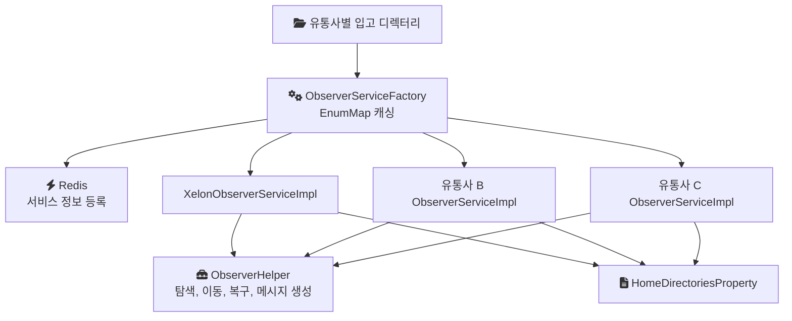
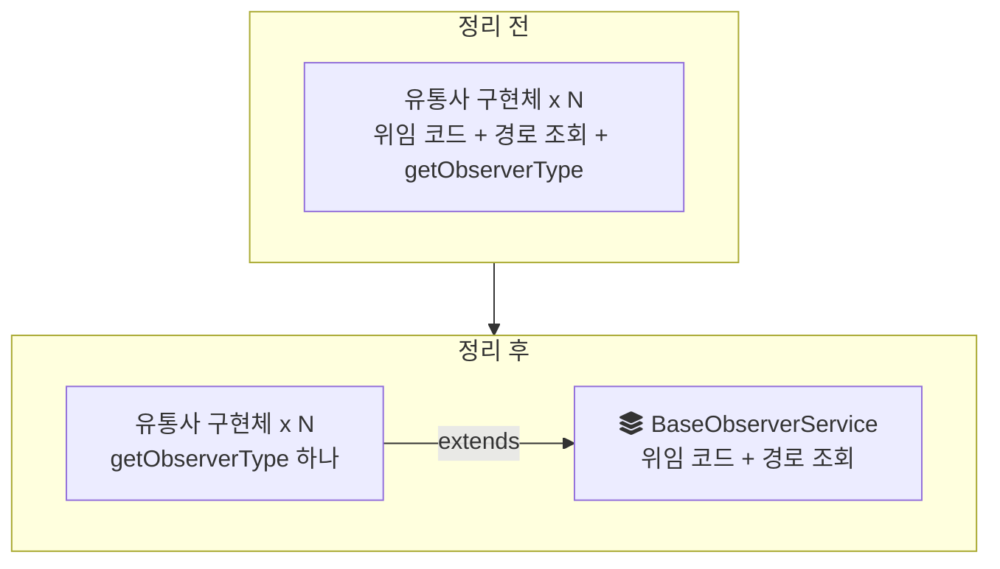
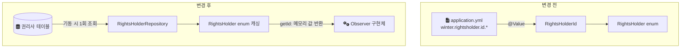

음원 콘텐츠 플랫폼(MCP)의 입수 파이프라인 앞단에는 File Observer라는 계층이 있었다. 유통사(소니, 워너, 유니버설, 카카오M, CD Baby 등)가 음원 원본 파일을 올리면, File Observer가 유통사별 디렉터리를 감시(observe)하다가 새 파일을 처리 대상으로 인식한다. 이 글은 그 계층의 구현체 쪽 중복을 내가 직접 정리한 기록이다. 무엇이 반복되고 있었는지, 처음 떠올린 설계를 왜 버렸는지, 권리사 ID를 설정 파일에서 DB로 옮기면서 무엇을 얻고 무엇을 남겼는지를 다룬다.

> 이 글의 코드는 회사의 실제 소스가 아니라 구조를 설명하기 위해 다시 쓴 예시다. 클래스 이름은 실제 구조를 따르지만 메서드 이름과 시그니처는 설명용이다.

## 작업의 전제

- 스택: Java, Spring, Spring Data JPA, Redis, YAML 기반 `@ConfigurationProperties`, Lombok
- 범위: File Observer 모듈의 `ObserverService` 구현체 계층과 권리사 ID 관리
- 범위 밖: `ObserverServiceFactory`. 이 클래스는 작업 이전부터 있던 구조이고 이번에 바꾸지 않았다.

## 기존 구조

`ObserverServiceFactory`는 Spring이 주입하는 `List<ObserverService>`를 받아 `@PostConstruct`에서 `ObserverType` 기준 `EnumMap`으로 캐싱하고, Redis에도 서비스 정보를 등록했다. Spring은 특정 타입의 빈을 배열이나 컬렉션으로 받으면 그 타입의 빈을 모두 넣어 준다. 그래서 구현체를 하나 추가하면 팩토리 코드를 고치지 않아도 자동으로 등록된다. `EnumMap`은 Javadoc 설명대로 내부적으로 배열로 표현되어 enum 키 조회에 적합하다.

아래 그림이 기존 계층이다. 팩토리 아래에 유통사별 구현체가 나란히 있고, 각 구현체가 같은 헬퍼와 같은 설정 클래스를 직접 부른다.



이 등록 구조는 이번 작업 이전부터 있던 것이다. 이번 작업의 대상은 그 아래, 구현체 쪽의 중복이었다.

## 무엇이 반복되고 있었나

반복은 두 군데에 있었다.

첫째, 파일 탐색, 이동, 복구, 메시지 생성 같은 실제 작업은 모두 `ObserverHelper`에 있었는데, 구현체마다 이 헬퍼를 부르는 위임 코드가 거의 똑같이 들어 있었다. `XelonObserverServiceImpl` 같은 구현체를 열어 보면 유통사 이름만 다르고 메서드 본문은 같은 식이었다.

둘째, 유통사별 홈 디렉터리 경로(`winter.rightsholder.homedirectory.*`)를 담은 `HomeDirectoriesProperty`에서 자기 경로를 꺼내는 코드도 구현체마다 반복됐다.

```java
// 설명용 예시: 기존 구현체의 모양
@Service
@RequiredArgsConstructor
public class XelonObserverServiceImpl implements ObserverService {
    private final ObserverHelper helper;
    private final HomeDirectoriesProperty homeDirectories;

    @Override public ObserverType getObserverType() { return ObserverType.XELON; }

    @Override public List<Path> findTargets() { return helper.findTargets(getHomeDirectories()); }
    @Override public void move(Path file)     { helper.move(file, getHomeDirectories()); }
    @Override public void recover(Path file)  { helper.recover(file, getHomeDirectories()); }

    private List<String> getHomeDirectories() {
        return homeDirectories.get(getObserverType());
    }
}
```

이 모양이 유통사 수만큼 있었다. 유통사가 늘 때마다 같은 모양의 구현체가 하나씩 추가되는 구조였고, 이 구조에서는 위임 방식을 하나 바꾸려면 모든 구현체를 같이 고쳐야 한다.

## 처음 떠올린 설계: 제네릭 Base 클래스

공통 코드를 추상 클래스로 올리는 것까지는 분명했다. 처음에는 `BaseObserverService<T extends ObserverType>`처럼 타입 파라미터를 가진 Base를 검토했다.

그런데 구현체들을 나란히 놓고 실제로 다른 줄을 찾아보니 `getObserverType()`의 반환값 하나뿐이었다. 위임 코드도, 홈 디렉터리 조회도 그 값만 알면 Base에서 처리할 수 있었다. 달라지는 값이 메서드 하나로 충분히 표현된다면 타입 파라미터는 더할 것이 없는 추상화가 된다.

그래서 제네릭을 걷어내고, `getHomeDirectories()`까지 Base로 옮기는 단순한 형태로 정리했다. 이 단순화는 내가 제안했다.

## 정리한 구조

Base 클래스가 위임과 경로 조회를 모두 갖고, 구현체는 자기가 어떤 유통사인지만 말한다. 템플릿 메서드 패턴(공통 흐름은 상위 클래스가 갖고, 달라지는 한 단계만 하위 클래스가 채우는 방식)의 가장 작은 형태다.

```java
// 설명용 예시: 정리 후의 모양
@RequiredArgsConstructor
public abstract class BaseObserverService implements ObserverService {
    private final ObserverHelper helper;
    private final HomeDirectoriesProperty homeDirectories;

    @Override public List<Path> findTargets() { return helper.findTargets(getHomeDirectories()); }
    @Override public void move(Path file)     { helper.move(file, getHomeDirectories()); }
    @Override public void recover(Path file)  { helper.recover(file, getHomeDirectories()); }

    protected List<String> getHomeDirectories() {
        return homeDirectories.get(getObserverType());
    }
}

@Service
public class XelonObserverServiceImpl extends BaseObserverService {
    // 생성자 주입은 생략
    @Override public ObserverType getObserverType() { return ObserverType.XELON; }
}
```

전후를 나란히 놓으면 구현체가 무엇을 책임지는지가 달라진 것이 보인다.



팩토리는 그대로다. 구현체가 여전히 `ObserverService` 빈이므로 `List<ObserverService>` 주입과 `EnumMap` 캐싱, Redis 등록은 바뀌지 않았다.

## 두 번째 문제: 설정 파일에 고정된 권리사 ID

구현체를 정리하고 나니 유통사 추가를 가로막는 다른 지점이 남았다. 권리사(유통사) ID였다.

권리사 ID는 `application.yml`의 `winter.rightsholder.id.*`에 값으로 적혀 있었다. `RightsHolderId`라는 별도 클래스가 `@Value`로 이 값을 주입받아 `RightsHolder` enum에 넘겨주는 구조였다. 새 파트너사가 추가되면 설정 파일을 고치고 배포해야 했다. 권리사 ID는 코드의 설정이라기보다 업무 데이터에 가까운데, 배포 주기에 묶여 있었다.

아래 그림은 전후 흐름이다.



방향은 DB를 원천으로 삼는 것이었다. 애플리케이션이 기동할 때 `RightsHolderRepository`로 한 번 조회해 `RightsHolder` enum에 값을 채우고, 이후 `getId()`는 메모리의 값을 돌려준다. 요청마다 DB를 조회하지 않는다. DB에 없는 권리사 ID를 찾으면 예외로 처리하도록 설계했다.

구현 방식으로는 두 가지를 두고 고민했다. 권리사 이름으로 한 건씩 조회하는 `findByRhName`과, `findAll`로 전부 읽어 맵으로 캐싱하는 방식이다. 최종적으로 어느 쪽을 택했는지, 누락 ID에 대한 즉시 실패가 모든 경로에서 완전하게 구현됐는지는 기록이 남아 있지 않아 이 글에서 단정하지 않는다.

## 남은 비용

이 정리가 모든 것을 해결한 것은 아니다. 구조상 따라오는 비용이 있다.

- 기동 시 1회 로딩이므로, DB에 새 권리사 ID를 넣어도 실행 중인 애플리케이션에는 바로 반영되지 않는다. 재배포는 필요 없지만 재기동은 필요하다. 설정 파일 수정과 빌드가 사라진 것이지, 반영 시점이 실시간이 된 것은 아니다.
- enum은 보통 불변 상수로 읽힌다. 그런 enum에 기동 시점에 값을 채워 넣으면, 코드를 처음 읽는 사람은 그 값이 어디서 오는지 알기 어렵다. 돌아보면 이 구조가 남긴 읽기 비용이다.
- 정량 지표가 없다. 반복 코드가 몇 줄 줄었는지, 유통사 추가에 걸리는 시간이 얼마나 줄었는지는 측정해 두지 않았다.

## 정리

- 공통화의 범위는 "실제로 달라지는 줄이 무엇인가"에서 정해졌다. 그 답이 `getObserverType()` 하나였기 때문에 제네릭이 필요 없었다.
- 설정 파일에서 DB로 옮긴 것은 권리사 ID를 배포 주기에서 떼어 낸 것이고, 재기동이라는 반영 시점은 그대로 남았다.

## 참고

- [Using @Autowired — Spring Framework Reference](https://docs.spring.io/spring-framework/reference/core/beans/annotation-config/autowired.html)
- [Using @PostConstruct and @PreDestroy — Spring Framework Reference](https://docs.spring.io/spring-framework/reference/core/beans/annotation-config/postconstruct-and-predestroy-annotations.html)
- [Externalized Configuration: Type-safe Configuration Properties — Spring Boot Reference](https://docs.spring.io/spring-boot/reference/features/external-config.html)
- [EnumMap — Java SE 17 API](https://docs.oracle.com/en/java/javase/17/docs/api/java.base/java/util/EnumMap.html)
