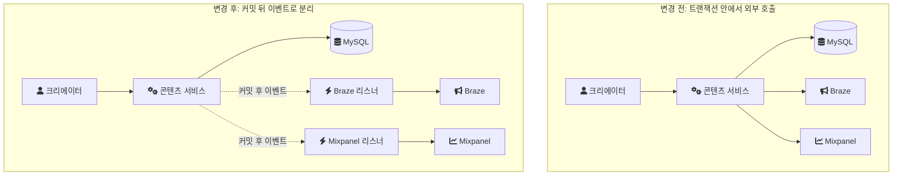
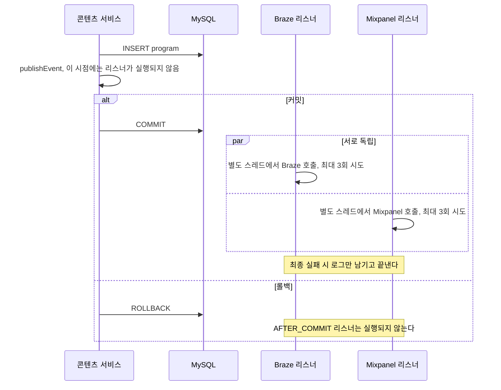

크리에이터 스튜디오는 누구나 오디오 콘텐츠를 만들어 음원 플랫폼에 배포할 수 있게 하는 B2C 제작 플랫폼이었다. 크리에이터는 프로그램, 에피소드, 클립을 만들고 고친다. 그 변경이 생길 때마다 Braze(마케팅 자동화 도구)와 Mixpanel(사용자 행동 분석 도구)에 사실을 알려야 했다.

이 글은 그 외부 호출을 트랜잭션 밖으로 옮긴 과정과, "끝내 실패하면 어떻게 하는가"에 대한 답이 왜 "3회 재시도 후 로그만"이었는지를 정리한 기록이다. 그 답이 영수증 발송 같은 다른 도메인에서는 왜 맞지 않는지도 함께 적는다.

## 이 결정이 나온 조건

결론이 다른 환경에도 옮겨지는지 판단할 수 있도록 조건을 먼저 적는다.

| 항목 | 내용 |
| --- | --- |
| 기간 | 2022년 4월부터 8월까지 초기 구축, 이후 정담당자로 유지보수 |
| 팀 | 초기 구축은 Java 개발자 3명(시니어 1명, 주니어 2명). 외부 연동, 인증, 감사 대응은 이후 내가 단독으로 맡았다 |
| 스택 | Java, Spring Boot, JPA, QueryDSL, MySQL, Redis, AWS |
| 외부 연동 대상 | Braze, Mixpanel |
| 연동 데이터의 성격 | 개별 이벤트가 아니라 전체 통계 카운트로 추이를 보는 용도 |

트래픽이나 이벤트 건수는 기록으로 남아 있지 않다. 그래서 이 글의 판단 근거는 처리량이 아니라 연동 데이터의 성격이다.

## 바뀐 구조 한눈에 보기

먼저 전후 구조를 그림으로 놓는다. 왼쪽은 외부 호출이 트랜잭션 안에 있던 구조이고, 오른쪽은 커밋 뒤로 옮긴 구조다.



## 문제: 외부 호출이 트랜잭션 안에 있었다

처음 구조는 직관적이었다. 콘텐츠를 저장하는 서비스 메서드 안에서 저장이 끝나면 바로 Braze와 Mixpanel을 호출했다. 아래 코드는 회사 소스가 아니라 그 구조를 설명하려고 다시 쓴 예시다.

```java
// 구조 설명용 예시(실제 코드 아님)
@Transactional
public void createProgram(ProgramCreateRequest request) {
    Program program = programRepository.save(Program.from(request));
    brazeClient.track(program.getId());     // 트랜잭션 안
    mixpanelClient.track(program.getId());  // 트랜잭션 안
}
```

이 구조에서 문제는 세 가지로 드러났다.

1. 외부 응답 시간이 곧 트랜잭션 길이가 된다. `@Transactional` 메서드가 끝나야 커밋되므로, 외부 API가 느리면 그동안 DB 커넥션과 트랜잭션이 열려 있다.
2. 외부 실패가 핵심 저장 실패로 번진다. 외부 호출에서 예외가 올라오면 메서드 전체가 실패하고 저장도 롤백된다. 크리에이터는 콘텐츠를 만들었는데, 분석 도구 쪽 네트워크 문제 때문에 실패 응답을 받는다.
3. 재시도 로직이 호출하는 곳마다 흩어져 있었다. 그래서 같은 외부 시스템인데도 실패를 다루는 방식이 일관되지 않았다.

앞의 두 문제는 외부 시스템이 느려지거나 실패하는 순간 드러난다. 세 번째는 장애가 나기 전까지 잘 보이지 않는다. 하지만 정책이 한곳에 없으니, 외부 연동을 하나 더 붙일 때마다 같은 불일치가 늘어난다.

## 결정: 외부 연동은 부수 효과이고, 부수 효과는 커밋 뒤에 실행한다

문제를 다시 정의했다. Braze와 Mixpanel 호출은 콘텐츠 생성의 일부가 아니다. 콘텐츠가 생성됐다는 사실에 대한 반응이다. 반응은 사실이 확정된 뒤에 일어나야 하고, 반응이 실패했다고 사실이 취소되어서는 안 된다.

그래서 외부 연동을 도메인 트랜잭션의 부수 효과로 정의했다. 도메인 로직은 이벤트를 발행하는 데까지만 책임지고, 외부 호출은 커밋 이후 비동기로 처리한다.

Spring에서 이 구분을 표현하는 도구가 `@TransactionalEventListener`다. 이 리스너는 이벤트가 발행된 즉시 실행되지 않고, 지정한 트랜잭션 단계(phase)에서 실행된다. [Javadoc](https://docs.spring.io/spring-framework/docs/current/javadoc-api/org/springframework/transaction/event/TransactionalEventListener.html)에 따르면 기본 phase는 `AFTER_COMMIT`이다.

### 두 리스너는 서로 독립적이다

Braze 리스너와 Mixpanel 리스너는 각자 자기 API만 호출하는 별개의 리스너였다. 한쪽이 실패해도 다른 쪽에 영향이 없고, 둘 사이에 순서도 필요 없었다. 두 시스템이 서로의 처리 결과에 의존하지 않는 독립적인 마케팅·통계 도구였기 때문이다.

리스너를 어떻게 등록하고 분리했는지 같은 구현 세부는 지금 정확히 기억하지 못한다. 그래서 아래 코드는 회사 코드가 아니라, 이 구조를 다시 구현한 개인 실험 저장소(engineering-lab의 creator-studio 모듈, 이하 랩)의 코드다.

```java
// 랩 코드: BrazeEventListener.java (MixpanelEventListener도 같은 형태)
@Async("externalIntegrationExecutor")
@TransactionalEventListener(phase = TransactionPhase.AFTER_COMMIT)
@Retryable(retryFor = ExternalIntegrationException.class, maxAttempts = 3,
        backoff = @Backoff(delay = 500, multiplier = 2))
public void onContentChanged(ContentChangedEvent event) {
    brazeClient.track(event);
}

@Recover
public void recover(ExternalIntegrationException e, ContentChangedEvent event) {
    log.warn("[EXTERNAL_INTEGRATION_FAILED] target=braze contentType={} contentId={}",
            event.contentType(), event.contentId(), e);
}
```

도메인 서비스 쪽은 이벤트를 발행할 뿐 외부 시스템을 모른다.

```java
// 랩 코드: ProgramCreationService.java
@Transactional
public Program createProgram(Long producerId, Long creatorId, String title) {
    Program program = programRepository.save(new Program(producerId, creatorId, title));
    eventPublisher.publishEvent(new ContentChangedEvent(ContentType.PROGRAM, program.getId(), ChangeType.CREATED));
    return program;
}
```

랩 코드에서 backoff 값(500ms, 2배씩 증가)과 전용 스레드풀 크기(core 4, max 8, 큐 100)는 랩을 만들며 새로 정한 값이다. 실제 운영 값은 기록이 없다.

### 커밋과 롤백에서 각각 무슨 일이 일어나는가

이벤트 발행부터 외부 호출까지의 흐름을 순서대로 그리면 다음과 같다. 커밋된 경우와 롤백된 경우를 나눠서 본다.



이 구조로 앞의 세 문제는 이렇게 바뀐다.

- 외부 호출은 커밋 뒤에 `@Async`로 별도 스레드에서 나간다. 트랜잭션 길이는 DB 작업 시간만큼으로 줄어든다.
- 트랜잭션이 롤백되면 `AFTER_COMMIT` 리스너는 실행되지 않는다. 존재하지 않는 콘텐츠를 외부에 알리는 일이 없다. 반대로 외부 호출이 실패해도 콘텐츠 저장은 이미 커밋된 뒤다.
- 재시도 정책이 리스너에 모인다. 도메인 서비스는 재시도를 알 필요가 없다.

### 트랜잭션 동기화에 기대는 구조의 함정

`@TransactionalEventListener`가 "커밋 뒤"를 알 수 있는 것은 트랜잭션 동기화 덕분이다. Spring은 현재 트랜잭션에 콜백을 등록해 두고, 실제 커밋 시점에 등록된 리스너를 호출한다. 그래서 트랜잭션 밖에서 발행한 이벤트는 걸어둘 곳이 없다. Javadoc은 이렇게 적는다.

> "If the event is not published within an active transaction, the event is discarded unless the `fallbackExecution()` flag is explicitly set."

활성 트랜잭션 밖에서 발행된 이벤트는 `fallbackExecution`을 켜지 않으면 버려진다는 뜻이다. 서비스 메서드에서 `@Transactional`을 빼거나, 트랜잭션이 없는 경로에서 같은 이벤트를 발행하면 리스너는 조용히 실행되지 않는다. 같은 Javadoc은 `AFTER_COMMIT` 시점에 데이터 접근 코드를 실행하면 원래 트랜잭션에 참여한 것처럼 동작하지만 변경이 커밋되지 않는다고도 경고한다. 이 두 함정은 [별도 노트](/posts/transactional-event-listener/)에 정리해 뒀다.

## 커밋은 됐는데 외부 연동이 끝내 실패하면

여기까지는 널리 알려진 패턴이다. 이 작업에서 실제로 정해야 했던 것은 "커밋은 됐는데 외부 연동이 3회 모두 실패하면 어떻게 하는가"였다.

정책은 이렇게 정했다. 재시도는 3회로 제한하고, 최종 실패하면 별도 재처리 없이 알림(로그)만 남긴다. 실패한 이벤트를 큐에 쌓았다가 다시 보내지 않는다. 중복 전송을 거르는 멱등성 처리도 따로 두지 않았다.

### 근거는 연동 데이터의 성격이었다

Braze와 Mixpanel은 이 서비스에서 개별 이벤트를 하나씩 정확히 세는 용도가 아니었다. 전체 통계 카운트로 추이를 보는 용도였다. 이벤트 하나가 빠지거나 재시도 때문에 하나가 중복되면, 그 기간 카운트가 1만큼 틀린다. 추이를 보는 목적에서는 그 정도 미스카운트(중복이나 누락)를 허용할 수 있다고 협의됐다.

그래서 이 결정은 "외부 연동을 대충 처리했다"가 아니다. 모든 도메인이 100% 정합성을 요구하지는 않으니, 도메인이 요구하는 정합성 수준을 먼저 협의하고 그 수준에 맞는 비용만 쓴 것이다.

### 3회는 시도 횟수인가 재시도 횟수인가

정책을 코드로 옮길 때 숫자의 의미를 확인해야 한다. Spring Retry의 [`@Retryable` Javadoc](https://docs.spring.io/spring-retry/docs/api/current/org/springframework/retry/annotation/Retryable.html)은 `maxAttempts`를 "the maximum number of attempts (including the first failure), defaults to 3"라고 설명한다. 첫 실패를 포함한 최대 시도 횟수라는 뜻이다. 그래서 랩 코드의 `maxAttempts = 3`은 최초 호출 1번과 재시도 2번이다.

운영 코드에서 "3회"가 시도 3번이었는지 재시도 3번이었는지는 기록이 없다. 미스카운트를 허용하는 도메인이라 결과에 큰 차이는 없지만, 정합성이 중요한 연동이라면 이 차이를 정책 문서에 명시해야 한다.

`@Recover`는 재시도가 모두 소진된 뒤 실행할 대체 경로다. [Spring Retry README](https://github.com/spring-projects/spring-retry/blob/main/README.md)에 따르면 복구 메서드의 반환 타입은 `@Retryable` 메서드와 같아야 하고, 인자로 발생한 예외와 원래 메서드의 인자를 받을 수 있다. 랩에서는 여기서 로그만 남긴다.

## 일반적인 선택지에 이 결정을 놓아 보면

당시 다른 방식을 놓고 비교한 기록은 없다. 다만 지금 돌아보며, 최종 실패를 다루는 일반적인 방식들 사이에서 이 결정이 어디에 있는지 정리해 두면 다른 도메인에 옮길 때 기준이 된다.

| 방식 | 무엇을 보장하는가 | 무엇이 더 필요한가 |
| --- | --- | --- |
| 제한된 재시도 후 로그만 남김 (이 프로젝트의 선택) | 보장 없음. 최종 실패한 이벤트는 외부에 반영되지 않는다 | 거의 없음 |
| 실패 이벤트를 재처리 큐에 넣고 다시 보냄 | 결국 반영된다. 대신 중복이 생길 수 있다 | 큐, 재처리 워커, 소비 쪽 중복 제거 |
| Transactional Outbox | 커밋과 이벤트 기록이 같은 트랜잭션에 묶여 유실이 없다 | Outbox 테이블, 발행기, 소비 쪽 중복 제거 |

Outbox는 이벤트를 메모리에서 바로 리스너로 넘기지 않고, 도메인 데이터와 같은 트랜잭션 안에서 이벤트 테이블에 함께 저장하는 방식이다. 커밋되면 이벤트도 남고, 롤백되면 이벤트도 사라진다. 별도 발행기가 테이블을 읽어 외부로 보내고, 성공하면 완료로 표시한다.

차이는 "커밋과 이벤트 기록이 같은 트랜잭션인가"에 있다. Post-Commit 이벤트는 커밋 뒤에 메모리에서 리스너를 부른다. 그래서 리스너가 실행되기 전에 프로세스가 죽으면 그 이벤트는 사라진다. Outbox는 이벤트를 커밋 안에 넣으므로 유실되지 않는다. 그 대신 테이블과 발행기를 운영해야 한다.

## 같은 패턴이 맞지 않는 곳

이 결정을 그대로 다른 도메인에 옮기면 틀린다. 결제 영수증 발송, 세금계산서 발행, 파트너사 정산 통보 같은 연동은 미스카운트를 허용하지 않는다. 영수증이 한 번 빠지면 고객이 받지 못하고, 두 번 가면 중복 청구로 오해받는다.

이런 도메인에서는 위 표의 아래쪽 방식이 필요하다. 도메인 판단만 남기면 다음 세 질문으로 정리된다.

1. 이 연동이 실패하면 누가 무엇을 잃는가. 통계 카운트 1건이면 추이에 영향이 없다. 영수증 1건이면 고객이 잃는다.
2. 중복을 허용하는가. 카운트 +1은 허용된다. 영수증 2통은 허용되지 않는다.
3. 유실을 허용하는가. 카운트 -1은 허용된다. 영수증 0통은 허용되지 않는다.

크리에이터 스튜디오의 Braze·Mixpanel 연동은 세 질문 모두 "허용"이었다. 하나라도 "불허"가 나오면 Post-Commit 이벤트와 제한된 재시도만으로는 부족하다. 재처리 큐는 중간 선택지처럼 보이지만, 큐를 두는 순간 중복 제거가 필요해진다. 그래서 내가 보기에 실제 비용은 Outbox 쪽에 가깝다.

## 랩에서 다시 확인한 것

회사 코드는 볼 수 없으므로, 구조가 의도대로 동작하는지 랩에서 다시 확인했다. 조건은 다음과 같다.

- Spring Boot 3.3.4, JDK 21, Testcontainers로 띄운 MySQL
- Braze·Mixpanel 클라이언트는 호출 기록만 남기는 테스트용 구현으로 교체
- 비동기 실행이라 테스트 스레드에서 바로 단언하지 않고 Awaitility로 기다림

[`PostCommitEventListenerTest`](https://github.com/polynomeer/engineering-lab/blob/d52297d0ad07c3d8a05a7471192a5655cb8b1378/career-lab/creator-studio/src/test/java/com/portfolio/creatorlab/integration/PostCommitEventListenerTest.java)의 두 테스트는 모두 통과했다.

| 테스트 | 확인한 것 |
| --- | --- |
| 커밋되면 Braze/Mixpanel 리스너가 각각 독립적으로 실행된다 | 5초 안에 두 클라이언트가 각각 1번씩 호출됨 |
| 트랜잭션이 롤백되면 AFTER_COMMIT 리스너는 실행되지 않는다 | 2초를 기다린 뒤에도 두 클라이언트 호출 0번 |

롤백 테스트는 "실행되지 않았다"를 확인해야 하므로, 비동기 리스너가 혹시라도 실행될 시간을 2초 준 뒤 호출 기록이 비어 있는지 본다. 이 시간은 증명이 아니라 관찰 창이다. 2초 뒤에 실행되는 리스너는 이 테스트로 잡히지 않는다.

이 랩은 아직 재시도 3회가 실제로 소진되는 경우와, 리스너 실행 전에 프로세스가 죽는 경우를 재현하지 않았다. 두 경우가 이 결정의 비용이 실제로 나타나는 곳이다.

## 이 구조가 남긴 비용

- 커밋 뒤 리스너가 실행되기 전에 프로세스가 죽으면 그 이벤트는 사라진다. 미스카운트를 허용하는 도메인이라 받아들인 비용이다.
- 최종 실패한 이벤트를 다시 보낼 경로가 없다. 실패는 로그로만 남는다.
- `@Async`로 넘긴 작업은 다른 스레드에서 실행된다. 요청 스레드에 담아 둔 로깅 컨텍스트(MDC)는 [Logback 문서](https://logback.qos.ch/manual/mdc.html)대로 자식 스레드에 자동으로 이어지지 않는다. 실패 로그를 원래 요청과 연결하려면 값을 따로 넘겨야 한다. 당시 이 부분을 어떻게 처리했는지는 기록이 없다.
- 비동기 스레드풀이 가득 차면 작업이 거절될 수 있다. 랩은 큐 100을 두었지만, 운영 값과 거절 시 동작은 기록이 없다.

## 정리

- 최종 실패 시 무엇을 할지는 패턴이 아니라 도메인이 정한다. 크리에이터 스튜디오에서는 통계 추이를 보는 연동이라 미스카운트를 허용하기로 협의했고, 그래서 3회 재시도 후 로그만 남기는 정책으로 충분했다.
- Post-Commit 이벤트는 리스너 실행 전 프로세스가 죽으면 이벤트를 잃는다. 유실을 허용할 수 없는 연동이라면 Outbox처럼 이벤트를 커밋 안에 넣는 방식이 필요하다.
- 정책 숫자는 코드의 의미와 맞춰 적어야 한다. `maxAttempts = 3`은 재시도 3번이 아니라 시도 3번이다.

## 참고

- [Spring Framework Javadoc: `@TransactionalEventListener`](https://docs.spring.io/spring-framework/docs/current/javadoc-api/org/springframework/transaction/event/TransactionalEventListener.html) — 기본 phase, 트랜잭션 밖 이벤트 폐기, AFTER_COMMIT 시점 데이터 접근 경고
- [Spring Retry Javadoc: `@Retryable`](https://docs.spring.io/spring-retry/docs/api/current/org/springframework/retry/annotation/Retryable.html) — `maxAttempts`의 의미와 기본값
- [Spring Retry README](https://github.com/spring-projects/spring-retry/blob/main/README.md) — `@Recover` 복구 메서드
- [Logback Manual, Chapter 8: Mapped Diagnostic Context](https://logback.qos.ch/manual/mdc.html) — MDC의 스레드 단위 관리
- 랩 코드 [`BrazeEventListener.java`](https://github.com/polynomeer/engineering-lab/blob/d52297d0ad07c3d8a05a7471192a5655cb8b1378/career-lab/creator-studio/src/main/java/com/portfolio/creatorlab/integration/BrazeEventListener.java)
- 랩 코드 [`MixpanelEventListener.java`](https://github.com/polynomeer/engineering-lab/blob/d52297d0ad07c3d8a05a7471192a5655cb8b1378/career-lab/creator-studio/src/main/java/com/portfolio/creatorlab/integration/MixpanelEventListener.java)
- 랩 코드 [`ProgramCreationService.java`](https://github.com/polynomeer/engineering-lab/blob/d52297d0ad07c3d8a05a7471192a5655cb8b1378/career-lab/creator-studio/src/main/java/com/portfolio/creatorlab/integration/ProgramCreationService.java)
- 랩 코드 [`AsyncIntegrationConfig.java`](https://github.com/polynomeer/engineering-lab/blob/d52297d0ad07c3d8a05a7471192a5655cb8b1378/career-lab/creator-studio/src/main/java/com/portfolio/creatorlab/integration/AsyncIntegrationConfig.java)
- 랩 테스트 [`PostCommitEventListenerTest.java`](https://github.com/polynomeer/engineering-lab/blob/d52297d0ad07c3d8a05a7471192a5655cb8b1378/career-lab/creator-studio/src/test/java/com/portfolio/creatorlab/integration/PostCommitEventListenerTest.java)
