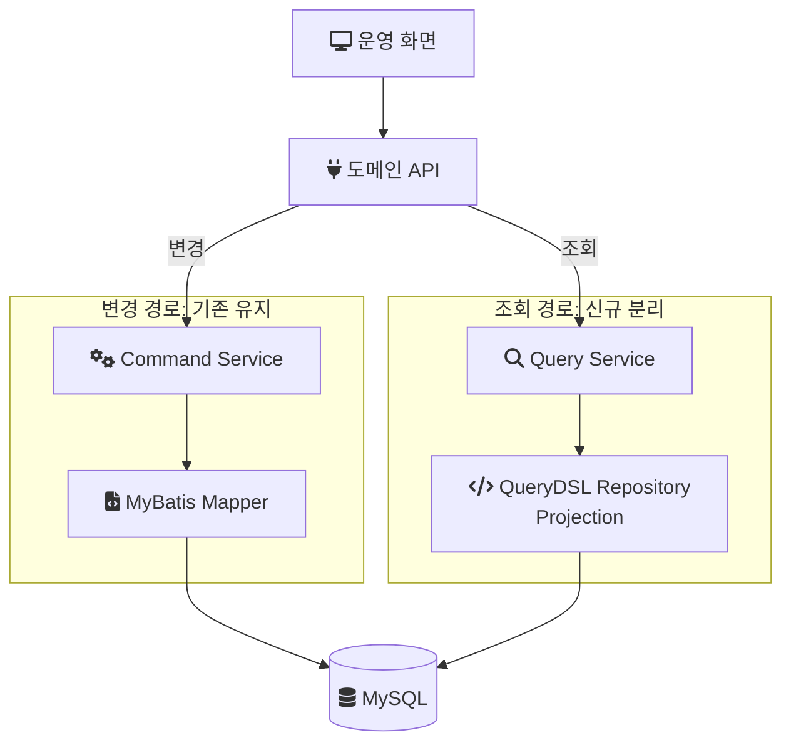
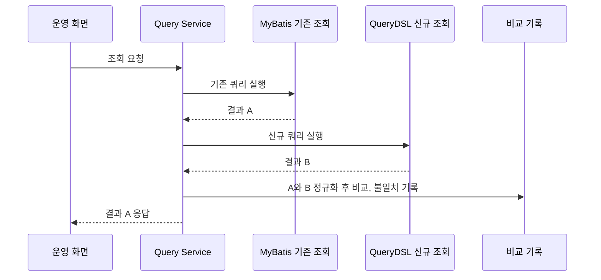
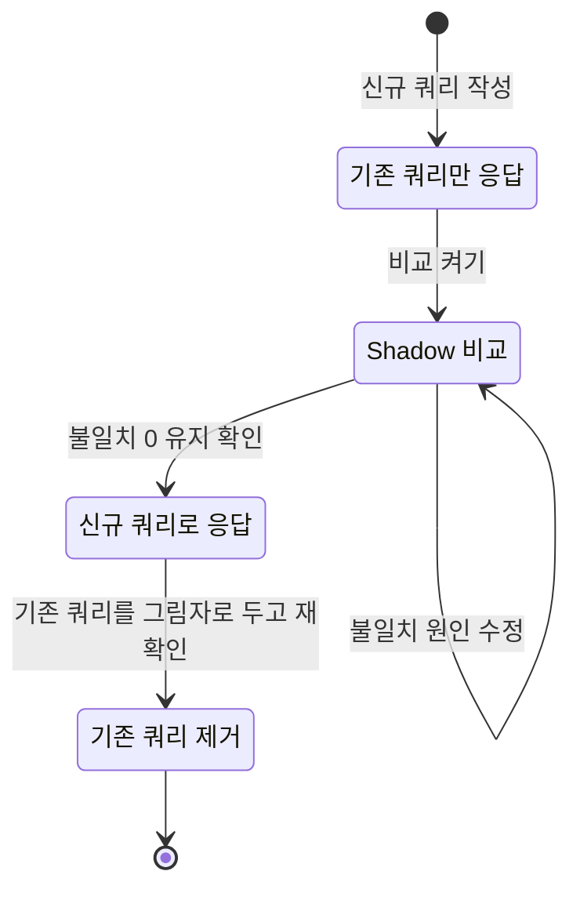
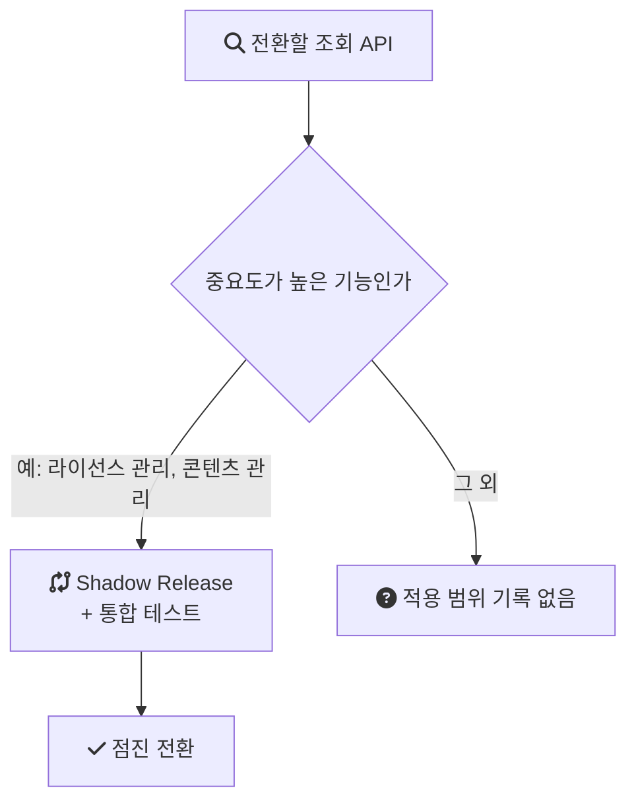

음원 콘텐츠 플랫폼(MCP) 재설계에서 데이터 접근 구조를 바꾼 방식은 "전부 JPA로 옮기기"가 아니었다. 변경은 MyBatis에 그대로 두고, 조회만 [QueryDSL](/posts/querydsl/)로 분리했다. 이 글은 왜 조회만 옮겼는지, 다시 쓴 조회가 기존과 같은 결과를 내는지 어떻게 확인했는지, 그리고 그 절차를 어디까지 적용했는지 정리한 기록이다.

> 이 글의 코드와 다이어그램은 회사의 실제 소스가 아니라, 설계 결정을 원리대로 다시 구성한 예시다. 비교 로직의 세부(정규화 규칙, 메트릭 이름, 관찰 기간)는 당시 구현을 옮긴 것이 아니라 이 방식을 구현할 때 필요한 요소를 정리한 것이다.

## 배경과 조건

MCP는 계약, 앨범, 곡 메타데이터와 유통사·계약별 라이선스 권리를 관리하는 사내 플랫폼이다. 서비스 상태가 "사용"인 곡만 8천만 건이 넘었고, 정산, 라이선스, 데이터 관련 부서가 이 시스템을 쓴다.

전면 개편은 2024년 1월부터 11월까지 백엔드 3명이 진행했다. 나는 백엔드 리딩을 맡았고, 이 글의 조회·변경 분리는 내가 직접 구현한 범위다. 스택은 Java, Spring Boot, JPA, MyBatis, MySQL이다.

이 작업은 앞선 두 작업 위에서 진행됐다. [API를 도메인 책임 단위로 다시 나누면서](/posts/mcp-domain-api-redesign/) 조회 구조와 쿼리를 함께 정리했고, [입력을 DTO와 3단계 검증으로 바꾸면서](/posts/mcp-dto-validation-pipeline/) 변경 경로의 검증 위치를 정했다. 이 글은 그다음 단계인 데이터 접근 계층의 분리를 다룬다.

## 문제: 조회와 변경이 같은 매퍼에 있었다

기존 구조에서는 MyBatis 매퍼 하나가 조회 SQL과 변경 SQL을 함께 담고 있었다. 이 구조에서 두 가지 문제가 생겼다.

- 비슷한 조회 SQL이 여러 매퍼에 반복해서 작성됐다. 조건 하나가 다른 조회마다 SQL이 새로 생겼다.
- 조회를 빠르게 하려고 매퍼의 SQL이나 결과 매핑을 고치면, 같은 매퍼를 쓰는 변경 로직이 영향을 받았다. 조회 최적화가 변경의 위험이 되는 구조였다.

두 문제 모두 조회와 변경이 같은 계층, 같은 파일에 묶여 있다는 데서 나온다. 그래서 결정은 둘을 떼어놓는 것이었다.

## 결정: 변경은 MyBatis에 두고 조회만 분리한다

변경은 기존 MyBatis 매퍼를 유지하고, 조회는 JPA 엔티티 위에 QueryDSL로 별도의 Query 모델을 만들었다. 저장소는 MySQL 하나로 두고 코드 경로만 나눈 것이다. 명령(변경)과 조회의 모델을 분리하는 방식을 CQRS(Command Query Responsibility Segregation)라고 부르는데, 저장소까지 나누지 않고 코드 경로만 나눈 이 구조는 그중 가장 가벼운 형태에 해당한다.

풀려는 문제가 "조회 SQL의 중복"과 "조회 최적화가 변경에 미치는 영향"이었으므로, 변경 경로까지 새 스택으로 다시 쓸 필요는 없었다. 조회를 떼어내면 두 문제가 함께 풀린다.



조회 도구로 QueryDSL을 쓴 것은 조회 쪽의 요구와 맞았기 때문이다. 결정에서 중요하게 본 것은 Projection과 조건 조합을 일관된 방식으로 구성하는 것이었다.

- 조건 조합: 값이 null이면 그 조건을 무시하는 [동적 쿼리](/posts/dynamic-query/)를 `BooleanExpression` 메서드의 조합으로 쓸 수 있다. 조건 하나가 다를 때마다 SQL을 새로 쓰던 문제를, 조건 메서드를 재사용하는 방식으로 바꿀 수 있다.
- Projection: 엔티티 전체가 아니라 필요한 컬럼만 골라 DTO에 바로 담는다. 화면마다 필요한 필드 집합이 달라도 같은 조회 기반 위에서 표현할 수 있다.

```java
// 재구성 예시: 조회 전용 QueryDSL 리포지토리 (실제 코드 아님)
@Repository
@RequiredArgsConstructor
public class ContractQueryRepository {

    private final JPAQueryFactory queryFactory;

    public List<ContractSummary> search(ContractSearchCondition c) {
        return queryFactory
            .select(Projections.constructor(ContractSummary.class,
                contract.id, contract.code, contract.status, album.title))
            .from(contract)
            .join(album).on(contract.albumId.eq(album.id))
            .where(distributorIdEq(c.distributorId()), statusEq(c.status()))
            .fetch();
    }

    private BooleanExpression distributorIdEq(Long id) {
        return id != null ? contract.distributorId.eq(id) : null;
    }

    private BooleanExpression statusEq(ContractStatus s) {
        return s != null ? contract.status.eq(s) : null;
    }
}
```

`where`에 `null`이 들어가면 QueryDSL은 그 조건을 건너뛴다. 그래서 조건 메서드 하나가 "값이 있으면 조건, 없으면 무시"를 표현하고, 여러 조회가 같은 조건 메서드를 공유할 수 있다.

## 두 기술이 공존할 때의 트랜잭션

MyBatis와 JPA가 같은 DB를 쓰면 트랜잭션 경계를 어떻게 잡느냐는 질문이 따라온다. 일반적으로 두 기술이 같은 `DataSource`와 하나의 트랜잭션 매니저를 공유하면, 한 트랜잭션 안에서 같은 커넥션을 쓴다.

여기서 주의할 것은 JPA의 [영속성 컨텍스트](/posts/jpa-architecture/)다. 영속성 컨텍스트는 트랜잭션 안에서 조회한 엔티티를 1차 캐시(트랜잭션 동안 들고 있는 엔티티 사본)에 보관한다. 같은 트랜잭션에서 MyBatis가 그 행을 바꾸면, JPA가 들고 있는 사본은 바뀐 내용을 모른다.

조회 모델을 엔티티가 아니라 Projection으로 구성하면 이 문제를 피할 수 있다. Projection은 결과를 DTO로 바로 받고 엔티티를 영속성 컨텍스트에 올리지 않으므로, MyBatis의 변경과 어긋날 1차 캐시 사본이 생기지 않는다. 조회 서비스에는 읽기 전용 트랜잭션을 둘 수 있다. [Spring 문서](https://docs.spring.io/spring-framework/reference/data-access/transaction/declarative/annotations.html)는 `@Transactional`의 `readOnly`를 읽기 전용과 읽기·쓰기 트랜잭션을 구분하는 속성으로 설명하고, 기본값은 읽기·쓰기다.

## 다시 쓴 조회가 같은 결과를 내는지 어떻게 아는가

조회를 분리하는 결정에는 위험이 하나 따른다. 기존 SQL을 그대로 옮긴 것이 아니라 QueryDSL로 다시 썼기 때문에 결과가 달라질 수 있다. 조인 조건, null 처리, 정렬, 날짜 해석, Enum 매핑 어디서든 차이가 생길 수 있고, 그 차이는 테스트 데이터에서는 안 나오다가 운영 데이터의 특정 조합에서만 나올 수 있다.

그래서 라이선스 관리(곡·앨범·영상 단위로 유통사와 계약별 권리를 다루는 기능), 콘텐츠 관리처럼 중요도가 높은 기능은 통합 테스트에 더해, 운영 조건에서 기존 결과와 신규 결과를 직접 비교하는 절차를 거쳤다.

## Shadow Release: 나란히 실행하고 비교한다

Shadow Release는 신규 구현을 기존 구현과 나란히 실행해 결과를 비교하되, 사용자에게는 기존 결과를 내보내는 방식이다. 신규 쿼리는 그림자처럼 따라 돌기만 하고 응답에는 영향을 주지 않는다. MCP에서는 기존 MyBatis 조회 결과와 신규 QueryDSL 조회 결과를 비교했다.

요청 하나가 처리되는 순서는 아래와 같다.



코드로 옮기면 다음과 같은 형태가 된다. 신규 쿼리의 실패는 기록만 하고 응답에는 전파하지 않는다.

```java
// 재구성 예시: Shadow 비교 (실제 코드 아님)
public List<ContractSummary> search(ContractSearchCondition c) {
    List<ContractSummary> legacy = contractMapper.search(c);

    if (shadow.isEnabled("contract.search")) {
        try {
            List<ContractSummary> candidate = contractQueryRepository.search(c);
            shadow.compare("contract.search", c, legacy, candidate);
        } catch (Exception e) {
            shadow.recordFailure("contract.search", c, e);
        }
    }
    return legacy;
}
```

## 비교 로직에 필요한 것

비교 로직은 단순히 `equals`를 부르는 것으로 끝나지 않는다. 이 방식을 구현할 때 필요한 요소는 세 가지다.

1. 정규화. 정렬 순서가 명세에 없는 조회라면 양쪽을 같은 키로 정렬한 뒤 비교한다. `null`과 빈 문자열처럼 의미가 같은 값은 비교 전에 맞춘다. 정규화 규칙은 "이 조회에서 무엇을 같은 결과로 볼 것인가"의 정의이고, 이 정의를 쓰다 보면 기존 쿼리에 숨어 있던 가정이 드러난다.
2. 필드 단위 차이. 행 수가 다른지, 같은 키의 행에서 어느 필드가 다른지를 기록한다. "다르다"는 사실만으로는 고칠 수 없고, 어느 필드가 어떻게 다른지가 있어야 원인을 찾는다.
3. 집계와 샘플링. 조회별 비교 횟수와 불일치 횟수를 메트릭으로 남기고, 불일치 상세는 요청 조건과 함께 로그로 남기되 샘플링한다. 초기에는 불일치가 많아 로그가 감당할 수 없이 늘어날 수 있기 때문이다.

## 전환 순서

비교 결과를 근거로 응답을 신규 쿼리로 넘기는 순서는 원칙적으로 아래와 같다. 이 순서는 방식의 원칙을 그린 것이고, 당시 각 단계를 정확히 얼마 동안 유지했는지는 기억나지 않는다.



불일치는 특정 조건 조합에서만 나오므로, 운영에서 조회 조건의 조합이 한 바퀴 돌 만큼의 기간을 지켜봐야 "불일치가 없다"고 말할 수 있다. 응답을 신규 결과로 바꾼 뒤에도 그림자 방향을 반대로 돌려 기존 쿼리를 그림자로 두면, 전환 직후의 차이를 한 번 더 확인할 수 있다.

## 어떤 종류의 불일치가 생기는가

당시 실제로 어떤 불일치가 몇 건 나왔는지는 기록이 남아 있지 않다. 다만 MyBatis와 JPA를 같은 DB 위에 공존시킬 때 어긋나는 지점은 유형이 정해져 있고, 그 유형은 [MyBatis와 JPA 공존 환경의 데이터 정합성 전략](/posts/legacy-jsp-system-refactoring-3/)에 따로 정리해 두었다. 비교 로직의 정규화 규칙은 이 유형을 전제로 미리 쓸 수 있다.

- Enum 매핑. MyBatis는 문자열을 그대로 내보내고, JPA는 `@Enumerated` 설정에 따라 이름 또는 순서값을 쓴다. DB에 있는 값이 Enum 정의에 없으면 한쪽은 null, 한쪽은 예외가 될 수 있다.
- 날짜와 기본값. `DATETIME` 컬럼의 기본값, 타임존, `TIMESTAMP` 자동 갱신이 매퍼와 엔티티에서 다르게 해석될 수 있다.
- null과 기본값. MyBatis 결과 맵의 null과 Projection 생성자의 기본 타입 값이 다르다. 정규화 없이 비교하면 전부 불일치로 잡힌다.
- 규칙의 이동. 조회 SQL 안에 CASE 문으로 들어 있던 규칙을 Java 코드로 옮기면 경계 조건이 달라질 수 있다.

## 어디까지 적용했는가

Shadow Release는 전체 조회 API에 일괄 적용한 것이 아니다. 라이선스 관리와 콘텐츠 관리처럼 중요도가 높은 기능 위주로 Shadow Release와 통합 테스트를 거쳐 점진 전환했다. 나머지 조회 API는 이 절차 없이 전환했을 가능성이 있는데, 정확히 어느 조회까지 적용했는지는 확인하지 못했다.



모든 조회에 적용하지 않은 데에는 이 방식의 비용이 관련된다. 같은 요청에 쿼리가 두 번 나가므로 해당 조회의 DB 부하가 늘고, 조회마다 정규화 규칙과 비교 로직을 따로 유지해야 한다.

## 결과

조회와 변경의 책임이 분리됐다. 조회 SQL을 매퍼마다 반복해서 쓰던 일이 줄었고, 매퍼는 변경 SQL만 남아 단순해졌다. 조회를 최적화해도 변경 경로에 영향이 없으므로, 어떤 수정이 어디에 영향을 주는지 파악하기 쉬워졌다.

## 비용과 남은 것

- 두 스택이 공존한다. MyBatis와 JPA가 같은 DB를 다르게 해석하는 지점(Enum, 날짜, null)은 코드베이스에 계속 남고, 새로 합류한 사람은 두 기술을 모두 알아야 한다.
- Shadow Release를 적용한 조회는 전환 기간 동안 쿼리가 두 번 나간다.
- 기록되지 않은 것이 있다. Shadow Release를 몇 주 운영했는지, 실제로 어떤 불일치가 몇 건 발견됐는지, 중요 기능 외의 조회를 어떤 절차로 전환했는지는 남아 있지 않다. 이 글의 비교 로직과 전환 순서가 원칙 수준에 머무는 이유다.
- 개인 랩(mcp-platform)은 아직 MyBatis와 QueryDSL 이원화와 Shadow 비교를 재현하지 않는다. 이 글의 코드에 랩 링크가 없는 이유다.

조회와 변경이 분리된 뒤에도 여러 개발자가 동시에 작업하며 구조가 다시 흐트러지는 문제가 남았다. 이를 테스트로 막은 과정은 이후 글에서 정리한다.

## 참고

- [Spring Framework Reference: Using @Transactional](https://docs.spring.io/spring-framework/reference/data-access/transaction/declarative/annotations.html) — `readOnly` 속성과 기본 전파 설정
- [Querydsl을 사용하는 이유와 기본 패턴](/posts/querydsl/) — QueryDSL 기본 사용법
- [MyBatis와 JPA 공존 환경의 데이터 정합성 전략](/posts/legacy-jsp-system-refactoring-3/) — 공존 시 불일치 유형
- [랩 README: mcp-platform](https://github.com/polynomeer/engineering-lab/blob/d52297d0ad07c3d8a05a7471192a5655cb8b1378/career-lab/mcp-platform/README.md) — 재현 범위와 제외 항목
