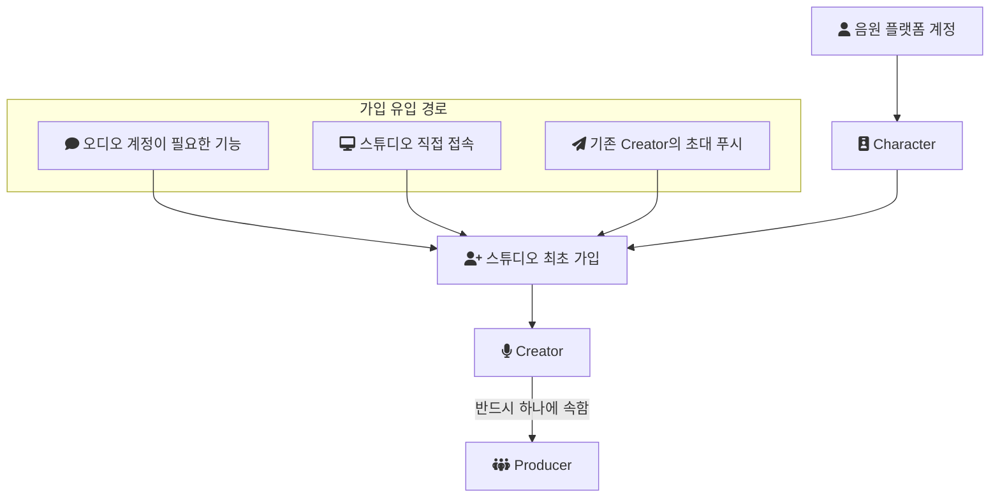
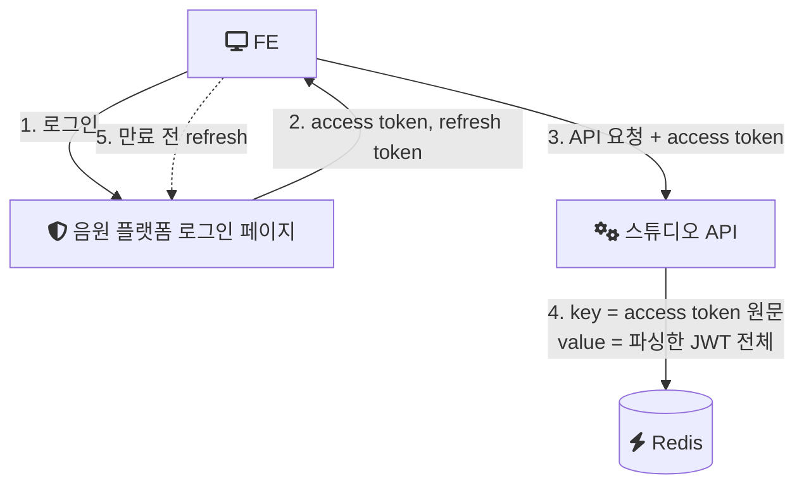
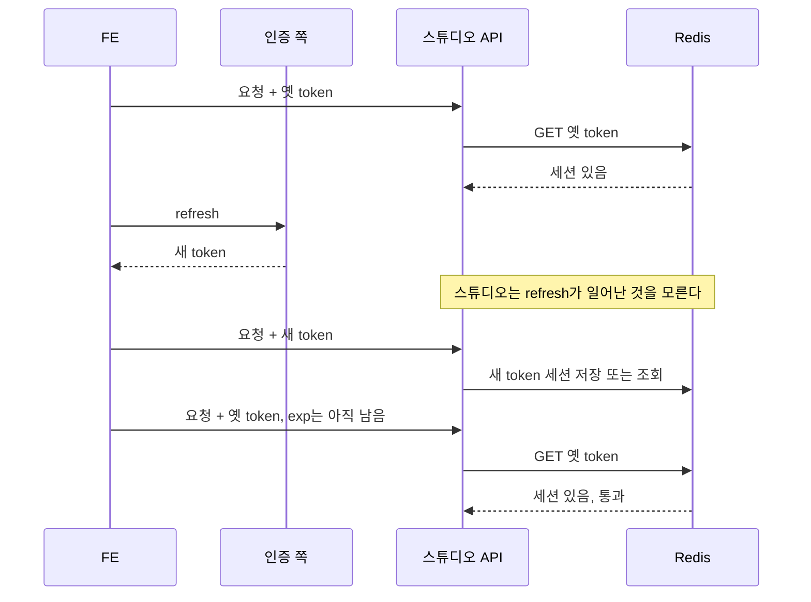
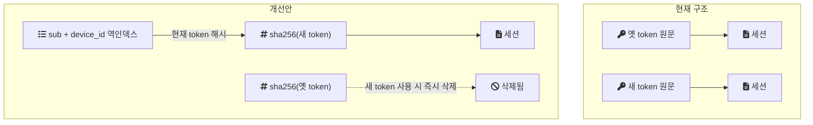

이 글은 크리에이터 스튜디오의 인증·세션 구조에서 찾은 빈틈 하나를 다룬다. FE가 token을 refresh해 새 access token을 받은 뒤에도, 옛 access token으로 스튜디오 API가 계속 통과될 수 있었다.

먼저 밝혀 둘 것이 있다. 이 문제는 내가 식별하고 개선안을 설계하는 데까지만 진행했다. 실제 구현과 배포는 하지 않았다. 글 뒷부분의 코드와 테스트는 회사 코드가 아니라, 그 설계를 개인 실험 저장소(engineering-lab의 creator-studio 모듈, 이하 랩)에서 처음 코드로 옮긴 결과다.

## 이 구조의 조건

| 항목 | 내용 |
| --- | --- |
| 서비스 | 누구나 오디오 콘텐츠를 만들어 음원 플랫폼에 배포하는 B2C 제작 플랫폼 |
| 기간 | 2022년 4월부터 8월까지 초기 구축, 이후 정담당자로 유지보수 |
| 담당 | 인증, KMS 암호화, 외부 연동, 감사 대응은 내가 단독으로 맡았다 |
| 스택 | Java, Spring Boot, JPA, QueryDSL, MySQL, Redis, AWS |
| 인증 주체 | 음원 플랫폼 본체의 로그인 페이지. 스튜디오는 token을 발급하지 않는다 |

사용자 수, 동시 세션 수, token 만료 시간 같은 수치는 기록이 없다. 그래서 이 글은 부하가 아니라 구조의 정확성에 관한 기록이다.

## 가입과 로그인의 도메인

세션 문제를 보기 전에, 스튜디오에서 "사용자"가 무엇인지 정리한다. 이 도메인 구조는 뒤에 다룰 Creator-Producer 매핑 장애를 이해할 때도 그대로 쓰인다.

- 음원 플랫폼 계정 아래에 Character가 있다. 이 Character가 스튜디오에 처음 가입하면 Creator로 매핑된다.
- 모든 Creator는 Producer 아래에 속한다. 직접 가입할 때는 Producer를 먼저 만들고 Creator 이름을 입력한다.
- 가입 유입 경로는 세 가지다. 댓글처럼 오디오 계정이 필요한 기능을 누를 때, 스튜디오에 직접 접속할 때, 기존 Creator가 보낸 초대 푸시 링크를 누를 때.



## 인증 흐름: 스튜디오는 token을 받기만 했다

인증은 스튜디오 밖에서 일어났다. FE가 음원 플랫폼의 로그인 페이지에서 인증해 access token을 얻고, 그 token을 붙여 스튜디오에 요청을 보낸다. 스튜디오 backend는 로그인 서버나 인증 서버를 서버 대 서버로 직접 호출하지 않았다.

스튜디오는 받은 token을 Redis에 저장해 세션처럼 썼다. key는 access token 원문이고, value는 JWT(JSON Web Token, 서명된 JSON 클레임 묶음)를 파싱한 값 전체였다. refresh token도 한 번은 저장했던 것으로 기억한다. [세션과 JWT의 차이](/posts/session-and-jwt/) 관점에서 보면, 원래 상태 없이 검증할 수 있는 JWT를 서버 쪽 저장소에 다시 담아 세션처럼 쓴 혼합 구조다.



그림에서 5번 화살표가 스튜디오를 거치지 않는다는 점이 이 글의 출발점이다.

## 문제: refresh 이후 옛 token이 계속 통과한다

FE가 token을 refresh하면 새 access token을 받는다. 이 교환은 FE와 인증 쪽 사이에서 일어나므로 스튜디오는 그 사실을 모른다. 스튜디오가 아는 것은 Redis에 있는 key뿐이다.

그런데 옛 access token의 만료 시각(exp)은 아직 남아 있다. Redis에도 옛 token을 key로 한 세션이 그대로 있다. 그래서 옛 token으로 요청이 오면 Redis 조회가 성공하고 요청이 통과된다. 새 token으로 온 요청도 통과된다. 한 사용자의 한 기기에 대해 유효한 세션이 둘 이상 존재하는 상태다.



이것이 왜 문제인가. access token은 [Bearer token](https://datatracker.ietf.org/doc/html/rfc6750#section-1.2)이다. RFC 6750은 Bearer token을 "any party in possession of the token (a 'bearer') can use the token in any way that any other party in possession of it can"인 token으로 정의한다. 가진 사람이면 누구든 쓸 수 있다는 뜻이다. refresh로 새 token을 받았다면 옛 token은 더 이상 필요 없는 자격 증명인데, 그것이 exp까지 살아 있으면 유출됐을 때 쓸 수 있는 시간이 그만큼 길어진다.

### TTL을 exp에 맞추면 해결되는가

먼저 떠오르는 해법은 Redis 세션의 TTL(키가 자동 삭제되기까지 남은 시간)을 access token의 exp와 정확히 맞추는 것이다. 나는 이것으로 해결되지 않는다는 점을 짚었다.

TTL은 "언제 저절로 사라지는가"를 정한다. 예를 들어 옛 token의 exp가 refresh 시점에 몇 분 남아 있다면 TTL도 그만큼 남고, 그동안 세션은 유효하다. TTL을 맞추면 만료된 token의 세션이 남는 문제는 없어지지만, 아직 만료되지 않은 옛 token을 지우지는 못한다.

필요한 것은 "새 token이 발급됐으니 이전 token은 폐기한다"는 별도의 정책이다. TTL은 수동적 만료이고, 폐기(revoke)는 능동적 무효화다. 두 가지는 서로 다른 문제다.

| 구분 | TTL 맞추기 | 능동적 폐기 |
| --- | --- | --- |
| 무엇을 막는가 | 만료된 token의 세션이 남는 것 | 아직 만료되지 않은 옛 token의 사용 |
| 언제 동작하는가 | 시간이 지나면 저절로 | 새 token이 확인되는 시점 |
| 필요한 정보 | token의 exp | 이 사용자, 이 기기의 현재 token이 무엇인지 |

표의 마지막 줄이 원래 구조로는 풀 수 없는 이유다. key가 token 원문뿐이라서, 새 token이 들어왔을 때 "같은 사용자, 같은 기기의 이전 token"이 무엇인지 찾을 방법이 없다.

## 원문 token을 key로 쓰는 구조의 다른 약점

폐기 문제와 별개로, token 원문을 Redis key로 두는 방식에는 일반적으로 다음 약점이 따라온다. 개선안의 해시 key와 역인덱스가 이 약점들도 함께 다룬다.

- Redis 관리 도구, 백업 파일(RDB, AOF), 장애 분석 과정에서 Bearer 자격 증명 원문이 그대로 보인다.
- JWT는 길다. key 자체가 커지므로 메모리와 네트워크 비용이 늘어난다.
- refresh할 때마다 새 key가 생기고 옛 key는 TTL이 다할 때까지 남는다. keyspace가 계속 불어난다.
- token만 key로 두면 특정 사용자의 세션을 한 번에 찾거나, 강제 로그아웃시키기 어렵다.

## 개선안: 해시 key와 현재 token 역인덱스

설계한 개선안은 두 가지 변경으로 이루어진다.

1. 세션 key를 access token 원문 대신 `sha256(access_token)`으로 바꾼다.
2. `sub`(JWT의 사용자 식별자)와 `device_id` 조합을 key로 하는 역인덱스를 따로 둔다. 이 역인덱스의 값은 그 사용자, 그 기기에서 "현재 유효한 token의 해시"다.

동작은 이렇다. 새 token이 한 번 쓰이면, 역인덱스에서 이전 token의 해시를 찾아 그 세션을 즉시 지우고 역인덱스를 새 해시로 바꾼다. 이후 옛 token으로 오는 요청은 해시가 역인덱스와 맞지 않아 거절된다.



현재 구조에서는 두 세션이 서로 연결되지 않은 채 나란히 있다. 개선안에서는 역인덱스가 "이 사용자의 이 기기에서 지금 유효한 것은 하나"라는 사실을 들고 있다.

### 설계에서 열려 있던 질문

이 설계를 다시 읽으며, 기록상 정해지지 않은 지점이 하나 보인다. 스튜디오는 token을 발급하지 않으므로, 역인덱스에 없는 해시가 들어왔을 때 그것이 "막 받은 새 token"인지 "이미 교체된 옛 token"인지 해시만으로는 구별할 수 없다. 둘 다 역인덱스와 해시가 다르기 때문이다. 구별하려면 token의 발급 시각(`iat`) 같은 순서 정보를 비교해야 한다.

당시 설계가 이 비교를 어떻게 정했는지, 그리고 스튜디오가 JWT 서명을 어디서 검증했는지는 기록에 없다. 이 두 가지가 정해져야 개선안이 실제로 동작한다.

### 표준은 refresh token 쪽을 어떻게 다루는가

같은 문제를 refresh token 쪽에서 다루는 표준 권고가 있다. OAuth 2.0 보안 모범 사례인 [RFC 9700 4.14.2절](https://www.rfc-editor.org/rfc/rfc9700.html#section-4.14.2)은 refresh token rotation을 "a new refresh token is issued with every refresh response and the previous refresh token is invalidated"로 설명한다. refresh할 때마다 새 refresh token을 주고 이전 것은 무효화한다는 뜻이다. 이미 무효화된 refresh token이 다시 쓰이면 탈취로 보고 그 클라이언트에 발급된 token을 모두 폐기하라고 권한다.

이 권고는 token을 발급하는 쪽의 일이다. 스튜디오는 발급자가 아니므로 이것을 그대로 적용할 수 없었다. 개선안의 역인덱스는 발급자가 아닌 서비스가 "현재 token은 하나"라는 같은 원칙을 자기 세션 저장소에서 지키려는 방법이다.

## 랩에서 개선안을 코드로 옮겨 보니

개선안은 운영에 들어가지 않았으므로, 랩에서 처음으로 코드로 옮겼다. 랩과 실제 환경은 두 가지가 다르다.

- 랩에서는 token을 서명된 JWT가 아니라 무작위 문자열로 단순화했다. 확인하려는 것이 서명 검증이 아니라 Redis 세션 key 구조이기 때문이다.
- 랩의 세션 관리자는 refresh까지 직접 처리한다. 그래서 교체 시점이 "새 token이 처음 쓰일 때"가 아니라 "refresh를 처리할 때"다. 위에서 적은 순서 판별 문제가 랩에서는 생기지 않는다.

key 구조는 세 가지다.

| key | 값 |
| --- | --- |
| `session:token:{sha256(accessToken)}` | 세션 데이터 |
| `session:index:{memberId}:{deviceId}` | 현재 유효한 access token의 해시 |
| `session:refresh:{sha256(refreshToken)}` | memberId와 deviceId, 한 번 쓰면 삭제 |

교체는 "역인덱스에서 이전 해시 읽기, 이전 세션 지우기, 새 세션과 역인덱스 쓰기"의 세 단계다. 이 단계가 Redis 호출 여러 번으로 쪼개지면 그 사이에 같은 기기의 다른 요청이 끼어들 수 있다. 그래서 랩은 이 세 단계를 Lua 스크립트 하나로 묶었다. [Redis 문서](https://redis.io/docs/latest/develop/programmability/eval-intro/)는 "Redis guarantees the script's atomic execution."이라고 적는다. 스크립트 실행 중에는 다른 명령이 끼어들지 않는다는 뜻이다. Lua로 묶는 것은 당시 설계에 없던, 랩에서 새로 정한 부분이다.

```java
// 랩 코드: ImprovedSessionManager.java
private static final DefaultRedisScript<Long> ROTATE_SESSION = new DefaultRedisScript<>(
        "local oldHash = redis.call('GET', KEYS[1]) "
                + "if oldHash then redis.call('DEL', 'session:token:' .. oldHash) end "
                + "redis.call('SET', 'session:token:' .. ARGV[1], ARGV[2], 'EX', ARGV[3]) "
                + "redis.call('SET', KEYS[1], ARGV[1], 'EX', ARGV[3]) "
                + "return 1",
        Long.class);
```

같은 Redis 문서는 스크립트가 접근하는 key 이름을 모두 인자로 넘기라고 권한다. 위 스크립트는 세션 key를 스크립트 안에서 조립하므로 이 권고를 지키지 않는다. 단일 Redis에서는 동작하지만, Redis Cluster로 옮기면 key가 다른 슬롯에 놓일 수 있어 그대로 쓸 수 없다.

비교 대상인 원래 구조도 랩에 재현했다. 원래 구조의 refresh는 새 세션을 추가할 뿐, 이전 세션을 찾을 방법이 없다.

```java
// 랩 코드: LegacySessionManager.java
return issue(memberId, deviceId); // 새 세션만 추가될 뿐, 이전 access token 세션은 손대지 않는다.
```

### 테스트 결과

[`SessionRotationRaceConditionTest`](https://github.com/polynomeer/engineering-lab/blob/d52297d0ad07c3d8a05a7471192a5655cb8b1378/career-lab/creator-studio/src/test/java/com/portfolio/creatorlab/session/SessionRotationRaceConditionTest.java)는 Testcontainers로 띄운 `redis:7.4-alpine`에서 실행했다. access token TTL은 30분, refresh token TTL은 14일로 두었다. 이 값은 랩에서 정한 것이고 실제 운영 값은 기록이 없다. 네 테스트 모두 통과했다.

| 테스트 | 원래 구조 | 개선안 |
| --- | --- | --- |
| refresh 직후 옛 access token 조회 | 세션 있음, 통과 | 세션 없음, 거절 |
| refresh 두 번 뒤 남은 세션 | 해당 테스트 없음 | 가장 최근 token 하나만 유효 |
| 이미 쓴 refresh token 재사용 | 해당 테스트 없음 | 예외로 거절 |

첫 줄이 이 글의 문제와 해법을 그대로 보여준다. 같은 시나리오에서 원래 구조는 옛 token을 통과시키고, 개선안은 refresh 직후부터 거절한다. exp가 남아 있는지와 관계없다.

테스트 이름에 경쟁 상태(race condition)가 들어가 있지만, 현재 테스트는 모두 한 스레드에서 순서대로 실행된다. 동시에 refresh가 두 번 들어오는 경우에 Lua 스크립트가 실제로 세션 하나만 남기는지는 아직 측정하지 않았다.

## 이 개선안이 남긴 비용과 미해결

- 구현하지 않았다. 운영 환경의 옛 token 통과 문제는 내가 맡은 동안 설계 단계에 머물렀다.
- 요청마다 Redis를 조회하는 비용은 그대로다. 역인덱스가 추가되면 새 token이 처음 쓰일 때 쓰기가 한 번 더 생긴다.
- 기기 식별자(`device_id`)를 어디서 얻는지가 정해져야 한다. 같은 기기를 다른 기기로 잘못 보면 세션이 여러 개 남고, 다른 기기를 같은 기기로 보면 정상 세션을 지운다.
- 정확한 refresh token 형식, 실제 TTL 값, Redis key prefix, 서명 검증 위치, 로그아웃 처리 방식은 기록에 없다.

## 정리

- TTL은 저절로 사라지는 시점을 정하고, 폐기는 아직 유효한 것을 지금 무효화한다. refresh 이후 옛 token 문제는 두 번째에 속하므로 TTL 조정으로는 풀리지 않는다.
- 폐기하려면 "이 사용자, 이 기기의 현재 token"을 가리키는 정보가 저장소에 있어야 한다. token 원문만 key로 둔 구조에는 그 정보가 없다.
- token을 발급하지 않는 서비스가 이 원칙을 지키려면, 새 token과 옛 token의 순서를 판단할 근거까지 함께 설계해야 한다.

## 참고

- [RFC 6750 1.2절: Bearer Token 정의](https://datatracker.ietf.org/doc/html/rfc6750#section-1.2) — 가진 사람이면 누구나 쓸 수 있는 token
- [RFC 9700 4.14.2절: Refresh Token Protection 권고](https://www.rfc-editor.org/rfc/rfc9700.html#section-4.14.2) — refresh token rotation과 재사용 탐지
- [Redis Docs: Scripting with Lua](https://redis.io/docs/latest/develop/programmability/eval-intro/) — 스크립트의 원자적 실행, key 이름을 인자로 넘기라는 권고
- 랩 코드 [`LegacySessionManager.java`](https://github.com/polynomeer/engineering-lab/blob/d52297d0ad07c3d8a05a7471192a5655cb8b1378/career-lab/creator-studio/src/main/java/com/portfolio/creatorlab/session/LegacySessionManager.java)
- 랩 코드 [`ImprovedSessionManager.java`](https://github.com/polynomeer/engineering-lab/blob/d52297d0ad07c3d8a05a7471192a5655cb8b1378/career-lab/creator-studio/src/main/java/com/portfolio/creatorlab/session/ImprovedSessionManager.java)
- 랩 테스트 [`SessionRotationRaceConditionTest.java`](https://github.com/polynomeer/engineering-lab/blob/d52297d0ad07c3d8a05a7471192a5655cb8b1378/career-lab/creator-studio/src/test/java/com/portfolio/creatorlab/session/SessionRotationRaceConditionTest.java)
