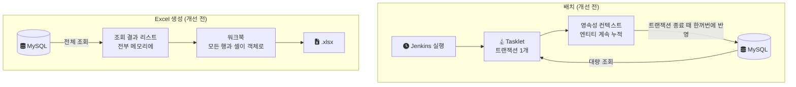
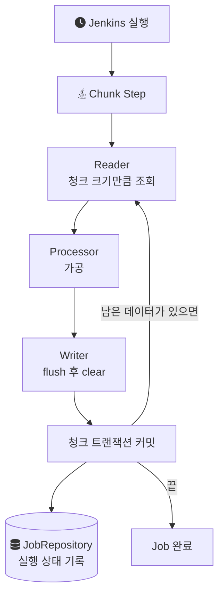
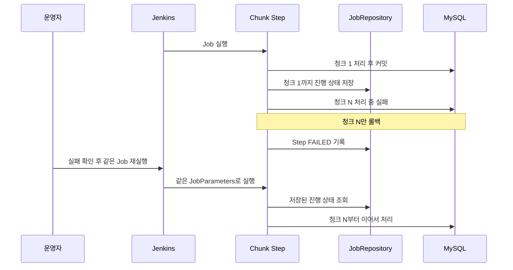
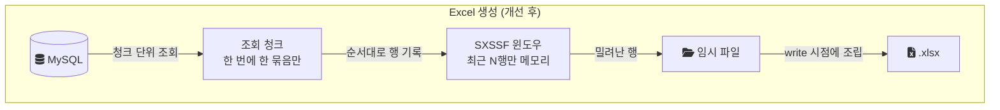

배치가 OOM(OutOfMemoryError, 힙에 새 객체를 둘 공간이 없을 때 나는 오류)으로 죽었고, 죽지 않은 날에도 [Full GC](/posts/java-garbage-collection/)가 반복됐다. Excel 파일을 만드는 기능도 같은 증상을 보였다. 이 글은 2022년 9월부터 12월까지 음원 플랫폼 회사에서 혼자 맡았던 대용량 배치와 Excel 생성 최적화를 정리한 기록이다. 원인을 어떻게 특정했는지, 배치와 Excel을 각각 어떻게 바꿨는지, 그리고 퇴사 후 같은 구조를 랩에서 다시 만들어 재 보니 무엇이 보였는지까지 다룬다.

> 회사 코드에는 더 이상 접근할 수 없다. 이 글의 코드는 퇴사 후 같은 문제를 처음부터 다시 구현한 [engineering-lab의 batch-excel 모듈](https://github.com/polynomeer/engineering-lab/tree/d52297d0ad07c3d8a05a7471192a5655cb8b1378/career-lab/batch-excel)에서 가져왔다. 랩의 도메인(구독 정산 레코드), 청크 크기, 윈도우 크기는 재현을 위해 새로 정한 값이고 운영값이 아니다.

## 조건: 무엇을 어떤 규모로 다뤘나

교훈이 다른 환경에도 통하는지 판단하려면 조건부터 알아야 한다.

| 항목 | 내용 |
| --- | --- |
| 기간과 인원 | 2022.9 ~ 2022.12, 단독 수행 |
| 스택 | Java, Spring Batch, JPA, MySQL, Apache POI |
| 배치 구조(개선 전) | Tasklet 하나가 전체 작업을 단일 트랜잭션으로 처리 |
| Excel 구조(개선 전) | 조회 결과를 한 번에 메모리에 올린 뒤 파일 생성 |
| Excel 데이터 규모 | 수십만 건 |
| 재실행 방식 | 실패를 확인하면 Jenkins에서 사람이 Job을 다시 실행 |

배치가 한 번에 처리한 건수와 서버의 힙 설정은 기록이 남아 있지 않다. 그래서 이 글의 운영 수치는 개선 전후의 메모리 값 두 쌍뿐이다.

## 증상: 데이터가 많은 작업에서 Full GC와 OOM

문제가 된 작업은 두 갈래였다.

- 대량 엔티티를 읽어 가공하고 저장하는 배치. [Spring Batch](https://docs.spring.io/spring-batch/reference/step/chunk-oriented-processing.html)의 Tasklet(한 번 호출되는 작업 단위) 하나가 작업 전체를 한 트랜잭션 안에서 처리했다.
- 조회 결과를 Excel 파일로 만드는 기능. 결과 전체를 리스트로 받은 뒤 워크북을 만들었다.

두 작업 모두 메모리 사용량이 급증했고, Full GC와 OOM이 반복됐다. 배치 쪽에는 한 가지 문제가 더 있었다. 트랜잭션이 작업 전체 길이만큼 열려 있으니 DB 락을 잡고 있는 시간도 그만큼 길었다.

개선 전 두 작업의 구조를 그리면 다음과 같다. 둘 다 처리 대상 전체가 작업이 끝날 때까지 힙에 남는다는 점이 같다.



## 원인 특정: MAT로 Heap Dump를 열었다

메모리 문제를 볼 때 숫자만 보면 "데이터가 많다"는 결론에서 멈춘다. 데이터가 많은 것만으로는 처리가 끝난 객체가 왜 힙에 남아 있는지를 설명하지 못한다. 그래서 무엇이 메모리를 차지하고 있는지를 직접 봤다.

Heap Dump(그 순간 힙에 있는 객체 전체를 파일로 떠낸 스냅숏)를 Eclipse MAT(Memory Analyzer Tool)로 열어 어떤 객체가 메모리를 많이 차지하는지 확인했다. GC 로그와 [Thread Dump](/posts/thread-dump-basics/)도 함께 확인했다. MAT에서 정확히 어떤 화면과 기능을 거쳤는지는 지금 기억나지 않아 여기 적지 않는다.

확인한 결론은 이렇다. 배치는 Tasklet 하나가 단일 트랜잭션으로 대량 엔티티를 처리했고, 그 엔티티가 [영속성 컨텍스트](/posts/jpa-architecture/)에 계속 쌓였다. 영속성 컨텍스트는 트랜잭션이 끝날 때까지 관리 중인 엔티티를 놓지 않는다. 그래서 이미 처리한 엔티티도 가비지가 되지 못했고, 트랜잭션이 끝나기 전에는 메모리가 해제되지 않았다. Excel 쪽은 조회 결과를 한 번에 메모리에 올린 뒤 파일을 만드는 방식이 원인이었다.

두 원인은 모양이 같다. 처리 대상 전체를 작업이 끝날 때까지 들고 있는 구조라는 점이다. 이런 구조에서는 힙을 늘려도 OOM이 나는 건수의 기준선만 올라간다. 그래서 고칠 대상을 힙 크기가 아니라 "한 번에 들고 있는 단위"로 잡았다.

## 배치: Tasklet 단일 트랜잭션에서 Chunk로

Spring Batch의 Chunk 지향 처리는 계약이 다르다. 공식 문서는 이를 다음처럼 정의한다.

> "Chunk oriented processing refers to reading the data one at a time and creating 'chunks' that are written out within a transaction boundary."

데이터를 하나씩 읽어 청크(묶음)를 만들고, 청크 하나를 트랜잭션 경계 안에서 쓴다는 뜻이다. 읽은 건수가 커밋 간격(commit interval)에 도달하면 Writer가 청크를 쓰고 트랜잭션을 커밋한다([Spring Batch: Chunk-oriented Processing](https://docs.spring.io/spring-batch/reference/step/chunk-oriented-processing.html)). 다음 청크는 새 트랜잭션이다.

이 전환에 더해 일정 건수마다 `flush()`와 `clear()`를 호출해 영속성 컨텍스트 크기를 직접 제어했다. 두 메서드의 역할은 Jakarta Persistence 명세에 적혀 있다([EntityManager Javadoc](https://jakarta.ee/specifications/persistence/3.1/apidocs/jakarta.persistence/jakarta/persistence/entitymanager)).

- `flush()`는 영속성 컨텍스트의 변경을 DB에 동기화한다. 쌓인 변경이 SQL로 나간다.
- `clear()`는 영속성 컨텍스트를 비워 관리 중인 엔티티를 모두 준영속(detached) 상태로 만든다. 명세는 flush하지 않은 변경은 저장되지 않는다고 덧붙인다.

그래서 순서가 중요하다. `clear()`만 하면 아직 DB에 나가지 않은 변경이 사라진다. `flush()`만 하면 변경은 DB에 반영되지만 엔티티는 여전히 컨텍스트에 남아 메모리가 줄지 않는다. 둘을 이 순서로 함께 호출해야 반영과 해제가 모두 일어난다.

바뀐 흐름은 다음과 같다. 엔티티는 청크 하나 분량만 살아 있다가 청크 경계에서 비워진다.



### 랩에서 다시 만든 Writer와 Reader

운영 코드의 청크 건수는 기억나지 않는다. 랩에서는 청크 크기를 1,000건으로 두고, Writer의 끝에서 `flush()`와 `clear()`를 호출하도록 만들었다. 청크 경계와 컨텍스트를 비우는 경계를 일치시킨 것이다.

```java
// 랩 코드: SettlementRecordChunkWriter (일부)
@Override
public void write(Chunk<? extends SettlementRecord> chunk) {
    entityManager.flush();   // 변경 감지된 UPDATE를 DB로 보낸다
    entityManager.clear();   // 다음 청크가 빈 컨텍스트에서 시작한다
}
```

랩의 Processor는 Reader가 넘긴 관리 상태 엔티티의 필드를 바로 바꾼다. 그래서 Writer는 `persist()`나 `merge()` 없이 변경 감지(dirty checking, 관리 중인 엔티티의 변경을 커밋 시점에 찾아 UPDATE로 만드는 기능)만으로 UPDATE를 만든다.

비교 대상인 개선 전 Tasklet은 페이지 단위로 조회는 하지만 `flush()`와 `clear()`를 한 번도 부르지 않는다. 페이지로 나눠 읽는 것만으로는 문제가 풀리지 않는다는 점을 보여 주려는 구성이다.

```java
// 랩 코드: LegacyAggregationTasklet (일부)
do {
    page = repository.findBy...IdGreaterThanOrderByIdAsc(
            targetMonth, PENDING, lastSeenId, PageRequest.of(0, 5_000));
    for (SettlementRecord record : page) {
        record.markAggregated();   // 변경 감지만 하고, 반영은 트랜잭션 종료 때
        lastSeenId = record.getId();
    }
    // flush()와 clear()를 호출하지 않는다
} while (!page.isEmpty());
```

조회 방식도 한 가지 정했다. 랩은 OFFSET 대신 마지막으로 읽은 id 다음부터 읽는 keyset 방식(`id > lastSeenId ORDER BY id`)을 쓴다. 이 결정은 운영에서 그렇게 했다는 근거가 없는 랩의 설계다. OFFSET이 커질수록 앞부분을 건너뛰기 위해 읽는 행이 늘어나는 비용을 피하려는 선택이다.

### 청크 크기는 커밋 비용과 컨텍스트 크기의 거래다

청크 크기를 어떤 근거로 정했는지는 기억나지 않는다. 다만 이 값이 무엇과 무엇을 맞바꾸는지는 분명하다.

청크가 작으면 커밋이 잦아진다. MySQL 문서는 InnoDB가 데이터를 변경한 트랜잭션을 커밋할 때마다 로그를 디스크에 flush해야 하고, 그래서 커밋 빈도가 저장 장치의 I/O 처리량에 묶인다고 설명한다([MySQL: Optimizing InnoDB Transaction Management](https://dev.mysql.com/doc/refman/8.0/en/optimizing-innodb-transaction-management.html)). 이때 쓰이는 로그가 [redo 로그](/posts/redo-undo-log/)다. 이 비용은 처리 건수가 아니라 커밋 횟수에 비례한다.

청크가 크면 반대 방향으로 간다. 영속성 컨텍스트가 다시 커지고, 트랜잭션이 길어져 락을 잡는 시간도 늘어난다. 같은 MySQL 문서는 수천 번 커밋하는 애플리케이션과 두세 시간에 한 번 커밋하는 애플리케이션이 서로 다른 성능 문제를 겪는다고 적는다. 큰 트랜잭션을 롤백하면 원래 변경보다 몇 배 오래 걸릴 수 있다는 경고도 있다. 개선 전 Tasklet이 바로 이 끝에 있었다.

값을 감이 아니라 실험으로 정하려면 두 지표를 같이 봐야 한다. 하나는 청크당 처리 시간으로, 커밋 오버헤드가 지배적인지를 보여 준다. 다른 하나는 청크를 처리하는 동안의 힙 증가폭으로, 컨텍스트가 얼마나 커지는지를 보여 준다.

### 실패한 청크와 재실행

단일 트랜잭션에서는 중간에 실패하면 작업 전체가 롤백된다. 구조상 마지막 건 근처에서 실패해도 처음부터 다시 돌려야 한다.

Chunk 구조로 바꾸면서 별도 상태 테이블을 만들지 않았다. Spring Batch가 기본으로 제공하는 JobRepository와 Step 실행 상태 추적을 그대로 썼다. 실패한 청크는 롤백되지만 이미 커밋된 청크는 남는다. 같은 JobParameters로 Job을 다시 실행하면 같은 JobInstance로 인식되고, ExecutionContext에 남은 상태로 실패 지점부터 이어서 처리한다([Spring Batch: Configuring a Step for Restart](https://docs.spring.io/spring-batch/reference/step/chunk-oriented-processing/restart.html)).

재실행 자체는 자동이 아니었다. 실패를 확인하면 Jenkins에서 사람이 해당 Job을 다시 실행했다. 정확히는 "자동 복구"가 아니라 "사람이 트리거하되 이미 처리한 부분은 건너뛰는 구조"였다. 그 흐름을 순서대로 그리면 다음과 같다.



재시작이 성립하려면 Reader가 어디까지 읽었는지를 ExecutionContext에 남겨야 한다. 랩의 Reader는 `ItemStreamReader`를 구현해 마지막으로 읽은 id를 저장한다.

```java
// 랩 코드: SettlementRecordKeysetReader (일부)
@Override
public void open(ExecutionContext ctx) {
    if (ctx.containsKey(LAST_SEEN_ID_KEY)) {
        lastSeenId = ctx.getLong(LAST_SEEN_ID_KEY);   // 재시작이면 이어서 읽는다
    }
}

@Override
public void update(ExecutionContext ctx) {
    ctx.putLong(LAST_SEEN_ID_KEY, lastSeenId);        // 청크 커밋과 함께 저장된다
}
```

코드를 다시 읽으며 한 가지를 더 확인했다. 랩의 Reader는 `PENDING` 상태만 읽고, 처리된 레코드는 `AGGREGATED`로 바뀐다. 그래서 체크포인트가 없더라도 이미 커밋된 레코드는 다시 읽히지 않는다. 진행 위치와 처리 상태라는 두 장치가 겹쳐 있는 셈이다. 다만 랩은 실패를 주입해 재시작하는 테스트를 아직 두지 않았으므로, 이 부분은 코드로 읽은 내용이고 실행으로 확인한 결과는 아니다.

## Excel: 전량 적재에서 SXSSF 스트리밍으로

Excel 쪽은 원인이 배치와 달랐지만 고치는 방향은 같았다. 한 번에 들고 있는 단위를 줄이는 것이다.

[Apache POI](/posts/apache-poi/)의 `XSSFWorkbook`은 시트의 모든 행과 셀을 객체로 메모리에 유지한다. 조회 결과 리스트에 더해 워크북 객체 트리가 한 번 더 힙을 차지한다. `SXSSFWorkbook`은 XSSF와 API가 호환되는 스트리밍 확장이다. 최근 N행만 메모리에 두고, 윈도우 밖으로 밀려난 행은 임시 파일에 기록한다. POI 문서는 이 구현이 매우 큰 스프레드시트를 만들어야 하는데 힙이 제한적일 때 쓰라고 소개한다([Apache POI: SXSSF](https://poi.apache.org/components/spreadsheet/how-to.html#sxssf)).

워크북만 바꾸면 절반만 고친 것이다. 조회 결과를 여전히 리스트 하나로 다 받으면 워크북 쪽 메모리는 줄어도 조회 쪽은 그대로다. 그래서 대량 조회를 청크 단위로 나누고, 읽은 청크를 바로 SXSSF 워크북에 흘려보내도록 다시 설계했다. 입력과 출력 양쪽이 모두 청크 크기와 윈도우 크기로 묶인다.



랩의 구현은 조회 페이지 2,000건, 윈도우 500행으로 정했다. 둘 다 운영값이 아니라 랩에서 정한 값이다.

```java
// 랩 코드: StreamingExcelExportService (일부)
try (SXSSFWorkbook workbook = new SXSSFWorkbook(500)) {   // 윈도우 500행
    workbook.setCompressTempFiles(true);
    Sheet sheet = workbook.createSheet("정산내역");
    int rowNum = 1;
    long lastSeenId = 0L;
    List<SettlementRecord> page;
    do {
        page = repository.findBy...IdGreaterThanOrderByIdAsc(
                targetMonth, AGGREGATED, lastSeenId, PageRequest.of(0, 2_000));
        for (SettlementRecord record : page) {
            writeDataRow(sheet, rowNum++, record);   // 윈도우를 벗어나면 다시 접근할 수 없다
        }
        if (!page.isEmpty()) lastSeenId = page.get(page.size() - 1).getId();
    } while (!page.isEmpty());
    try (OutputStream out = Files.newOutputStream(outputPath)) {
        workbook.write(out);
    } finally {
        workbook.dispose();   // 임시 파일 삭제
    }
}
```

랩 코드의 `setCompressTempFiles(true)`, `dispose()`, 고정 열 너비, 스타일 한 번 생성 후 재사용은 랩에서 정한 구성이다. 운영 코드에서 이 옵션들을 썼는지는 확인되지 않았다.

### 스트리밍이 막는 쓰기 패턴

SXSSF는 윈도우를 벗어난 행을 다시 읽거나 고칠 수 없다. 그 행은 이미 디스크로 나갔다. POI 문서는 이 외에도 `Sheet.clone()`과 수식 평가를 지원하지 않는다고 적는다([Apache POI: Spreadsheet](https://poi.apache.org/components/spreadsheet/)). 그래서 SXSSF로 바꾸기 전에 "쓰기 패턴이 순차적인가"를 먼저 확인해야 한다.

- 마지막에 합계 행을 넣는 경우는 쓰면서 누적하면 된다.
- 열 너비를 데이터에 맞추는 경우는 고정값을 쓰거나 추적할 열을 미리 지정해야 한다. 이미 디스크로 나간 행은 너비 계산에 쓸 수 없다.
- 뒤쪽 행의 값에 따라 앞쪽 행의 서식을 바꿔야 하는 경우는 스트리밍과 정면으로 충돌한다. 1차 순회에서 서식 결정에 필요한 집계값만 구하고 2차 순회에서 쓰는 방식이 일반적인 해법이다.

## 결과

| 항목 | 개선 전 | 개선 후 |
| --- | --- | --- |
| 배치 메모리 피크 | 3.8GB | 1.6GB (58% 감소) |
| Excel 생성 메모리 | 1.2GB | 180MB (85% 감소) |
| Full GC와 OOM | 반복 발생 | 개선 후 없이 운영 |
| 트랜잭션 길이 | 작업 전체 | 청크 하나 |
| 실패 시 재실행 | 구조상 처음부터 | Jenkins에서 재실행하면 마지막 커밋 청크 다음부터 |

트랜잭션이 청크 단위로 짧아지면서 DB 부하도 줄었다. 수십만 건 규모의 Excel도 OOM 없이 만들어졌다.

## 랩에서 다시 재 보니: 감소율은 측정 방식에 따라 달라진다

랩은 같은 기법이 같은 방향으로 메모리를 줄이는지를 확인하려고 만들었다. 조건은 다음과 같다.

| 항목 | 랩 조건 |
| --- | --- |
| 런타임 | Java 21, Spring Boot 3.3.4, Apache POI 5.3.0 |
| DB | MySQL 8.0.39 (Testcontainers) |
| JVM | 테스트 클래스마다 새 JVM, 최대 힙 2GB |
| 배치 시나리오 | 20만 건, 청크 1,000건 |
| Excel 시나리오 | 10만 건 × 6열, 조회 페이지 2,000건, 윈도우 500행 |
| 측정 | 별도 스레드가 `MemoryMXBean`으로 힙 사용량을 샘플링해 최댓값 기록 |

처음 결과는 실망스러웠다. 5ms마다 힙 사용량을 그냥 읽어 최댓값을 피크로 잡았더니, 배치의 증가폭(delta)은 Tasklet 215MB, Chunk 191MB였다. 감소율이 11.2%밖에 되지 않았다.

원인은 측정 방식에 있었다. GC가 아직 돌지 않아 잠깐 쌓여 있는 가비지까지 피크에 섞였다. Chunk 방식도 청크마다 조회 결과 리스트 같은 임시 객체를 만들고 버리는데, 샘플링 순간에 GC가 돌지 않았으면 그 가비지가 그대로 잡힌다. 영속성 컨텍스트가 실제로 붙잡고 있는 살아 있는 객체(live set)가 아니라 그 순간의 할당 압력을 재고 있었던 것이다.

그래서 샘플마다 `System.gc()`를 먼저 부르고(힌트일 뿐 즉시 수집을 보장하지 않는다), 간격을 100ms로 늘렸다. 결과가 완전히 달라졌다.

| 시나리오 | 개선 전 delta | 개선 후 delta | 감소율 |
| --- | --- | --- | --- |
| 배치 (README 기록) | 114.2MB | 6.2MB | 94.6% |
| Excel (README 기록) | 568.1MB | 1.5MB | 99.7% |

README에는 두 번 연속 실행해 같은 감소율이 나왔다고 남아 있다. 2026년 10월 2일 로컬 실행의 테스트 리포트에는 배치 94.5%, Excel 99.6%(568.2MB에서 2.5MB)가 찍혀 있다.

이 숫자는 운영의 58%, 85%보다 훨씬 크다. 세 가지 이유로 둘을 직접 비교하면 안 된다.

첫째, 기준이 다르다. 랩의 감소율은 측정 시작 시점 힙을 뺀 증가폭끼리 비교한 값이다. 같은 실행의 절대 피크로 계산하면 배치는 148.1MB에서 40.7MB로 72.5%, Excel은 601.6MB에서 39.4MB로 93.5%가 된다. 같은 데이터에서 무엇을 분모로 두느냐만으로 감소율이 20%p 넘게 움직인다. 운영의 3.8GB와 1.6GB에는 애플리케이션이 원래 쓰는 힙도 들어 있었을 것이다. 다만 그 값을 어떤 도구의 어떤 지표로 읽었는지는 기록이 남아 있지 않다.

둘째, 규모와 구성이 다르다. 랩은 데이터가 작고 애플리케이션이 단순하다. 개선 전 쪽에서 영속성 컨텍스트가 차지하는 비중이 그만큼 두드러진다.

셋째, 랩의 개선 전 Excel 시나리오는 엔티티 리스트와 XSSF 워크북을 함께 들고 있다. 568MB는 두 효과의 합이고, XSSF만의 비용이 아니다.

그래서 랩이 보여 주는 것은 "Chunk 전환과 flush/clear, 청크 조회와 SXSSF 스트리밍이 같은 방향으로 메모리를 줄인다"는 데까지다. 운영에서 정확히 58%와 85%가 나왔다는 것을 재현한 것은 아니다. 그리고 메모리를 잰다는 말만으로는 아무것도 보장되지 않는다는 점도 남는다. 가비지와 live set을 구분하지 않으면 같은 개선이 11%로도, 95%로도 보인다.

## 비용과 남은 것

- 청크 크기가 새 설정값이 됐다. 너무 작으면 커밋 비용이, 너무 크면 원래 문제가 돌아온다. 운영에서 이 값을 정한 근거는 남아 있지 않다.
- 재시작이 가능하려면 Reader가 진행 위치를 저장해야 하고, 정렬 기준이 처리 중에 바뀌지 않아야 한다. 단일 트랜잭션 시절에는 없던 제약이다.
- 재실행은 여전히 사람이 한다. Jenkins에서 실패를 확인하고 다시 실행하는 절차가 운영 부담으로 남았다.
- SXSSF로 바꾸면서 이미 쓴 행을 고칠 수 없게 됐다. 앞쪽 행을 나중에 고쳐야 하는 양식은 두 번 순회해야 한다.
- 배치 피크가 1.6GB 밑으로 내려가지 않은 이유는 기록에 없다. 남은 1.6GB의 구성을 Heap Dump로 다시 확인했다면 다음 병목이 어디인지도 알 수 있었을 것이다.

대량 Excel 다운로드를 요청과 생성으로 분리하는 일반적인 설계는 [대용량 엑셀 다운로드 요청을 안정적으로 처리하는 방법](/posts/bulk-excel-performance/)에 따로 정리했다.

## 참고

- [Spring Batch Reference: Chunk-oriented Processing](https://docs.spring.io/spring-batch/reference/step/chunk-oriented-processing.html)
- [Spring Batch Reference: Configuring a Step for Restart](https://docs.spring.io/spring-batch/reference/step/chunk-oriented-processing/restart.html)
- [Jakarta Persistence 3.1: EntityManager](https://jakarta.ee/specifications/persistence/3.1/apidocs/jakarta.persistence/jakarta/persistence/entitymanager)
- [MySQL 8.0 Reference Manual: Optimizing InnoDB Transaction Management](https://dev.mysql.com/doc/refman/8.0/en/optimizing-innodb-transaction-management.html)
- [Apache POI: SXSSF (Streaming Usermodel API)](https://poi.apache.org/components/spreadsheet/how-to.html#sxssf)
- [Apache POI: Spreadsheet Overview](https://poi.apache.org/components/spreadsheet/)
- 랩 코드 (commit `d52297d`)
  - [README: 측정 방식과 감소율 차이](https://github.com/polynomeer/engineering-lab/blob/d52297d0ad07c3d8a05a7471192a5655cb8b1378/career-lab/batch-excel/README.md)
  - [LegacyAggregationTasklet.java](https://github.com/polynomeer/engineering-lab/blob/d52297d0ad07c3d8a05a7471192a5655cb8b1378/career-lab/batch-excel/src/main/java/com/portfolio/batchlab/batch/legacy/LegacyAggregationTasklet.java)
  - [SettlementRecordChunkWriter.java](https://github.com/polynomeer/engineering-lab/blob/d52297d0ad07c3d8a05a7471192a5655cb8b1378/career-lab/batch-excel/src/main/java/com/portfolio/batchlab/batch/chunk/SettlementRecordChunkWriter.java)
  - [SettlementRecordKeysetReader.java](https://github.com/polynomeer/engineering-lab/blob/d52297d0ad07c3d8a05a7471192a5655cb8b1378/career-lab/batch-excel/src/main/java/com/portfolio/batchlab/batch/chunk/SettlementRecordKeysetReader.java)
  - [StreamingExcelExportService.java](https://github.com/polynomeer/engineering-lab/blob/d52297d0ad07c3d8a05a7471192a5655cb8b1378/career-lab/batch-excel/src/main/java/com/portfolio/batchlab/excel/StreamingExcelExportService.java)
  - [MemoryUsageProbe.java](https://github.com/polynomeer/engineering-lab/blob/d52297d0ad07c3d8a05a7471192a5655cb8b1378/career-lab/batch-excel/src/main/java/com/portfolio/batchlab/support/MemoryUsageProbe.java)
