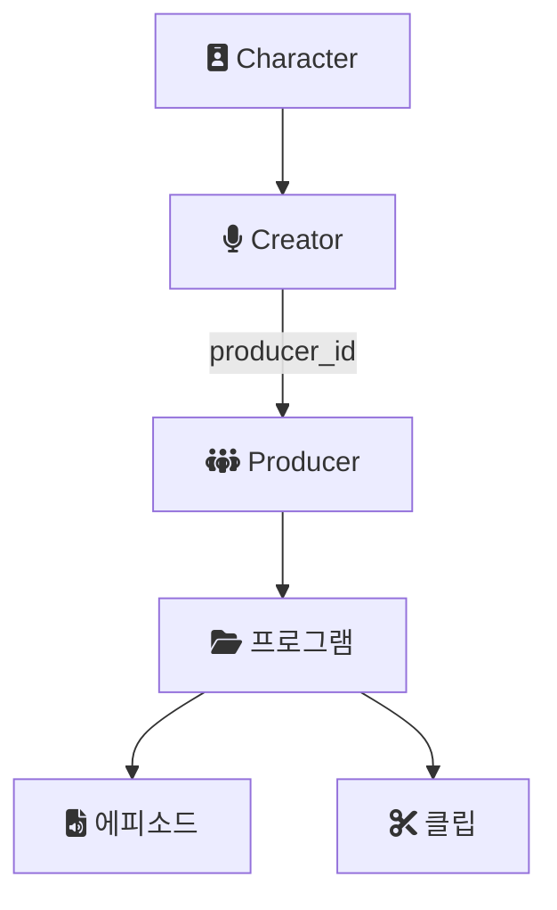
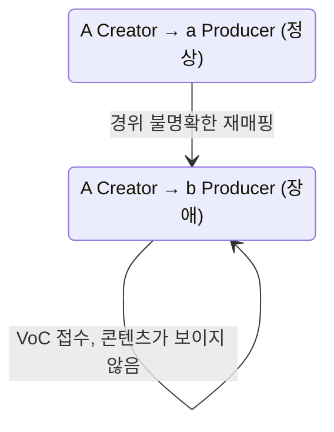
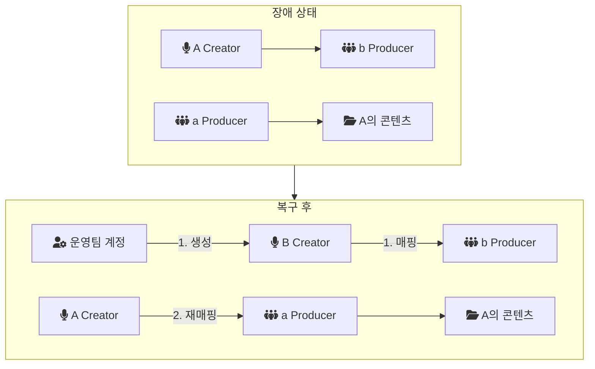
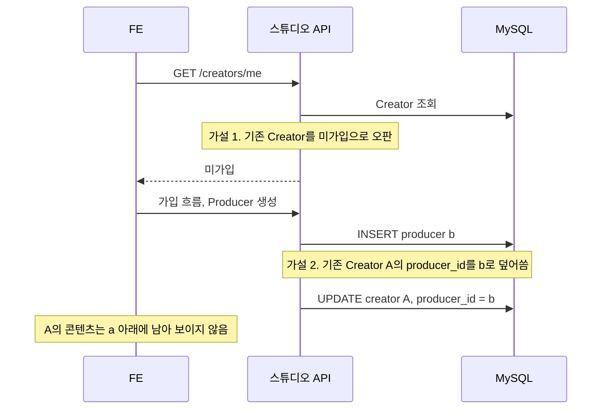
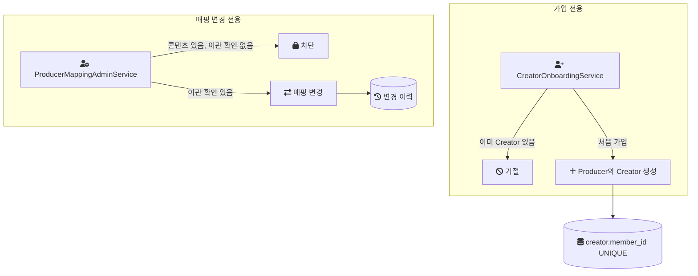

크리에이터 스튜디오에서 한 Creator의 콘텐츠가 전부 사라진 것처럼 보이는 VoC(Voice of Customer, 고객 문의)가 들어왔다. 실제로 콘텐츠가 지워진 것은 아니었다. Creator가 속한 Producer가 다른 Producer로 바뀌어 있었다.

이 글은 그 장애를 어떻게 복구했는지, 왜 DB를 직접 고치지 않았는지, 원인을 어디까지 좁혔고 어디서 멈췄는지를 정리한다. 원인은 확정하지 못했다. 그래서 이 글의 원인 부분은 가설로 읽어야 한다.

## 장애를 이해하기 위한 도메인

스튜디오의 사용자 구조는 [refresh 이후 옛 token 문제를 다룬 글](/posts/refresh-token-old-token-pass/)에서 정리한 것과 같다. 이 장애와 관련된 부분만 다시 적는다.

- 음원 플랫폼 계정 아래의 Character가 스튜디오에 처음 가입하면 Creator로 매핑된다.
- 모든 Creator는 Producer 아래에 속한다. 직접 가입할 때는 Producer를 먼저 만들고 Creator 이름을 입력한다.
- Creator가 만든 프로그램, 에피소드, 클립은 Producer를 통해 보인다. 이번 장애가 매핑을 되돌리는 것만으로 복구됐다는 점이 이 구조를 보여준다.

마지막 항목이 이 장애의 핵심 구조다. 콘텐츠와 Creator 사이에 Producer가 있다. Creator가 가리키는 Producer가 바뀌면, 콘텐츠는 DB에 그대로 있어도 Creator 화면에서는 보이지 않는다.



## 이 장애의 조건

| 항목 | 내용 |
| --- | --- |
| 서비스 | 누구나 오디오 콘텐츠를 만들어 음원 플랫폼에 배포하는 B2C 제작 플랫폼 |
| 역할 | 초기 구축 후 정담당자로 유지보수 |
| 스택 | Java, Spring Boot, JPA, QueryDSL, MySQL, Redis, AWS |
| 영향 범위 | VoC로 접수된 A Creator 한 건 |

정확한 발생 시기, 같은 증상을 겪은 다른 Creator가 있었는지, 장애 지속 시간은 기록이 없다.

## 증상: 콘텐츠가 사라진 것처럼 보였다

A Creator는 a Producer를 만들어 가입했다. 이후 어느 시점에 A Creator가 b Producer로 재매핑됐다. 그 사이에 a Producer가 삭제됐다가 다시 만들어졌는지 같은 정확한 경위는 불명확하다.

A Creator 입장에서는 그동안 등록한 프로그램, 에피소드, 클립이 전부 사라진 것처럼 보였다. 새로 연결된 b Producer에는 A가 만든 콘텐츠가 없기 때문이다.



## 복구: DML 대신 애플리케이션 흐름을 택했다

가장 빠른 복구는 SQL 한 줄이다. Creator 행의 `producer_id`를 원래 값으로 되돌리면 된다. 하지만 두 가지 이유로 그 길을 택하지 않았다.

첫째, UI로는 재매핑을 즉시 되돌리기 어려웠다.

둘째, DML(데이터를 직접 바꾸는 SQL)로 DB를 고치면 애플리케이션이 매핑을 바꿀 때 함께 수행하는 비즈니스 로직을 건너뛴다. 연관 데이터 검증이나 부수 효과 같은 것들이다. 장애 원인도 모르는 상태에서 그 로직까지 우회하면, 겉보기 매핑만 맞고 다른 곳이 어긋난 상태를 새로 만들 위험이 있다고 판단했다.

그래서 애플리케이션의 정상 흐름을 이용하는 우회 경로를 택했다. 순서는 이렇다.

1. 운영팀 계정으로 B Creator를 급히 만들어 b Producer에 매핑했다. 이때 B를 b Producer의 대표로 설정했을 가능성이 있지만, 정확히는 기억하지 못한다.
2. A Creator를 원래 a Producer로 다시 매핑했다.
3. A Creator의 콘텐츠 접근이 복구됐다.



이 선택의 대가는 데이터가 하나 늘었다는 것이다. b Producer 아래에 운영 목적의 B Creator가 남았다. a Producer와 b Producer가 이후 어떻게 정리됐는지는 기록이 없다.

## 원인 분석: 두 가설까지 좁혔다

복구 뒤 원인을 다시 구성하면서, 가장 유력한 후보 두 가지로 좁혔다.

가설 1은 가입 여부 오판이다. 가입 여부를 조회하는 API(`GET /creators/me` 같은)가 기존 Creator를 "미가입"으로 잘못 판단했을 수 있다. 그 이유로는 Creator의 status 값, character_id 불일치, 캐시 불일치 같은 것이 후보다. 미가입으로 판단되면 사용자는 가입 흐름을 다시 타고, 가입 흐름은 Producer를 먼저 만든다.

가설 2는 Producer 생성 시 덮어쓰기다. Producer 생성 기능 자체가 새 Producer를 INSERT한 뒤, 이미 있는 Creator의 `producer_id`를 새 값으로 덮어썼을 수 있다.

두 가설은 서로 다른 지점을 가리킨다. 가설 1은 읽기(가입 여부 판단)가 틀린 경우이고, 가설 2는 쓰기(Producer 생성)가 기존 데이터를 건드린 경우다. 아래 그림은 두 가설이 한 흐름으로 이어지는 경우를 그린 것이다.



이 그림은 확정된 흐름이 아니라 두 가설을 이어 붙였을 때의 모습이다. 실제 로그와 DB 조회로 어느 쪽이었는지 확정하지 못했다. 가설 1만, 가설 2만, 또는 전혀 다른 경로였을 가능성도 남아 있다.

## 재발 방지 방향

원인을 확정하지 못했으므로, 재발 방지는 두 가설을 모두 막는 방향으로 제안했다.

1. Producer 생성과 기존 Creator의 Producer 변경을 별개 동작으로 분리한다. 가입 흐름은 기존 Creator의 매핑을 바꿀 수 없어야 한다.
2. 이미 Creator가 있으면 재가입 대신 복구나 상태 확인 경로로 안내한다.
3. 기존 Producer에 콘텐츠가 있으면 `producer_id` 변경을 차단하거나, 명시적인 이관 절차를 요구한다.
4. 매핑 변경 이력을 기록한다.

1번과 2번은 가설 1과 2를 각각 막는다. 3번은 원인과 관계없이 "콘텐츠가 사라진 것처럼 보이는" 결과 자체를 막는다. 4번은 다음에 같은 일이 생겼을 때 매핑이 언제, 어떤 경로로 바뀌었는지 확인할 근거가 된다.

이 방향들이 실제로 구현됐는지는 확인되지 않았다.

## 랩에서 가설과 재발 방지를 코드로 옮겨 보니

회사 코드는 볼 수 없으므로, 개인 실험 저장소(engineering-lab의 creator-studio 모듈, 이하 랩)에서 가설 2와 재발 방지 구조를 다시 만들었다. 랩의 도메인 이름과 스키마는 독립 프로젝트로 재구성하며 새로 정한 것이다. 음원 플랫폼의 계정과 Character 체계 대신 자체 `member` 테이블을 쓴다.

### 가설 2를 재현한 대조군

랩의 `LegacyProducerCreationService`는 "만약 정말 그런 구조였다면"을 코드로 옮긴 것이다. 실제 원인이 아니라 재현 가능한 버그 메커니즘 하나다.

```java
// 랩 코드: LegacyProducerCreationService.java
Producer newProducer = producerRepository.save(new Producer(producerName));

Creator existing = creatorRepository.findByMemberId(memberId).orElse(null);
if (existing != null) {
    existing.reassignProducer(newProducer.getId()); // BUG: 기존 매핑을 무조건 덮어쓴다
    return existing;
}
```

테스트에서 이미 Creator가 있는 회원으로 이 메서드를 호출하면, Creator의 `producer_id`가 새 Producer로 바뀐다. 원래 프로그램은 원래 Producer 아래에 그대로 1건 남아 있다. 삭제되지 않았지만 Creator에서 닿을 경로가 끊긴 상태로, VoC의 증상과 같은 결과다.

### 재발 방지 구조

재발 방지는 진입점 분리, 애플리케이션 검사, DB 제약의 세 층으로 만들었다.



가입 서비스는 이미 Creator가 있으면 새 Producer를 만들기 전에 거절한다. 가입 흐름에는 기존 Creator의 `producer_id`를 바꾸는 메서드가 아예 없다.

```java
// 랩 코드: CreatorOnboardingService.java
if (creatorRepository.existsByMemberId(memberId)) {
    throw new CreatorAlreadyExistsException(memberId);
}
```

애플리케이션 검사가 뚫려도 DB가 막는다. 랩 스키마는 `creator.member_id`에 유니크 키 `uq_creator_member`를 둔다. [MySQL 문서](https://dev.mysql.com/doc/refman/8.4/en/create-index.html)는 "A `UNIQUE` index creates a constraint such that all values in the index must be distinct."라고 적는다. 같은 회원으로 두 번째 Creator 행을 넣으면 오류가 난다는 뜻이다. 다만 이 제약은 두 번째 Creator가 생기는 것을 막을 뿐, 가설 2처럼 기존 행의 `producer_id`를 UPDATE하는 것은 막지 못한다. 그래서 진입점 분리가 함께 필요하다.

매핑 변경은 관리자 전용 서비스 하나로만 가능하다. 콘텐츠가 있는 Producer에서 옮기려면 이관 확인(`transferContent`)을 명시해야 하고, 모든 변경은 이력 테이블에 남는다.

```java
// 랩 코드: ProducerMappingAdminService.java
boolean hasContent = programRepository.existsByProducerId(fromProducerId);
if (hasContent && !transferContent) {
    throw new ContentTransferRequiredException(fromProducerId);
}
creator.reassignProducer(toProducerId);
historyRepository.save(
        new ProducerMappingHistory(creatorId, fromProducerId, toProducerId, changedByMemberId, reason));
```

이 서비스는 당시 운영 대응을 정식 기능으로 만든 것이기도 하다. 당시에는 DML을 피하려고 운영 계정으로 임시 Creator를 만드는 우회를 했다. 내가 보기에 이런 매핑 변경 기능이 처음부터 있었다면, 검증과 이력을 거치는 한 번의 호출로 되돌릴 수 있었다.

### 테스트 결과

[`CreatorProducerMappingIntegrationTest`](https://github.com/polynomeer/engineering-lab/blob/d52297d0ad07c3d8a05a7471192a5655cb8b1378/career-lab/creator-studio/src/test/java/com/portfolio/creatorlab/onboarding/CreatorProducerMappingIntegrationTest.java)는 Testcontainers로 띄운 MySQL에서 실행했고 네 테스트 모두 통과했다.

| 테스트 | 확인한 것 |
| --- | --- |
| 가설 2 재현 | 같은 Creator의 `producer_id`가 새 Producer로 바뀌고, 원래 프로그램은 원래 Producer 아래에 1건 그대로 남는다 |
| 재가입 시도 | 이미 Creator가 있으면 예외로 거절되고 원래 매핑은 그대로다 |
| 이관 확인 없는 매핑 변경 | 콘텐츠가 있으면 차단되고 매핑은 그대로다 |
| 이관 확인 있는 매핑 변경 | 매핑이 바뀌고 이력에 이전 Producer, 새 Producer, 사유가 남는다 |

이 랩이 재현하지 않은 것도 있다. 가설 1의 원인 후보인 status 불일치나 캐시 불일치로 조회가 미가입을 돌려주는 경로는 만들지 않았다. 랩의 상태 조회는 매번 DB를 직접 읽는다. 같은 회원이 가입 요청을 동시에 두 번 보내는 경우도 테스트하지 않았다.

## 남은 것

- 원인을 확정하지 못했다. 실제 로그와 DB 조회로 두 가설 중 어느 쪽인지 가려내지 못했다.
- B Creator가 대표로 설정됐는지, a Producer와 b Producer가 최종적으로 어떻게 정리됐는지는 기억이 불확실하다.
- 재발 방지 방향은 제안까지만 확인된다. 실제 구현 여부는 확인되지 않았다.

## 정리

- 장애 복구에서 가장 빠른 길(DML)과 가장 안전한 길(애플리케이션 흐름)이 다를 때, 원인을 모르는 상태라면 비즈니스 로직을 우회하지 않는 쪽이 새 불일치를 덜 만든다.
- 콘텐츠와 사용자 사이에 소유 단위(Producer)가 끼어 있으면, 매핑 하나가 바뀌는 것만으로 데이터는 그대로인데 사라진 것처럼 보인다. 그 매핑을 바꾸는 경로는 하나로 좁히고 이력을 남겨야 한다.
- 원인을 확정하지 못했을 때는 재발 방지를 가설 하나에 맞추지 않고, 후보 가설을 모두 막는 방향으로 잡는다. 결과 자체(콘텐츠가 보이지 않게 되는 것)를 막는 장치를 하나 더 두면 원인이 또 다른 곳에 있어도 피해가 줄어든다.

## 참고

- [MySQL 8.4 Reference Manual: CREATE INDEX, Unique Indexes](https://dev.mysql.com/doc/refman/8.4/en/create-index.html) — MySQL Docs: UNIQUE 인덱스 제약
- [`LegacyProducerCreationService.java`](https://github.com/polynomeer/engineering-lab/blob/d52297d0ad07c3d8a05a7471192a5655cb8b1378/career-lab/creator-studio/src/main/java/com/portfolio/creatorlab/onboarding/LegacyProducerCreationService.java) — 랩 코드
- [`CreatorOnboardingService.java`](https://github.com/polynomeer/engineering-lab/blob/d52297d0ad07c3d8a05a7471192a5655cb8b1378/career-lab/creator-studio/src/main/java/com/portfolio/creatorlab/onboarding/CreatorOnboardingService.java) — 랩 코드
- [`ProducerMappingAdminService.java`](https://github.com/polynomeer/engineering-lab/blob/d52297d0ad07c3d8a05a7471192a5655cb8b1378/career-lab/creator-studio/src/main/java/com/portfolio/creatorlab/onboarding/ProducerMappingAdminService.java) — 랩 코드
- [`V1__init_schema.sql`](https://github.com/polynomeer/engineering-lab/blob/d52297d0ad07c3d8a05a7471192a5655cb8b1378/career-lab/creator-studio/src/main/resources/db/migration/V1__init_schema.sql) — 랩 스키마
- [`CreatorProducerMappingIntegrationTest.java`](https://github.com/polynomeer/engineering-lab/blob/d52297d0ad07c3d8a05a7471192a5655cb8b1378/career-lab/creator-studio/src/test/java/com/portfolio/creatorlab/onboarding/CreatorProducerMappingIntegrationTest.java) — 랩 테스트
