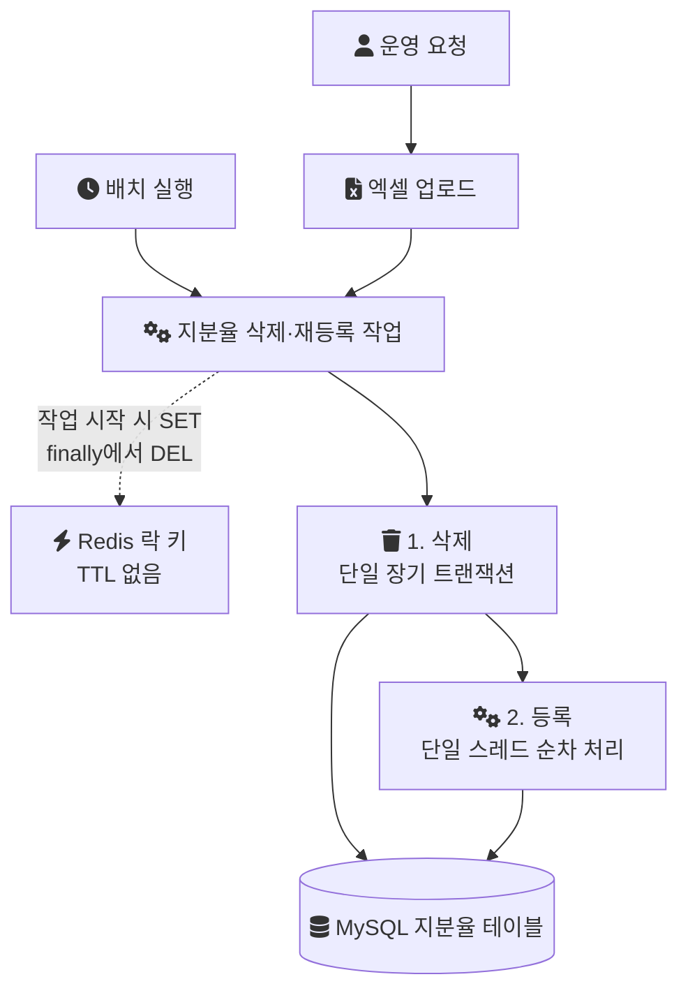
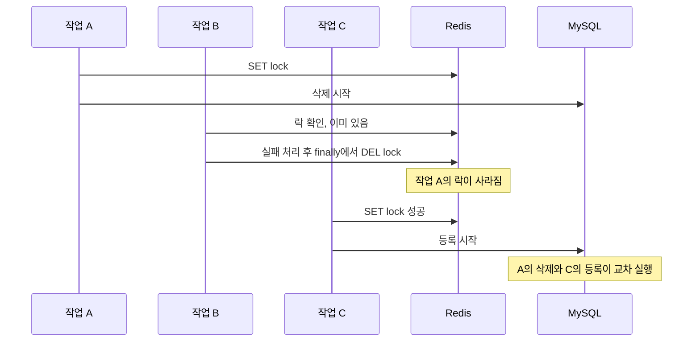

> 이 시리즈는 음원 플랫폼 회사의 지분율 시스템에서 대량 삭제·재등록 작업을 개선한 과정을 기록한다.
> 성능 수치보다 먼저, 이 작업이 평소에는 돌아가다가 예외 상황에서 무엇을 보장하지 못했는지를 다룬다.
> 결과만 짧게 정리한 글은 [대용량 지분율 데이터 처리 성능 개선과 동시성 제어 전략](/posts/bulk-insert-performacne/)이다.

## 어떤 시스템이었나

저작권·실연권 지분율은 곡마다 권리자가 수익을 얼마씩 나눠 갖는지를 정한 비율이다. 이 데이터는 유통사별 월 단위 정산의 기준이 된다. 정산 배치는 지분율을 읽어 수익을 배분하므로, 지분율이 틀리거나 비어 있으면 정산도 그대로 틀린다.

지분율은 한 번 넣고 끝나는 데이터가 아니었다. 정책이 바뀌거나 오류를 정정해야 하면 특정 월의 데이터를 대량으로 삭제한 뒤 다시 등록했다. 그래서 이 삭제·재등록 작업이 늦어지거나 실패하면 정산 일정 전체가 밀렸다.

이 시리즈가 다루는 개선은 2022년 8월부터 11월까지 기존 시스템을 대상으로 혼자 설계하고 구현한 작업이다. 판단의 전제가 된 조건은 다음과 같다.

| 항목 | 내용 |
| --- | --- |
| 스택 | Java, Spring Boot, MySQL, Redis, AWS |
| 데이터 분포 | 협회와 일부 대형 유통사가 전체 지분율 데이터의 80% 이상 |
| 실행 환경 | 배치와 운영 요청이 동시에 들어옴 |
| 삭제 소요 시간 | 2시간 이상 |
| 등록 소요 시간 | 대량 업로드 시 40분 이상 |
| 팀 | 단독 수행 |

## 기능은 단순했다

작업 자체는 두 단계였다. 대상 월의 기존 지분율을 삭제하고, 엑셀로 올라온 새 지분율을 등록한다. 두 단계가 순서대로 실행되면 끝이다.

당시 구조를 그림으로 옮기면 다음과 같다. 삭제와 등록을 잇는 장치는 Redis 키 하나였다.

평소에는 이 구조로 충분했다. 문제는 평소가 아닐 때였다.

## 예외 상황에서 답하지 못한 질문들

이 구조를 놓고 다음 질문을 던지면 시스템은 대답하지 못했다.

- 작업 중인 프로세스가 비정상 종료되면 락은 언제 풀리는가?
- 다른 프로세스가 락을 지우면 어떻게 되는가?
- 삭제는 끝났는데 등록이 실패하면, 지금 데이터는 어떤 상태인가?
- 삭제 트랜잭션이 2시간 넘게 열려 있는 동안 같은 테이블을 쓰는 다른 작업은 어떻게 되는가?

각 질문의 답은 구조 안에 이미 들어 있었다. 아래에서 하나씩 본다.

## TTL 없는 락은 풀릴 방법이 없었다

기존 Redis 락은 `SET`으로 키를 만들고, TTL(키에 걸린 만료 시간) 없이, 작업이 끝나면 `finally` 블록에서 `DEL`을 호출했다.

`finally`는 JVM 안에서 예외가 났을 때는 실행되지만, 프로세스 자체가 죽거나 Redis로 가는 네트워크가 끊기면 `DEL`은 Redis에 도착하지 않는다. TTL이 없으니 Redis가 스스로 키를 지울 일도 없다. 그러면 락은 사람이 지울 때까지 남고, 그동안 같은 작업은 계속 막힌다.

## 소유권 없는 DEL은 남의 락을 지운다

더 근본적인 문제는 해제 쪽에 있었다. `DEL`은 그 키를 누가 만들었는지 확인하지 않는다. 락을 갖지 않은 프로세스도 `finally`에 도달하면 키를 지울 수 있었다.

예를 들어 락 획득에 실패한 쪽도 같은 `finally`를 지나도록 짜여 있으면, 그 프로세스가 지금 작업 중인 다른 프로세스의 락을 지운다. 아래 시퀀스는 이렇게 일어날 수 있는 순서 하나를 그린 것이다. 운영 로그를 옮긴 것이 아니라 구조상 가능한 순서다.

이렇게 되면 삭제와 등록이 같은 월 데이터를 동시에 건드리는 [Race Condition](/posts/how-to-control-race-condition/)(실행 순서에 따라 결과가 달라지는 상황)이 생길 수 있다. Redis에는 락이 없다고 남아 있는데 DB에서는 삭제가 진행 중인, Redis와 DB의 상태가 어긋난 순간도 생긴다.

Redis 문서도 이 패턴의 약점을 짚는다. [`SET` 명령 문서](https://redis.io/docs/latest/commands/set/)는 `SET ... NX`와 `DEL`로 만든 락에서, 만료 뒤에 보낸 `DEL`이 다른 클라이언트가 새로 잡은 락을 지울 수 있다고 설명하고, 값이 일치할 때만 지우는 방식으로 해제하라고 권한다. TTL을 붙이는 것만으로는 이 문제가 풀리지 않는다는 뜻이다.

## 작업이 어디까지 끝났는지 기록하는 곳이 없었다

락 문제를 고쳐도 남는 질문이 있다. 삭제는 끝났는데 등록이 실패하면 그 월의 지분율은 비어 있거나 일부만 들어간 상태가 된다. 그런데 당시에는 삭제와 등록의 진행 단계를 구분하는 상태 모델이 없었다. Redis 키는 "누군가 작업 중"이라는 사실만 담을 뿐, 어느 단계까지 끝났는지는 담지 않았고, 휘발성이라 장애가 나면 그 정보마저 사라진다.

그래서 "락이 걸려 있었나?"라는 질문에서 "이 작업은 지금 어느 단계에 있는가?"라는 질문으로 관점을 옮겨야 했다. 이 질문에 답하려면 Redis가 아니라 영속적인 저장소에 단계를 남겨야 한다.

## 단일 트랜잭션은 느린 것만이 문제가 아니었다

삭제는 하나의 긴 [트랜잭션](/posts/transaction/)으로 실행됐고 2시간 이상 걸렸다.

트랜잭션이 길면 처리 시간 외에도 비용이 따라온다. InnoDB는 `DELETE`가 스캔한 인덱스 레코드마다 락을 건다([Locks Set by Different SQL Statements](https://dev.mysql.com/doc/refman/8.0/en/innodb-locks-set.html)). 그 락은 트랜잭션이 끝날 때까지 유지되므로, 같은 범위를 쓰려는 다른 작업은 그동안 기다린다. 또 끝 무렵에 실패하면 그때까지 지운 행을 [Undo 로그](/posts/redo-undo-log/)로 되돌려야 한다. 실패했을 때 치르는 비용이 작업 크기에 비례해 커지는 구조였다.

데이터 분포가 이 비용을 키웠다. 협회와 일부 대형 유통사가 전체의 80% 이상을 차지하고 있어서, 이들의 데이터를 지울 때마다 스캔 범위와 트랜잭션 시간이 이 소수 유통사에 좌우됐다. 이 부분은 다음 편들에서 실행계획과 함께 다룬다.

## 정리하면

이 작업을 한 문장으로 요약하면 "평소엔 잘 되지만, 예외 상황에선 아무것도 보장하지 않는다"였다.

- 락은 있었지만 비정상 종료 시 풀리지 않았고, 소유자가 아닌 쪽도 지울 수 있었다.
- 작업 단계는 어디에도 기록되지 않았다.
- 삭제는 2시간 이상 하나의 트랜잭션으로 락을 쥐고 있었다.

이 시리즈의 이후 편은 이 세 가지를 차례로 다룬다. 먼저 삭제 배치가 왜 그렇게 오래 걸렸는지 실행계획과 데이터 분포로 원인을 찾고, 전체 삭제 후 전체 등록 구조의 위험을 정리한 뒤, 청크 분할과 병렬 처리, 분산 락 재설계와 상태 전이 모델로 넘어간다.

## 참고

- [SET](https://redis.io/docs/latest/commands/set/) — Redis 문서, Patterns 절의 `SET ... NX` 락과 해제 방식
- [InnoDB: Locks Set by Different SQL Statements](https://dev.mysql.com/doc/refman/8.0/en/innodb-locks-set.html) — MySQL 8.0 Reference Manual
- [대용량 지분율 데이터 처리 성능 개선과 동시성 제어 전략](/posts/bulk-insert-performacne/)
- 랩 코드: [LegacyRedisLock.java](https://github.com/polynomeer/engineering-lab/blob/d52297d0ad07c3d8a05a7471192a5655cb8b1378/career-lab/equity-system/src/main/java/com/portfolio/equitylab/lock/LegacyRedisLock.java), [RedisLockRaceConditionTest.java](https://github.com/polynomeer/engineering-lab/blob/d52297d0ad07c3d8a05a7471192a5655cb8b1378/career-lab/equity-system/src/test/java/com/portfolio/equitylab/lock/RedisLockRaceConditionTest.java)
