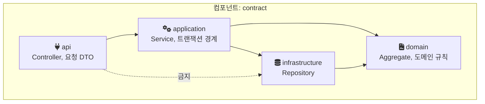
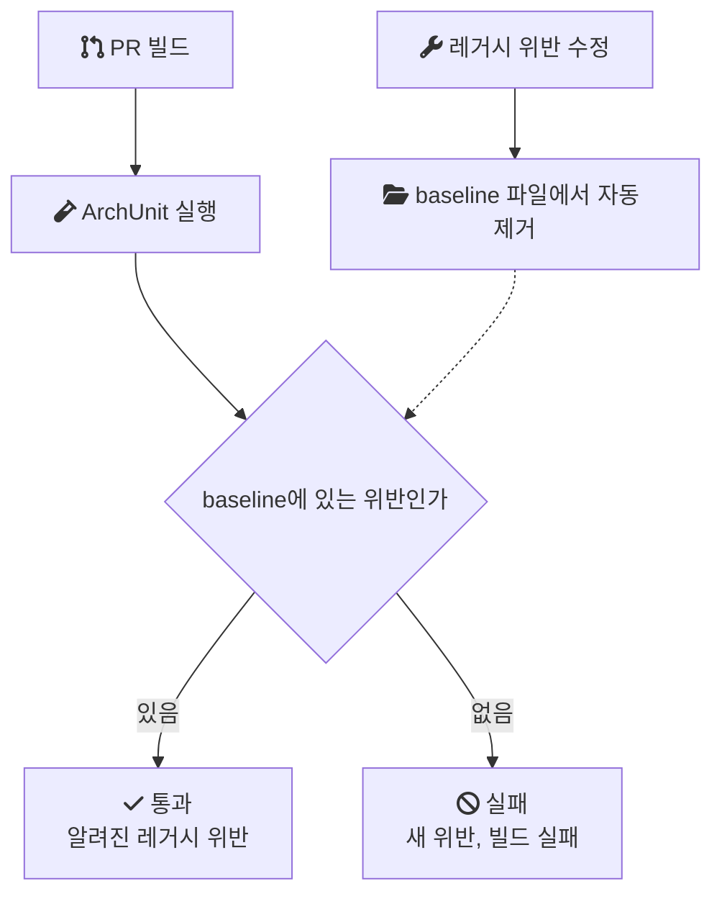
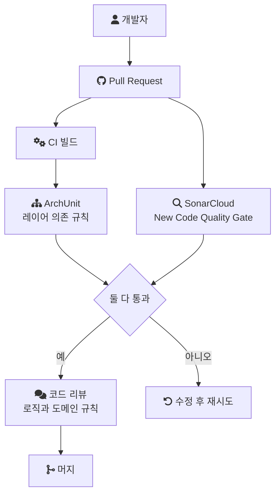

음원 콘텐츠 플랫폼(MCP)을 화면 중심 API에서 도메인 중심 구조로 재설계하는 동안, 백엔드 세 명이 같은 코드베이스에서 동시에 작업했다. 이 글은 합의한 구조가 작업이 진행되며 어떻게 흐트러졌는지, 그 구조 규칙을 테스트와 PR 검증으로 옮긴 방법, 그리고 이미 위반이 쌓인 코드베이스에 규칙을 도입하면서 신규 코드와 레거시를 어떻게 나눠 다뤘는지 정리한 기록이다.

> 이 글의 코드는 회사의 실제 소스가 아니다. 같은 구조를 처음부터 다시 만든 개인 랩의 코드이거나, 일반적인 기법을 설명하기 위한 예시이며, 각각 그렇다고 표시했다. 패키지 이름은 설명용이다.

## 배경과 조건

MCP는 계약, 앨범, 곡 메타데이터와 유통사·계약별 라이선스 권리를 관리하는 사내 플랫폼이다. 전면 개편은 2024년 1월부터 11월까지 진행했고, 백엔드는 3명이었다. 나는 백엔드 리딩을 맡아 공통 기능, 아키텍처 규칙, 앨범·트랙·계약·지분율 관리 API를 직접 구현했고, 나머지 API는 다른 두 명이 나눠 맡았다. 배치 처리나 권리 이관처럼 규모가 큰 기능은 팀원에게 독립적으로 맡겼다. 스택은 Java, Spring Boot, JPA, MapStruct, MySQL이다.

재설계는 여러 갈래로 동시에 진행됐다. [API를 도메인 책임 단위로 다시 나누고](/posts/mcp-domain-api-redesign/), [입력을 DTO와 3단계 검증으로 바꾸고](/posts/mcp-dto-validation-pipeline/), [조회를 QueryDSL로 분리했다](/posts/shadow-release-query-migration/). 이 글의 규칙은 그 구조들이 개발자 세 명의 동시 작업 속에서도 유지되게 하는 장치였다.

이 방식에는 직전 경험이 있었다. 이전 프로젝트(MDS)에서는 시니어 개발자가 ArchUnit으로 설계한 계약 강제 구조를 따라 개발했다. MCP에서는 그 구조를 직접 설계하고 적용하는 역할을 맡았다.

## 문제: 구조가 동시 작업 속에서 흐트러졌다

재설계의 방향은 팀에 공유되어 있었다. 도메인 책임 단위로 API를 묶고, Controller에서 Service, Domain, Repository로 의존 방향을 지키고, 입력은 DTO로 받아 매핑한다. 그런데 재설계가 진행되며 여러 개발자가 동시에 작업하자 네 가지 문제가 쌓였다.

- 레이어 간 의존성이 얽혔다. 아래 계층이 위 계층을 참조하거나, 패키지끼리 서로를 참조하는 순환 의존이 생겼다.
- 서비스 계층을 우회하는 호출이 생겼다. Controller가 Service를 거치지 않고 저장소를 직접 호출하면, 서비스에 모아둔 트랜잭션 경계와 도메인 규칙이 적용되지 않는다.
- 도메인 규칙이 다시 분산됐다. 도메인 객체에 모으기로 한 규칙이 서비스나 컨트롤러에 들어갔다.
- DTO 매핑 방식이 통일되지 않았다. 같은 종류의 변환을 API마다 다른 방식으로 구현했다.

하나하나는 작은 위반이지만, 이 규칙들은 앞선 재설계가 의미를 갖기 위한 전제였다. 서비스 우회 호출이 하나 생기면 트랜잭션 경계를 서비스 메서드 하나로 정한 설계가 그 경로에서 깨지고, 도메인 규칙이 흩어지면 검증을 단계로 나눈 설계가 무너진다.

구조 규칙이 문서와 리뷰에만 있으면, 지켜지는지는 리뷰어가 매번 찾아내는 데 달려 있다. MDS에서 규칙이 테스트로 강제되는 코드베이스를 경험했기 때문에, 규칙을 코드로 옮기면 그 확인을 빌드가 맡는다는 차이를 알고 있었다.

## 결정: 구조, 매핑, 의존 규칙, PR 검증

결정은 네 가지였다.

1. 기능 중심 패키지 구조를 도메인 책임 중심의 Package-by-Component 구조로 바꾼다.
2. MapStruct 기반 DTO 매핑 규칙을 표준화한다.
3. 레이어 의존성 규칙을 ArchUnit 테스트 코드로 명문화한다.
4. SonarCloud로 PR마다 자동 검증한다.

적용 원칙은 하나였다. 신규로 추가되는 코드는 규칙을 100% 강제하고, 기존에 이미 존재하던 위반은 점진적으로 리팩터링하며 정리한다.

## Package-by-Component: 패키지가 책임을 말하게 한다

Package-by-Component는 기술 계층(controller, service, repository)을 최상위로 두지 않고, 도메인 책임 단위(계약, 앨범, 트랙)를 최상위 패키지로 두는 방식이다. 각 컴포넌트 안에 api, application, domain, infrastructure 같은 계층을 둔다.



이 구조에서는 새 기능을 추가할 때 "어느 컴포넌트의 책임인가"를 먼저 정하면 패키지가 정해지고, 그 패키지 안에서 무엇이 무엇에 의존할 수 있는지는 규칙이 정한다. 개인 랩도 같은 구조로 `contract` 컴포넌트 아래에 `api`, `application`, `domain`, `infrastructure`를 두었다.

## 규칙을 테스트로 옮기기

[ArchUnit](https://www.archunit.org/userguide/html/000_Index.html)은 컴파일된 클래스의 의존 관계를 분석해, 구조 규칙을 JUnit 테스트로 표현하게 해주는 라이브러리다. 규칙이 깨지면 테스트가 실패하고, 테스트가 실패하면 CI(커밋마다 빌드와 테스트를 자동으로 돌리는 파이프라인)가 빌드를 막는다.

아래는 개인 랩에서 다시 만든 규칙이다. 문제 목록의 서비스 우회 호출, 도메인의 프레임워크 의존, 레이어 의존 방향에 하나씩 대응한다.

```java
// 랩 코드: archrule/LayerArchitectureRules.java
public static final ArchRule CONTROLLERS_MUST_NOT_ACCESS_INFRASTRUCTURE =
        noClasses().that().resideInAPackage("..api..")
                .should().dependOnClassesThat().resideInAPackage("..infrastructure..");

public static final ArchRule DOMAIN_MUST_NOT_DEPEND_ON_SPRING_WEB =
        noClasses().that().resideInAPackage("..domain..")
                .should().dependOnClassesThat().resideInAnyPackage("org.springframework.web..");

public static final ArchRule LAYER_DEPENDENCY = Architectures.layeredArchitecture()
        .consideringAllDependencies()
        .layer("Api").definedBy(resideInAPackage("..api.."))
        .layer("Application").definedBy(resideInAPackage("..application.."))
        .layer("Domain").definedBy(resideInAPackage("..domain.."))
        .layer("Infrastructure").definedBy(resideInAPackage("..infrastructure.."))
        .whereLayer("Api").mayNotBeAccessedByAnyLayer()
        .whereLayer("Domain").mayOnlyBeAccessedByLayers("Application", "Infrastructure");
```

- 첫 번째 규칙은 api 패키지의 클래스가 infrastructure 패키지의 클래스에 의존하지 못하게 한다. Controller가 저장소를 직접 부르는 서비스 우회 호출이 여기서 걸린다.
- 두 번째 규칙은 도메인 객체가 Spring Web에 의존하지 못하게 한다. 도메인 규칙이 웹 계층의 타입에 묶이지 않게 한다.
- 세 번째 규칙은 계층 사이의 접근 방향을 한 번에 선언한다. `..api..`처럼 점 두 개로 감싼 패턴은 경로 어딘가에 그 세그먼트가 있는 모든 패키지를 뜻하므로, 컴포넌트가 늘어나도 규칙을 고칠 필요가 없다.

순환 의존은 ArchUnit의 slice 규칙으로 표현할 수 있다. 사용자 가이드는 `slices().matching("..myapp.(*)..").should().beFreeOfCycles()` 형태로 패키지 묶음 사이의 순환을 검사하는 예를 든다. 랩은 아직 이 규칙을 포함하지 않는다.

매핑 방식 통일은 의존 규칙과 성격이 다르다. 프로젝트에서는 MapStruct를 표준 매핑 방식으로 정했고, 매퍼 인터페이스에 MapStruct 어노테이션이 붙어 있는지 같은 조건도 ArchUnit의 클래스 규칙으로 표현할 수 있다. 당시 매핑 표준을 정확히 어떤 규칙으로 검사했는지는 기록에 없다.

## 랩에서 확인한 것: 같은 규칙, 다른 결과

규칙이 실제로 위반을 잡는지는 위반하는 코드에 대고 돌려봐야 알 수 있다. 랩은 같은 `ArchRule` 인스턴스를 두 대상에 적용한다. 하나는 규칙을 지키는 실제 코드(`contract` 패키지), 다른 하나는 일부러 규칙을 어기도록 만든 테스트 전용 패키지(`badexample`)다.

```java
// 랩 코드: badexample/api/BadContractController.java
public class BadContractController {
    // 위반 지점: api 계층 클래스가 infrastructure 계층 클래스에 직접 의존.
    private final BadContractRepository repository = new BadContractRepository();
}
```

```java
// 랩 코드: archrule/ArchitectureViolationDemoTest.java
AssertionError error = assertThrows(AssertionError.class,
        () -> LayerArchitectureRules.CONTROLLERS_MUST_NOT_ACCESS_INFRASTRUCTURE.check(BAD_EXAMPLE_CLASSES));

assertThat(error.getMessage())
        .contains("BadContractController")
        .contains("BadContractRepository");
```

위반 메시지에 위반한 클래스와 의존 대상이 함께 나온다. 리뷰어가 "이건 서비스를 거쳐야 한다"고 지적하던 내용을 빌드 로그가 대신 말한다.

랩 실행 조건과 결과는 이렇다. archunit-junit5 1.3.0, JDK 21에서 DB 없이 실행했고, 실제 코드 대상 3개 규칙은 모두 통과, `badexample` 대상 3개 규칙은 모두 `AssertionError`로 위반을 보고했다. 2026년 9월 29일 로컬에서 2회 연속 같은 결과였다. 각 테스트 클래스는 0.1초 안팎에 끝났다. 클래스 수가 적은 랩 규모의 수치라 실제 코드베이스의 검사 시간을 대신하지는 않는다.

랩을 만들며 확인한 API 사용상의 함정도 두 가지 있다.

- `layeredArchitecture()`에서 `mayOnlyBeAccessedByLayers()`를 인자 없이 호출하면 `IllegalArgumentException`이 난다. "어떤 계층도 접근할 수 없다"는 `mayNotBeAccessedByAnyLayer()`로 표현해야 한다.
- 규칙 위반 시 `check()`가 던지는 예외는 일반 `AssertionError`다. 전용 예외 타입을 기대하고 테스트를 쓰면 컴파일되지 않는다.

## 이미 위반이 쌓인 코드베이스에 규칙을 넣는 법

규칙을 도입하는 시점에는 이미 위반이 쌓여 있었다. 정적 분석 위반은 480건이었다. 이 상태에서 규칙을 그대로 CI에 올리면 첫 실행부터 실패하고, 신규 코드가 규칙을 지켜도 모든 PR이 실패로 표시된다. 그래서 원칙을 "신규 코드는 100% 강제, 기존 위반은 점진 정리"로 정했다.

이 원칙을 구현하는 일반적인 기법이 baseline(현재 위반을 목록으로 기록해 두고 그 밖의 새 위반만 실패로 처리하는 방식)이다. 당시 이 원칙을 정확히 어떤 방식으로 구현했는지는 세부가 기억나지 않는다. 아래는 ArchUnit이 제공하는 baseline 기능으로 같은 원칙을 구현하는 방법이다.

ArchUnit에는 이 용도의 `FreezingArchRule`이 있다. 사용자 가이드에 따르면 규칙을 감싸면 처음 실행 때 위반을 저장소에 기록하고, 이후 실행에서는 새 위반만 보고한다. 기본 저장소는 일반 텍스트 파일이고, 저장소를 새로 만들려면 `freeze.store.default.allowStoreCreation`을 `true`로 켜야 한다(기본값 `false`).

```java
// 기법 설명용 예시: 기존 규칙을 baseline으로 감싸기
@ArchTest
static final ArchRule layers_frozen =
    FreezingArchRule.freeze(LayerArchitectureRules.LAYER_DEPENDENCY);
```

```properties
# archunit.properties (기법 설명용 예시)
freeze.store.default.path=src/test/resources/archunit-baseline
freeze.store.default.allowStoreCreation=true
freeze.refreeze=false
```

이 기능의 위반 목록은 줄어들기만 한다. 가이드는 "If violations are fixed, FreezingArchRule will automatically reduce the known stored violations to prevent any regression."라고 설명한다(위반을 고치면 저장된 위반 목록을 자동으로 줄여 회귀를 막는다). 목록을 다시 늘리려면 `freeze.refreeze=true`를 명시적으로 켜야 한다.



이 방식에서는 baseline 파일의 항목 수가 곧 남은 레거시 위반 수가 된다. 숫자가 줄어드는 것을 PR마다 확인할 수 있다.

## SonarCloud를 PR 게이트로

ArchUnit은 의존 관계를 본다. 코드 스멜, 중복, 복잡도 같은 항목은 보지 않는다. 그쪽은 SonarCloud로 PR마다 자동 검증했다. PR이 올라오면 분석이 돌고, Quality Gate(머지 전에 통과해야 하는 품질 조건 묶음) 결과가 PR에 표시된다.

SonarCloud도 신규 코드와 기존 코드를 나눠 다루는 개념을 기본으로 갖고 있다. [문서](https://docs.sonarsource.com/sonarqube-cloud/standards/about-new-code/)는 New Code를 최근에 추가되거나 수정된 코드로 정의하고, 기본 Quality Gate인 Sonar way의 조건은 New Code에만 적용된다고 설명한다. 기존 코드의 이슈는 전체 대시보드에 보이지만, 기본 설정에서는 PR을 막는 조건이 되지 않는다. "신규는 강제, 레거시는 점진 정리"라는 원칙과 같은 구조다.



두 도구를 합친 검증 범위는 다음과 같다.

| 검사 대상 | 도구 | 신규 코드 | 기존 코드 |
| --- | --- | --- | --- |
| 레이어 의존 방향, 서비스 우회 호출 | ArchUnit | 빌드 실패 | 점진 정리 |
| 패키지 순환 의존 | ArchUnit | 빌드 실패 | 점진 정리 |
| 코드 스멜, 중복, 복잡도 | SonarCloud | Quality Gate 실패 | 대시보드에서 추적 |

## 레거시 위반을 줄인 과정

480건을 75건까지 줄이는 동안의 큰 흐름은 앞서 적은 원칙 그대로다. 신규 코드는 규칙을 어길 수 없게 하고, 기존 위반은 리팩터링하며 점진적으로 정리했다. 다만 어떤 기준으로 정리 순서를 정했는지(심각도별 분류를 했는지, 모듈별로 우선순위를 두었는지)는 기억나지 않는다. 그래서 여기서는 순서를 재구성하지 않는다.

같은 상황에 일반적으로 쓸 수 있는 기법은 있다. baseline을 규칙별로 나눠 두면 규칙마다 남은 위반 수를 따로 볼 수 있고, 구조적 위험이 큰 규칙부터 비우는 순서를 정할 수 있다. 순환 의존은 한쪽을 바꿀 때 다른 쪽이 함께 깨지고 모듈을 떼어낼 수 없게 만들기 때문에, 이런 순서를 정한다면 앞쪽에 둘 만한 항목이다. 이것은 기법의 설명이지 당시 그렇게 했다는 기록이 아니다.

## 결과

정적 분석 위반이 480건에서 75건으로 84% 줄었다. 레이어 침범과 순환 의존이 줄었고, 신규 기능을 추가할 때도 구조가 일관되게 유지됐다.

코드 리뷰의 효율도 올라갔다. 서비스 우회나 레이어 침범 같은 구조 위반은 리뷰 전에 빌드가 걸러내므로, 리뷰는 로직과 도메인 규칙에 집중할 수 있었다.

## 비용과 남은 것

- 75건은 남았다. 이 위반들을 어떤 이유로 남겼는지, 이후 어떻게 다뤘는지는 기록에 없다.
- 규칙은 규칙이 표현한 것만 막는다. 규칙에 걸리지 않는 패키지로 클래스를 옮겨 규칙을 피하는 코드가 나올 수 있고, 이런 경우는 여전히 리뷰가 잡아야 한다. 규칙이 생겨도 리뷰가 없어지는 것이 아니라 리뷰가 볼 대상이 바뀐다.
- 규칙을 처음 설계하는 비용이 있다. 패키지 구조를 Package-by-Component로 정하고 계층 이름을 통일한 뒤에야 `..api..` 같은 패턴 하나로 모든 컴포넌트에 같은 규칙을 적용할 수 있다.
- 개인 랩은 레이어 규칙 3개만 재현한다. `FreezingArchRule` baseline과 SonarCloud 연동, 순환 의존 규칙은 아직 랩에 없다.

MDS에서는 시니어가 만든 규칙 안에서 개발했고, MCP에서는 그 규칙을 직접 설계했다. MCP는 규칙을 처음부터 갖고 시작한 코드베이스가 아니라 위반 480건이 쌓인 상태에서 규칙을 들여온 경우였고, 그래서 신규 코드와 레거시를 나눠 다루는 원칙이 규칙 목록과 함께 정해져야 했다.

## 참고

- [ArchUnit User Guide](https://www.archunit.org/userguide/html/000_Index.html) — layered architecture, slice 순환 검사, Freezing Arch Rules의 저장소 설정과 위반 감소 동작
- [SonarQube Cloud: About new code](https://docs.sonarsource.com/sonarqube-cloud/standards/about-new-code/) — New Code 정의와 Sonar way Quality Gate의 적용 범위
- [랩 코드: LayerArchitectureRules.java](https://github.com/polynomeer/engineering-lab/blob/d52297d0ad07c3d8a05a7471192a5655cb8b1378/career-lab/mcp-platform/src/test/java/com/portfolio/mcplab/archrule/LayerArchitectureRules.java)
- [랩 코드: MainCodeArchitectureTest.java](https://github.com/polynomeer/engineering-lab/blob/d52297d0ad07c3d8a05a7471192a5655cb8b1378/career-lab/mcp-platform/src/test/java/com/portfolio/mcplab/archrule/MainCodeArchitectureTest.java)
- [랩 코드: ArchitectureViolationDemoTest.java](https://github.com/polynomeer/engineering-lab/blob/d52297d0ad07c3d8a05a7471192a5655cb8b1378/career-lab/mcp-platform/src/test/java/com/portfolio/mcplab/archrule/ArchitectureViolationDemoTest.java)
- [랩 코드: BadContractController.java](https://github.com/polynomeer/engineering-lab/blob/d52297d0ad07c3d8a05a7471192a5655cb8b1378/career-lab/mcp-platform/src/test/java/com/portfolio/mcplab/badexample/api/BadContractController.java)
