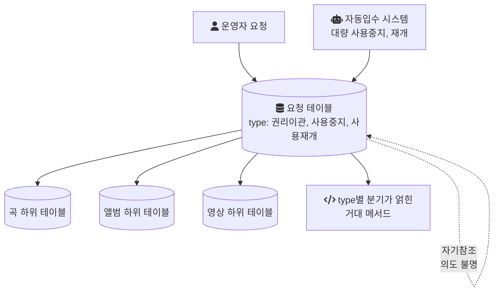
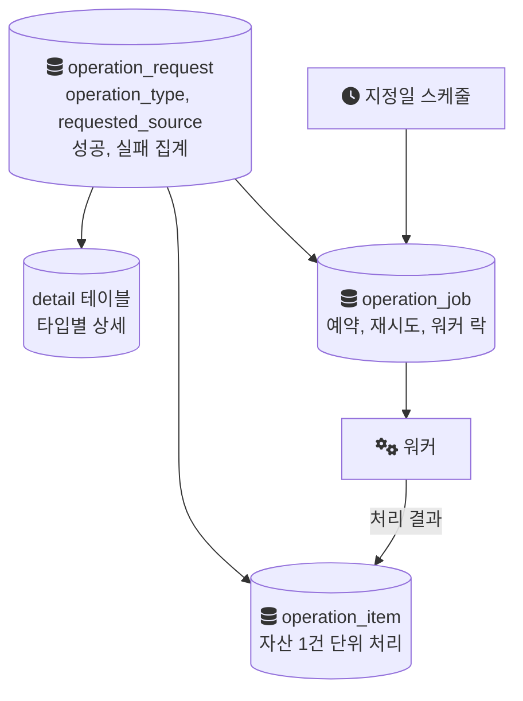
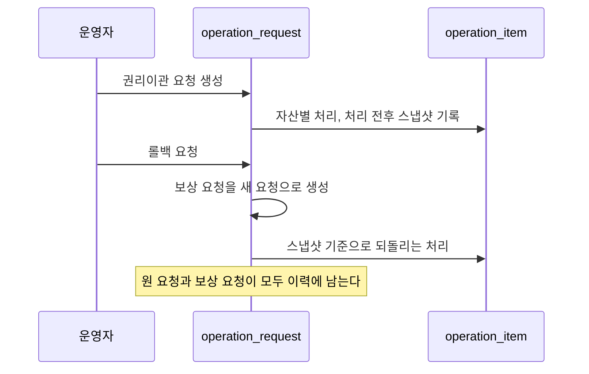
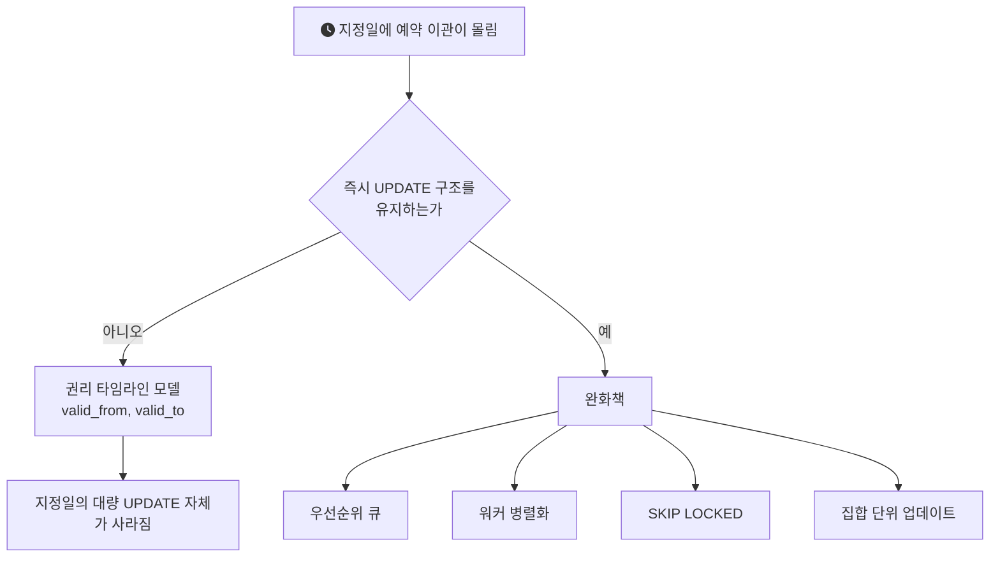

이 글은 실행되지 않은 설계 제안의 기록이다. 음원 콘텐츠 플랫폼(MCP) 전면 개편에서 나는 백엔드를 리딩했고, 그 과정에서 레거시 권리이관 시스템의 구조적 문제를 정리해 재설계 방향을 팀에 제안했다. 제안은 DB 테이블 구조 자체를 바꿔야 하는 규모였고, 팀 논의 단계에서 멈췄다. 개편 당시 권리이관 기능은 다른 팀원이 기존 구조를 유지한 채 포팅 수준으로 옮겼다.

그래서 이 글에는 결과 수치가 없다. 아래에 나오는 테이블 이름과 선택지는 모두 검토만 하고 만들지 않은 것이다. 남길 가치가 있다고 본 것은 두 가지다. 레거시의 문제를 표면 증상이 아니라 모델의 축 단위로 진단한 과정, 그리고 설계가 나와도 지금 실행할지는 따로 판단해야 한다는 점이다.

## 권리이관이 하는 일

MCP는 곡, 앨범, 영상 단위로 유통사와 계약별 라이선스 권리를 관리했다. 권리이관은 특정 콘텐츠의 권리를 다른 유통사의 다른 계약으로 옮기는 기능이다. 단건으로도, 일괄로도 요청할 수 있었다. 적용일이 과거나 현재면 즉시 처리하고, 미래면 지정일에 자동으로 실행돼야 했다.

같은 시스템 안에는 곡, 앨범, 영상의 서비스 상태를 일괄로 사용중지하거나 사용재개하는 기능도 있었다. 이 기능은 운영자 요청으로도 생기고, 자동입수 시스템이 대량으로 발생시키기도 했다.

## 레거시 구조

아래 그림은 기존 요청 모델을 단순화한 것이다. 세 종류의 요청이 한 테이블에 들어가고, 그 아래 자산 종류별로 하위 테이블이 따로 있었다.

## 운영에서 드러난 문제

문제는 운영에서 하나씩 드러났다. 정리하면 일곱 가지였다.

1. type 분기. 권리이관, 사용중지, 사용재개가 한 요청 테이블에 type으로만 구분되어 저장됐고, 코드 곳곳에 type별 분기가 얽힌 거대한 메서드가 있었다.
2. 출처 혼재. 자동입수 시스템이 만드는 대량의 사용중지, 재개 요청이 사용자 요청과 같은 테이블에 섞여, 사용자 요청만 따로 보기가 어려웠다.
3. 의도를 알 수 없는 설계. 요청 1건 아래에 곡, 앨범, 영상별 하위 테이블이 따로 있었고, 요청 테이블을 자기참조해 배타적 관계를 표현하려던 것으로 보이는 설계가 있었다. 원래 의도는 팀 안에서도 명확히 파악하지 못했다.
4. 느린 목록 화면. 요청 단위로 목록을 보여 주기 위해 하위 item 테이블과 JOIN한 뒤 GROUP BY를 했고, 화면 조회가 크게 느렸다.
5. 수동 복구. 요청을 재처리하거나 롤백해야 하면 개발자가 로직과 DB UPDATE 문을 직접 역추적해 DBA에게 수동 복구를 요청해야 했다.
6. 자리가 없는 예외 업무. 유통사는 그대로 두고 같은 유통사 안에서 계약만 바꾸는 업무가 있었는데, 기존 권리이관 상태 전이도에는 이 경우를 넣을 자리가 마땅치 않았다.
7. 지정일 적체. 특정 날짜에 예약 권리이관이 몰리면 새벽 내내 처리하지 못하고 다음 날로 밀려, 지정한 적용일(effective date)을 지키지 못하는 경우가 있었다.

증상은 일곱 개지만, 원인은 그보다 적다고 봤다. 1과 2는 서로 다른 질문을 한 컬럼에 담은 결과다. "무슨 작업인가"와 "누가 만들었는가"가 같은 축에 있으니 분기와 혼재가 함께 생긴다. 4는 요청 단위로 보여 줄 정보를 요청 단위로 갖고 있지 않아서 생긴다. 5와 7은 요청을 실행하는 단위가 모델에 없어서, 예약, 재시도, 이력이 들어갈 자리가 없었던 것이다.

## 제안한 모델: request, item, job

이 진단을 바탕으로 요청 테이블을 3계층으로 나누는 모델을 검토했다.

- `operation_request`: 공통 요청 헤더. 누가 언제 어떤 작업을 요청했는지를 담는다.
- `operation_item`: 개별 자산 단위의 처리. 곡, 앨범, 영상 한 건이 한 행이다.
- `operation_job`: 실행 단위. 예약, 재시도, 워커 락을 담당한다.

타입별로만 필요한 상세는 별도 detail 테이블로 두었다. 아래 그림이 제안 모델이다.

### 작업 종류와 요청 출처를 다른 축으로

핵심 원칙은 `operation_type`(무슨 작업인가)과 `requested_source`(누가, 어디서 만들었는가)를 서로 다른 컬럼으로 두는 것이었다. 이렇게 나누면 "사용자가 만든 사용중지 요청"과 "자동입수가 만든 사용중지 요청"을 같은 작업으로 처리하면서도 따로 조회할 수 있다. 문제 2가 이 분리로 풀린다.

### 목록은 헤더만 읽는다

목록 화면은 item과 JOIN해서 GROUP BY로 다시 묶지 않고, request 헤더만 읽게 했다. 화면에 필요한 성공, 실패 건수는 처리하면서 헤더에 미리 집계해 둔다. 조회 시점에 계산하던 것을 쓰기 시점으로 옮기는 방식이다. 그 대가로 item 처리 결과와 헤더 집계가 어긋나지 않게 유지하는 책임이 생긴다.

### 롤백은 새 요청으로

재처리와 롤백은 수동 UPDATE 대신 두 가지로 다루는 방향을 검토했다. 처리 전후 상태를 스냅샷으로 남기고, 롤백 자체를 새로운 보상 요청(compensation request)으로 만들어 이력에 남기는 것이다.

이 발상은 보상 트랜잭션 패턴과 같은 방향이다. Microsoft의 아키텍처 문서는 이 패턴을 실패한 작업의 완료된 단계를 되돌리는 방식으로 설명하면서, 원래 상태로 단순 복원하면 그사이 다른 작업이 만든 변경을 덮어쓸 수 있다고 지적한다. 권리 데이터도 이관 이후 다른 요청이 같은 콘텐츠를 건드릴 수 있으므로, 이전 값을 그대로 덮는 UPDATE보다 되돌리는 작업을 하나의 요청으로 기록하는 편이 추적하기 쉽다.

아래 그림은 검토한 롤백 흐름이다.

### 계약만 바꾸는 업무는 별도 작업으로

같은 유통사 안에서 계약만 바꾸는 업무는 권리이관과 별개의 작업 종류(`RIGHT_CONTRACT_CHANGE`)로 분리하는 방향이었다. 대신 요청을 처리하는 상태 머신은 새로 만들지 않고 공통으로 재사용한다. 작업 종류가 늘어도 요청이 어떤 단계를 거치는지는 같게 유지하자는 것이다.

## 지정일 적체에 대한 두 갈래

7번 문제는 요청 모델을 바꾸는 것만으로는 풀리지 않았다. 지정일에 대량 UPDATE를 실행하는 구조가 남아 있으면 적체도 남는다. 그래서 두 갈래로 검토했다.

근본적인 방향은 권리 타임라인 모델이었다. 권리 행에 유효 기간(`valid_from`, `valid_to`)을 두면, 미래 적용일의 이관은 그 날짜부터 유효한 행을 미리 넣어 두는 것으로 표현된다. 조회는 "지금 유효한 행"을 고르면 된다. 지정일에 할 일 자체가 없어지므로 적체도 생기지 않는다. 그 대신 권리를 읽는 모든 조회가 유효 기간 조건을 알아야 한다.

기존 즉시 UPDATE 구조를 유지할 경우의 완화책도 같이 검토했다. 우선순위 큐, 워커 병렬화, 집합 단위 업데이트, 그리고 `SKIP LOCKED`다. MySQL 문서는 `SKIP LOCKED`를 이렇게 설명한다.

> "A locking read that uses `SKIP LOCKED` never waits to acquire a row lock."

잠긴 행을 기다리지 않고 결과에서 빼고 진행한다는 뜻이다. 같은 문서는 이것이 일반적인 트랜잭션 작업에는 맞지 않고, 여러 세션이 큐 같은 테이블에 접근할 때 락 경합을 피하는 용도라고 덧붙인다. 여러 워커가 `operation_job`에서 처리할 작업을 나눠 가져가는 경우가 그 용도에 해당한다. 다만 완화책은 처리 속도를 높일 뿐, 하루에 몰리는 양이 처리 능력을 넘으면 적체는 다시 생긴다.

## 실행하지 않은 이유

이 제안은 요청 테이블을 나누는 것에서 끝나지 않는다. 하위 테이블 구성, 목록 조회, 롤백 방식, 지정일 처리까지 테이블 구조 자체를 바꿔야 하는 변경이었다. 팀은 이 규모의 변경을 MCP 전면 개편이라는 이미 큰 프로젝트 범위 안에서 감당하지 않았다. 논의만 진행됐고, 권리이관은 기존 구조를 유지한 채 포팅 수준으로 이관됐다.

돌아보면 이것도 하나의 판단이었다. 설계가 구체화됐다는 것과 지금 실행해야 한다는 것은 다른 문제다. 같은 개편에서 조회 구조를 바꿀 때는 [기존 결과와 나란히 비교하며 점진 전환하는 방식](/posts/shadow-release-query-migration/)을 택했고, 구조 규칙도 [신규 코드부터 강제하고 레거시는 점진 정리](/posts/archunit-guardrails-on-legacy/)했다. 두 작업은 기존 구조를 유지한 채 옮겨 갈 수 있었지만, 권리이관 재설계는 테이블 구조 변경을 전제로 한 제안이었다는 점에서 성격이 달랐다.

이후에 다시 생각해 본 것도 있다. 이런 변경을 실행하려면 개편과 분리된 별도 프로젝트로 두고, 신규 요청부터 새 모델로 받으며 옛 구조를 점차 줄이는 식의 전환이 필요했을 것이다. Martin Fowler가 Strangler Fig라고 부르는 방식이 이 방향이다. 다만 이것은 지금의 생각이고, 당시 팀 논의에서 이 경로를 검토했다는 기록은 없다.

## 정리

- 일곱 개의 증상은 세 가지 축으로 묶였다. 작업 종류와 요청 출처가 한 컬럼에 있었고, 요청 단위의 집계가 없었고, 실행 단위가 모델에 없었다.
- 지정일 적체는 요청 모델과 별개의 문제였다. 근본 해법은 대량 UPDATE를 없애는 타임라인 모델이었고, 완화책은 처리 속도를 높일 뿐이었다.
- 제안은 실행되지 않았다. 구현, 배포, 성능 수치는 없고, 이 글의 테이블과 선택지는 모두 검토 단계의 것이다.

## 참고

- [Locking Reads — MySQL 8.0 Reference Manual](https://dev.mysql.com/doc/refman/8.0/en/innodb-locking-reads.html) — MySQL Docs
- [Compensating Transaction pattern — Azure Architecture Center](https://learn.microsoft.com/en-us/azure/architecture/patterns/compensating-transaction) — Microsoft Learn
- [Strangler Fig Application — Martin Fowler](https://martinfowler.com/bliki/StranglerFigApplication.html) — Martin Fowler
