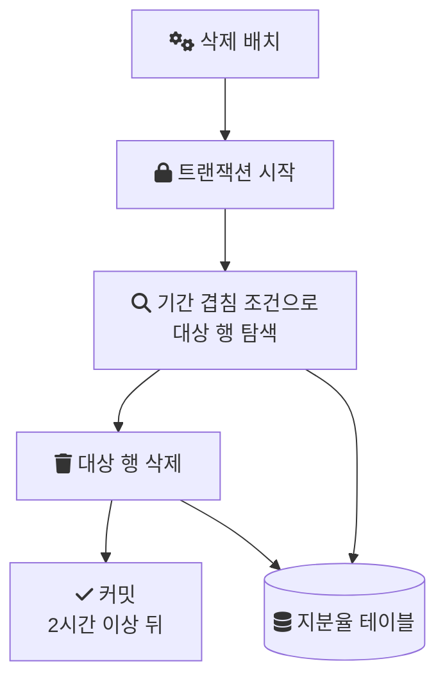
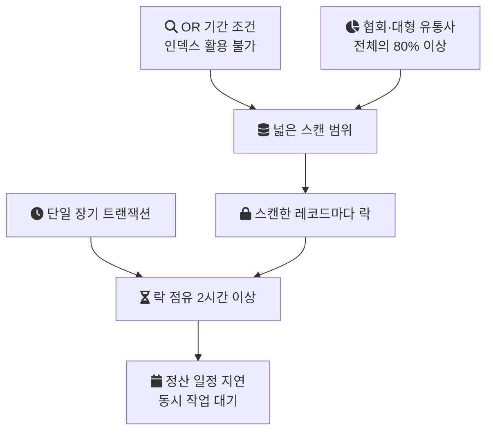
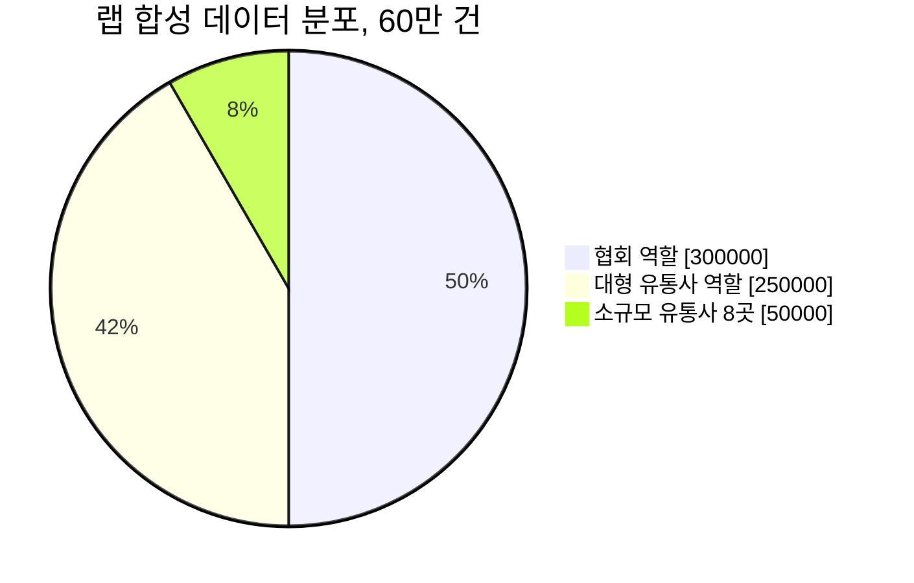

[Part 0](/posts/share-ratio-1/)에서는 지분율 삭제·재등록 작업이 예외 상황에서 무엇을 보장하지 못했는지 정리했다. 이 글은 그중 삭제 배치 하나에 집중한다. 2시간 넘게 걸리던 삭제가 어디서 시간을 쓰고 있었는지, 실행계획과 데이터 분포를 차례로 확인한 과정을 적는다.

## 전제

이 글의 판단은 다음 조건에서 나왔다.

- 데이터: 유통사별 월 단위 정산에 쓰는 저작권·실연권 지분율. 정책 변경이나 오류 정정이 생기면 특정 월 데이터를 대량으로 삭제한 뒤 재등록한다.
- 분포: 협회와 일부 대형 유통사가 전체 지분율 데이터의 80% 이상을 차지한다.
- 스택: Java, Spring Boot, MySQL, Redis, AWS.
- 환경: 배치와 운영 요청이 동시에 들어온다.
- 삭제 방식: 대상 데이터 전체를 하나의 트랜잭션으로 삭제한다.

## 증상: 삭제 하나가 2시간 넘게 걸렸다

삭제 배치는 2시간 이상 걸렸다. 지분율은 정산의 기준 데이터이므로, 삭제가 끝나지 않으면 재등록도 시작되지 않고 정산 일정이 그만큼 밀린다.

시간만의 문제도 아니었다. 삭제는 하나의 트랜잭션이었으므로 2시간 넘는 동안 그 트랜잭션이 잡은 락이 계속 유지됐다. 배치와 운영 요청이 동시에 들어오는 환경에서는 그 시간 동안 같은 테이블을 쓰려는 작업이 함께 영향을 받는다.

삭제 흐름을 그려 보면 다음과 같다. 한 번의 `DELETE`가 조건에 맞는 행을 찾는 스캔과 실제 삭제를 모두 하나의 트랜잭션 안에서 한다.



그래서 먼저 볼 곳은 대상 행을 찾는 단계였다.

## 실행계획: 기간 조건이 인덱스를 타지 못했다

쿼리가 어떤 경로로 실행되는지는 `EXPLAIN`으로 본다. 실행계획(옵티마이저가 고른 인덱스와 접근 방식)에서 먼저 볼 칸은 `type`, `key`, `rows`다. `key`는 실제로 쓴 인덱스이고, `rows`는 MySQL이 읽어야 한다고 추정한 행 수다. `type`이 `ALL`이면 테이블 전체를 읽는다는 뜻이다. MySQL 문서는 `ALL`이 대개 좋지 않으며, 보통 인덱스를 추가해 피할 수 있다고 설명한다([EXPLAIN Output Format](https://dev.mysql.com/doc/refman/8.0/en/explain-output.html)).

실행계획을 조회해 보니 기간이 겹치는 행을 찾는 조건이 OR로 묶여 있었고, 그 때문에 인덱스를 제대로 타지 못하고 있었다.

왜 OR가 문제인지는 [인덱스](/posts/db-index/)가 행을 찾는 방식에서 나온다. 복합 인덱스(여러 컬럼을 순서대로 묶어 정렬한 인덱스)는 왼쪽 컬럼부터 차례로 범위를 좁힐 때 쓸 수 있다. MySQL 문서는 다음처럼 설명한다.

> "If the table has a multiple-column index, any leftmost prefix of the index can be used by the optimizer to look up rows."
> ([Multiple-Column Indexes](https://dev.mysql.com/doc/refman/8.0/en/multiple-column-indexes.html))

복합 인덱스가 있으면 왼쪽부터 이어지는 컬럼 조합으로 행을 찾을 수 있다는 뜻이다. 같은 문서는 서로 다른 컬럼을 OR로 묶은 조건이 그 인덱스로 조회되지 않는 예를 함께 든다. 기간 조건이 `start_date`의 범위와 `end_date`의 범위를 OR로 묶고 있으면, 인덱스 위의 연속된 구간 하나로 범위를 좁힐 수 없다. 이때 인덱스로 좁힐 수 있는 것은 기껏해야 맨 앞의 유통사 조건까지이고, 나머지 기간 조건은 읽어 온 행을 하나씩 걸러 내는 데만 쓰인다. 유통사 하나가 테이블의 큰 몫을 차지한다면, 유통사 조건으로 좁혀도 읽어야 할 행은 여전히 많다.

아래 SQL은 이 차이를 보여 주는 설명용 예시다. 실제 테이블 이름과 조건식이 아니다.

```sql
-- 설명용 예시: 기간 겹침을 OR로 표현한 조건
DELETE FROM share_rate
WHERE partner_id = :partnerId
  AND (start_date BETWEEN :from AND :to
       OR end_date BETWEEN :from AND :to);
```

같은 의미를 `start_date <= :to AND end_date >= :from`처럼 AND로 다시 쓰면, 유통사 조건으로 먼저 좁힌 뒤 기간 컬럼으로 범위를 줄일 수 있다. 이 재정의와 복합 인덱스 설계는 이후 편에서 다룬다.

## 데이터 분포: 소수 유통사가 80% 이상이었다

쿼리만 고치면 끝나는지 확인하려고 데이터 분포를 직접 쿼리로 셌다. 유통사별 건수를 집계하는 단순한 쿼리다.

```sql
-- 설명용 예시
SELECT partner_id, COUNT(*) AS cnt
FROM share_rate
GROUP BY partner_id
ORDER BY cnt DESC;
```

결과는 고르지 않았다. 협회 데이터와 일부 대형 유통사가 전체 지분율 데이터의 80% 이상을 차지했다.

이 분포는 삭제 시간에 직접 영향을 준다. 유통사를 구분하지 않는 일반 쿼리로 처리하면, 이 소수 유통사의 대량 데이터가 매번 스캔 범위와 트랜잭션 시간을 좌우한다. 반대로 나머지 다수의 소규모 유통사는 데이터가 상대적으로 적어서, 같은 문제를 같은 크기로 겪지 않는다. 그래서 개선도 모든 유통사를 똑같이 다루는 방식으로는 부족했다.

## 두 원인이 맞물리는 방식

인덱스를 타지 못하는 조건과 치우친 분포는 각각 따로 있어도 느리다. 그런데 이 둘이 단일 장기 트랜잭션 안에서 만나면 락 점유 시간이 더 길어진다.

InnoDB는 `DELETE`가 처리 중에 스캔한 인덱스 레코드마다 락을 건다. MySQL 문서는 이렇게 적는다.

> "It does not matter whether there are WHERE conditions in the statement that would exclude the row."
> ([Locks Set by Different SQL Statements](https://dev.mysql.com/doc/refman/8.0/en/innodb-locks-set.html))

WHERE 조건에서 걸러질 행이라도 스캔했다면 락이 걸린다는 뜻이다. 같은 문서는 이 락이 보통 next-key lock(레코드와 그 앞의 빈 구간을 함께 잠그는 락)이라 그 구간으로의 INSERT도 막는다고 설명한다. 인덱스를 못 타서 스캔 범위가 넓으면, 실제로 지우는 행보다 훨씬 많은 레코드에 락이 걸리고, 그 락은 커밋까지 2시간 넘게 유지된다.

이 관계를 정리하면 다음과 같다.



그래서 해법도 하나로 끝날 수 없었다. 스캔 범위는 조건과 인덱스로, 분포는 대형 유통사를 따로 다루는 경로로, 락 점유 시간은 트랜잭션 크기로 각각 다뤄야 했다.

## 랩에서 재현해 보니: 데이터가 메모리에 다 올라가면 문제가 숨는다

이후 같은 구조를 개인 랩에서 처음부터 다시 구현해 봤다. 아래 수치는 운영 결과가 아니라 랩 측정이며, 조건은 다음과 같다.

- MySQL 8.0.39 (Testcontainers), `innodb_buffer_pool_size=24M`
- 랩이 임의로 만든 합성 데이터 60만 건. 협회 역할 30만 건, 대형 유통사 역할 25만 건, 소규모 유통사 8곳 각 6,250건
- Before: 성능 인덱스 없이 단일 트랜잭션 삭제

랩 데이터의 분포는 실제 비율이 아니라 "소수가 80% 이상"이라는 조건을 흉내 내려고 정한 값이다.



처음 돌렸을 때는 인덱스가 있든 없든 둘 다 빨랐다. 60만 건 정도는 MySQL 기본 버퍼 풀에 통째로 올라가기 때문이다. 버퍼 풀은 InnoDB가 테이블과 인덱스 데이터를 메모리에 캐시해, 자주 쓰는 데이터를 디스크 대신 메모리에서 바로 읽게 하는 영역이다([Buffer Pool](https://dev.mysql.com/doc/refman/8.0/en/innodb-buffer-pool.html)). 데이터가 전부 메모리에 있으면 전체 스캔도 디스크를 거의 건드리지 않는다. 그래서 랩은 버퍼 풀을 24MB로 일부러 줄였고, 그제야 인덱스 없는 전체 스캔이 디스크 I/O를 일으켜 병목이 재현됐다.

```java
// 랩 코드: AbstractMySqlIntegrationTest (실제 운영 설정 아님)
static final MySQLContainer<?> MYSQL = new MySQLContainer<>("mysql:8.0.39")
        .withCommand("--innodb-buffer-pool-size=24M", "--innodb-buffer-pool-instances=1");
```

이 조건에서 협회 역할 30만 건을 단일 트랜잭션으로 지우는 데 2,021ms가 걸렸다(2026-10-02 실행 1회). 그 2,021ms 동안 트랜잭션 하나가 락을 쥐고 있었다. README에 남긴 이전 실행에서는 1.3초였으니 실행마다 편차가 있다.

절대값은 운영의 2시간과 비교할 수 없다. 데이터 규모와 하드웨어, 동시 부하가 모두 다르다. 이 실험에서 얻은 것은 한 가지다. 작은 데이터나 넉넉한 메모리에서는 인덱스를 타지 못하는 쿼리도 빠르게 보이므로, 테스트 환경에서 문제가 안 보인다고 운영에서도 괜찮다고 판단할 수 없다.

## 남은 질문

원인은 찾았다. 그러면 쿼리와 인덱스만 고치면 충분했을까. 스캔 범위가 줄어도 삭제가 여전히 하나의 트랜잭션이라면, 대형 유통사를 지우는 동안 락은 처음부터 끝까지 유지된다. 실패하면 그때까지의 삭제를 모두 되돌리고, 삭제가 끝나기 전에는 등록이 시작되지 않는다.

이 구조 자체의 위험은 [Part 2. 전체 삭제 후 전체 등록 구조의 위험성](/posts/bulk-insert-with-lock-part2/)에서 정리한다.

## 참고

- [EXPLAIN Output Format](https://dev.mysql.com/doc/refman/8.0/en/explain-output.html) — MySQL 8.0 Reference Manual
- [Multiple-Column Indexes](https://dev.mysql.com/doc/refman/8.0/en/multiple-column-indexes.html) — MySQL 8.0 Reference Manual
- [Locks Set by Different SQL Statements in InnoDB](https://dev.mysql.com/doc/refman/8.0/en/innodb-locks-set.html) — MySQL 8.0 Reference Manual
- [Buffer Pool](https://dev.mysql.com/doc/refman/8.0/en/innodb-buffer-pool.html) — MySQL 8.0 Reference Manual
- 랩 코드: [LegacyDeletionService.java](https://github.com/polynomeer/engineering-lab/blob/d52297d0ad07c3d8a05a7471192a5655cb8b1378/career-lab/equity-system/src/main/java/com/portfolio/equitylab/deletion/LegacyDeletionService.java), [DeletionPerformanceBenchmarkTest.java](https://github.com/polynomeer/engineering-lab/blob/d52297d0ad07c3d8a05a7471192a5655cb8b1378/career-lab/equity-system/src/test/java/com/portfolio/equitylab/deletion/DeletionPerformanceBenchmarkTest.java), [AbstractMySqlIntegrationTest.java](https://github.com/polynomeer/engineering-lab/blob/d52297d0ad07c3d8a05a7471192a5655cb8b1378/career-lab/equity-system/src/test/java/com/portfolio/equitylab/AbstractMySqlIntegrationTest.java), [README](https://github.com/polynomeer/engineering-lab/blob/d52297d0ad07c3d8a05a7471192a5655cb8b1378/career-lab/equity-system/README.md)
