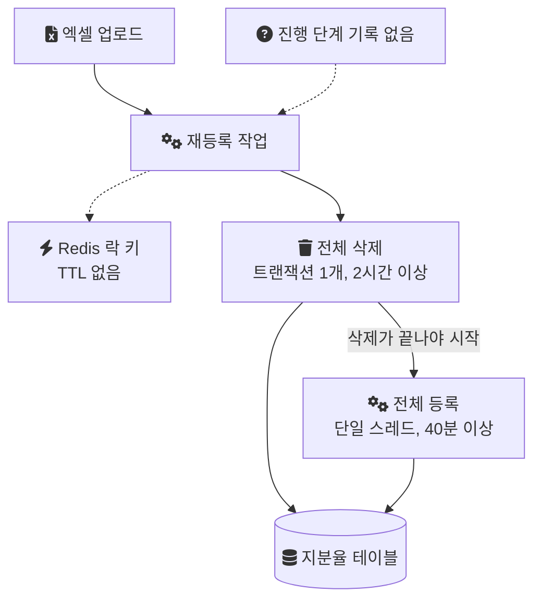
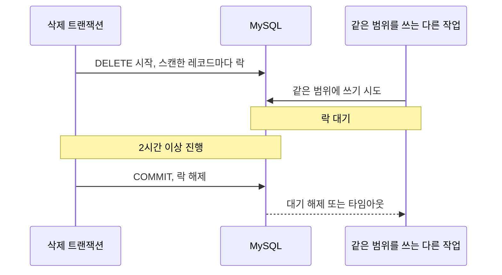
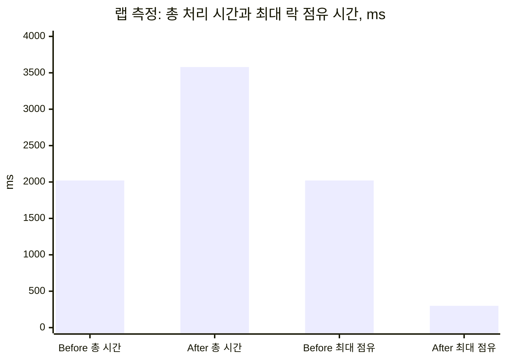

[Part 1](/posts/bulk-insert-with-lock-part1/)에서는 삭제가 2시간 넘게 걸린 원인을 찾았다. OR로 묶인 기간 조건이 인덱스를 타지 못했고, 협회와 일부 대형 유통사가 데이터의 80% 이상을 차지해 스캔 범위가 컸다. 그런데 쿼리를 고쳐도 남는 문제가 있었다. 이 글은 쿼리가 아니라 "전체를 지우고 전체를 다시 넣는" 작업 구조 자체가 가진 위험을 정리하고, 그 위험에서 개선 기준을 어떻게 세웠는지 적는다.

---

## 기존 작업 구조

지분율 재등록은 두 단계였다. 대상 월의 기존 데이터를 지우고, 엑셀로 받은 새 데이터를 넣는다. 각 단계의 방식과 소요 시간은 다음과 같았다.

| 단계 | 방식 | 소요 시간 |
| --- | --- | --- |
| 삭제 | 대상 전체를 하나의 장기 트랜잭션으로 삭제 | 2시간 이상 |
| 등록 | 엑셀 파싱부터 DB 저장까지 단일 스레드 순차 처리 | 대량 업로드 시 40분 이상 |
| 동시 실행 제어 | Redis `SET`, TTL 없음, `finally`에서 무조건 `DEL` | |

두 단계 사이에는 작업이 어느 단계까지 왔는지 기록하는 상태 모델이 없었다. 구조를 그리면 다음과 같다.



이 구조의 위험은 세 가지로 나눠 볼 수 있다.

---

## 위험 1: 트랜잭션 하나가 락을 너무 오래 쥔다

삭제가 하나의 [트랜잭션](/posts/transaction/)이면, 그 트랜잭션이 잡은 락은 커밋할 때까지 풀리지 않는다. InnoDB는 `DELETE`가 스캔한 인덱스 레코드마다 락을 걸고, 그 락은 보통 next-key lock(레코드와 그 앞의 빈 구간을 함께 잠그는 락)이다([Locks Set by Different SQL Statements](https://dev.mysql.com/doc/refman/8.0/en/innodb-locks-set.html)). 그래서 2시간 넘는 동안, 스캔한 범위 전체에 다른 작업이 쓰지 못하는 구간이 생긴다.

MySQL 문서도 큰 테이블에서 많은 행을 지우는 상황을 따로 짚는다.

> "If you are deleting many rows from a large table, you may exceed the lock table size for an InnoDB table."
> ([DELETE Statement](https://dev.mysql.com/doc/refman/8.0/en/delete.html))

많은 행을 지우면 InnoDB의 락 테이블 크기를 넘을 수 있다는 경고다. 문서는 이어서 테이블이 잠겨 있는 시간을 줄이는 방법을 함께 안내한다.

배치와 운영 요청이 동시에 들어오는 환경에서 이 시간은 그대로 다른 작업의 대기 시간이 된다. 아래 시퀀스는 단일 트랜잭션 삭제가 진행되는 동안 같은 범위를 쓰려는 작업이 어떻게 되는지를 보여 준다. 운영 로그가 아니라 락 동작을 설명하는 그림이다.



실패했을 때의 비용도 같은 크기로 커진다. 트랜잭션이 끝 무렵에 실패하면, 그때까지 지운 행을 [Undo 로그](/posts/redo-undo-log/)를 따라 되돌린다. 2시간짜리 작업의 실패는 2시간분의 작업을 되돌리는 일로 이어진다.

---

## 위험 2: 삭제가 끝나기 전에는 아무것도 시작하지 못한다

등록은 삭제가 끝나야 시작한다. 그래서 삭제가 늦어지면 등록도 늦어지고, 삭제가 실패하면 등록은 실행되지 않는다. 삭제 단계 하나가 전체 작업의 병목이자 단일 실패 지점(그 하나가 멈추면 전체가 멈추는 지점)이었다.

등록도 빠르지 않았다. 엑셀 파싱부터 DB 저장까지 단일 스레드가 순서대로 처리했고, 대량 업로드 시 40분 이상 걸렸다. CPU를 충분히 쓰지 못했고 I/O 대기 시간이 길었다. 두 단계가 직렬이므로, 한 번의 재등록은 삭제 2시간 이상에 등록 40분 이상을 더한 시간 동안 끝나지 않는다. 그 사이에 대상 월의 데이터는 삭제가 커밋된 뒤부터 등록이 끝날 때까지 비어 있거나 일부만 들어 있다.

---

## 위험 3: 중간에 멈추면 어디까지 했는지 알 수 없다

두 단계 사이에 기록이 없다는 점이 앞의 두 위험을 키웠다.

- 삭제가 커밋된 뒤 등록이 중간에 실패하면 대상 월에는 새 데이터가 일부만 들어간 채 남는다. 그런데 이것이 "등록이 실패한 상태"인지 "등록이 아직 진행 중인 상태"인지 데이터만 보고 구분할 수 없다.
- Redis 락 키는 "누군가 작업 중"이라는 사실만 담고, 어느 단계인지는 담지 않는다. 휘발성이라 장애가 나면 그마저 사라진다.
- 락이 TTL 없이 남거나, 소유자가 아닌 쪽이 `DEL`로 지우면 삭제와 등록이 교차 실행될 수 있었다. 이 문제는 [Part 0](/posts/share-ratio-1/)에서 정리했다.

결국 삭제 쿼리를 빠르게 만드는 것만으로는 부족했다. 성능이 나아져도 다음 전제는 그대로 남기 때문이다.

- 대상 전체를 하나의 트랜잭션으로 처리한다.
- 삭제와 등록이 어느 단계에 있는지 시스템이 모른다.
- 등록은 한 줄로만 흐른다.

---

## 개선 기준

이 개선이 무엇을 줄이려 했는지를, 개선 후 확인한 효과에서 거꾸로 정리하면 다음 네 가지다.

1. 트랜잭션 하나가 락을 쥐는 시간을 줄인다. 동시 작업이 덜 기다리고, 정산 배치가 언제 끝날지 예측할 수 있어야 한다.
2. 불필요한 범위 스캔과 I/O를 줄인다. 대형 유통사를 지울 때도 인덱스를 가장 좁게 타야 한다.
3. 작업 단계를 DB에 남긴다. Redis가 아니라 DB의 상태를 기준으로 삼아, Redis에 장애가 나도 정합성의 기준이 남아야 한다.
4. 등록은 병렬로 처리하되 DB를 과부하로 몰지 않는다.

첫 번째 기준에서 중요한 것은 "총 처리 시간"이 아니라 "락 점유 시간"이라는 점이다. 이 구분이 왜 필요한지는 랩에서 직접 확인했다.

---

## 랩에서 확인한 것: 청크로 나눠도 총 시간은 늘 수 있다

같은 구조를 개인 랩에서 다시 구현해 비교했다. 아래는 운영 결과가 아니라 랩 측정이다.

- 환경: MySQL 8.0.39 (Testcontainers), `innodb_buffer_pool_size=24M`, 기본값 `innodb_flush_log_at_trx_commit=1`
- 데이터: 랩이 임의로 만든 합성 데이터 60만 건, 그중 협회 역할 30만 건을 삭제
- Before: 성능 인덱스 없이 단일 트랜잭션으로 삭제
- After: 복합 인덱스를 추가하고, 대형 유통사 전용 경로에서 청크 단위로 반복 삭제. 청크마다 자동 커밋
- 측정: 2026-10-02 실행 1회

랩의 청크 삭제 코드는 `LIMIT`이 걸린 `DELETE`를 지운 건수가 청크 크기보다 작아질 때까지 반복한다. 각 호출이 트랜잭션 밖에서 자동 커밋되므로, 청크 하나가 곧 트랜잭션 하나다.

```java
// 랩 코드: OptimizedDeletionService.deleteInChunks (실제 운영 코드 아님)
do {
    long chunkStart = System.nanoTime();
    deletedInChunk = dao.deleteOverlappingChunk(distributorCode, periodStart, periodEnd, DELETE_CHUNK_SIZE);
    maxChunkDurationMs = Math.max(maxChunkDurationMs, elapsedMs(chunkStart));
    totalDeleted += deletedInChunk;
    chunkCount++;
} while (deletedInChunk == DELETE_CHUNK_SIZE);
```

결과는 다음과 같다.

| 항목 | Before | After |
| --- | --- | --- |
| 총 처리 시간 | 2,021ms | 3,579ms |
| 트랜잭션 수 | 1 | 61 |
| 트랜잭션 하나가 락을 쥔 최대 시간 | 2,021ms | 299ms |

같은 값을 막대로 보면 다음과 같다.



총 처리 시간은 오히려 늘었다. README에 남긴 이전 실행에서도 단일 트랜잭션 1.3초, 청크 삭제 3.2~4.7초로 같은 방향이었다. 원인은 커밋 횟수다. 기본 설정에서 InnoDB는 커밋마다 로그를 디스크로 flush한다.

> "Logs are written and flushed to disk at each transaction commit."
> ([innodb_flush_log_at_trx_commit](https://dev.mysql.com/doc/refman/8.0/en/innodb-parameters.html#sysvar_innodb_flush_log_at_trx_commit))

커밋할 때마다 로그를 쓰고 디스크에 내려 쓴다는 뜻이다. 61번 커밋하면 61번 디스크 동기화를 기다린다.

반면 트랜잭션 하나가 락을 쥔 최대 시간은 2,021ms에서 299ms로 줄었다. 다른 작업 입장에서 기다려야 하는 최대 시간이 그만큼 짧아진 것이다. 다만 이 비교는 Before에 인덱스가 없고 After에 인덱스가 있어서, 청크화만의 효과로 읽으면 안 된다. 인덱스와 청크화가 함께 만든 차이다.

이 측정이 개선 기준 1번을 뒷받침한다. 청크화로 얻는 것은 처리량이 아니라, 한 트랜잭션이 시스템을 막는 시간의 상한이다. 총 시간까지 줄이려면 커밋 빈도와 flush 비용 사이의 균형을 따로 맞춰야 하고, 랩은 이 부분을 다루지 않았다.

---

## 선택한 방향과 그 대가

기준을 세운 뒤 정한 방향은 다음과 같다.

- 기간 조건을 인덱스를 쓸 수 있는 형태로 다시 정의하고, 유통사ID와 기간 컬럼으로 복합 인덱스를 다시 설계한다.
- 데이터의 80% 이상을 차지하는 협회와 대형 유통사는 유통사 코드를 고정한 전용 쿼리 경로로 분리한다.
- 삭제를 단일 장기 트랜잭션이 아니라 청크 단위 트랜잭션으로 나눈다.
- 등록은 파싱, 검증, 매핑, 삽입 단계로 나누고, 삽입은 청크 단위로 ThreadPool에서 병렬 처리하되 Backpressure로 흐름을 제어한다.
- 작업 단계를 삭제중, 삭제완료, 등록중, 등록완료로 정의하고 DB에 기록한다.

이 방향에는 대가가 있다. 삭제를 청크로 나누면 삭제 전체가 하나의 트랜잭션으로 원자적이라는 성질을 잃는다. 일부 청크만 커밋된 중간 상태가 생길 수 있고, 그 상태를 판단하는 일은 트랜잭션 대신 상태 모델이 맡아야 한다. 마지막 항목이 필요한 이유가 여기 있다.

구체적인 구현은 [Part 3. 청크 분할과 병렬 처리로 재설계하기](/posts/bulk-insert-with-lock-part3/)에서 이어진다.

## 참고

- [DELETE Statement](https://dev.mysql.com/doc/refman/8.0/en/delete.html) — MySQL 8.0 Reference Manual
- [Locks Set by Different SQL Statements in InnoDB](https://dev.mysql.com/doc/refman/8.0/en/innodb-locks-set.html) — MySQL 8.0 Reference Manual
- [InnoDB Startup Options and System Variables: innodb_flush_log_at_trx_commit](https://dev.mysql.com/doc/refman/8.0/en/innodb-parameters.html#sysvar_innodb_flush_log_at_trx_commit) — MySQL 8.0 Reference Manual
- [OptimizedDeletionService.java](https://github.com/polynomeer/engineering-lab/blob/d52297d0ad07c3d8a05a7471192a5655cb8b1378/career-lab/equity-system/src/main/java/com/portfolio/equitylab/deletion/OptimizedDeletionService.java) — GitHub: 랩 코드
- [EquityShareDeletionDao.java](https://github.com/polynomeer/engineering-lab/blob/d52297d0ad07c3d8a05a7471192a5655cb8b1378/career-lab/equity-system/src/main/java/com/portfolio/equitylab/repository/EquityShareDeletionDao.java) — GitHub: 랩 코드
- [DeletionPerformanceBenchmarkTest.java](https://github.com/polynomeer/engineering-lab/blob/d52297d0ad07c3d8a05a7471192a5655cb8b1378/career-lab/equity-system/src/test/java/com/portfolio/equitylab/deletion/DeletionPerformanceBenchmarkTest.java) — GitHub: 랩 코드
- [README](https://github.com/polynomeer/engineering-lab/blob/d52297d0ad07c3d8a05a7471192a5655cb8b1378/career-lab/equity-system/README.md) — GitHub: 랩 코드
