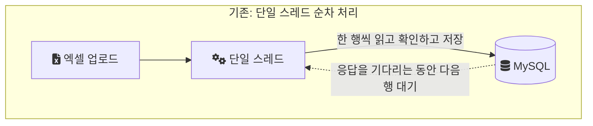
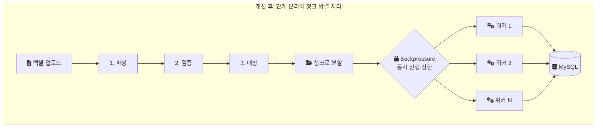

# 3편. 청크 분할과 병렬 처리로 등록 파이프라인 재설계하기

이 시리즈가 다루는 지분율 시스템은 음원 플랫폼 회사에서 저작권·실연권 지분율 데이터를 관리하는 시스템이다.
지분율은 유통사별 월 단위 정산에 쓰이는 데이터라서, 정책이 바뀌거나 오류를 정정해야 하면 특정 월의 데이터를 대량으로 지우고 다시 등록해야 했다([2편](/posts/bulk-insert-with-lock-part2/)에서 다룬 삭제 후 재등록 구조다).
삭제든 등록이든 늦어지거나 실패하면 그 월의 정산 일정 전체가 함께 밀린다.

이 글은 그중 등록 쪽을 다룬다. 작업 조건은 다음과 같았다.

- 기간: 2022년 8월부터 11월까지, 기존 시스템 개선
- 인원: 설계와 구현을 혼자 맡았다
- 스택: Java, Spring Boot, MySQL, Redis, AWS
- 입력: 운영자가 올리는 지분율 엑셀 파일
- 증상: 대량 업로드 한 번의 등록에 40분 이상

## 등록이 40분 이상 걸리던 구조

기존 등록은 엑셀 데이터를 읽어서 DB에 저장하기까지를 단일 스레드에서 순서대로 처리했다.
한 행을 읽고, 확인하고, 저장할 형태로 바꾸고, 다음 행으로 넘어가는 흐름이다.

이 구조에서는 한 시점에 하나의 일만 진행된다.
DB에 쓰기를 보내고 응답을 기다리는 동안 다음 행의 파싱이나 검증은 시작되지 않는다.
그래서 CPU는 대부분의 시간을 쉬고, 전체 소요 시간은 I/O 대기 시간의 합에 가까워졌다.
대량 업로드에서는 이 합이 40분을 넘었다.



40분은 단순히 기다리는 시간이 아니었다.
등록이 끝나야 그 월의 지분율이 정산에 쓰일 수 있으므로, 등록 시간은 곧 정산 일정의 여유를 줄이는 시간이었다.

## 단계를 나누고 삽입을 청크로 묶었다

개선은 두 가지 결정으로 이뤄졌다.

첫째, 처리 흐름을 파싱, 검증, 매핑, 삽입의 네 단계로 나눴다.

- 파싱: 엑셀 셀 값을 읽어 문자열이나 숫자로 꺼낸다
- 검증: 지분율 범위, 기간 같은 규칙을 확인한다
- 매핑: 검증을 통과한 값을 저장할 엔티티 형태로 바꾼다
- 삽입: 엔티티를 DB에 쓴다

둘째, DB 삽입을 청크 단위로 묶고 ThreadPool에서 병렬로 실행했다.
청크(chunk)는 한 번에 처리하고 저장할 행의 묶음이다.
행을 한 건씩 저장하지 않고 일정 개수씩 묶어 한 번에 쓰면, 쓰기 요청의 왕복 횟수가 줄고 묶음 단위로 작업을 나눠 줄 수 있다.
ThreadPool은 미리 정해 둔 수의 스레드를 만들어 두고 작업을 나눠 맡기는 구조다.
스레드 여러 개가 각자의 청크를 처리하면, 한 청크가 DB 응답을 기다리는 동안 다른 청크의 검증이 진행된다.

여기에 Backpressure를 더했다.
Backpressure는 처리하는 쪽이 감당할 수 있는 속도에 맞춰 보내는 쪽을 늦추는 흐름 제어다.
병렬 처리만 넣으면 엑셀을 읽는 쪽이 DB가 받아낼 수 있는 속도보다 빠르게 작업을 쌓을 수 있다.
그러면 대기 중인 청크가 메모리에 쌓이고, DB에는 동시에 너무 많은 쓰기가 몰린다.
동시에 진행되는 작업 수에 상한을 두면 이 상한 이상은 제출 자체가 기다리게 된다.

바뀐 구조를 그리면 이렇다.



ThreadPool의 스레드 수와 청크 크기는 이 글에 적지 않는다.
당시 값을 정확히 기록해 두지 않았고, 근거 없이 숫자를 채우지 않기로 했다.
아래 코드와 측정에 나오는 수치는 모두 재현 랩에서 새로 정한 값이다.

## 랩 코드로 본 구현

당시 코드는 남아 있지 않다.
그래서 같은 결정을 처음부터 다시 구현한 재현 랩([equity-system](https://github.com/polynomeer/engineering-lab/blob/d52297d0ad07c3d8a05a7471192a5655cb8b1378/career-lab/equity-system/README.md))의 코드로 구조를 설명한다.
랩의 스키마와 이름, 스레드 수, 청크 크기는 실제 값이 아니다.

먼저 기존 구조를 재현한 순차 파이프라인이다.
행마다 `process`를 부르고, 모이면 저장한다.
모든 일이 한 스레드 안에서 차례로 일어난다.

```java
// 랩 코드: SequentialRegistrationPipeline.java (기존 구조 재현)
for (RawEquityRow raw : rawRows) {
    batch.add(rowProcessor.process(raw));          // 파싱·검증·매핑
    if (batch.size() == INSERT_BATCH_SIZE) {
        insertDao.insertBatch(batch);              // 삽입이 끝날 때까지 다음 행 대기
        total += batch.size();
        batch = new ArrayList<>(INSERT_BATCH_SIZE);
    }
}
```

다음은 개선 구조를 재현한 병렬 파이프라인이다.
입력을 청크로 나누고, 청크마다 파싱·검증·매핑과 삽입을 하나의 작업으로 묶어 ThreadPool에 제출한다.

```java
// 랩 코드: ParallelRegistrationPipeline.java (개선 구조 재현)
Semaphore backpressure = new Semaphore(MAX_IN_FLIGHT_CHUNKS);

try (ExecutorService pool = Executors.newFixedThreadPool(POOL_SIZE)) {
    for (List<RawEquityRow> chunk : chunks) {
        acquireUninterruptibly(backpressure);      // 상한에 닿으면 여기서 제출이 멈춘다
        futures.add(pool.submit(() -> {
            try {
                return processAndInsertChunk(chunk);
            } finally {
                backpressure.release();            // 청크 하나가 끝나야 다음 제출이 가능해진다
            }
        }));
    }
    // 모든 Future의 결과를 모아 총 건수를 확인한다
}
```

Backpressure는 `Semaphore`로 구현했다.
Java 문서는 세마포어를 "Conceptually, a semaphore maintains a set of permits."라고 설명한다(개념적으로 permit의 집합을 관리한다는 뜻이다. [Semaphore Javadoc](https://docs.oracle.com/en/java/javase/21/docs/api/java.base/java/util/concurrent/Semaphore.html)).
`acquire()`는 permit이 없으면 하나가 생길 때까지 막히고, `release()`는 permit을 돌려준다.
permit 수를 동시 진행 청크의 상한으로 두면, 제출하는 루프는 앞선 청크가 끝나 permit이 돌아올 때까지 다음 청크를 넘기지 못한다.
세마포어 자체의 동작은 [세마포어와 permit](/posts/semaphore-and-permits/)에서 따로 다뤘다.

`release()`를 `finally`에 둔 이유는 청크 처리가 예외로 끝나도 permit이 돌아오게 하기 위해서다.
여기서 permit이 새면 상한이 점점 줄어들고, 마지막에는 제출 루프가 영원히 멈춘다.

이 흐름에서 스레드 수와 permit 수는 서로 다른 것을 제한한다.
스레드 수는 동시에 실행되는 청크의 수를 정하고, permit 수는 실행 중이거나 큐에서 기다리는 청크의 수를 정한다.
`Executors.newFixedThreadPool`은 문서상 "a shared unbounded queue"(크기 제한이 없는 공유 큐)에서 작업을 꺼내 쓰고, 스레드가 모두 바쁘면 새 작업은 그 큐에서 기다린다([Executors Javadoc](https://docs.oracle.com/en/java/javase/21/docs/api/java.base/java/util/concurrent/Executors.html#newFixedThreadPool(int))).
그래서 permit 상한이 없으면 큐에 쌓이는 청크 수에도 상한이 없다.

## 랩에서 다시 재 본 효과

랩에서 같은 메커니즘이 실제로 시간을 줄이는지 확인했다([RegistrationPipelineBenchmarkTest](https://github.com/polynomeer/engineering-lab/blob/d52297d0ad07c3d8a05a7471192a5655cb8b1378/career-lab/equity-system/src/test/java/com/portfolio/equitylab/registration/RegistrationPipelineBenchmarkTest.java)).
조건은 다음과 같다.

| 항목 | 값 |
| --- | --- |
| 데이터 | 5,000행, 같은 입력을 두 파이프라인에 넣음 |
| DB | MySQL 8.0.39 (Testcontainers) |
| 행 1건 검증 지연 | 2ms, `Thread.sleep`으로 흉내 |
| 순차 파이프라인 | 단일 스레드, 삽입 배치 1,000행 |
| 병렬 파이프라인 | 스레드 8개, 동시 진행 상한 8, 청크 250행 |
| 실행 횟수 | 1회 |

결과는 순차 13,755ms, 병렬 2,113ms였다.
두 경우 모두 저장된 행 수는 5,000건으로 같았다.

이 숫자는 운영 결과가 아니고, 비율도 운영과 비교할 대상이 아니다.
랩은 행마다 2ms를 잠들게 해서 I/O 대기를 흉내 냈기 때문에, 스레드가 늘수록 대기 시간이 겹치는 효과가 거의 그대로 드러난다.
실제 검증에는 CPU를 쓰는 부분과 DB를 기다리는 부분이 섞여 있었고, 운영에서 줄어든 비율은 40분에서 12분으로 약 3.3배였다.
랩이 보여주는 것은 대기 시간이 긴 작업을 나눠 병렬로 돌리면 대기가 겹쳐 전체 시간이 줄어든다는 메커니즘까지다.

## 결과

운영에서의 변화는 다음과 같았다.

- 등록 처리 시간: 40분 → 12분
- CPU 활용도: 단일 스레드에서 쉬던 CPU를 여러 워커가 나눠 쓰게 됐다
- DB 부하: Backpressure로 동시 쓰기를 제한해, 고부하 상황에서도 DB 과부하를 막았다

단계 분리, 청크 단위 삽입, 병렬 처리, Backpressure를 함께 적용했기 때문에 12분을 어느 하나의 효과로 나눌 수는 없다.

## 남은 것과 대가

병렬로 바꾸면서 생긴 대가도 있다.

먼저 튜닝 대상이 늘었다.
순차 구조에는 조정할 값이 거의 없었지만, 이제는 스레드 수, 청크 크기, 동시 진행 상한이 서로 영향을 준다.
스레드를 늘려도 DB가 받아낼 수 있는 쓰기 양을 넘으면 대기만 길어지고, 상한을 너무 낮추면 병렬화의 효과가 사라진다.
당시 이 값을 어떻게 정했는지 근거를 남겨 두지 않은 것은 지금 보면 아쉬운 부분이다.

다음으로 실패의 모양이 바뀌었다.
순차 구조에서는 어느 행에서 멈췄는지가 곧 진행 위치였다.
병렬 구조에서는 여러 청크가 동시에 진행되므로, 하나가 실패했을 때 다른 청크는 이미 저장을 마쳤을 수 있다.
청크 하나가 성공했다는 사실만으로는 등록 작업 전체가 어디까지 왔는지 말할 수 없게 된 것이다.
작업 단위의 진행 상태를 DB에 두는 상태 전이 모델은 [5편](/posts/bulk-insert-with-lock-part5/)에서 다룬다.

마지막으로 등록이 빨라졌다고 해서 삭제와 등록의 순서 문제가 사라지지는 않았다.
삭제와 등록은 여전히 같은 월의 데이터를 두고 순서를 지켜야 했고, 그 순서는 Redis 분산 락이 지키고 있었다.
그 락이 어떤 구조였고 왜 순서를 보장하지 못할 수 있었는지가 다음 편의 주제다.

## 다음 편

[4편. 분산 락이 있어도 레이스가 발생할 수 있었던 이유](/posts/bulk-insert-with-lock-part4/)에서는 기존 Redis 락의 구조와, 그 구조가 허용하던 두 가지 실패를 다룬다.

## 참고

- [Java SE 21 API: Executors.newFixedThreadPool](https://docs.oracle.com/en/java/javase/21/docs/api/java.base/java/util/concurrent/Executors.html#newFixedThreadPool(int))
- [Java SE 21 API: Semaphore](https://docs.oracle.com/en/java/javase/21/docs/api/java.base/java/util/concurrent/Semaphore.html)
- [랩 코드: SequentialRegistrationPipeline.java](https://github.com/polynomeer/engineering-lab/blob/d52297d0ad07c3d8a05a7471192a5655cb8b1378/career-lab/equity-system/src/main/java/com/portfolio/equitylab/registration/SequentialRegistrationPipeline.java)
- [랩 코드: ParallelRegistrationPipeline.java](https://github.com/polynomeer/engineering-lab/blob/d52297d0ad07c3d8a05a7471192a5655cb8b1378/career-lab/equity-system/src/main/java/com/portfolio/equitylab/registration/ParallelRegistrationPipeline.java)
- [랩 코드: RowProcessor.java](https://github.com/polynomeer/engineering-lab/blob/d52297d0ad07c3d8a05a7471192a5655cb8b1378/career-lab/equity-system/src/main/java/com/portfolio/equitylab/registration/RowProcessor.java)
- [랩 테스트: RegistrationPipelineBenchmarkTest.java](https://github.com/polynomeer/engineering-lab/blob/d52297d0ad07c3d8a05a7471192a5655cb8b1378/career-lab/equity-system/src/test/java/com/portfolio/equitylab/registration/RegistrationPipelineBenchmarkTest.java)
