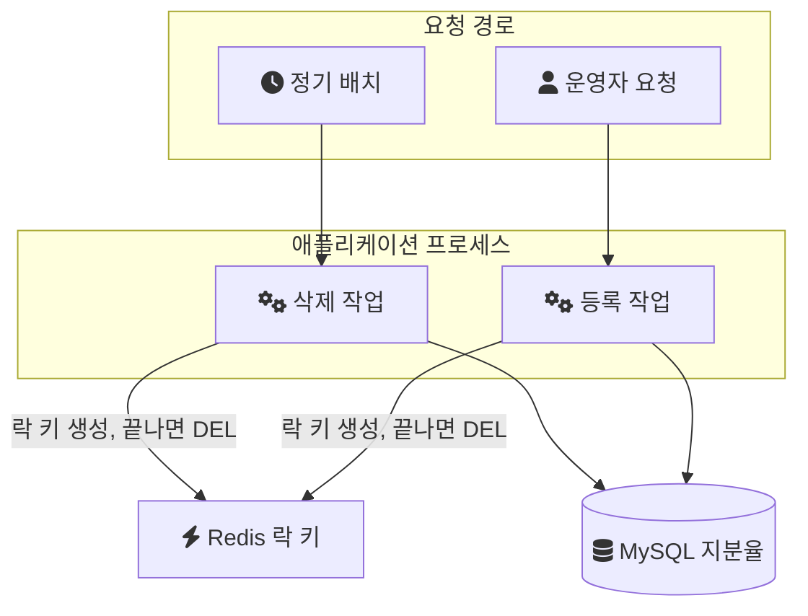
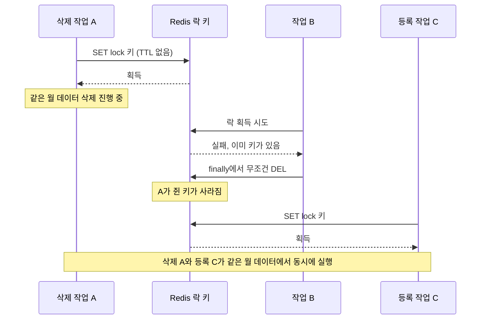

# 4편. 분산 락이 있어도 레이스가 발생한 이유

[3편](/posts/bulk-insert-with-lock-part3/)까지는 처리 속도를 다뤘다.
이번 글은 속도와 별개로 남아 있던 문제, 작업 순서를 다룬다.

지분율 시스템은 음원 플랫폼 회사에서 유통사별 월 단위 정산에 쓰이는 저작권·실연권 지분율을 관리했다.
정책 변경이나 오류 정정이 생기면 특정 월의 데이터를 대량으로 삭제한 뒤 다시 등록했다.
이 삭제·재등록은 정기 배치로도 돌고, 운영자 요청으로도 들어왔다.
두 경로가 같은 시간대에 겹칠 수 있었기 때문에 동시성 제어가 필요했고, 그 역할을 Redis 분산 락이 맡고 있었다.

---

## 깨지면 안 되는 순서

같은 월의 지분율에 대해서는 다음 순서가 지켜져야 했다.

1. 기존 데이터 삭제
2. 신규 데이터 등록

이 순서가 섞이면 결과를 예측할 수 없다.
등록이 삭제보다 먼저 일부 진행되면 새로 넣은 행이 뒤이은 삭제에 지워질 수 있고, 삭제가 끝나기 전에 등록이 시작되면 지워져야 할 행과 새 행이 한 기간에 섞일 수 있다.
정산은 이 데이터를 그대로 읽으므로, 순서가 한 번 깨지면 그 월의 정산 기준이 틀어진다.

그래서 삭제와 등록은 같은 대상에 대해 동시에 실행되지 않도록 락으로 보호되어 있었다.
한 프로세스 안의 락이 아니라 Redis에 락 키를 두고 여러 프로세스가 함께 보는 분산 락이었다.



위 그림에서 어떤 요청이 삭제로 가고 어떤 요청이 등록으로 가는지는 설명을 위한 예다.
요점은 서로 다른 경로의 작업이 같은 락 키 하나에 순서를 맡기고 있었다는 것이다.

---

## 기존 락의 구조

기존 락은 세 가지로 요약된다.

- 작업 시작 시 `SET`으로 락 키를 만든다
- 키에 TTL을 걸지 않는다
- `finally` 블록에서 소유권을 확인하지 않고 무조건 `DEL`한다

TTL(Time To Live)은 키가 자동으로 만료되기까지의 시간이다.
소유권 확인은 지금 키를 쥐고 있는 쪽이 정말 나인지를 보는 것이다.
기존 구조에는 둘 다 없었다.

구조를 코드로 옮기면 다음과 같은 모양이다.
아래는 당시 코드가 아니라 재현 랩에서 같은 구조를 다시 만든 코드다.

```java
// 랩 코드: LegacyRedisLock.java (기존 구조 재현)
public boolean tryAcquire(String key, String token) {
    Boolean acquired = redisTemplate.opsForValue().setIfAbsent(key, token); // TTL 없음
    return Boolean.TRUE.equals(acquired);
}

public void release(String key, String token) {
    redisTemplate.delete(key); // token을 보지 않고 무조건 삭제
}
```

`release`가 `token`을 인자로 받으면서도 쓰지 않는다는 점이 이 구조의 핵심이다.
키 이름만 같으면 누가 만든 락이든 지운다.

이 두 결함은 서로 다른 종류의 실패를 만든다.
하나는 락이 영원히 안 풀리는 실패이고, 다른 하나는 락이 너무 쉽게 풀리는 실패다.

---

## 첫 번째 실패: TTL이 없으면 락이 영원히 남는다

락을 쥔 프로세스가 `finally`까지 도달하지 못하고 끝나는 경우가 있다.
프로세스가 강제로 종료되거나, 배포로 인스턴스가 내려가거나, Redis와의 연결이 끊긴 채로 작업이 끝나는 경우다.

`finally`는 같은 JVM 안에서 실행 흐름이 정상적으로 이어질 때만 실행된다.
프로세스 자체가 사라지면 `DEL`을 보낼 주체가 없다.
TTL이 있으면 시간이 지나 키가 저절로 사라지지만, TTL이 없으면 키는 누군가 손으로 지울 때까지 남는다.

그 사이 같은 대상의 삭제와 등록은 모두 락 획득에 실패한다.
정합성은 지켜지지만 작업이 진행되지 않는다.
Redis 문서는 분산 락이 갖춰야 할 성질로 이것을 따로 꼽는다.
"Eventually it is always possible to acquire a lock, even if the client that locked a resource crashes or gets partitioned."(락을 쥔 클라이언트가 죽거나 네트워크에서 떨어져도 결국에는 락을 다시 얻을 수 있어야 한다는 뜻이다. [Distributed Locks with Redis](https://redis.io/docs/latest/develop/clients/patterns/distributed-locks/))
기존 구조는 이 성질을 갖지 못했다.

랩에서는 TTL 없이 락을 잡고 `release`를 부르지 않은 채 3초를 기다려도 키가 그대로 남아 있는 것으로 이 실패를 확인했다([RedisLockRaceConditionTest](https://github.com/polynomeer/engineering-lab/blob/d52297d0ad07c3d8a05a7471192a5655cb8b1378/career-lab/equity-system/src/test/java/com/portfolio/equitylab/lock/RedisLockRaceConditionTest.java), `legacyLockNeverExpiresWithoutRelease`).

---

## 두 번째 실패: 무조건 DEL은 남의 락을 지운다

더 근본적인 문제는 해제 쪽에 있었다.
`finally`에서 소유권을 확인하지 않고 `DEL`하면, 지금 락을 쥔 프로세스가 내가 아니어도 키가 지워진다.

락을 쥐지 않은 프로세스가 `finally`에 도달하는 경로는 생각보다 많다.
예를 들어 락 획득 시도와 작업을 같은 `try` 안에 두고 해제를 `finally`에 두면, 획득에 실패한 프로세스도 `finally`를 지나며 `DEL`을 보낸다.
또는 어떤 이유로든 키가 한 번 비워진 뒤 다른 프로세스가 새로 락을 잡았다면, 늦게 끝난 원래 프로세스의 `DEL`은 새 소유자의 키를 지운다.

이렇게 키가 지워지면 원래 소유자는 여전히 작업 중인데 락은 비어 있다.
세 번째 프로세스가 이 빈자리에서 락을 얻으면, 두 프로세스가 동시에 자신이 락을 쥐고 있다고 믿게 된다.
[Race Condition](/posts/how-to-control-race-condition/)은 이처럼 실행 순서에 따라 결과가 달라지는 상황이고, 여기서는 그 결과가 삭제와 등록의 교차 실행이다.

다음 그림은 이 실패가 성립하는 한 가지 순서다.
운영에서 기록된 순서가 아니라, 무조건 `DEL` 구조에서 가능한 순서를 그린 것이다.



이 순서에서 A는 아무 잘못도 하지 않았다.
A의 코드만 봐서는 문제를 찾을 수 없고, 다른 프로세스의 `finally`가 A의 보호를 걷어낸다.
락 키가 존재한다는 사실만으로는 지금 누가 쥐고 있는지 알 수 없다는 것이 원인이다.

Redis 문서도 같은 지점을 짚는다.
"Using just DEL is not safe as a client may remove another client's lock."(`DEL`만 쓰는 해제는 다른 클라이언트의 락을 지울 수 있어 안전하지 않다는 뜻이다. [Distributed Locks with Redis](https://redis.io/docs/latest/develop/clients/patterns/distributed-locks/))

랩에서는 A가 락을 잡은 뒤 키를 비우고 B가 다시 잡게 만든 상태에서, A가 무조건 `DEL`을 호출하자 C가 즉시 락을 얻는 것을 확인했다(같은 테스트의 `legacyLockAllowsConcurrentOwnership`).
키를 비우는 단계는 테스트가 직접 만든 전제이고, 확인한 것은 무조건 `DEL`이 남의 락을 지운다는 점 하나다.

---

## Redis와 DB의 상태가 어긋날 수 있었다

락이 잘못 풀리면 Redis와 DB가 서로 다른 이야기를 하게 된다.
Redis에는 락이 없으니 아무 작업도 진행 중이 아닌 것처럼 보이지만, DB에서는 삭제가 아직 진행 중일 수 있다.
반대로 프로세스가 죽어 락만 남은 경우에는 Redis는 작업 중이라고 말하는데 DB에서는 아무 일도 일어나지 않는다.

기존 구조에서는 작업이 어디까지 왔는지를 판단할 기준이 사실상 Redis 락 키 하나였다.
그 키가 위 두 실패 모두에서 실제 상태와 어긋날 수 있었으므로, 락 키만 보고는 다음 작업을 시작해도 되는지 판단할 수 없었다.

---

## 문제를 다시 정의했다

여기까지 정리하면 기존 락에는 두 질문에 대한 답이 없었다.

- 지금 이 락을 쥔 것은 누구인가
- 이 락을 풀 자격이 있는 것은 누구인가

첫 번째 질문에 답이 없으니 해제가 남의 락을 지웠고, 해제 주체가 사라지는 경우에 대한 답이 없으니 락이 영원히 남았다.

두 실패 중 TTL 부재는 TTL을 걸면 바로 줄어드는 문제다.
그런데 TTL만 추가하면 오히려 두 번째 실패가 일어날 기회가 늘어난다.
키가 만료되어 다른 프로세스가 락을 새로 잡은 뒤, 늦게 끝난 원래 소유자가 무조건 `DEL`을 보내면 새 소유자의 락이 지워지기 때문이다.
Redis 문서가 조건부 해제를 설명하며 드는 예도 이 경우다.
그래서 TTL보다 소유권을 확인하지 않는 `DEL`이 더 근본적인 문제였다.

또 하나 분명해진 것은, 락이 작업 순서까지 표현할 수는 없다는 점이다.
락은 지금 한 작업만 실행되게 하는 장치이지, 삭제가 끝났는지 등록이 시작됐는지를 기록하는 장치가 아니다.
순서를 지키려면 락과 별도로 작업의 진행 상태를 믿을 수 있는 곳에 남겨야 했다.

---

## 이 글에서 다루지 않은 것

이 문제가 운영 중 어떤 증상과 로그로 처음 드러났는지는 근거 자료가 남아 있지 않아 다루지 않았다.
이 글은 기존 구조가 어떤 실패를 허용했는지까지를 다룬다.

---

## 다음 편

[5편. 배타적 락과 조건부 해제로 순서를 보장하기](/posts/bulk-insert-with-lock-part5/)에서는 이 두 질문에 답하도록 락을 SETNX와 Lock Token, TTL로 다시 만들고, 작업 순서를 DB의 상태 전이 모델에 맡긴 과정을 다룬다.

## 참고

- [Redis: Distributed Locks with Redis](https://redis.io/docs/latest/develop/clients/patterns/distributed-locks/) — Redis Docs: 락의 safety와 liveness 성질, `DEL`만 쓰는 해제의 위험
- [랩 코드: LegacyRedisLock.java](https://github.com/polynomeer/engineering-lab/blob/d52297d0ad07c3d8a05a7471192a5655cb8b1378/career-lab/equity-system/src/main/java/com/portfolio/equitylab/lock/LegacyRedisLock.java) — GitHub
- [랩 테스트: RedisLockRaceConditionTest.java](https://github.com/polynomeer/engineering-lab/blob/d52297d0ad07c3d8a05a7471192a5655cb8b1378/career-lab/equity-system/src/test/java/com/portfolio/equitylab/lock/RedisLockRaceConditionTest.java) — GitHub
