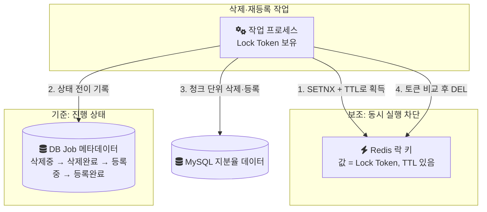
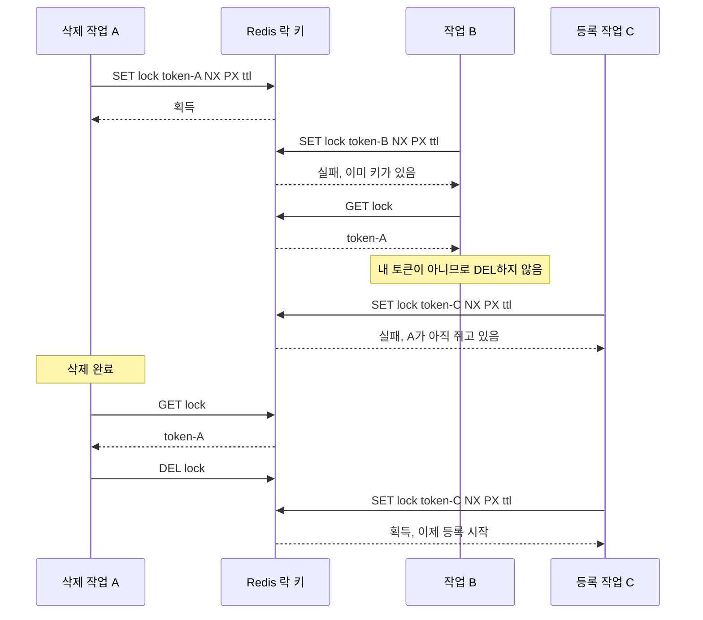
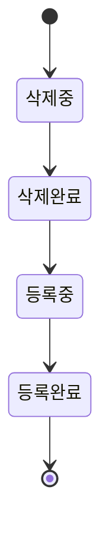

# 5편. 배타적 락과 조건부 해제로 순서를 보장하기

[4편](/posts/bulk-insert-with-lock-part4/)에서 기존 Redis 락의 문제를 두 질문으로 정리했다.
지금 락을 쥔 것은 누구인가, 그리고 그 락을 풀 자격이 있는 것은 누구인가.
기존 구조는 TTL 없이 키를 만들고 `finally`에서 무조건 `DEL`했기 때문에 두 질문 모두에 답하지 못했다.

이 글은 그 답을 구조에 넣은 과정이다.
작업 조건은 앞 편과 같다.
음원 플랫폼 회사의 지분율 시스템에서, 유통사별 월 단위 정산에 쓰이는 지분율을 대량으로 삭제하고 재등록하는 작업이었다.
정기 배치와 운영자 요청이 같은 시간대에 들어올 수 있었고, 2022년 8월부터 11월까지 혼자 설계와 구현을 맡았다.
스택은 Java, Spring Boot, MySQL, Redis, AWS였다.

## 세 가지를 바꿨다

개선은 세 갈래였다.

1. 락 획득: SETNX와 Lock Token, TTL로 다시 만들었다
2. 락 해제: 저장해 둔 토큰과 현재 락의 토큰을 비교해, 일치할 때만 `DEL`했다
3. 작업 순서: 삭제중, 삭제완료, 등록중, 등록완료의 상태 전이 모델을 정의하고 DB Job 메타데이터를 기준 상태로 삼았다. Redis 락은 보조 수단으로 내렸다

1과 2는 4편의 두 질문에 대한 답이고, 3은 락이 작업 순서까지 표현할 수 없다는 한계에 대한 답이다.
바뀐 구조를 먼저 그리면 다음과 같다.



## 획득: SETNX와 Lock Token, TTL

락 획득은 키가 없을 때만 키를 만드는 원자 연산으로 바꿨다.
SETNX는 "SET if Not eXists"의 줄임말이다.
요즘 Redis에서는 `SET` 명령에 `NX` 옵션을 붙여 같은 일을 하고, `PX` 옵션으로 만료 시간을 함께 건다.
Redis 문서가 제시하는 획득 명령은 다음 형태다([Distributed Locks with Redis](https://redis.io/docs/latest/develop/clients/patterns/distributed-locks/)).

```text
SET resource_name my_random_value NX PX 30000
```

여기서 `30000`은 문서의 예시 값이다.
이 프로젝트에서 실제로 건 TTL 값은 기록이 남아 있지 않아 적지 않는다.

키의 값에는 `true` 같은 표시 대신 Lock Token을 넣었다.
Lock Token은 락을 획득할 때마다 새로 만드는 고유한 식별자다.
같은 키를 쓰더라도 값이 실행마다 다르므로, 키의 값을 보면 지금 이 락을 쥔 것이 누구인지 알 수 있다.
문서도 이 값이 "must be unique across all clients and all lock requests"(모든 클라이언트와 모든 락 요청에 걸쳐 고유해야 한다)고 적는다.

TTL은 4편의 첫 번째 실패에 대한 답이다.
락을 쥔 프로세스가 `finally`에 도달하지 못하고 죽어도, TTL이 지나면 키가 사라지고 다음 작업이 락을 얻을 수 있다.

재현 랩에서 같은 획득을 구현하면 다음과 같다.
아래는 당시 코드가 아니라 랩 코드다.

```java
// 랩 코드: SafeRedisLock.java
public boolean tryAcquire(String key, String token, Duration ttl) {
    Boolean acquired = redisTemplate.opsForValue().setIfAbsent(key, token, ttl); // SET key token NX PX ttl
    return Boolean.TRUE.equals(acquired);
}
```

4편의 기존 구조 재현 코드와 비교하면 획득 쪽에서 달라진 것은 `ttl` 인자 하나다.

## 해제: 내 토큰일 때만 지운다

4편에서 더 근본적인 문제로 본 것은 소유권 확인 없는 `DEL`이었다.
그래서 해제는 다음 순서로 바꿨다.

1. 락 키의 현재 값을 `GET`으로 읽는다
2. 획득할 때 저장해 둔 내 토큰과 비교한다
3. 일치할 때만 `DEL`한다

토큰이 다르면 그 락은 이미 내 것이 아니므로 아무것도 하지 않는다.
4편에서 그린 실패 순서에 이 규칙을 넣으면 다음과 같이 바뀐다.



B는 4편에서와 똑같이 `finally`에 도달하지만, 토큰이 다르므로 A의 락을 건드리지 못한다.
C는 A가 스스로 락을 풀 때까지 기다린다.
같은 규칙은 TTL이 만료된 뒤에도 작동한다.
A가 TTL보다 오래 걸려 키가 만료되고 다른 작업이 새로 락을 잡았다면, 늦게 끝난 A의 `GET`은 다른 토큰을 돌려받으므로 A는 새 소유자의 락을 지우지 않는다.

## GET과 DEL 사이에 남는 틈

토큰 비교로 해제가 크게 안전해졌지만, `GET`과 `DEL`을 별도의 명령으로 보내면 둘 사이에 짧은 틈이 남는다.
`GET`으로 내 토큰을 확인한 직후 TTL이 만료되고 다른 프로세스가 락을 잡으면, 이어서 보낸 `DEL`이 새 소유자의 키를 지울 수 있다.

당시 구현이 이 두 단계를 Lua 스크립트로 묶어 원자적으로 실행했는지는 기록이 남아 있지 않다.
그래서 여기서는 표준 방식을 소개하는 데서 그친다.
Redis 문서는 비교와 삭제를 한 번에 하는 방법으로 Lua 스크립트를 제시하고, Redis 8.4부터는 `DELEX key IFEQ value` 명령으로 같은 일을 할 수 있다고 적는다.
Redis 문서는 "Redis guarantees the script's atomic execution."라고 적는다(스크립트 실행의 원자성을 보장한다는 뜻이다. [Scripting with Lua](https://redis.io/docs/latest/develop/programmability/eval-intro/)). 스크립트가 도는 동안 다른 명령이 끼어들지 않으므로 비교와 삭제 사이에 틈이 생기지 않는다.

```lua
if redis.call("get",KEYS[1]) == ARGV[1] then
    return redis.call("del",KEYS[1])
else
    return 0
end
```

재현 랩은 이 스크립트로 해제를 구현했다.

```java
// 랩 코드: SafeRedisLock.java
private static final DefaultRedisScript<Long> COMPARE_AND_DELETE = new DefaultRedisScript<>(
        "if redis.call('get', KEYS[1]) == ARGV[1] then "
                + "return redis.call('del', KEYS[1]) "
                + "else return 0 end",
        Long.class);

public boolean release(String key, String token) {
    Long result = redisTemplate.execute(COMPARE_AND_DELETE, Collections.singletonList(key), token);
    return result != null && result == 1L; // 0이면 내 락이 아니었다는 뜻
}
```

랩 테스트에서는 A가 잡은 키를 비우고 B가 새로 잡게 한 뒤 A가 `release`를 호출하면 `false`가 돌아오고, C는 여전히 락을 얻지 못하는 것을 확인했다([RedisLockRaceConditionTest](https://github.com/polynomeer/engineering-lab/blob/d52297d0ad07c3d8a05a7471192a5655cb8b1378/career-lab/equity-system/src/test/java/com/portfolio/equitylab/lock/RedisLockRaceConditionTest.java), `safeLockPreventsCrossOwnerDeletion`).
TTL을 2초로 걸고 해제하지 않았을 때 5초 안에 다른 토큰이 락을 얻는 것도 같은 테스트에서 확인했다(`safeLockExpiresAutomaticallyViaTtl`).
이 2초와 5초는 테스트용 값이다.

## TTL은 작업 시간과 함께 봐야 한다

TTL을 걸면 생기는 새 질문이 있다.
작업이 TTL보다 오래 걸리면 어떻게 되는가.

Redis 문서는 TTL을 "lock validity time"이라고 부르고, 이것이 자동 해제 시간이자 다른 클라이언트가 락을 얻기 전에 작업을 마쳐야 하는 시간이라고 설명한다.
즉 TTL이 지나면 작업이 아직 진행 중이어도 상호 배제가 끝난다.
이 시스템의 등록은 [3편](/posts/bulk-insert-with-lock-part3/)의 개선 후에도 12분이 걸렸다(개선 전에는 40분 이상).
TTL을 작업 시간보다 짧게 잡으면 작업 도중에 락이 만료되고 다른 작업이 들어올 수 있다.
반대로 너무 길게 잡으면 프로세스가 죽었을 때 그만큼 오래 기다려야 한다.

당시 TTL을 몇 분으로 걸었는지는 기록이 없어 이 글에서 숫자로 말하지 않는다.
대신 이 긴장을 락 하나로 해결하려 하지 않았다는 점을 적어 둔다.
TTL이 어떤 값이든 락은 시간이 지나면 풀린다.
그래서 삭제가 끝났는지, 등록을 시작해도 되는지는 락이 아니라 다음 절의 상태 모델에 물었다.

Redis 문서는 오래 걸리는 작업에 대해 fencing token 구현과 락 연장을 권한다.
이 프로젝트에서 둘 중 무엇을 구현했다는 기록은 없으므로, 이 글에서는 다루지 않는다.

## 순서는 DB의 상태 전이 모델이 맡았다

4편의 마지막에서 확인한 한계는, 락이 지금 한 작업만 실행되게 할 수는 있어도 작업이 어디까지 왔는지는 기록하지 못한다는 점이었다.
그래서 삭제·재등록 작업의 진행 상태를 네 단계로 정의했다.

- 삭제중: 기존 데이터를 지우는 중이다
- 삭제완료: 기존 데이터를 모두 지웠다
- 등록중: 신규 데이터를 넣는 중이다
- 등록완료: 신규 데이터를 모두 넣었다

상태는 한 방향으로만 이동한다.



이 모델에서 삭제와 등록의 순서는 상태의 순서로 표현된다.
등록중은 삭제완료 다음에만 올 수 있으므로, 등록을 시작해도 되는지는 락 키의 존재가 아니라 이 작업의 현재 상태로 판단한다.

이 상태를 어디에 두느냐가 두 번째 결정이었다.
기준 상태는 DB의 Job 메타데이터에 두고, Redis 락은 동시 실행을 막는 보조 수단으로만 썼다.
4편에서 본 것처럼 Redis 락 키는 프로세스가 죽거나 잘못 지워지면 실제 진행 상태와 어긋날 수 있다.
기준을 DB에 두면 Redis에 문제가 생겨 락 키를 믿을 수 없게 되어도, 작업이 어느 단계에 있는지는 DB에서 확인할 수 있다.

두 저장소의 역할을 나누면 이렇다.

| 질문 | 답하는 곳 |
| --- | --- |
| 지금 이 대상에 대해 다른 작업이 실행 중인가 | Redis 락 키와 토큰 |
| 이 작업은 어느 단계까지 왔는가 | DB Job 메타데이터 |
| 등록을 시작해도 되는가 | DB 상태가 삭제완료인지 |
| 둘이 어긋나면 무엇을 믿는가 | DB Job 메타데이터 |

이 상태 모델은 재현 랩에 아직 구현되어 있지 않다.
랩이 재현한 것은 락의 획득과 해제까지다.

## 결과

개선 후 달라진 점은 다음과 같다.

- 소유권 확인 없는 `DEL`로 생기던 Race Condition이 제거됐다
- 동시 실행 환경에서도 삭제와 등록의 순서가 안정적으로 지켜졌다
- 락을 쥔 프로세스가 비정상 종료돼도 TTL로 락이 자동으로 풀렸다
- Redis에 장애가 나도 DB 상태를 기준으로 정합성이 유지됐다

같은 시기에 삭제 처리 시간은 2시간에서 5분으로, 등록 처리 시간은 40분에서 12분으로 줄었다.

## 남은 것

해결하지 못했거나 기록이 남지 않은 부분도 있다.

- TTL의 정확한 값은 남아 있지 않다. 작업 시간과 TTL의 관계를 숫자로 검증할 수 없다
- `GET`과 `DEL`을 Lua로 원자화했는지 확인되지 않는다. 원자화하지 않았다면 두 명령 사이의 틈은 남아 있었다
- 상태 모델의 네 단계에는 실패를 나타내는 상태가 없다. 작업이 중간에 실패했을 때 상태를 어떻게 남기고 어디서부터 다시 실행했는지는 이 글의 근거 자료에 없어 다루지 않았다
- 락 만료 후 늦게 도착한 쓰기를 DB가 거절하게 하는 fencing token은 다루지 않았다. fencing token의 원리는 Redis 문서의 Analysis of Redlock 절에서 이어지는 논의를 참고할 수 있다


## 참고

- [Redis: Distributed Locks with Redis](https://redis.io/docs/latest/develop/clients/patterns/distributed-locks/) — `SET NX PX` 획득, 토큰 비교 해제 스크립트와 `DELEX`, lock validity time, fencing token 권고
- [Redis: Scripting with Lua](https://redis.io/docs/latest/develop/programmability/eval-intro/) — 스크립트의 원자적 실행
- [랩 코드: SafeRedisLock.java](https://github.com/polynomeer/engineering-lab/blob/d52297d0ad07c3d8a05a7471192a5655cb8b1378/career-lab/equity-system/src/main/java/com/portfolio/equitylab/lock/SafeRedisLock.java)
- [랩 코드: LegacyRedisLock.java](https://github.com/polynomeer/engineering-lab/blob/d52297d0ad07c3d8a05a7471192a5655cb8b1378/career-lab/equity-system/src/main/java/com/portfolio/equitylab/lock/LegacyRedisLock.java)
- [랩 테스트: RedisLockRaceConditionTest.java](https://github.com/polynomeer/engineering-lab/blob/d52297d0ad07c3d8a05a7471192a5655cb8b1378/career-lab/equity-system/src/test/java/com/portfolio/equitylab/lock/RedisLockRaceConditionTest.java)
