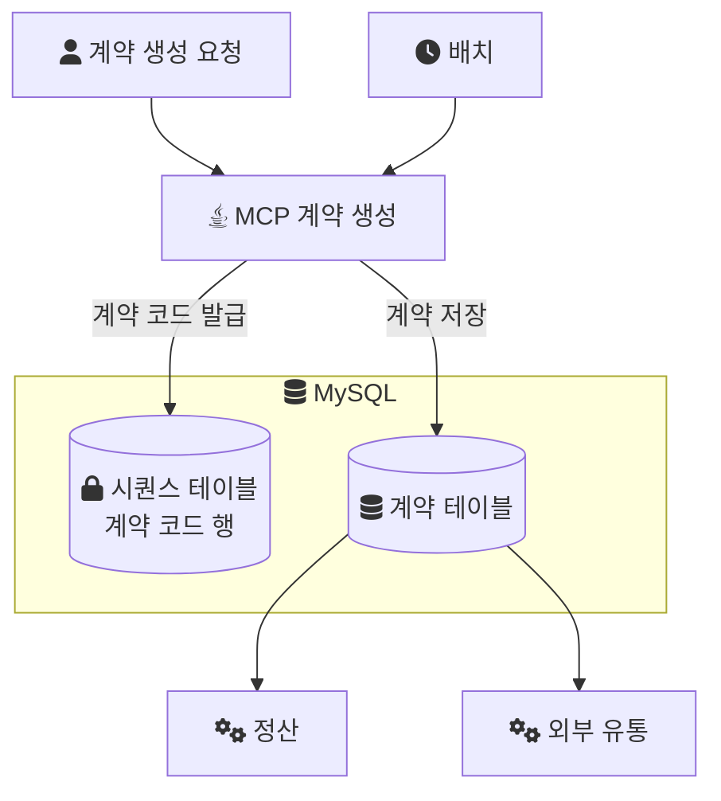
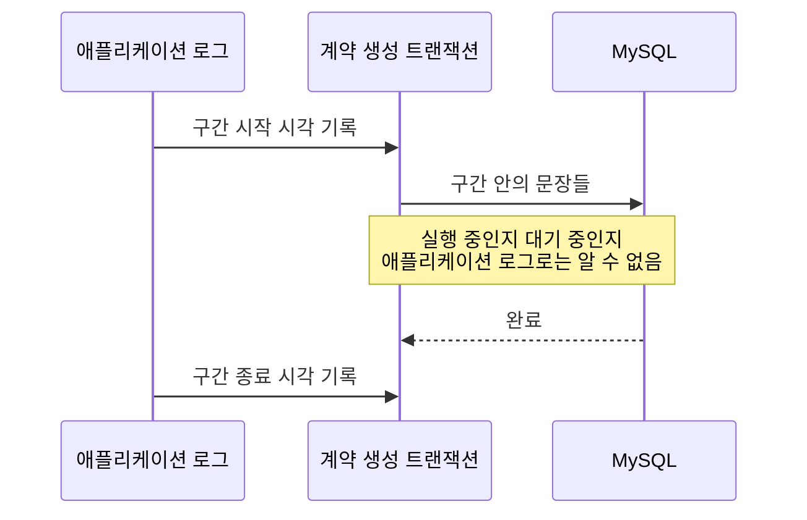

음원 플랫폼 회사에서 콘텐츠 플랫폼(MCP)을 전면 개편하던 2024년, 계약을 생성하는 처리가 2분씩 걸렸다. 이 시리즈는 그 2분의 원인이 된 채번 구조와, 그 구조를 바꾼 방법, 나중에 그 설계에 남은 결함까지 확인한 기록이다.

- Part 1(이 글): 시스템과 증상, 그리고 원인으로 지목된 SELECT 한 줄.
- Part 2: 그 SELECT 안에서 UPDATE가 일어나 락 경합을 만드는 구조.
- Part 3: 채번(번호를 발급하는 일)을 SELECT에서 떼어내 범위 단위로 받고, 비즈니스 트랜잭션 밖으로 옮겼다. 그리고 그 설계가 놓친 것.

## 어떤 시스템이었나

MCP는 음원의 계약, 앨범, 곡 메타데이터를 관리하는 내부 플랫폼이다. 계약이 생성될 때마다 계약 코드가 발급된다. 이 계약 코드는 정산과 외부 유통이 계약을 가리킬 때 쓰는 핵심 식별자다.

이 글의 결론이 다른 시스템에도 통하는지 판단하려면 조건부터 알아야 한다.

- 스택: Java, Spring Boot, MySQL. 데이터 변경은 MyBatis, 개편하면서 조회 일부를 JPA·QueryDSL로 옮겼다([조회 전환 기록](/posts/shadow-release-query-migration/)).
- 팀: 백엔드 3명. 나는 백엔드 리딩을 맡았고, 이 채번 구조 개선은 내가 직접 구현한 범위다.
- 트래픽: 운영 인스턴스는 여러 대였지만, 사용자와 트래픽 자체가 적은 내부 시스템이었다. 당시 설계도 단일 서버 위주로 쓰인다는 전제에서 출발했다.
- 채번 방식: 시퀀스 테이블의 행을 증가시키는 함수로 계약 코드를 발급하고 있었다. MySQL에는 Oracle의 `SEQUENCE` 같은 객체가 없어서, 이런 테이블 기반 채번은 MySQL에서 흔히 쓰이는 방식이다.

계약 건수나 초당 요청 수 같은 규모 수치는 기록으로 남아 있지 않다. 그래서 이 시리즈에서 운영에서 나온 숫자는 계약 생성 처리 시간의 변경 전과 후, 2분과 10초 두 개뿐이다. 랩과 문서에서 가져온 숫자는 그때마다 출처를 밝힌다.

계약 코드가 어디서 발급되고 어디로 쓰이는지 그림으로 보면 이렇다.



계약 생성 요청과 배치가 모두 같은 시퀀스 행에서 번호를 받는다는 점이 이후 이야기 전체의 배경이다.

## 증상: 계약 생성에 2분이 걸렸다

드러난 증상은 세 가지였다.

- 계약 생성 처리에 2분이 걸렸다.
- 요청이 동시에 들어오면 대기 시간이 늘었다.
- 배치 처리에서도 병목이 커졌다.

세 증상은 모두 "동시에 무언가를 하면 더 느려진다"는 방향을 가리킨다. 혼자 실행될 때의 계산 비용보다, 여러 요청이 같은 자원을 두고 순서를 기다리는 비용을 의심하게 만드는 모양이다.

## 원인으로 지목된 SELECT 한 줄

원인은 계약 코드를 받아 오는 방식에 있었다. 계약 코드를 생성할 때 SELECT 문 안에서 시퀀스 증가 함수를 호출하고 있었고, 그 함수가 시퀀스 테이블의 행을 UPDATE하면서 row-level 락 경합이 생겼다. 그 결과가 동시 요청 시의 대기 시간 증가와 배치 병목이었다.

당시 이 원인을 어떤 측정과 순서로 찾아냈는지는 기록으로 남아 있지 않다. 그래서 이 글은 진단 과정을 재구성하지 않는다. 대신 이 원인이 왜 알아보기 어려운 형태인지, 그리고 같은 종류의 문제를 일반적으로 어떻게 확인하는지를 정리한다.

호출부는 대략 이런 형태다.

> 아래 함수 이름과 SQL은 회사의 실제 소스가 아니라 구조를 설명하려고 다시 구성한 예시다.

```sql
SELECT next_seq('CONTRACT_CODE');
```

이 한 줄은 문장도 SELECT이고 이름도 "다음 번호를 가져온다"로 읽힌다. 겉모양만 보면 읽기다. 하지만 함수 안에서 시퀀스 행을 갱신한다면, 이 문장은 쓰기이고 쓰기에 따르는 락을 건다.

## 일반론: 이런 원인이 잘 보이지 않는 이유

이 절은 당시의 경험이 아니라, 이런 구조의 병목이 일반적으로 어떻게 드러나는지에 대한 설명이다.

첫째, 문장의 종류가 성질을 가린다. InnoDB에서 평범한 SELECT는 락을 걸지 않기 때문에, SELECT 문은 락 경합의 용의자 목록에서 빠지기 쉽다. 함수 안에 UPDATE가 들어 있으면 바깥 문장이 SELECT여도 락은 걸린다. 이 차이는 2편에서 MySQL 문서와 함께 다룬다.

둘째, 대기는 원인과 다른 곳에 찍힌다. 락을 오래 쥔 트랜잭션은 자기 일을 정상적으로 하고 있을 뿐이고, 느려지는 것은 그 락을 기다리는 다른 요청이다. 애플리케이션 로그에서 문장 하나의 앞뒤 시각을 찍으면, 그 사이가 길다는 것은 알 수 있어도 DB가 그 문장을 실행하고 있었는지 실행 차례를 기다리고 있었는지는 알 수 없다. 기다리는 이유도 여러 가지다.

- 다른 트랜잭션이 쥔 락(같은 데이터를 동시에 바꾸지 못하게 DB가 거는 잠금)
- 커넥션 풀에서 커넥션을 받지 못한 대기
- 디스크나 로그 쓰기 같은 자원 경합

한 [트랜잭션](/posts/transaction/) 안에서 애플리케이션이 보는 것과 DB에서 일어나는 것을 나란히 놓으면 이렇다.



셋째, 부하가 적으면 거의 드러나지 않는다. 동시에 들어오는 요청이 없으면 기다릴 상대도 없다. 그래서 이런 병목은 요청이 몰리거나 배치가 함께 돌 때 커진다. 이번 증상이 "동시 요청 시 대기 증가"와 "배치 병목"이었던 것과 같은 모양이다.

## 일반론: 실행과 대기를 DB에서 구분하는 방법

실행과 대기의 구분은 DB 쪽에서 해야 한다. 아래는 일반적인 확인 방법이고, 당시 이 쿼리로 확인했다는 기록은 없다.

MySQL 8.0이라면 `performance_schema.data_lock_waits`가 그 자리다. [MySQL 문서](https://dev.mysql.com/doc/refman/8.0/en/performance-schema-data-lock-waits-table.html)에 따르면 이 테이블은 어떤 락 요청이 어떤 보유 락에 막혀 있는지를 요청 트랜잭션(`REQUESTING_ENGINE_TRANSACTION_ID`)과 보유 트랜잭션(`BLOCKING_ENGINE_TRANSACTION_ID`) 쌍으로 보여 준다. 느린 구간이 지나가는 동안 아래 쿼리를 돌려 행이 나오면, 그 구간은 실행이 아니라 대기다.

```sql
SELECT w.REQUESTING_ENGINE_TRANSACTION_ID AS waiting_trx,
       w.BLOCKING_ENGINE_TRANSACTION_ID   AS blocking_trx,
       l.OBJECT_NAME, l.LOCK_TYPE, l.LOCK_MODE
FROM performance_schema.data_lock_waits w
JOIN performance_schema.data_locks l
  ON l.ENGINE_LOCK_ID = w.BLOCKING_ENGINE_LOCK_ID;
```

`OBJECT_NAME`에 저장 대상 테이블이 아니라 다른 테이블이 나온다면, 저장 자체가 느린 것이 아니라 저장에 이르기까지 필요한 무언가가 다른 트랜잭션에 묶여 있다는 뜻이다. 이 구조에서라면 그 다른 테이블이 시퀀스 테이블이 된다.

## 이 글에서 확인된 것과 남은 질문

사실로 남아 있는 것은 이렇다.

- 계약 생성 처리에 2분이 걸렸고, 동시 요청 시 대기가 늘고 배치 병목이 커졌다.
- 계약 코드를 SELECT 안의 시퀀스 증가 함수로 발급했고, 그 함수가 시퀀스 행을 UPDATE해 row-level 락 경합이 생겼다.

남은 질문은 메커니즘이다. 읽기처럼 보이는 문장이 어떤 락을 걸고, 그 락을 언제 놓기에 다른 요청을 기다리게 하는가. 다음 편에서는 `next_seq`의 내부를 열어 이 질문에 답한다.

## 참고

- [MySQL 8.0 Reference Manual - The data_lock_waits Table](https://dev.mysql.com/doc/refman/8.0/en/performance-schema-data-lock-waits-table.html) — 대기 중인 락 요청과 그것을 막는 보유 락의 쌍
