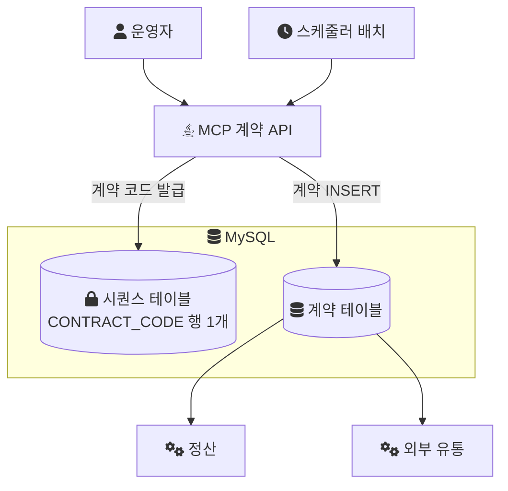
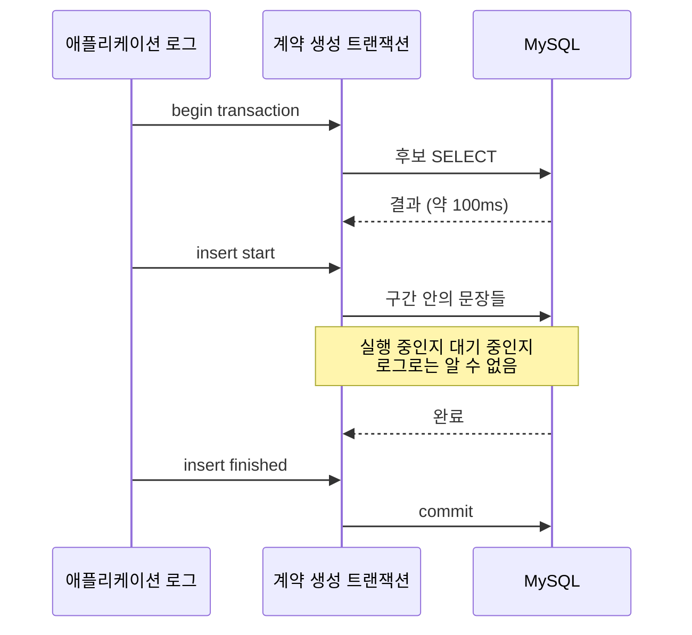

음원 플랫폼 회사에서 콘텐츠 플랫폼(MCP)을 전면 개편하던 2024년, 계약을 생성하는 처리가 2분씩 걸렸다. 이 시리즈는 그 2분이 어디서 나오는지 찾고, 원인을 없애는 구조로 바꾸고, 나중에 그 구조에 남은 결함까지 확인한 기록이다.

- Part 1(이 글): 증상과 첫 가설. INSERT를 튜닝했는데 시간이 기대만큼 줄지 않았다.
- Part 2: 계약 코드를 받아 오는 SELECT 안에서 UPDATE가 일어나고 있었다.
- Part 3: 채번(번호를 발급하는 일)을 SELECT에서 떼어내 범위 단위로 받고, 비즈니스 트랜잭션 밖으로 옮겼다. 그리고 그 설계가 놓친 것.

## 어떤 시스템이었나

MCP는 음원의 계약, 앨범, 곡 메타데이터를 관리하는 내부 플랫폼이다. 운영자가 화면에서 계약을 등록하면, 계약마다 계약 코드가 하나씩 발급된다. 이 계약 코드는 정산과 외부 유통이 계약을 가리킬 때 쓰는 핵심 식별자라서, 중복되면 정산과 유통 양쪽이 틀어진다.

이 글의 결론이 다른 시스템에도 통하는지 판단하려면 조건부터 알아야 한다.

- 스택: Java, Spring Boot, MySQL(InnoDB). 데이터 변경은 MyBatis, 개편하면서 조회 일부를 JPA·QueryDSL로 옮겼다([조회 전환 기록](/posts/shadow-release-query-migration/)).
- 팀: 백엔드 3명. 나는 백엔드 리딩을 맡았고, 이 채번 구조 개선은 내가 직접 구현한 범위다.
- 트래픽: 운영 인스턴스는 여러 대였지만, 사용자와 트래픽 자체가 적은 내부 시스템이었다. 당시 설계도 단일 서버 위주로 쓰인다는 전제에서 출발했다.
- 채번 방식: MySQL에는 Oracle의 `SEQUENCE` 같은 객체가 없어서, 번호를 담은 시퀀스 테이블의 행 하나를 증가시키는 함수로 계약 코드를 발급하고 있었다.

계약 건수나 초당 요청 수 같은 규모 수치는 기록으로 남아 있지 않다. 그래서 이 시리즈의 숫자는 처리 시간(2분, 약 1분 30초, 10초) 세 개뿐이다.

계약 생성 경로를 그림으로 보면 이렇다.



화면 요청과 배치가 모두 같은 시퀀스 행 하나에서 번호를 받는다는 점이 이후 이야기 전체의 배경이다.

## 증상: 실패하지 않지만 2분이 걸린다

처리는 실패하지 않았다. 오류도, 타임아웃도 없었다. 다만 계약 생성 처리에 2분이 걸렸고, 요청이 동시에 몰리면 대기 시간이 더 길어졌다. 배치가 도는 시간대에는 배치 자체도 병목이 됐다.

처리의 흐름은 단순했다.

- 입력: 생성할 계약 정보
- 처리: 계약마다 계약 코드를 발급하고 검증한다
- 출력: 계약 테이블에 다건 INSERT

애플리케이션 로그는 대략 이런 모양이었다.

```text
[INFO] select contract candidates finished (≈100ms)
[INFO] start inserting contracts
... (약 1~2분)
[INFO] insert contracts finished
```

후보를 읽는 쿼리는 100ms 안팎에 끝나고, 시간의 대부분은 `start inserting`과 `insert finished` 사이에 찍혀 있었다. 로그만 보면 INSERT가 병목이었다.

## 첫 가설: INSERT가 느리다

이 가설에는 근거가 있었다. INSERT는 쓰기 작업이고, 인덱스가 많을수록 비용이 늘고, 다건 INSERT를 한 건씩 보내면 네트워크 왕복과 SQL 파싱 비용이 건수만큼 쌓인다. MyBatis의 배치 설정이 제대로 되어 있지 않을 가능성도 있었다.

그래서 전형적인 INSERT 튜닝부터 했다.

- `ExecutorType.BATCH` 적용
- multi-row INSERT로 변경
- 로그 출력 최소화

`ExecutorType.BATCH`는 MyBatis가 갱신 문장을 모아 한 번에 보내는 실행 모드다. [MyBatis 문서](https://mybatis.org/mybatis-3/java-api.html)는 이 실행기가 "will batch all update statements"(모든 갱신 문장을 묶어 보낸다)고 설명한다. multi-row INSERT는 `VALUES` 뒤에 여러 행을 한 문장으로 묶는 방식이다.

```sql
INSERT INTO contract (...)
VALUES
  (...),
  (...),
  (...);
```

둘 다 INSERT 자체의 비용을 줄이는 정석적인 방법이다.

## 2분이 1분 30초가 됐다

튜닝 후 실행 시간은 2분에서 약 1분 30초로 줄었다. 빨라지긴 했지만, INSERT가 병목의 대부분이었다면 이 정도 변경으로는 더 크게 줄었어야 했다.

이상한 점이 두 가지 더 있었다.

1. 처리할 건수가 늘면 실행 시간이 거의 선형으로 늘었다.
2. INSERT 문장 자체는 단순했다. 트리거도, FK도, 서브쿼리도 없었다.

SQL 실행 비용을 줄였는데 시간이 크게 줄지 않았다면, 남은 시간은 SQL을 실행하는 데가 아니라 다른 데서 쓰이고 있을 가능성이 컸다. 30초는 INSERT 몫이었지만, 남은 1분 30초는 INSERT로 설명되지 않았다.

## 로그 구간은 "실행 중"과 "대기 중"을 구분하지 못한다

그래서 믿고 있던 가정부터 다시 봤다. 로그를 [트랜잭션](/posts/transaction/) 단위로 쪼개 보면 이렇다.

```text
[INFO] begin transaction
[INFO] select candidates
[INFO] select finished
[INFO] insert start
... (지연)
[INFO] insert finished
[INFO] commit
```

이 로그가 말해 주는 것은 `insert start`와 `insert finished` 사이가 길다는 사실 하나다. 그 구간 안의 문장이 DB에서 실제로 실행되고 있었는지, 아니면 실행 차례를 기다리고 있었는지는 알려 주지 않는다. 문장 하나가 기다리는 이유는 여러 가지다.

- 다른 트랜잭션이 쥔 락(같은 데이터를 동시에 바꾸지 못하게 DB가 거는 잠금)
- 커넥션 풀에서 커넥션을 받지 못한 대기
- 디스크나 로그 쓰기 같은 자원 경합

애플리케이션 로그에는 이 셋이 모두 "느린 구간"으로만 찍힌다.

한 트랜잭션의 시간을 위아래로 펼치면, 로그가 보여 주는 것과 보여 주지 않는 것이 갈린다.



이 구분은 DB 쪽에서 해야 한다. MySQL 8.0이라면 `performance_schema.data_lock_waits`가 그 자리다. [MySQL 문서](https://dev.mysql.com/doc/refman/8.0/en/performance-schema-data-lock-waits-table.html)에 따르면 이 테이블은 어떤 락 요청이 어떤 보유 락에 막혀 있는지를 요청 트랜잭션(`REQUESTING_ENGINE_TRANSACTION_ID`)과 보유 트랜잭션(`BLOCKING_ENGINE_TRANSACTION_ID`) 쌍으로 보여 준다. 느린 구간이 지나가는 동안 아래 쿼리를 돌려 행이 나오면, 그 구간은 실행이 아니라 대기다.

```sql
SELECT w.REQUESTING_ENGINE_TRANSACTION_ID AS waiting_trx,
       w.BLOCKING_ENGINE_TRANSACTION_ID   AS blocking_trx,
       l.OBJECT_NAME, l.LOCK_TYPE, l.LOCK_MODE
FROM performance_schema.data_lock_waits w
JOIN performance_schema.data_locks l
  ON l.ENGINE_LOCK_ID = w.BLOCKING_ENGINE_LOCK_ID;
```

`OBJECT_NAME`에 계약 테이블이 아니라 다른 테이블이 나온다면, INSERT가 느린 것이 아니라 INSERT에 이르기까지 필요한 무언가가 다른 트랜잭션에 묶여 있다는 뜻이다.

## 질문을 바꿨다

여기서 질문을 바꿨다.

- 이전 질문: INSERT가 느린가?
- 바꾼 질문: INSERT 구간 안에서, 이 트랜잭션은 무엇을 기다리고 있나?

두 번째 질문에 답하려면 INSERT 문장 하나가 아니라 같은 트랜잭션 안에서 INSERT 전에 실행되는 모든 문장을 봐야 했다. 계약 하나를 넣으려면 계약 코드가 먼저 있어야 하고, 계약 코드는 INSERT 직전에 SELECT로 받아 오고 있었다. 그 SELECT는 대략 이런 형태였다.

> 아래 함수 이름과 SQL은 회사의 실제 소스가 아니라 구조를 설명하려고 다시 구성한 예시다.

```sql
SELECT next_seq('CONTRACT_CODE');
```

오래전부터 있던 코드였고, 다들 "SELECT로 번호 하나 가져오는 것"으로 여기고 있었다. 이름도 조회처럼 생겼고, 문장도 SELECT다. 하지만 바꾼 질문 앞에서는 이 한 줄도 확인 대상이었다.

- 이 함수는 정말 읽기만 하는가?
- 이 함수가 DB 안에서 무엇을 건드리고, 그것을 언제 놓는가?

## 이 시점에 확인된 것과 아닌 것

확인된 것은 세 가지였다.

- 실행 시간의 대부분이 INSERT 구간에 찍힌다.
- INSERT 튜닝으로는 2분이 약 1분 30초까지만 줄었고, 시간은 건수에 비례해 늘었다.
- INSERT 직전에 계약 코드를 받아 오는 SELECT가 있고, 그 안에서 시퀀스 함수가 호출된다.

확인되지 않은 것은 그 함수가 무엇을 하는가였다. 그래도 의심의 범위는 바뀌었다. INSERT 문장에서, INSERT를 감싼 트랜잭션 전체로. 다음 편에서는 `next_seq`의 내부를 열어 SELECT 안에 무엇이 들어 있었는지 본다.

## 참고

- [MyBatis 3 Java API - SqlSession, ExecutorType](https://mybatis.org/mybatis-3/java-api.html) — `SIMPLE`, `REUSE`, `BATCH` 실행기 설명
- [MySQL 8.0 Reference Manual - The data_lock_waits Table](https://dev.mysql.com/doc/refman/8.0/en/performance-schema-data-lock-waits-table.html) — 대기 중인 락 요청과 그것을 막는 보유 락의 쌍
