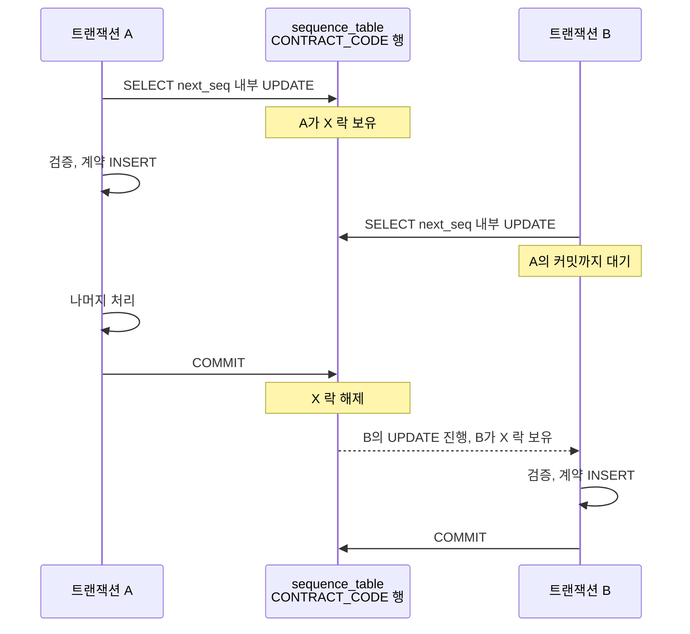
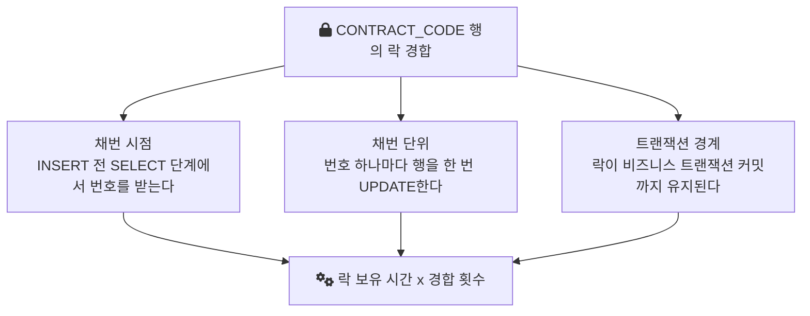

[1편](/posts/sequence-part1/)에서는 계약 생성 처리에 2분이 걸리고 동시 요청과 배치에서 대기가 커졌다는 증상, 그리고 그 원인이 계약 코드를 받아 오는 `SELECT next_seq('CONTRACT_CODE')` 한 줄 안의 시퀀스 증가였다는 데까지 적었다. 남은 질문은 메커니즘이었다. 이 글은 그 함수 안을 열어, 읽기처럼 보이는 문장이 어떤 락을 걸고 그 락이 왜 다른 요청을 기다리게 하는지 정리한다.

> 이 글의 함수, 테이블 이름과 SQL은 회사의 실제 소스가 아니라 구조를 설명하려고 MySQL 문법으로 다시 구성한 예시다. 확인된 사실은 "SELECT 안에서 시퀀스 증가 함수를 호출했고, 그 함수가 시퀀스 테이블의 행을 UPDATE해 락 경합이 생겼다"는 것, 그리고 해결책의 하나로 시퀀스 증가를 별도 트랜잭션으로 분리했다는 것(곧 그 전에는 비즈니스 트랜잭션 안에서 실행됐다는 것)까지다. 나머지는 이 사실과 InnoDB 문서로부터 따라 나오는 설명이다.

## 함수 안에 UPDATE가 있었다

호출부는 조회처럼 생겼다.

```sql
SELECT next_seq('CONTRACT_CODE');
```

함수 본문은 달랐다. 구조만 옮기면 이렇다.

```sql
CREATE FUNCTION next_seq(p_name VARCHAR(50)) RETURNS BIGINT
MODIFIES SQL DATA
BEGIN
  DECLARE v BIGINT;
  UPDATE sequence_table
     SET value = value + 1
   WHERE sequence_name = p_name;   -- 1. 시퀀스 행을 갱신한다
  SELECT value INTO v
    FROM sequence_table
   WHERE sequence_name = p_name;   -- 2. 갱신한 값을 읽는다
  RETURN v;
END
```

`next_seq`는 이름과 호출 문장만 보면 읽기지만, 실제로는 시퀀스 테이블의 행 하나를 갱신하고 그 값을 다시 읽는 쓰기 함수였다. 바깥 문장이 SELECT라는 사실은 안에서 일어나는 UPDATE의 성질을 바꾸지 않는다.

이 착시에는 이유가 있다. InnoDB에서 평범한 SELECT는 락을 걸지 않는다. [MySQL 문서](https://dev.mysql.com/doc/refman/8.0/en/innodb-consistent-read.html)는 READ COMMITTED와 REPEATABLE READ에서 SELECT가 기본으로 쓰는 consistent read를 이렇게 설명한다. "A consistent read does not set any locks on the tables it accesses"(consistent read는 접근하는 테이블에 어떤 락도 걸지 않는다). 그래서 "SELECT는 락과 무관하다"는 감각이 생긴다. 이 감각은 [MVCC](/posts/mvcc/)(행의 이전 버전을 보여 주어 읽기와 쓰기가 서로 막지 않게 하는 방식)로 처리되는 순수한 읽기에만 맞다. 함수 안의 UPDATE는 consistent read가 아니라 잠금을 거는 쓰기다.

## UPDATE가 거는 락과 그 락이 풀리는 시점

위 예시의 시퀀스 테이블은 `sequence_name`이 기본 키다. InnoDB 문서([Locks Set by Different SQL Statements](https://dev.mysql.com/doc/refman/8.0/en/innodb-locks-set.html))에 따르면 `UPDATE ... WHERE`는 원래 탐색 중 만나는 레코드마다 배타적 next-key 락을 걸지만, 유일 인덱스로 한 행을 찾는 경우에는 인덱스 레코드 락 하나만 건다. 그래서 `next_seq('CONTRACT_CODE')`는 `CONTRACT_CODE` 행 하나에 X 락(배타 락, 다른 트랜잭션이 그 행을 읽기 위해 잠그거나 고치지 못하게 하는 락)을 건다.

문제는 이 락이 언제 풀리느냐다. 같은 문서는 트랜잭션이 쥔 InnoDB 락이 모두 커밋이나 롤백 때 풀린다고 적는다. 함수가 반환됐다고 풀리는 것이 아니다. 그리고 [InnoDB Locking](https://dev.mysql.com/doc/refman/8.0/en/innodb-locking.html) 문서에 따르면 T1이 행에 X 락을 쥐고 있으면, 다른 트랜잭션 T2가 같은 행에 요청한 락은 바로 승인되지 않고 T1이 락을 놓을 때까지 기다린다.

`next_seq`는 계약 생성 트랜잭션 안에서 호출됐다. 그래서 락을 쥐는 구간은 "번호 하나 증가"가 아니라 "번호를 받은 순간부터 그 트랜잭션이 커밋할 때까지"가 된다. 그 사이에 있는 검증과 저장 같은 나머지 처리가 모두 락 보유 시간에 들어간다.

## 두 트랜잭션이 같은 행에서 만나면

계약 생성 트랜잭션 두 개가 거의 동시에 시작하면 순서는 아래처럼 된다.



B가 기다리는 시간은 A의 UPDATE 한 번이 아니라 A의 트랜잭션 전체다. B 쪽에서 보면 이 대기는 "계약 코드를 받는 SELECT 한 줄"이 멈춘 것으로 나타난다. [1편](/posts/sequence-part1/)에서 말한 "대기는 원인과 다른 곳에 찍힌다"가 이 모양이다.

같은 트랜잭션 안에서 `next_seq`를 여러 번 부르는 것 자체는 막히지 않는다. 자기가 이미 쥔 락을 다시 요청하는 것이기 때문이다. 막히는 것은 언제나 다른 트랜잭션이다. 그래서 동시에 들어온 요청과 배치는 앞 트랜잭션이 끝나기를 줄지어 기다린다.

애플리케이션 스레드와 커넥션이 몇 개든, 계약 코드 발급은 이 행 하나 앞에서 한 줄로 선다. 애플리케이션의 병렬성이 DB의 행 하나 때문에 직렬화된 것이다.

## 이 구조가 증상을 설명하는 방식

1편의 증상을 이 구조로 다시 읽으면 이렇다. 이 해석은 위 구조에서 따라 나오는 추론이고, 당시 문장별 대기 시간을 따로 잰 기록은 남아 있지 않다.

- 동시 요청 때 대기가 늘어난 이유: 기다리는 쪽이 늘면 줄이 길어진다. 각 요청의 대기는 자기 실행 시간이 아니라 앞선 트랜잭션들의 길이의 합이다.
- 배치 병목이 커진 이유: 배치도 같은 시퀀스 행에서 번호를 받으므로, 배치와 다른 요청이 서로의 트랜잭션이 끝나기를 기다린다.

대기가 길어지면 다른 위험도 생긴다. 이것은 일반적인 InnoDB 동작이다. InnoDB는 행 락을 기다리는 시간이 `innodb_lock_wait_timeout`을 넘으면 기다리던 쪽에 오류를 돌려준다([문서](https://dev.mysql.com/doc/refman/8.0/en/innodb-parameters.html#sysvar_innodb_lock_wait_timeout), 기본값 50초). 락 보유 시간이 이 값에 가까워지면 느린 것이 실패로 바뀔 수 있다.

## DB에서는 이렇게 보인다

1편에서 일반적인 확인 방법으로 든 `performance_schema.data_lock_waits`를 위 상황에서 조회하면, 기다리는 트랜잭션 B와 막고 있는 트랜잭션 A의 쌍이 나오고, 막고 있는 락의 정보는 `data_locks`에서 이런 모양일 것이다.

```text
OBJECT_NAME     INDEX_NAME  LOCK_TYPE  LOCK_MODE       LOCK_DATA
sequence_table  PRIMARY     RECORD     X,REC_NOT_GAP   'CONTRACT_CODE'
```

`X,REC_NOT_GAP`은 갭 없이 레코드 하나에만 걸린 배타 락이라는 뜻이다. 위 출력은 구조에서 예상되는 모양을 적은 것이고, 당시 운영 DB에서 떠 둔 출력은 아니다. 핵심은 `OBJECT_NAME`이 계약 테이블이 아니라 시퀀스 테이블이라는 점이다. 계약을 저장하는 요청의 대기가 저장 대상과 상관없는 테이블에서 생긴다는 것을 DB는 이렇게 직접 보여 준다.

## 고쳐야 할 것은 세 겹이었다

이 구조를 축으로 나눠 보면, 병목은 한 가지 결함이 아니라 세 가지가 겹친 결과다. 3편에서 다룰 세 가지 변경이 각각 이 축 하나씩에 대응한다.



- 시점: 번호를 SELECT 단계에서 받으니, 그 뒤의 처리 시간이 모두 락 보유 시간이 된다.
- 단위: 번호 하나에 UPDATE 하나라, 경합 횟수가 발급 건수와 같다.
- 경계: 채번이 비즈니스 트랜잭션 안에 있으니, 락은 비즈니스 로직이 끝나야 풀린다.

SQL 문장을 다듬는 것으로는 이 셋 중 어느 것도 바뀌지 않는다. 필요한 것은 쿼리 튜닝이 아니라 채번 구조의 변경이었다. [3편](/posts/sequence-part3/)에서는 이 세 축을 각각 어떻게 바꿨는지, 그 결과 2분이 10초가 된 과정, 그리고 그 설계가 놓친 다중 인스턴스 문제를 다룬다.

## 참고

- [MySQL 8.0 Reference Manual - Consistent Nonlocking Reads](https://dev.mysql.com/doc/refman/8.0/en/innodb-consistent-read.html) — 평범한 SELECT는 락을 걸지 않는다
- [MySQL 8.0 Reference Manual - InnoDB Locking](https://dev.mysql.com/doc/refman/8.0/en/innodb-locking.html) — X 락과 레코드 락, 락 요청이 대기하는 조건
- [MySQL 8.0 Reference Manual - Locks Set by Different SQL Statements in InnoDB](https://dev.mysql.com/doc/refman/8.0/en/innodb-locks-set.html) — 유일 인덱스 UPDATE의 레코드 락, 커밋·롤백 시 락 해제
- [MySQL 8.0 Reference Manual - InnoDB Startup Options and System Variables](https://dev.mysql.com/doc/refman/8.0/en/innodb-parameters.html#sysvar_innodb_lock_wait_timeout) — `innodb_lock_wait_timeout`
- [MySQL 8.0 Reference Manual - The data_lock_waits Table](https://dev.mysql.com/doc/refman/8.0/en/performance-schema-data-lock-waits-table.html)
