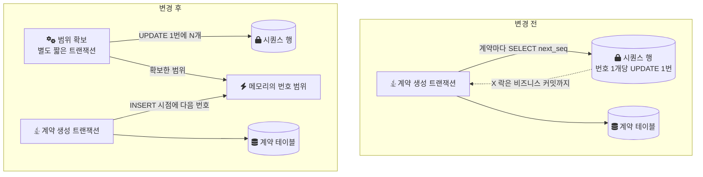
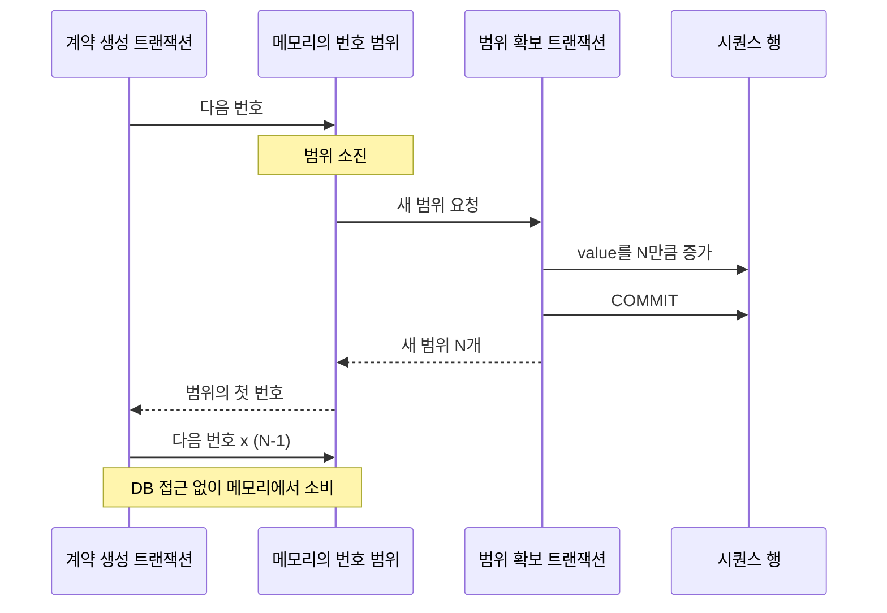
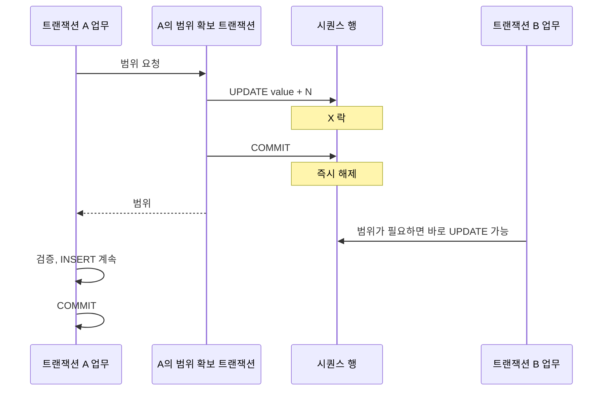
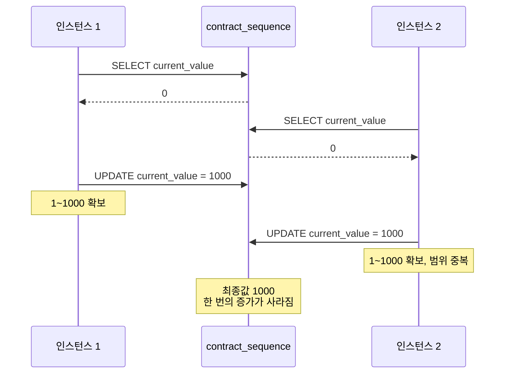
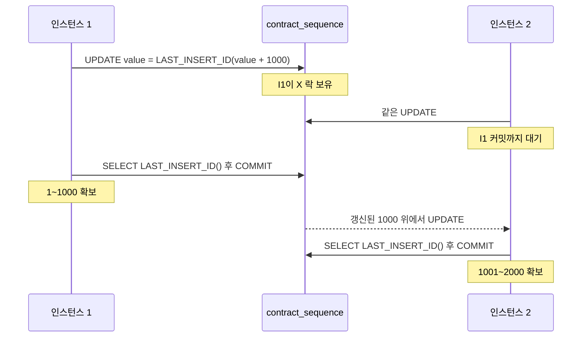

[1편](/posts/sequence-part1/)에서는 계약 생성에 2분이 걸리고 동시 요청과 배치에서 대기가 커졌다는 증상과, 그 원인이 계약 코드를 받아 오는 `SELECT next_seq('CONTRACT_CODE')` 안의 시퀀스 증가라는 것을 적었다. 2편에서는 그 안의 UPDATE가 시퀀스 행에 X 락을 걸고, 그 락이 비즈니스 트랜잭션이 커밋할 때까지 풀리지 않아 동시에 들어온 요청과 배치가 그 행 앞에서 줄을 서는 구조를 정리했다.

2편 끝에서 병목을 세 축으로 나눴다. 채번 시점, 채번 단위, 트랜잭션 경계다. 이 글은 세 축을 각각 어떻게 바꿨는지, 그 결과 2분이 10초가 된 과정, 그리고 그 설계가 여러 인스턴스 환경을 고려하지 못해 남긴 결함과 그 결함을 고치는 방향을 정리한다.

> 퇴사한 회사의 코드에는 지금 접근할 수 없다. 이 글의 코드는 내가 같은 문제를 처음부터 다시 구현한 [랩](https://github.com/polynomeer/engineering-lab/blob/d52297d0ad07c3d8a05a7471192a5655cb8b1378/career-lab/mcp-platform/README.md)의 코드이거나, 구조를 설명하려고 다시 구성한 예시다. 랩의 테이블 이름, 범위 크기(500, 1000), 스레드 수는 재현용으로 정한 값이지 운영값이 아니다.

## 바꾸기 전과 후

전체 그림부터 보면 이렇다.



변경 전에는 비즈니스 트랜잭션이 시퀀스 행을 직접 잡고 있었다. 변경 후에는 시퀀스 행을 만지는 일이 별도의 짧은 트랜잭션으로 빠지고, 비즈니스 트랜잭션은 메모리에 확보해 둔 범위에서 번호를 꺼내 쓰기만 한다.

## 첫 번째 축: 채번을 SELECT 단계에서 빼내 INSERT 시점으로

변경 전에는 계약 코드를 SELECT 단계에서 받았다.

```text
계약 코드 SELECT (next_seq 내부 UPDATE, 여기서 X 락 획득)
  → 검증
  → 다른 계약 처리
  → INSERT
  → COMMIT (여기서 X 락 해제)
```

키가 실제로 필요한 순간은 INSERT 하나뿐인데, 번호를 받는 시점이 그보다 앞에 있었기 때문에 그 사이의 처리 시간이 전부 락 보유 시간이 됐다. 그래서 채번 로직을 SELECT 단계에서 제거하고, 번호는 INSERT 시점에 꺼내 쓰도록 옮겼다.

```text
검증
  → 다른 계약 처리
  → INSERT 시점에 확보된 범위에서 다음 번호를 꺼냄 (DB 락 없음)
  → INSERT
  → COMMIT
```

다만 이 축만 바꾸면 번호를 꺼내는 일이 여전히 시퀀스 행 UPDATE라서, 경합은 그대로 남고 위치만 뒤로 밀린다. INSERT 시점에 번호를 "DB 락 없이" 꺼낼 수 있으려면, 번호를 미리 여러 개 확보해 두는 두 번째 축이 함께 바뀌어야 했다.

## 두 번째 축: 번호를 하나씩이 아니라 범위로 받기

시퀀스 테이블을 범위 할당(range allocation) 방식으로 바꿨다. 한 번의 증가로 N개의 번호를 통째로 확보하고, 그 범위를 애플리케이션 메모리에서 순서대로 소비한다. 범위를 다 쓰면 다시 한 번 증가시켜 다음 범위를 받는다. JPA의 `@SequenceGenerator`가 `allocationSize`로 하는 일과 같은 원리다.



시퀀스 행에 대한 경합이 없어지는 것은 아니다. 빈도가 "번호 하나마다"에서 "N개마다 한 번"으로 줄어든다. 계약 K건을 만드는 동안 시퀀스 행을 만지는 횟수가 K번에서 K/N번이 된다.

당시 N을 얼마로 잡았고 어떤 근거로 정했는지는 기록으로 남아 있지 않다. 그래서 크기를 고르는 기준은 이 글 뒷부분에 일반론으로만 정리한다.

## 세 번째 축: 시퀀스 증가를 별도 트랜잭션으로

범위를 확보하는 UPDATE를 비즈니스 트랜잭션 안에서 실행하면, 첫 번째와 두 번째 축을 바꿔도 2편의 문제가 그대로 돌아온다. 범위 확보는 드물어지지만, 한 번 확보할 때마다 시퀀스 행의 락이 비즈니스 트랜잭션이 끝날 때까지 유지되기 때문이다. 그래서 시퀀스 증가 로직을 별도 트랜잭션으로 분리했다.

Spring에서는 이것을 보통 `REQUIRES_NEW` 전파로 표현한다. [Spring 문서](https://docs.spring.io/spring-framework/reference/data-access/transaction/declarative/tx-propagation.html)에 따르면 `REQUIRES_NEW`는 바깥 트랜잭션에 참여하지 않고 독립된 물리 트랜잭션을 쓰며, 안쪽 트랜잭션의 락은 그 트랜잭션이 끝나는 즉시 풀린다. 랩의 구현도 범위 확보 메서드를 `@Transactional(propagation = Propagation.REQUIRES_NEW)`로 감쌌다.

경계를 나눈 뒤의 시간 순서는 이렇다.



시퀀스 행의 락 보유 시간이 "비즈니스 트랜잭션 전체"에서 "UPDATE 한 번과 커밋"으로 줄어든다. 비즈니스 로직이 얼마나 오래 걸리든 시퀀스 행은 영향을 받지 않는다.

이 분리에는 비용이 둘 있다.

- 커넥션: `REQUIRES_NEW`는 바깥 트랜잭션의 커넥션을 쥔 채 커넥션을 하나 더 받는다. Spring 문서는 동시 스레드 수보다 커넥션 풀이 최소 하나 이상 크지 않으면 이 옵션을 쓰지 말라고 경고한다. 풀이 작으면 모든 스레드가 바깥 커넥션을 쥔 채 두 번째 커넥션을 기다리며 멈출 수 있다.
- 되돌릴 수 없음: 범위 확보 트랜잭션은 이미 커밋됐으므로, 비즈니스 트랜잭션이 롤백돼도 확보한 번호는 시퀀스 테이블로 돌아오지 않는다.

두 번째 비용이 결번 문제로 이어진다.

## 결번은 허용했다

범위 할당은 구조적으로 결번(쓰이지 않고 건너뛴 번호)을 만든다.

- 확보한 범위를 다 쓰기 전에 인스턴스가 재시작되면 남은 번호가 사라진다.
- 비즈니스 트랜잭션이 롤백돼도 범위 확보는 커밋된 뒤라 그 번호는 사라진다.

결번을 막으려면 유실된 번호를 회수하는 장치를 만들거나 한 건씩 채번하는 방식으로 돌아가야 하는데, 어느 쪽이든 원래 병목으로 돌아가는 비용이다. 이 설계는 결번이 생겨도 비즈니스상 큰 문제가 없다는 전제에서 출발했다. 계약 코드는 정산과 외부 유통에서 계약을 가리키는 식별자라 유일해야 하지만, 번호 사이에 빈 자리가 있다고 틀어지는 업무는 아니었다. 법적으로 연속 번호가 필요한 문서(세금계산서 같은)였다면 이 전제가 성립하지 않으므로 다른 구조를 골라야 한다.

## 결과: 2분에서 10초로

계약 생성 처리 시간이 2분에서 10초로 줄었다. 락 대기와 배치 병목이 줄었고, 성능을 예측하기도 쉬워졌다.

이번 변경은 SQL 문장 하나를 빠르게 만든 것이 아니라, 시퀀스 행의 락을 쥐는 시간과 횟수를 줄인 것이다. 2분이 10초가 됐다는 결과는 그 2분의 상당 부분이 실행이 아니라 대기였다는 2편의 해석과 어긋나지 않는다. 다만 변경 전후에 대기 시간을 따로 재서 나눈 기록은 없으므로, 2분 중 얼마가 대기였는지는 숫자로 말할 수 없다.

## 설계가 놓친 것: 여러 인스턴스가 동시에 범위를 확보하면

여기까지가 당시 한 일이다. 그런데 이 설계에는 내가 당시 예상하지 못한 빈틈이 있었다.

운영 인스턴스는 여러 대였다. 각 인스턴스는 자기 메모리에 범위를 들고 있다가 소진되면 시퀀스 테이블에서 새 범위를 확보한다. 그런데 이 "범위를 확보하는 연산"이 여러 인스턴스에서 동시에 실행될 수 있다는 점을 설계에서 고려하지 않았다. 범위 확보가 인스턴스 사이에서 항상 안전하게 직렬화된다는 보장이 설계에 없었다.

이 빈틈이 생긴 배경에는 두 가지 전제가 있었다.

- 단일 서버 위주로 쓰인다는 전제. 트래픽과 사용자가 적어 두 인스턴스가 같은 순간에 범위를 확보하는 일 자체가 드물었다.
- `SELECT ... FOR UPDATE`가 느리다는 판단. 당시에는 행을 잠그는 조회 자체가 느리다고 보고 그것을 피하는 방향으로 설계했던 것 같다.

두 번째 전제는 나중에 틀린 것으로 확인했다. 이후 직접 벤치마크해 보니 `SELECT ... FOR UPDATE`도 느리지 않았고, 청크 단위로 묶어 FOR UPDATE를 거는 방식으로도 충분한 성능이 나왔을 것이다. 그 벤치마크의 조건과 수치는 기록해 두지 않아 여기에 적지 못한다. 실제 운영에서 두 인스턴스가 겹치는 범위를 받아 계약 코드가 중복 발급된 적이 있는지도 확인되지 않았다.

## 랩에서 재현한 충돌

빈틈이 어떤 모양인지 보려고 랩에서 범위 확보를 "SELECT로 현재 값을 읽고, 애플리케이션에서 계산하고, 별도 UPDATE로 반영"하는 구조로 재구성했다. 세 단계가 하나의 원자적 연산으로 묶여 있지 않다. 아래는 랩 코드에서 핵심 줄만 옮긴 것이다([NonAtomicContractCodeAllocator.java](https://github.com/polynomeer/engineering-lab/blob/d52297d0ad07c3d8a05a7471192a5655cb8b1378/career-lab/mcp-platform/src/main/java/com/portfolio/mcplab/sequence/NonAtomicContractCodeAllocator.java)).

```java
// 랩 코드: 재현용 "변경 전" 구조
long current = jdbcTemplate.queryForObject(
        "SELECT current_value FROM contract_sequence WHERE seq_key = ?",
        Long.class, seqKey);                       // 1) 락 없이 읽는다
widenRaceWindow();                                 // 재현용 50ms 지연
long newValue = current + blockSize;               // 2) 메모리에서 계산한다
jdbcTemplate.update(
        "UPDATE contract_sequence SET current_value = ? WHERE seq_key = ?",
        newValue, seqKey);                         // 3) 따로 쓴다
return new AllocatedRange(current + 1, newValue);
```

두 인스턴스가 이 사이에 끼어들면 순서는 이렇게 된다.



평범한 SELECT는 락을 걸지 않으므로 두 인스턴스가 같은 값을 읽고, 두 UPDATE는 같은 값을 쓴다. [lost update](/posts/isolation-levels-and-anomalies/)(두 트랜잭션이 같은 값을 읽고 각자 쓴 결과 한쪽의 갱신이 사라지는 현상)이고, 그 결과 두 인스턴스가 같은 번호 범위에서 같은 계약 코드를 발급한다.

랩의 테스트([NonAtomicAllocatorConcurrencyTest](https://github.com/polynomeer/engineering-lab/blob/d52297d0ad07c3d8a05a7471192a5655cb8b1378/career-lab/mcp-platform/src/test/java/com/portfolio/mcplab/sequence/NonAtomicAllocatorConcurrencyTest.java))는 Testcontainers로 띄운 MySQL에 10개 스레드를 `CountDownLatch`로 동시에 출발시켜 각자 1,000개짜리 범위를 확보하게 한다. 스레드 하나가 인스턴스 하나 역할이다. 2026-09-29 로컬 실행에서 이 구조는 겹치는 범위를 만들었고, 최종 시퀀스 값은 기대치 10,000에 못 미쳤다.

이 재현에는 조건이 붙는다. SELECT와 UPDATE 사이에 50ms 지연을 일부러 넣었다. 같은 머신의 로컬 MySQL에서는 두 문장 사이가 너무 짧아, 지연 없이는 겹침이 매번 재현된다고 보장할 수 없었기 때문이다. 이 결과는 "이 구조에서는 겹칠 수 있다"를 보여 줄 뿐, 운영에서 얼마나 자주 겹쳤을지를 말해 주지는 않는다.

## 고치는 방향: 계산과 확정을 하나의 원자적 연산으로

문제를 인지한 뒤 정리한 방향은, 범위를 계산하는 일과 확정하는(쓰는) 일을 떼어 놓지 않고 인스턴스 수와 무관한 원자적 연산 하나로 묶는 것이다. 방법은 두 가지다. 이 방향이 실제 운영 코드에 반영됐는지는 확인되지 않았고, 아래 코드는 둘 다 랩의 구현이다.

첫째, 원자적 UPDATE 하나로 읽기, 계산, 쓰기를 묶는다. MySQL에는 `UPDATE ... RETURNING`이 없지만 `LAST_INSERT_ID(expr)`를 쓰면 같은 효과를 낼 수 있다. [MySQL 문서](https://dev.mysql.com/doc/refman/8.0/en/information-functions.html#function_last-insert-id)는 `UPDATE sequence SET id=LAST_INSERT_ID(id+1)` 다음에 `SELECT LAST_INSERT_ID()`로 값을 읽는 시퀀스 흉내 예제를 들고, 이 방식이 "multi-user safe"(여러 클라이언트가 동시에 써도 안전)하다고 적는다. 값이 커넥션 단위로 기억되기 때문이다. 랩은 증가폭만 1에서 범위 크기로 바꿨다([AtomicUpdateContractCodeAllocator.java](https://github.com/polynomeer/engineering-lab/blob/d52297d0ad07c3d8a05a7471192a5655cb8b1378/career-lab/mcp-platform/src/main/java/com/portfolio/mcplab/sequence/AtomicUpdateContractCodeAllocator.java)).

```java
// 랩 코드: 원자적 UPDATE 하나로 범위 확보
@Transactional(propagation = Propagation.REQUIRES_NEW)
public AllocatedRange allocateBlock(String seqKey, int blockSize) {
    jdbcTemplate.update(
        "UPDATE contract_sequence SET current_value = LAST_INSERT_ID(current_value + ?) WHERE seq_key = ?",
        blockSize, seqKey);
    long blockEnd = jdbcTemplate.queryForObject("SELECT LAST_INSERT_ID()", Long.class);
    return new AllocatedRange(blockEnd - blockSize + 1, blockEnd);
}
```

UPDATE는 행에 X 락을 걸고 커밋까지 유지하므로, 같은 행을 갱신하려는 다른 인스턴스의 UPDATE는 앞 트랜잭션이 끝난 뒤 갱신된 값 위에서 실행된다. 2편에서 병목을 만든 바로 그 성질이, 트랜잭션이 짧아지자 범위가 겹치지 않게 하는 장치가 된다.



랩에서 확인한 함정이 하나 있다. `LAST_INSERT_ID()`는 커넥션 단위 상태라서, UPDATE와 그 뒤의 `SELECT LAST_INSERT_ID()`가 다른 커넥션에서 실행되면 엉뚱한 값을 읽는다. 랩은 메서드를 트랜잭션으로 감싸 두 JDBC 호출이 같은 커넥션을 쓰게 했다.

둘째, 시퀀스 행을 `SELECT ... FOR UPDATE`로 잠근 뒤 같은 트랜잭션 안에서 범위를 계산하고 갱신하고 커밋한다([SelectForUpdateContractCodeAllocator.java](https://github.com/polynomeer/engineering-lab/blob/d52297d0ad07c3d8a05a7471192a5655cb8b1378/career-lab/mcp-platform/src/main/java/com/portfolio/mcplab/sequence/SelectForUpdateContractCodeAllocator.java)). 다른 인스턴스는 그 트랜잭션이 끝날 때까지 같은 행의 잠금을 기다리므로 범위가 겹칠 수 없다. 당시 피했던 바로 그 방식이고, 위 회고대로 느리지도 않았다. [비관적 락과 원자적 업데이트](/posts/how-to-control-race-condition/)의 차이는 문장 수와 코드 모양이지, 직렬화를 DB 행 락에 맡긴다는 점은 같다.

랩에서 같은 조건(10개 스레드, 1,000개씩, 지연 없음)으로 돌린 결과는 두 방식 모두 같았다. 2회 반복 모두 겹침이 0건이었고, 받은 범위를 정렬해 이어 붙이면 1부터 10,000까지 빈틈 없이 채워졌다. 이 테스트는 정합성을 보는 것이고, 두 방식의 성능을 비교한 측정은 아니다.

두 방식 모두 인스턴스가 몇 대로 늘어도 그대로 안전하다. 그래서 채번에 인스턴스 식별자를 넣거나 인스턴스별로 시퀀스를 나눌 필요는 없다. 그렇게 하면 오히려 결번 관리가 복잡해진다. 트래픽이 더 커진다면 DB의 `AUTO_INCREMENT`를 그대로 쓰거나 전용 ID 생성기(Snowflake류)로 분리하는 것이 다음 대안이다.

## 범위 크기를 고르는 기준

당시 값이 남아 있지 않으므로, 여기서는 일반적인 기준만 적는다. 범위 크기 N은 세 가지 사이의 균형이다.

- 시퀀스 행을 만지는 주기: N을 채번 처리량으로 나누면 범위 확보 주기가 나온다. 주기가 짧으면 경합이 다시 보이기 시작한다.
- 한 번에 잃어도 되는 번호의 양: 재시작 한 번에 최대 N개, 인스턴스가 M대면 배포 한 번에 최대 M×N개가 사라진다. 이 양이 계약 코드의 자릿수에 비해 무시할 만해야 한다.
- 번호 순서와 생성 순서의 어긋남: 인스턴스마다 다른 범위를 소비하므로, 나중에 만든 계약이 더 작은 번호를 가질 수 있다. N이 클수록 어긋남이 커진다. 시간순 정렬이 필요하면 번호가 아니라 생성 시각 컬럼을 써야 한다.

참고로 JPA `@SequenceGenerator`의 `allocationSize` 기본값은 50이다([Jakarta Persistence 3.1](https://jakarta.ee/specifications/persistence/3.1/apidocs/jakarta.persistence/jakarta/persistence/sequencegenerator)). 고정값 하나를 정하기보다, 단위 시간당 범위 확보 횟수와 재시작으로 유실된 번호 수(확보 상한과 실제 최대 사용값의 차이)를 관측하며 조정하는 값으로 다루는 편이 맞다.

## 이 변경이 남긴 것

- 얻은 것: 계약 생성 2분에서 10초. 시퀀스 행의 락 보유 시간이 비즈니스 로직 길이와 분리됐다.
- 받아들인 것: 결번, 그리고 번호 순서와 생성 순서의 어긋남.
- 놓친 것: 범위 확보의 인스턴스 간 원자성. 단일 서버 전제와 FOR UPDATE에 대한 잘못된 판단이 겹쳐 생긴 빈틈이고, 고치는 방향은 정리했지만 운영에 반영됐는지는 확인되지 않았다.

돌이켜 보면 2편에서 병목을 만든 것과 이번에 빈틈을 막는 것은 같은 메커니즘이다. 행 하나에 걸리는 X 락은 오래 쥐면 병목이 되고, 짧게 쥐면 직렬화 장치가 된다. 당시에는 락 자체를 피하려 했고, 고쳐야 했던 것은 락을 쥐는 시간이었다.

같은 개편에서 했던 다른 구조 작업은 [ArchUnit 규칙 도입 기록](/posts/archunit-guardrails-on-legacy/)과 [Shadow Release 조회 전환 기록](/posts/shadow-release-query-migration/)에 정리했다.

## 참고

- [MySQL 8.0 Reference Manual - Information Functions, LAST_INSERT_ID()](https://dev.mysql.com/doc/refman/8.0/en/information-functions.html#function_last-insert-id) — `LAST_INSERT_ID(expr)`로 시퀀스를 흉내 내는 예제와 커넥션 단위 동작
- [MySQL 8.0 Reference Manual - Locks Set by Different SQL Statements in InnoDB](https://dev.mysql.com/doc/refman/8.0/en/innodb-locks-set.html) — UPDATE의 레코드 락과 커밋 시 해제
- [Spring Framework Reference - Transaction Propagation](https://docs.spring.io/spring-framework/reference/data-access/transaction/declarative/tx-propagation.html) — `REQUIRES_NEW`의 독립 트랜잭션, 락 해제 시점, 커넥션 풀 경고
- [Jakarta Persistence 3.1 - SequenceGenerator](https://jakarta.ee/specifications/persistence/3.1/apidocs/jakarta.persistence/jakarta/persistence/sequencegenerator) — `allocationSize` 정의와 기본값 50
- 랩 코드(engineering-lab, 커밋 `d52297d`)
  - [README - 시나리오 1 계약 코드 채번 동시성](https://github.com/polynomeer/engineering-lab/blob/d52297d0ad07c3d8a05a7471192a5655cb8b1378/career-lab/mcp-platform/README.md)
  - [NonAtomicContractCodeAllocator.java](https://github.com/polynomeer/engineering-lab/blob/d52297d0ad07c3d8a05a7471192a5655cb8b1378/career-lab/mcp-platform/src/main/java/com/portfolio/mcplab/sequence/NonAtomicContractCodeAllocator.java) — 재현용 변경 전 구조
  - [AtomicUpdateContractCodeAllocator.java](https://github.com/polynomeer/engineering-lab/blob/d52297d0ad07c3d8a05a7471192a5655cb8b1378/career-lab/mcp-platform/src/main/java/com/portfolio/mcplab/sequence/AtomicUpdateContractCodeAllocator.java) — 원자적 UPDATE
  - [SelectForUpdateContractCodeAllocator.java](https://github.com/polynomeer/engineering-lab/blob/d52297d0ad07c3d8a05a7471192a5655cb8b1378/career-lab/mcp-platform/src/main/java/com/portfolio/mcplab/sequence/SelectForUpdateContractCodeAllocator.java) — SELECT ... FOR UPDATE
  - [ConcurrentAllocationHarness.java](https://github.com/polynomeer/engineering-lab/blob/d52297d0ad07c3d8a05a7471192a5655cb8b1378/career-lab/mcp-platform/src/test/java/com/portfolio/mcplab/sequence/ConcurrentAllocationHarness.java) — 10개 스레드 동시 출발 하네스
  - [V1__init.sql](https://github.com/polynomeer/engineering-lab/blob/d52297d0ad07c3d8a05a7471192a5655cb8b1378/career-lab/mcp-platform/src/main/resources/db/migration/V1__init.sql) — `contract_sequence` 스키마
