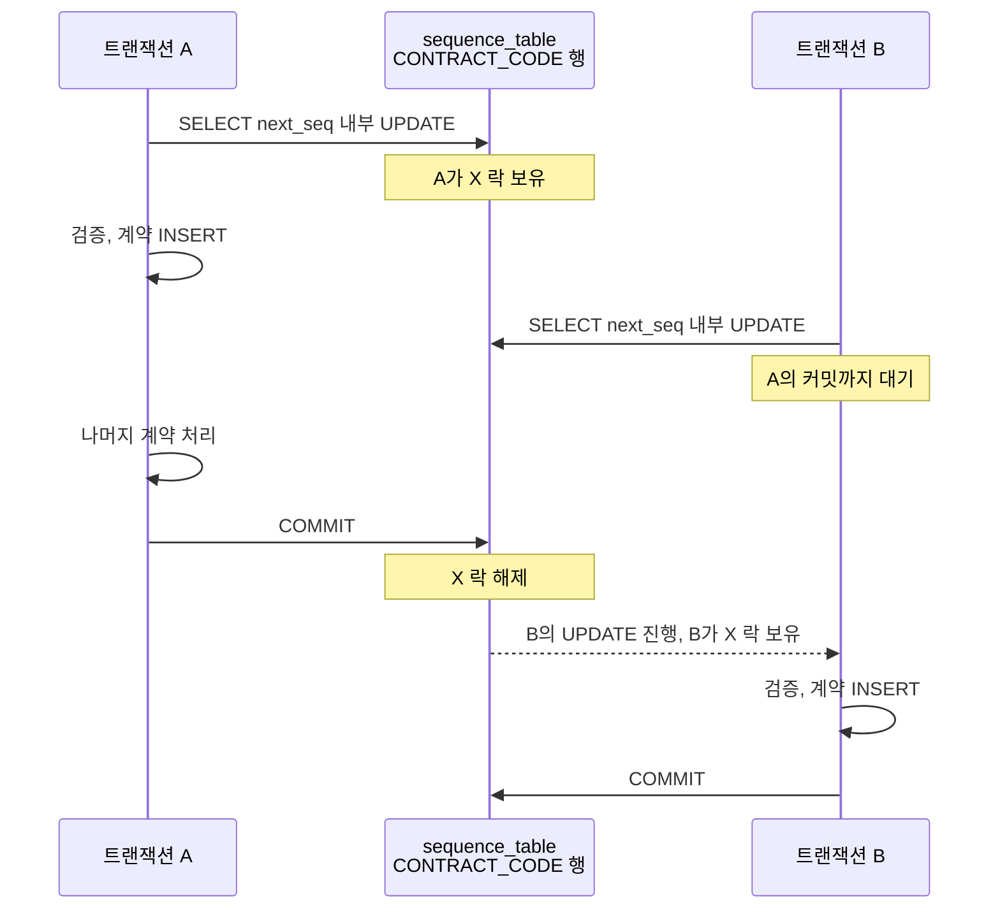
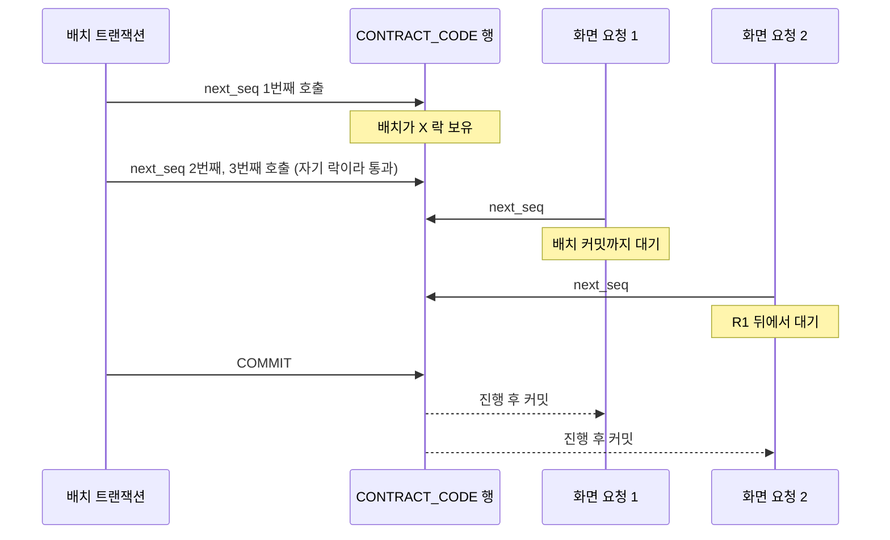
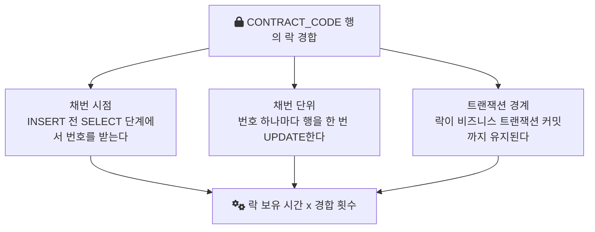

[1편](/posts/sequence-part1/)에서 계약 생성 처리의 2분은 로그상 INSERT 구간에 몰려 있었지만, INSERT 튜닝으로는 약 1분 30초까지만 줄었다. 남은 의심은 INSERT 직전에 계약 코드를 받아 오는 `SELECT next_seq('CONTRACT_CODE')` 한 줄이었다. 이 글은 그 함수 안을 열어, 읽기처럼 보이는 문장이 왜 다른 요청을 커밋 때까지 붙잡아 두었는지 정리한다.

> 이 글의 함수, 테이블 이름과 SQL은 회사의 실제 소스가 아니라 구조를 설명하려고 MySQL 문법으로 다시 구성한 예시다. 확인된 사실은 "SELECT 안에서 시퀀스 증가 함수를 호출했고, 그 함수가 시퀀스 테이블의 행을 UPDATE해 락 경합이 생겼다"는 것까지다.

## 함수 안에 UPDATE가 있었다

호출부는 조회처럼 생겼다.

```sql
SELECT next_seq('CONTRACT_CODE');
```

함수 본문은 달랐다. 구조만 옮기면 이렇다.

```sql
CREATE FUNCTION next_seq(p_name VARCHAR(50)) RETURNS BIGINT
MODIFIES SQL DATA
BEGIN
  DECLARE v BIGINT;
  UPDATE sequence_table
     SET value = value + 1
   WHERE sequence_name = p_name;   -- 1. 시퀀스 행을 갱신한다
  SELECT value INTO v
    FROM sequence_table
   WHERE sequence_name = p_name;   -- 2. 갱신한 값을 읽는다
  RETURN v;
END
```

`next_seq`는 이름과 호출 문장만 보면 읽기지만, 실제로는 시퀀스 테이블의 행 하나를 갱신하고 그 값을 다시 읽는 쓰기 함수였다. 바깥 문장이 SELECT라는 사실은 안에서 일어나는 UPDATE의 성질을 바꾸지 않는다.

이 착시에는 이유가 있다. InnoDB에서 평범한 SELECT는 락을 걸지 않는다. [MySQL 문서](https://dev.mysql.com/doc/refman/8.0/en/innodb-consistent-read.html)는 READ COMMITTED와 REPEATABLE READ에서 SELECT가 기본으로 쓰는 consistent read를 이렇게 설명한다. "A consistent read does not set any locks on the tables it accesses"(consistent read는 접근하는 테이블에 어떤 락도 걸지 않는다). 그래서 "SELECT는 락과 무관하다"는 감각이 생긴다. 이 감각은 [MVCC](/posts/mvcc/)(행의 이전 버전을 보여 주어 읽기와 쓰기가 서로 막지 않게 하는 방식)로 처리되는 순수한 읽기에만 맞다. 함수 안의 UPDATE는 consistent read가 아니라 잠금을 거는 쓰기다.

## UPDATE가 거는 락과 그 락이 풀리는 시점

시퀀스 테이블은 `sequence_name`이 기본 키다. InnoDB 문서([Locks Set by Different SQL Statements](https://dev.mysql.com/doc/refman/8.0/en/innodb-locks-set.html))에 따르면 `UPDATE ... WHERE`는 원래 탐색 중 만나는 레코드마다 배타적 next-key 락을 걸지만, 유일 인덱스로 한 행을 찾는 경우에는 인덱스 레코드 락 하나만 건다. 그래서 `next_seq('CONTRACT_CODE')`는 `CONTRACT_CODE` 행 하나에 X 락(배타 락, 다른 트랜잭션이 그 행을 읽기 위해 잠그거나 고치지 못하게 하는 락)을 건다.

문제는 이 락이 언제 풀리느냐다. 같은 문서는 트랜잭션이 쥔 InnoDB 락이 모두 커밋이나 롤백 때 풀린다고 적는다. 함수가 반환됐다고 풀리는 것이 아니다. 그리고 [InnoDB Locking](https://dev.mysql.com/doc/refman/8.0/en/innodb-locking.html) 문서에 따르면 T1이 행에 X 락을 쥐고 있으면, 다른 트랜잭션 T2가 같은 행에 요청한 락은 바로 승인되지 않고 T1이 락을 놓을 때까지 기다린다.

`next_seq`는 계약 생성 트랜잭션 안에서 호출됐다. 그래서 락을 쥐는 구간은 "번호 하나 증가"가 아니라 "번호를 받은 순간부터 그 트랜잭션이 커밋할 때까지"였다. 그 사이에는 검증, 다른 계약들의 처리, 다건 INSERT가 모두 들어 있었다.

## 두 트랜잭션이 같은 행에서 만나면

계약 생성 트랜잭션 두 개가 거의 동시에 시작하면 순서는 아래처럼 된다.



B가 기다린 시간은 A의 UPDATE 한 번이 아니라 A의 트랜잭션 전체다. B의 로그에서는 이 대기가 "INSERT 직전의 SELECT 한 줄"이 멈춘 것으로 나타나고, 그 SELECT가 INSERT 구간 로그 안에 있었기 때문에 [1편](/posts/sequence-part1/)에서는 INSERT가 느린 것처럼 보였다.

같은 트랜잭션 안에서 `next_seq`를 여러 번 부르는 것 자체는 막히지 않는다. A가 이미 쥔 락을 A가 다시 요청하는 것이기 때문이다. 막히는 것은 언제나 다른 트랜잭션이다. 그래서 한 트랜잭션이 계약을 많이 처리할수록 락 보유 시간이 길어지고, 그동안 들어온 화면 요청과 배치는 앞 트랜잭션이 끝나기를 줄지어 기다린다. 아래 그림은 많은 계약을 처리하는 트랜잭션 하나와 화면 요청 두 개가 겹치는 경우를 이 구조에 따라 그린 것이다.



애플리케이션 스레드와 커넥션이 몇 개든, 계약 코드 발급은 이 행 하나 앞에서 한 줄로 선다. 애플리케이션의 병렬성이 DB의 행 하나 때문에 직렬화된 것이다.

## 이 구조가 증상을 설명하는 방식

1편에서 남은 의문 세 가지를 이 구조로 다시 읽으면 이렇다. 이 해석은 위 구조에서 따라 나오는 추론이고, 당시 문장별 대기 시간을 따로 잰 기록은 남아 있지 않다.

- INSERT 튜닝이 30초만 줄인 이유: `ExecutorType.BATCH`와 multi-row INSERT는 INSERT를 실행하는 비용을 줄인다. 락을 기다리는 시간은 실행 비용이 아니므로 그대로 남는다.
- 건수에 비례해 늘어난 이유: 트랜잭션이 처리하는 계약이 많을수록 락 보유 시간이 길어지고, 뒤에서 기다리는 요청의 대기도 그만큼 길어진다.
- 동시 요청 때 더 느려진 이유: 기다리는 쪽이 늘면 줄이 길어진다. 대기는 각자의 실행 시간이 아니라 앞사람들의 트랜잭션 길이의 합이다.

여기에 쓰기 자체의 비용도 더해진다. 번호 하나를 받을 때마다 시퀀스 행이 실제로 갱신되므로, 발급 건수만큼 [undo와 redo 로그](/posts/redo-undo-log/)가 쌓인다. 락 대기에 비하면 작은 비용이지만, 건수에 비례해 늘어난다는 점은 같다.

대기가 길어지면 다른 위험도 생긴다. InnoDB는 행 락을 기다리는 시간이 `innodb_lock_wait_timeout`을 넘으면 기다리던 쪽에 오류를 돌려준다([문서](https://dev.mysql.com/doc/refman/8.0/en/innodb-parameters.html#sysvar_innodb_lock_wait_timeout), 기본값 50초). 당시 처리는 느렸을 뿐 실패하지는 않았지만, 락 보유 시간이 이 값에 가까워지면 느린 것이 실패로 바뀐다.

## DB에서는 이렇게 보인다

1편에서 말한 `performance_schema.data_lock_waits`를 위 상황에서 조회하면, 기다리는 트랜잭션 B와 막고 있는 트랜잭션 A의 쌍이 나오고, 막고 있는 락의 정보는 `data_locks`에서 이런 모양일 것이다.

```text
OBJECT_NAME     INDEX_NAME  LOCK_TYPE  LOCK_MODE       LOCK_DATA
sequence_table  PRIMARY     RECORD     X,REC_NOT_GAP   'CONTRACT_CODE'
```

`X,REC_NOT_GAP`은 갭 없이 레코드 하나에만 걸린 배타 락이라는 뜻이다. 위 출력은 구조에서 예상되는 모양을 적은 것이고, 당시 운영 DB에서 떠 둔 출력은 아니다. 핵심은 `OBJECT_NAME`이 계약 테이블이 아니라 시퀀스 테이블이라는 점이다. INSERT 구간의 대기가 INSERT 대상과 상관없는 테이블에서 생기고 있다는 것을 DB는 이렇게 직접 보여 준다.

## 왜 처음에는 보이지 않았나

이 병목이 오래 숨어 있던 이유는 세 가지로 정리된다.

1. 함수 이름과 바깥 문장이 읽기처럼 보인다.
2. 대기는 기다리는 쪽의 로그에 찍히므로, 원인(락을 쥔 트랜잭션)과 증상(멈춘 SELECT)이 서로 다른 요청의 로그에 나뉘어 나타난다.
3. 요청이 적고 트랜잭션이 짧을 때는 대기가 거의 없다. 사용자가 적은 내부 시스템이라 평소에는 잘 드러나지 않았고, 요청이 동시에 몰리거나 배치가 많은 계약을 처리할 때 대기로 드러났다.

## 고쳐야 할 것은 세 겹이었다

원인을 확인하고 나니, 병목은 한 가지 결함이 아니라 세 가지가 겹친 결과였다.



- 시점: 번호를 SELECT 단계에서 받으니, 그 뒤의 처리 시간이 모두 락 보유 시간이 된다.
- 단위: 번호 하나에 UPDATE 하나라, 경합 횟수가 발급 건수와 같다.
- 경계: 채번이 비즈니스 트랜잭션 안에 있으니, 락은 비즈니스 로직이 끝나야 풀린다.

INSERT SQL을 더 다듬는 것으로는 이 셋 중 어느 것도 바뀌지 않는다. 필요한 것은 쿼리 튜닝이 아니라 채번 구조의 변경이었다. [3편](/posts/sequence-part3/)에서는 이 세 축을 각각 어떻게 바꿨는지, 그 결과 2분이 10초가 된 과정, 그리고 그 설계가 놓친 다중 인스턴스 문제를 다룬다.

## 참고

- [MySQL 8.0 Reference Manual - Consistent Nonlocking Reads](https://dev.mysql.com/doc/refman/8.0/en/innodb-consistent-read.html) — 평범한 SELECT는 락을 걸지 않는다
- [MySQL 8.0 Reference Manual - InnoDB Locking](https://dev.mysql.com/doc/refman/8.0/en/innodb-locking.html) — X 락과 레코드 락, 락 요청이 대기하는 조건
- [MySQL 8.0 Reference Manual - Locks Set by Different SQL Statements in InnoDB](https://dev.mysql.com/doc/refman/8.0/en/innodb-locks-set.html) — 유일 인덱스 UPDATE의 레코드 락, 커밋·롤백 시 락 해제
- [MySQL 8.0 Reference Manual - InnoDB Startup Options and System Variables](https://dev.mysql.com/doc/refman/8.0/en/innodb-parameters.html#sysvar_innodb_lock_wait_timeout) — `innodb_lock_wait_timeout`
- [MySQL 8.0 Reference Manual - The data_lock_waits Table](https://dev.mysql.com/doc/refman/8.0/en/performance-schema-data-lock-waits-table.html)
