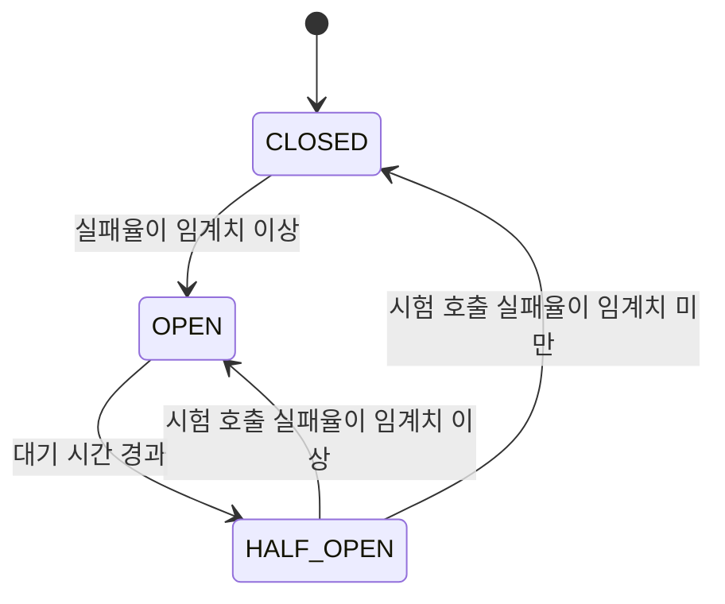

서비스 A가 외부 서비스 B를 호출하는데 B가 응답하지 않는 상황을 생각해 보자. A의 요청 스레드는 B의 응답을 타임아웃까지 기다린다. 그 사이 A로 들어온 다른 요청들도 B를 호출하고 똑같이 기다린다. 결국 A의 스레드와 커넥션이 모두 B를 기다리느라 묶이고, B와 상관없는 A의 기능까지 응답하지 못하게 된다. 서킷 브레이커(Circuit Breaker)는 이런 장애 전파를 끊기 위한 패턴이다.

## 왜 필요한가

Martin Fowler는 이 패턴을 소개하면서 문제를 이렇게 요약한다.

> "Remote calls can fail, or hang without a response until some timeout limit is reached."

원격 호출은 실패할 수도 있고, 타임아웃에 닿을 때까지 응답 없이 멈춰 있을 수도 있다는 뜻이다. 같은 글은 응답하지 않는 공급자를 많은 호출자가 기다리면 핵심 자원이 바닥나고, 그것이 여러 시스템에 걸친 연쇄 장애(cascading failure)로 이어진다고 설명한다([Martin Fowler, CircuitBreaker](https://martinfowler.com/bliki/CircuitBreaker.html)).

타임아웃만으로는 부족하다. 타임아웃은 요청 하나가 기다리는 시간의 상한을 정할 뿐, 이미 실패하고 있는 대상을 계속 호출하는 것 자체는 막지 못한다. B가 완전히 죽어 있다면 모든 요청이 타임아웃 시간만큼 기다린 뒤에야 실패한다. 서킷 브레이커는 "지금은 B가 실패하고 있다"는 사실을 기억해 두고, 그동안은 B를 아예 호출하지 않고 즉시 실패시킨다.

## 세 가지 상태

이름은 전기 회로의 차단기에서 왔다. 과전류가 흐르면 차단기가 회로를 끊어 더 큰 사고를 막는 것처럼, 실패가 일정 수준을 넘으면 호출 경로를 끊는다.



- CLOSED(닫힘): 정상 상태다. 호출이 그대로 대상에게 전달되고, 성공과 실패를 기록한다.
- OPEN(열림): 실패가 임계치를 넘은 상태다. 대상을 호출하지 않고 즉시 실패를 돌려준다.
- HALF_OPEN(반열림): OPEN 상태에서 정해진 시간이 지나면, 대상이 회복했는지 보기 위해 일부 호출만 시험적으로 통과시킨다. 결과가 좋으면 CLOSED로, 나쁘면 다시 OPEN으로 간다.

회로가 "닫혀 있어야" 전류가 흐른다는 점 때문에, 정상 상태가 CLOSED라는 이름이 처음에는 헷갈린다. Fowler는 상태 변화를 로그로 남기고 모니터링해야 하며, 운영자가 차단기를 수동으로 열거나 닫을 수 있어야 한다고도 덧붙인다. 차단기가 열렸다는 것 자체가 장애의 조기 신호이기 때문이다.

## Resilience4j로 보는 구체적인 동작

Java에서 많이 쓰는 구현인 Resilience4j는 위 상태를 유한 상태 기계로 구현하고, 실패를 판단하는 방식을 세밀하게 설정하게 한다([Resilience4j, CircuitBreaker](https://resilience4j.readme.io/docs/circuitbreaker)).

- 최근 호출 결과를 슬라이딩 윈도우로 모은다. 최근 N개 호출을 보는 count-based 방식과, 최근 N초 동안의 호출을 보는 time-based 방식이 있다.
- 윈도우 안의 실패율이 `failureRateThreshold`(기본 50%) 이상이면 OPEN으로 바뀐다. 느린 호출의 비율(`slowCallRateThreshold`)도 기준으로 쓸 수 있다.
- 실패율은 최소 호출 수(`minimumNumberOfCalls`, 기본 100)가 쌓인 뒤에야 계산한다. 호출 두 번 중 한 번 실패했다고 50%로 보고 차단하는 일을 막기 위해서다.
- OPEN 상태는 `waitDurationInOpenState`(기본 60초) 동안 유지되고, HALF_OPEN에서는 `permittedNumberOfCallsInHalfOpenState`(기본 10개)만큼 시험 호출을 허용한다.
- OPEN 상태에서 거부된 호출은 `CallNotPermittedException`으로 실패한다.

Spring Boot 3에서는 `resilience4j-spring-boot3`와 `spring-boot-starter-aop` 의존성을 추가하고, 인스턴스별 설정을 `application.yml`에 둔다. 아래 설정은 Resilience4j 문서의 Spring Boot 예제다([Resilience4j, Getting Started with Spring Boot 3](https://resilience4j.readme.io/docs/getting-started-3)).

```yaml
resilience4j.circuitbreaker:
    instances:
        backendA:
            registerHealthIndicator: true
            slidingWindowSize: 100
            permittedNumberOfCallsInHalfOpenState: 10
            waitDurationInOpenState: 10000
            failureRateThreshold: 60
            eventConsumerBufferSize: 10
```

호출하는 메서드에는 애너테이션으로 서킷 브레이커와 대체 응답(fallback)을 지정한다.

```java
@CircuitBreaker(name = "backendA", fallbackMethod = "fallback")
public String getRecommendations(String userId) {
    return recommendationClient.get(userId);
}

private String fallback(String userId, Exception e) {
    return "[]"; // 추천 목록 대신 빈 목록
}
```

문서에 따르면 fallback 메서드는 같은 클래스에 있어야 하고, 원래 메서드와 같은 파라미터에 예외 파라미터 하나를 더 받으며, 반환 타입이 같아야 한다. 예외 타입별로 fallback을 여러 개 두면 가장 구체적인 타입이 선택된다.

## 설계할 때 주의할 점

- 무엇을 실패로 셀지 정해야 한다. 대상 서버의 장애(5xx, 타임아웃, 연결 실패)는 실패로 세야 하지만, 클라이언트 쪽 잘못인 400이나 비즈니스 검증 실패까지 세면 정상인 서비스에 차단기가 열린다.
- 타임아웃과 함께 써야 한다. 응답 없이 멈춘 호출은 타임아웃이 없으면 실패로 기록되지도 않는다. 느린 호출 비율 기준을 함께 쓰는 이유도 여기에 있다.
- 의존 대상마다 따로 둔다. 외부 API 여러 개를 차단기 하나로 묶으면, 하나가 실패할 때 멀쩡한 나머지까지 차단된다.
- fallback은 업무적으로 허용되는 응답이어야 한다. 추천 목록이나 부가 정보처럼 비어 있어도 되는 기능에는 빈 응답이 적절하지만, 결제 승인처럼 결과를 꾸며낼 수 없는 호출이라면 fallback은 "지금은 처리할 수 없다"는 명확한 실패여야 한다.
- 임계치는 트래픽에 맞춘다. 호출이 적은 대상에 큰 `minimumNumberOfCalls`를 두면 차단기가 사실상 열리지 않고, 너무 작게 두면 일시적인 실패에도 열린다.

## 정리

서킷 브레이커는 실패하는 대상을 계속 기다리는 대신 빠르게 실패하도록 만들어, 장애가 호출하는 쪽으로 번지는 것을 막는다. 실패를 고치는 장치가 아니라 실패의 범위를 가두는 장치이므로, 타임아웃, 대체 응답, 상태 변화 모니터링과 함께 설계해야 효과가 있다. 서비스 간 호출이 많은 구조에서 왜 이런 장치가 필요한지는 [Microservices Architecture](/posts/microservices-architecture/)와 [Spring Boot에서 외부 API 연동을 설계할 때 보는 것](/posts/spring-boot-external-api-integration/)에서도 다뤘다.

## 참고

- [CircuitBreaker](https://martinfowler.com/bliki/CircuitBreaker.html) — Martin Fowler
- [CircuitBreaker](https://resilience4j.readme.io/docs/circuitbreaker) — Resilience4j Documentation
- [Getting Started with Spring Boot 3](https://resilience4j.readme.io/docs/getting-started-3) — Resilience4j Documentation
